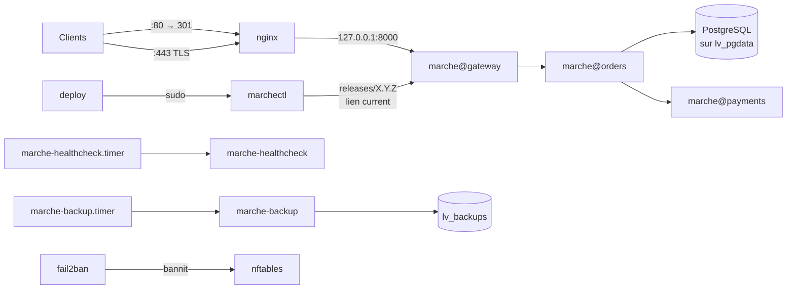

# 🟡 Projet fil rouge Linux — Palier 2 : fiabiliser et durcir

> **Cours associé :** [02.md](../02.md) — **Durée indicative :** 15 à 20 h — **Machine :** `web1` au terme du Palier 1 (correcteur à 100 %)
>
> **Lab :** ce palier a besoin d'un **second disque** pour LVM. Sur le VPS : `web1` en machine virtuelle (`./lab.sh up 1 --vm` puis `./lab.sh ajouter-disque web1 disque2 2GiB`). Sans KVM : lab local Docker (`./lab.sh ajouter-disque web1 disque2 2G`). Voir [lab/README.md](lab/README.md).

## Mission

Trois mois ont passé. Marché a des clients, et les ennuis qui vont avec :

- un lundi matin, le disque plein a fait tomber PostgreSQL : les sauvegardes et la base partageaient le même système de fichiers ;
- une version livrée un vendredi soir ne démarrait pas, et il a fallu deux heures pour remettre l'ancienne à la main ;
- un stagiaire avait `sudo` « pour déployer », donc tous les droits ;
- le journal SSH montre des milliers de tentatives par jour, et le site est toujours en HTTP.

Votre mission : rendre `web1` **fiable** (stockage séparé et extensible, déploiements réversibles en une commande, sauvegardes vérifiées) et **durci** (moindre privilège, HTTPS, pare-feu nftables, bannissement automatique, services confinés). Puis diagnostiquer des pannes de **performance** : un service qui brûle le CPU, une fuite mémoire, un disque plein que `du` ne voit pas…



## Livraison

```bash
./outils/empaqueter.sh 1.1.0             # version saine
./outils/empaqueter.sh 1.2.0 --cassee    # version qui ne démarre pas : votre marchectl doit la rejeter SEUL
```

Copiez les deux archives et leurs `.sha256` sur `web1`.

---

## Étapes

Même règle qu'au Palier 1 : tout à la main, tout noté dans `NOTES.md`. Les noms **en gras** sont imposés. Faites un **instantané** (`lxc snapshot web1 avant-p2`) ou gardez votre `NOTES.md` du Palier 1 à portée : plusieurs étapes peuvent vous enfermer dehors.

### 1. Stockage : LVM (cours : M10)
- [ ] Sur le second disque : groupe de volumes **`vg_marche`**, volumes **`lv_pgdata`** (1 Gio) et **`lv_backups`** (400 Mio), en ext4.
- [ ] **Migrer** les données de PostgreSQL sur `lv_pgdata`, monté sur **`/var/lib/postgresql`**, sans perdre une commande. PostgreSQL doit être **réellement** arrêté pendant la copie : vérifiez-le (`pg_lsclusters`), ne vous fiez pas au code de retour de `systemctl stop postgresql`.
- [ ] `lv_backups` monté sur **`/var/backups/marche`**.
- [ ] Les deux dans `/etc/fstab` **par UUID** ; le volume des sauvegardes en **`nofail`** (la machine doit démarrer même s'il manque). `findmnt --verify` sans erreur, puis **redémarrage** pour le prouver.
- [ ] Le volume des sauvegardes est trop petit : agrandissez-le **à chaud** à 600 Mio au moins, système de fichiers compris.

### 2. Comptes, délégation, partage (cours : M9, M14)
- [ ] Compte **`deploy`** (clé SSH dédiée) : il peut lancer **`/usr/local/sbin/marchectl`** en root sans mot de passe, et **rien d'autre**. Fichier dans `/etc/sudoers.d/`, édité avec `visudo -f`.
- [ ] Groupe **`ssh-autorises`** : seuls ses membres se connectent en SSH (`AllowGroups`). Mettez-y votre compte et `deploy` **avant** de recharger sshd.
- [ ] Compte **`audit`** : lit `/var/log/marche` **sans** être dans `devs` (ACL), y compris les fichiers créés plus tard.
- [ ] Dossier d'équipe **`/srv/partage`** : groupe `devs`, fermé aux autres, les fichiers créés héritent du groupe `devs` et restent lisibles par `audit`.

### 3. `marchectl` : déployer sans trembler (cours : M1, M2)
Écrivez **`/usr/local/sbin/marchectl`** (root, 700), en bash strict. Interface imposée :

| Commande | Effet |
| --- | --- |
| `marchectl status` | version en service, versions installées, état des services, santé ; code ≠ 0 si malade |
| `marchectl deploy [-f] <archive>` | vérifie l'empreinte `.sha256` si présente, **inspecte** l'archive (un seul dossier racine `marche-X.Y.Z/`, aucun chemin hors de lui), prépare `/opt/marche/releases/X.Y.Z` (code + **son propre venv**) pendant que l'ancienne tourne, **bascule atomiquement** le lien `/opt/marche/current`, contrôle la santé, et **revient seul** à l'ancienne version si la nouvelle est malade |
| `marchectl rollback` | revient à la version précédente |
| `marchectl backup` | sauvegarde immédiate (via le service systemd) |
| `marchectl restore [-t] <dump>` | restaure ; `-t` : restauration **de test** dans `marche_test`, compte les commandes, supprime la base de test |

- [ ] Codes de sortie : **0** succès, **1** erreur, **2** usage, **3** une autre opération est en cours (verrou), **4** déploiement annulé par retour arrière automatique.
- [ ] Chaque opération est journalisée dans **`/var/log/marche/marchectl.log`** : date, **qui** (l'utilisateur derrière `sudo`), quoi, résultat.
- [ ] On garde les 3 dernières versions, jamais la courante ni la précédente.
- [ ] Déployez 1.1.0 (succès), puis 1.2.0 (retour arrière automatique, code 4), depuis votre PC : `ssh deploy@web1 sudo marchectl deploy /home/deploy/marche-1.2.0.tar.gz`.

<details><summary>🔎 Indices</summary>

- Bascule atomique : `ln -sfn cible current.nouveau && mv -T current.nouveau current` (un `rename(2)`, jamais d'instant sans lien).
- `set -Eeuo pipefail` : sans `-E`, un `trap … ERR` ne se déclenche pas dans les fonctions.
- `flock -n` sur un descripteur ouvert par `exec 9>/run/marchectl.lock`.
- ⚠️ Ne faites jamais `tar -tzf … | head -1` ni `tar -tzf … | grep -q …` dans un script en `pipefail` : lisez la liste une fois dans une variable (voir les pièges en fin de page).
</details>

### 4. systemd, pour de bon (cours : M16)
- [ ] Une unité **modèle** **`marche@.service`** (instances `gateway`, `orders`, `payments`) exécutée depuis `/opt/marche/current`, et une cible **`marche.target`** qui démarre tout Marché (loadgen compris). Retirez les unités du Palier 1.
- [ ] **Confinement** : score `systemd-analyze security marche@gateway` **≤ 4,0** (explorez `ProtectSystem=`, `ProtectHome=`, `PrivateTmp=`, `NoNewPrivileges=`, `CapabilityBoundingSet=`, `SystemCallFilter=`, `RestrictAddressFamilies=`…). Le service ne doit plus pouvoir écrire ailleurs que dans `/var/lib/marche`.
- [ ] **Limites** : `MemoryMax=` sur les trois services.
- [ ] **Timers** à la place de cron : **`marche-backup.timer`** (quotidien, **rattrapé** si la machine était éteinte) et **`marche-healthcheck.timer`** (toutes les 5 minutes). Plus aucune ligne cron pour Marché.
- [ ] journald : taille maximale fixée par un fichier dans `/etc/systemd/journald.conf.d/`.

### 5. Sauvegardes vérifiées (cours : M11)
- [ ] `marche-backup` refuse de tourner si **`/var/backups/marche` n'est pas monté** (sinon il remplit le disque racine en silence) et si une sauvegarde est déjà en cours.
- [ ] En plus du dump : un **instantané de la configuration** (`/etc/marche`, `/etc/nginx`, `/etc/nftables.conf`, unités systemd, code en service sans venv) dans **`/var/backups/marche/config/<date>/`**, avec **`rsync --link-dest`** vers l'instantané précédent (lien **`config/latest`**) : un fichier inchangé ne prend pas de place. 14 instantanés au plus.
- [ ] Prouvez qu'un fichier inchangé est **le même inode** dans deux instantanés (`stat -c %h`, `ls -i`).
- [ ] `marchectl restore -t` sur la dernière sauvegarde : notez le nombre de commandes.

### 6. HTTPS (cours : M14, section nginx et TLS)
- [ ] Certificat auto-signé (lab) valable pour **`web1`**, `localhost`, `127.0.0.1` et **`10.10.10.21`** (subjectAltName) : **`/etc/ssl/certs/marche.crt`**, clé **`/etc/ssl/private/marche.key`** en 600.
- [ ] Port 80 → **301** vers https ; 443 en **TLS 1.2 et 1.3 uniquement** ; en-têtes **HSTS**, `X-Content-Type-Options`, `X-Frame-Options` ; nginx ne révèle sa **version** ni en HTTP ni en HTTPS.
- [ ] Le loadgen et le healthcheck parlent HTTPS **en vérifiant** le certificat (jamais `-k`).

### 7. Pare-feu nftables et fail2ban (cours : M13, M14)
- [ ] ufw **désactivé** : un seul outil pilote le pare-feu. **`/etc/nftables.conf`** : politique **drop** en entrée, loopback, connexions établies, ICMP, SSH (avec limite de débit), 80 et 443, journalisation limitée des refus. **Pas de `flush ruleset`**. Validé par `nft -c -f` avant application.
- [ ] fail2ban (`/etc/fail2ban/jail.local`, jamais `jail.conf`) : jails **`sshd`**, **`nginx-botsearch`**, **`recidive`**, action **nftables**, et la passerelle du lab **`10.10.10.1`** dans `ignoreip`.
- [ ] **Filtre maison `marche-sondes`** : le filtre fourni `nginx-botsearch`, rejoué sur le journal du 14 septembre (`fail2ban-regex`), ne reconnaît qu'une petite partie des sondes du scanner de 03 h 17. Écrivez **`/etc/fail2ban/filter.d/marche-sondes.conf`** qui reconnaît **ses 42 sondes et rien d'autre** (aucun client légitime), et la jail **`marche-sondes`** qui l'utilise. Déposez le journal **`marche.access.log.gz` à côté de votre `REPONSES.txt`** : le correcteur rejoue votre filtre dessus.
- [ ] Mises à jour de sécurité automatiques (`unattended-upgrades`) actives.

### 8. Audit noyau (cours : M14) — sur VM seulement
- [ ] auditd surveille `/etc/marche`, `/etc/sudoers` et `/etc/sudoers.d/`. Montrez avec `ausearch -k` qui a modifié le secret. (Impossible en conteneur : le sous-système d'audit est celui de l'hôte. Sur le lab Docker, notez l'étape « à faire sur VM ».)

---

## Pannes

`sudo ./panne.sh liste 2`. Le Palier 2 ajoute des pannes de **performance et de système** ; au Palier 2, le tirage à l'aveugle pioche aussi dans celles du Palier 1 qui ont encore un sens.

1. **Entraînement** : chaque panne du Palier 2, une par une. Dans **`DIAGNOSTICS.md`**, pour chacune : symptôme côté client, **la mesure qui l'a révélée** (commande et sortie utile), cause racine, correction, prévention. Les commandes attendues viennent des modules 5 à 8 : `top -H`, `ps -eLo`, `/proc/<pid>/status`, `pidstat`, `vmstat`, `free`, `lsof +L1`, `df -i`, `systemctl show` (`-p DropInPaths`), `systemctl cat`, `pg_stat_activity`, `nft list ruleset`, `visudo -c`…
2. **Manche finale** : `sudo ./panne.sh aveugle 2 3`. Correcteur à 100 % et trois causes racines écrites **avant** `sudo ./panne.sh revele`.

⚠️ `sudoers-casse` casse la règle de `deploy`. Si c'était la **vôtre**, vous n'auriez plus `sudo` pour réparer : sur un vrai serveur, `pkexec visudo -f …` ou la console de secours ; ici, `./lab.sh shell web1`. (Avec sudo 1.9, une ligne invalide est ignorée avec un message à chaque appel ; avec sudo 1.8 — Ubuntu 20.04, RHEL 8 — un seul fichier cassé bloque `sudo` pour tout le monde.)

---

## Critères d'acceptation

**Automatiques :**

```bash
sudo ./verifier.sh 2 --reponses REPONSES.txt      # marche.access.log.gz à côté de REPONSES.txt
```

122 critères. Le correcteur commence par **mesurer la santé** (CPU, mémoire et sa tendance, latence d'une commande, disques, inodes, descripteurs) **avant** de toucher à quoi que ce soit, puis revérifie le Palier 1 adapté (code dans `current`, unités `marche@…`, HTTPS), puis le Palier 2 : il tente lui-même un déploiement cassé, un déploiement concurrent, une archive à l'empreinte fausse, un bannissement suivi d'un rechargement du pare-feu, une restauration de test.

**Manuels :**

| Critère | ✔ |
| --- | --- |
| Redémarrage de `web1` : volumes montés, Marché en HTTPS, pare-feu et fail2ban actifs, sans intervention | |
| `ssh awa@web1` est refusé (pas dans `ssh-autorises`), `ssh deploy@web1 sudo -l` ne montre que `marchectl` | |
| Depuis votre PC : `ssh deploy@web1 sudo marchectl deploy …1.2.0…` → code 4, le site n'a jamais cessé de répondre plus de quelques secondes | |
| `marchectl rollback` deux fois de suite revient au point de départ | |
| Depuis une autre machine du lab (p. ex. `lb1`, créée d’avance), des échecs SSH répétés (au-delà de `maxretry`) → bannie ; votre accès via le VPS ne l’est jamais | |
| Le navigateur (via tunnel) affiche le site en HTTPS après import du certificat dans le magasin de confiance | |
| `DIAGNOSTICS.md` : les 9 pannes + la manche finale, avec les **mesures** | |
| Sur VM : `ausearch -k marche_config` montre votre propre modification de `marche.env` (qui, quand, avec quel programme) | |

## Pièges rencontrés en construisant la solution

Tous vécus en construisant et en testant ce palier :

- **`postgresql.service` n'est qu'une enveloppe** sur Ubuntu : `systemctl stop postgresql` rend la main avant l'arrêt réel de l'instance `postgresql@16-main`. Copier les données à ce moment-là, c'est copier une base en train de s'écrire (`rsync` : *file has vanished*).
- **SIGPIPE + pipefail, en vrai** : `racine=$(tar -tzf "$archive" | head -1 | cut -d/ -f1)` a échoué **une fois sur quelques-unes** avec le code 141 : `head` s'arrête, `tar` écrit encore et meurt de SIGPIPE. Pire : `if tar -tzf … | grep -q '\.\./'` peut être **faux précisément quand grep a trouvé** un chemin dangereux (grep sort tôt, tar meurt, pipefail rend le pipeline faux). Un contrôle de sécurité qui s'inverse au hasard. Solution : lire la liste une fois dans une variable, puis `grep -q … <<< "$liste"`. Même bug dans `logrotate -d … | grep -qi error` : l'erreur peut passer inaperçue.
- **`systemctl restart nftables` vide TOUT le pare-feu** : l'unité d'Ubuntu contient `ExecStop=/usr/sbin/nft flush ruleset`. Les bannissements de fail2ban disparaissent, même sans `flush ruleset` dans votre fichier. Pour appliquer une modification : **`systemctl reload nftables`**. (Dans le lab Docker, `restart` efface aussi les règles NAT de Docker : plus de DNS dans le conteneur jusqu'au redémarrage de la machine.)
- **`server_tokens off;` placé dans le seul bloc 443** : la redirection du port 80 annonce toujours `nginx/1.24.0 (Ubuntu)`. À mettre dans chaque `server`, ou une fois dans `http {}`.
- **`http2 on;` n'existe pas** dans le nginx 1.24 d'Ubuntu 24.04 (arrivé en 1.25.1) : `listen 443 ssl http2;`.
- **`set -E` oublié** : le `trap … ERR` ne se déclenche pas dans les fonctions, et un échec au milieu de `cmd_deploy` n'était pas journalisé.
- **`$USER` non défini** sous `set -u` quand le script est lancé par `sudo` ou un service : `${SUDO_USER:-$(id -un)}`.
- **`lvextend` sans `-r`** : le volume grandit, `df` ne bouge pas (le système de fichiers n'a pas été agrandi).
- **`ProtectSystem=strict`** sans `ReadWritePaths=/var/lib/marche` : le service démarre puis échoue à sa première écriture.
- **Loadgen en HTTPS** : les bibliothèques Python n'utilisent pas forcément le magasin du système ; `SSL_CA_FILE=/etc/ssl/certs/marche.crt` dans l'unité, plutôt que de désactiver la vérification.
- **`nginx-botsearch` ne connaît pas** `/.env`, `/.git/config`, `/backup.sql` : 9 sondes reconnues sur 42 dans le journal du 14 septembre. Un filtre se **teste** avec `fail2ban-regex` sur des données réelles avant d'y croire.
- **Le healthcheck lancé par le timer pendant une intervention** échoue, et c'est normal : un critère « le dernier healthcheck a réussi » était faux pour de mauvaises raisons. On vérifie qu'il **tourne**, et séparément qu'il **détecte**.

---

Palier validé ? Comparez avec [solution/palier-2](solution/palier-2/), puis passez au [Palier 3](palier-3.md).
