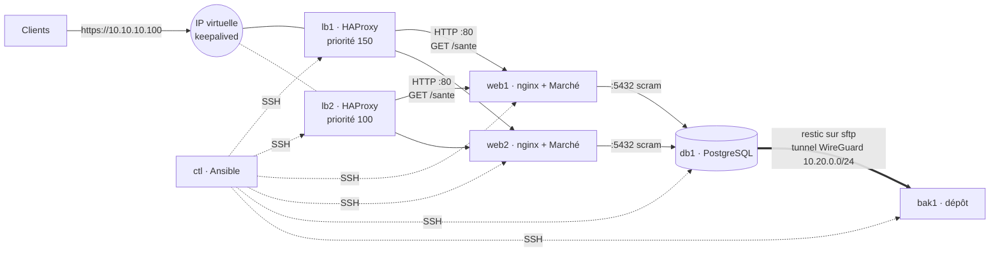

# 🔴 Projet fil rouge Linux — Palier 3 : haute disponibilité, reconstruite par Ansible

> **Cours associé :** [03.md](../03.md) — **Durée indicative :** 25 à 35 h — **Machines :** `ctl`, `lb1`, `lb2`, `web1`, `web2`, `db1`, `bak1` (`./lab.sh up 3`, voir [lab/README.md](lab/README.md))
>
> **Prérequis :** Palier 2 validé (`verifier.sh 2` à 100 %). Gardez le dernier dump de la base du Palier 2 : c'est la production à migrer.

## Mission

Marché grandit : un seul serveur, c'est une seule panne pour tout perdre, et chaque réinstallation à la main prend une journée. La direction fixe trois exigences :

1. **Plus de point de défaillance unique** sur le chemin d'une commande : deux répartiteurs avec une IP virtuelle, deux serveurs d'application, une base dédiée.
2. **Des sauvegardes hors de la machine, chiffrées, toutes les heures** : au pire, une heure de commandes perdues (RPO), et une restauration testée.
3. **Tout est décrit dans Ansible** : si un incendie emporte des machines, on en livre de neuves et on reconstruit **en moins de 30 minutes** (RTO).



| Machine | Rôle | Joignable par |
| --- | --- | --- |
| `lb1`, `lb2` (.11, .12) | HAProxy (TLS), keepalived, IP virtuelle **10.10.10.100** | tout le monde (80, 443) |
| `web1`, `web2` (.21, .22) | nginx (HTTP) + Marché (unités du Palier 2, `marchectl`) | **les répartiteurs seulement** (80) |
| `db1` (.31) | PostgreSQL | **les serveurs web seulement** (5432) |
| `bak1` (.41) | dépôt de sauvegardes | **db1, par le tunnel seulement** |
| `ctl` (.5) | poste de contrôle : Ansible, correcteur | — |

SSH : depuis `ctl` et la passerelle du lab (`10.10.10.1`) uniquement, pour toutes les machines.

---

## Étapes

Travaillez **dans l'ordre**, et écrivez le rôle Ansible **juste après** avoir compris l'étape (à la main sur une machine si besoin, puis détruite et reconstruite par Ansible). Tout le projet Ansible vit dans `ansible/` à la racine de ce dossier, visible depuis `ctl` dans `/srv/projet/ansible`.

### 0. Le poste de contrôle (cours : M15)
- [ ] `./lab.sh up 3`, puis sur `ctl` : votre compte, une clé `ssh-keygen -t ed25519`, et `sudo apt install ansible`.
- [ ] Depuis l'hôte : `./lab.sh autoriser <votre clé publique de ctl>` (le compte `ubuntu` de chaque machine l'accepte, comme chez un hébergeur).
- [ ] `ansible all -m ping` → 6 `pong`.
- [ ] Coffre : **tous** les secrets (mot de passe de la base, du dépôt restic, VRRP, mot de passe de votre compte) dans `group_vars/all/vault.yml` **chiffré** (`ansible-vault`). Aucun secret en clair dans le projet.

### 1. Socle commun — rôles `commun` et `parefeu` (cours : M15, M16, M3 ; étape 2 : M13, M14)
- [ ] Sur **toutes** les machines : fuseau, `/etc/hosts`, votre compte d'administration (clé, mot de passe **haché**, `sudo`), SSH durci (`AllowGroups`), fail2ban, `unattended-upgrades`, journald limité, sysctl réseau.
- [ ] Pare-feu nftables **par rôle de machine**, depuis **un seul gabarit** : le tableau ci-dessus, rien de plus. Le fichier est validé (`nft -c`) **avant** d'être écrit, et appliqué par **reload**.

### 2. Base de données — rôle `postgresql` (db1)
- [ ] PostgreSQL écoute sur le réseau privé ; `pg_hba` : base `marche`, rôle `marche`, **web1 et web2 seulement**, `scram-sha-256`.
- [ ] **Migration** : restaurez le dump du Palier 2 dans db1 (c'est la production : aucune commande ne doit manquer). Dump **avant** de détruire l'ancien web1 (`pg_dump -Fc`), applications arrêtées pendant la restauration ; si l'application a déjà créé ses tables vides sur db1 : `pg_restore --clean --if-exists --no-owner --role=marche`. Comptez les commandes avant et après.

### 3. Application — rôle `marche` (web1, web2)
- [ ] Le Palier 2 sans base locale : compte `marche`, arborescence, `marchectl`, `marche@.service` + `marche.target` durcis, `DATABASE_URL` vers db1 (depuis le coffre), nginx en HTTP.
- [ ] Déploiement de la version fixée **dans l'inventaire** (`marche_version`), **une machine à la fois** (`serial: 1`), via `marchectl deploy`.
- [ ] Une route **`/sante`** (nginx → `orders` `/healthz`), autorisée aux seuls répartiteurs : elle prouve que le serveur **joint la base**.
- [ ] Le générateur de trafic tourne sur **web1**, vers **`https://10.10.10.100`**, en **vérifiant** le certificat.

### 4. Répartition et IP virtuelle — rôles `haproxy` et `keepalived` (lb1, lb2) (cours : M8)
- [ ] HAProxy : TLS (certificat valable pour `10.10.10.100`, le **même** sur les deux), HTTP → 301, HSTS, `/admin` refusé, contrôle de santé **`/sante`**, `retries` + `redispatch`. Configuration validée (`haproxy -c`) avant écriture.
- [ ] keepalived : IP virtuelle **10.10.10.100**, lb1 prioritaire, **unicast**, authentification, et l'IP **quitte** un répartiteur dont HAProxy est mort (`track_script`).

### 5. Sauvegardes hors site — rôles `wireguard`, `depot_sauvegarde`, `sauvegarde` (cours : M10 ; étape 2 : M11)
- [ ] Tunnel **WireGuard** db1 ↔ bak1 (`10.20.0.2` ↔ `10.20.0.1`). Les clés privées sont générées **sur** les machines et n'en sortent jamais.
- [ ] Sur bak1 : un compte **`sauvegarde`**, accessible **uniquement** par la clé de db1, **uniquement** en sftp, **uniquement** par le tunnel.
- [ ] Sur db1 : **restic** vers `sftp:sauvegarde@10.20.0.1:/srv/restic/marche`. Le mot de passe du dépôt reste sur db1 : **bak1 ne peut rien déchiffrer**. Script **`/usr/local/sbin/marche-sauvegarde`** (dump vérifié **avant** l'envoi, rétention), timer **horaire**, script **`/usr/local/sbin/marche-restauration [-t]`**.
- [ ] 🪤 Pensez au jour où db1 sera reconstruite, **vide… ou presque** (qui écrit dedans avant la restauration ?) : que deviendrait « le dernier instantané » si la sauvegarde tournait avant la restauration ?

### 6. Idempotence et dérive
- [ ] `ansible-playbook site.yml` deux fois de suite : la seconde affiche **`changed=0` partout**.
- [ ] Modifiez une configuration à la main sur une machine, puis `ansible-playbook site.yml --check --diff` : la dérive apparaît, et une exécution normale la corrige.

### 7. Runbook — `RUNBOOK.md`
Écrivez, **avant** l'épreuve finale, la procédure de reprise pas à pas : quelles commandes, dans quel ordre, depuis quelle machine, et comment vérifier chaque étape. C'est ce document que vous suivrez, chronomètre lancé.

---

## Pannes

`outils/panne-infra.sh` (sur `ctl`) injecte des pannes **entre machines** : `./panne-infra.sh liste`.

1. **Entraînement** : chaque panne, une par une, avec pour chacune dans `INCIDENTS.md` : symptôme, **sur quelle machine** vous l'avez trouvée et comment, cause, correction. Réflexe attendu : la correction passe par **Ansible** quand c'est possible (un `ansible-playbook site.yml` bien écrit en répare plusieurs à lui seul — lesquelles, et pourquoi pas les autres ?).
2. **Manche à l'aveugle** : `./panne-infra.sh aveugle 3`. Correcteur à 100 % et trois causes écrites avant `./panne-infra.sh revele`.

## Épreuve finale : le sinistre

Sur l'**hôte** du lab (PC ou VPS) :
```bash
./outils/sinistre.sh docker      # ou : lxd
```
Il relève l'état de la base, **détruit `db1` et `web2`**, les recrée **vierges**, et lance le chronomètre. Suivez **votre** `RUNBOOK.md`. Le site doit être rétabli et les données restaurées **en moins de 30 minutes**, avec au plus une heure de commandes perdues. Puis, sur `ctl` :
```bash
./verifier-infra.sh --sinistre --ansible /srv/projet/ansible
```

---

## Critères d'acceptation

**Automatiques** — sur `ctl` :
```bash
./verifier-infra.sh --ansible /srv/projet/ansible
```
Le correcteur vérifie chaque machine (accès, socle, pare-feu), le **cloisonnement** (il tente lui-même les connexions interdites), le site à travers l'IP virtuelle, puis **provoque** des pannes : il arrête HAProxy sur le répartiteur actif (l'IP doit basculer en perdant 5 requêtes au plus sur 60, puis revenir), arrête un serveur web entier, puis seulement `orders` sur l'autre (HAProxy doit le retirer quand même). Il lance une sauvegarde, une restauration de test, vérifie que bak1 ne peut rien lire, et rejoue votre playbook : **`changed=0`** exigé.

**Manuels :**

| Critère | ✔ |
| --- | --- |
| `RUNBOOK.md` suivi pendant le sinistre, sans improvisation ; les écarts sont notés | |
| Sinistre : `verifier-infra.sh --sinistre` vert (données, RPO, RTO ≤ 30 min) | |
| `INCIDENTS.md` : les 8 pannes + la manche à l'aveugle | |
| Pendant une bascule de l'IP virtuelle, le générateur de trafic de web1 (journal) montre combien de requêtes ont échoué | |
| `ansible-lint` sur le projet : aucun avertissement non justifié | |
| Un tiers peut reconstruire l'infrastructure avec votre dépôt, votre `RUNBOOK.md` et le mot de passe du coffre, **rien d'autre** | |

## Pièges rencontrés en construisant la solution

- **`ansible.cfg` ignoré dans un dossier accessible en écriture à tous** : c'est le cas du dossier du projet monté depuis Windows dans `ctl`. Ansible le dit (*« Ansible is being run in a world writable directory… ignoring it as an ansible.cfg source »*) et continue avec les valeurs par défaut : mauvais inventaire, mauvais utilisateur. `export ANSIBLE_CONFIG=$PWD/ansible.cfg`, ou copier le projet dans votre home sur `ctl`.
- **`password_hash` sans sel fixe** : le hachage change à chaque exécution, la tâche `user` rapporte `changed` à chaque fois, et l'idempotence est perdue. Sel fixe, stocké dans le coffre.
- **`/etc/hosts` dans un conteneur Docker** est un montage : Ansible ne peut pas le remplacer par renommage (`Device or resource busy`). `unsafe_writes: true`.
- **`systemctl restart nftables`** vide aussi les tables de fail2ban (et le DNS de Docker) : le handler fait **reload**.
- **La première sauvegarde d'une base reconstruite** : sauvegardée, elle devient « le dernier instantané » ; `restic restore latest` restaure alors… la base neuve. Et elle n'est **pas vide** : vécu pendant la construction de la solution, le générateur de trafic de web1 y avait écrit 22 commandes avant la restauration, et le garde-fou « base vide » les a laissées passer. Le script compare maintenant au dernier instantané (étiquette `commandes=N`) et refuse une base nettement plus petite. Les instantanés précédents étaient toujours là : `restic snapshots`, puis `marche-restauration <ID>`.
- **Pendant la reprise, l'application reste arrêtée** (`systemctl stop marche.target marche-loadgen` sur les web) jusqu'à la fin de la restauration : sinon elle écrit dans une base qu'on va écraser.
- **Retirer une ligne de `pg_hba.conf` ne coupe pas les connexions ouvertes** : le pool de `orders` continue de fonctionner… jusqu'au prochain redémarrage. Un test de port (`nc -z`) ne voit rien ; seule une **nouvelle** connexion authentifiée le révèle.
- **`vrrp_track_process`** (réaction instantanée à la mort de HAProxy) ne fonctionne pas dans un conteneur (*Failed to set/clear process event listen - errno 111*) : `vrrp_script` avec `interval 1`, `fall 1` perd 1 à 2 requêtes sur 60 à la bascule (13 avec `interval 2`, `fall 2`).
- **`pg_dump | restic backup --stdin`** : si `pg_dump` meurt en route, restic enregistre un instantané tronqué, et « réussi ». Dump sur disque, vérifié (`pg_restore -l`), puis envoi.
- **keepalived ne lit que les 8 premiers caractères** de `auth_pass`, sans rien dire.
- **`script "/usr/bin/pidof haproxy"`, l'exemple qu'on trouve partout**, échoue **toujours** sur Ubuntu 24.04 avec `enable_script_security` : `pidof` y est un lien vers `killall5`, keepalived exécute la cible du lien, et `killall5` sans signal renvoie 1. Résultat : les deux répartiteurs en `FAULT`, **personne** ne porte l'IP virtuelle (`journalctl -u keepalived` : *usage: killall5 -signum*).
- **`ansible-vault encrypt --vault-password-file .vault-pass`** quand `ansible.cfg` déclare déjà `vault_password_file` : *« The vault-ids default,default are available to encrypt »*. Un seul des deux.
- **Un nom de tâche qui contient « : »** (typographie française !) doit être entre guillemets, sinon *mapping values are not allowed in this context*.
- **`--limit` exclut le `localhost` implicite** : le play qui génère la PKI sur `ctl` saute sans prévenir, et le rôle `haproxy` ne trouve pas le certificat. `-l 'localhost:db1,bak1'`.
- **`/etc/systemd/journald.conf.d/` n'existe pas** sur une Ubuntu neuve : `copy` échoue (*Destination directory … does not exist*) ; créer le dossier d'abord.
- **Une machine recréée a une nouvelle clé d'hôte SSH** : Ansible échoue sur *REMOTE HOST IDENTIFICATION HAS CHANGED*. C'est voulu : `ssh-keygen -R <ip>`, geste conscient, jamais `StrictHostKeyChecking=no`.
- **`--limit db1` pendant la reprise** : db1 a une **nouvelle clé WireGuard**, que bak1 doit apprendre. Le rôle a besoin des deux extrémités : `--limit db1,bak1` (ou tout le playbook).
- **`yes oui | commande` dans un script en `pipefail`** : `yes` meurt de SIGPIPE quand la commande a fini de lire, et le script s'arrête. `printf 'oui\n' | commande`.

---

Palier validé ? Comparez avec [solution/palier-3](solution/palier-3/). Vous avez terminé le projet fil rouge : relisez [le README](README.md) pour mesurer le chemin parcouru.
