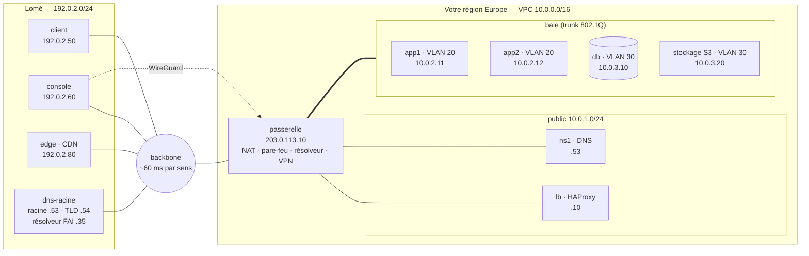

# 🟢 Projet fil rouge Networking & Cloud — Palier 1 : câbler le réseau de Marché, du câble au navigateur

> **Cours associé :** [01.md](../01.md) — **Durée indicative :** 20 à 30 h — **Machines :** 12 (`./lab/docker/lab.sh up 1`, voir [lab/README.md](lab/README.md))
>
> **Prérequis :** la ligne de commande Linux (cours Linux, étape 1). Aucune connaissance réseau préalable : c'est l'objet du palier.

## Mission

Marché — la plateforme de commande en ligne des cours Linux et Observabilité — ouvre sa **propre région** dans un datacenter européen. Ses clients sont à **Lomé**, à 120 ms d'aller-retour par le câble sous-marin. On vous livre des machines **nues** (une adresse attribuée par le « fournisseur », rien d'autre) et un « Internet » qui fonctionne comme le vrai : une racine DNS, un registre de domaines, un fournisseur d'accès qui jette les adresses privées et les adresses usurpées.

À la fin, un client de Lomé tape `https://www.marche.test` et commande : le nom se résout depuis la racine, les paquets traversent l'océan, votre passerelle les traduit et les filtre, le répartiteur les déchiffre et les route, l'application les enregistre. Les images viennent d'un cache à Lomé. Vous administrez le tout par un VPN, et vous savez dire ce que chaque pièce serait chez AWS, GCP ou Azure.



| Machine | Fourni par le lab | Ce que vous en faites |
| --- | --- | --- |
| `backbone`, `dns-racine` | **oui** (l'Internet) | rien — sauf déclarer votre domaine au registre |
| `client` | **oui** (vos clients) | y installer votre racine de certificats, y lancer le générateur de trafic |
| `console` | **oui** (votre poste, chez vous) | votre PKI, votre VPN, votre SSH |
| `edge` | non | le nœud CDN de Lomé |
| `passerelle`, `lb`, `ns1`, `app1`, `app2`, `db`, `stockage` | non | tout |

Les adresses que Docker attribue (`203.0.113.10`, `10.0.1.10`, `172.31.255.x` sur la baie…) sont celles du **fournisseur** : comme l'IP privée d'une instance cloud, vous ne les changez pas. Les interfaces portent des noms parlants (`internet`, `pub`, `baie`). Tout le reste est à vous.

---

## Étapes

Travaillez **dans l'ordre** : chaque étape s'appuie sur la précédente. Tout ce que vous configurez doit **survivre à un redémarrage** (le correcteur redémarre des machines) : `systemd-networkd` pour les interfaces et les routes, `/etc/nftables.conf`, `/etc/sysctl.d/`, services `enable`.

### 0. Le plan avant les câbles (cours : M1, M2)
- [ ] `./lab/docker/lab.sh up 1`, puis `./lab.sh etat` : qui a quelle adresse ? Sur chaque machine : `ip -br link`, `ip -br addr`, `ip route`. Notez ce qui manque.
- [ ] Écrivez **`rendu/palier-1/PLAN-ADRESSAGE.md`** : le VPC `10.0.0.0/16`, un sous-réseau par rôle (public `10.0.1.0/24` — imposé —, applications en **VLAN 20** `10.0.2.0/24`, données en **VLAN 30** `10.0.3.0/24`), l'adresse de chaque machine, le préfixe IPv6 ULA `fd00:4d41:5243::/48` découpé en `/64`, le sous-réseau du VPN `10.99.0.0/24`. Pour chaque sous-réseau : réseau, passerelle, broadcast, nombre d'hôtes. Justifiez vos choix de taille.

Adresses imposées (le correcteur les attend) : passerelle `.1` dans chaque sous-réseau, `app1` `10.0.2.11`, `app2` `10.0.2.12`, `db` `10.0.3.10`, `stockage` `10.0.3.20`, IPv6 `fd00:4d41:5243:<20|30|1>::<suffixe>`, console `10.99.0.2`.

### 1. La passerelle : un routeur (M4, M5)
- [ ] Routage IPv4 **et** IPv6 activé, route par défaut vers le fournisseur (`203.0.113.1`), anti-usurpation (`rp_filter`).
- [ ] Le lien `baie` est un **trunk** : créez-y les sous-interfaces **802.1Q** `baie.20` et `baie.30` (systemd-networkd : `.netdev` `Kind=vlan`), avec les adresses de passerelle.

### 2. Les machines : chacune dans son réseau (M4, M5)
- [ ] `app1`, `app2` dans le VLAN 20, `db`, `stockage` dans le VLAN 30, chacune avec sa route par défaut vers la passerelle de **son** VLAN. `lb` et `ns1` : route par défaut vers `10.0.1.1`.
- [ ] Vérifiez l'étanchéité : `app1` ne voit pas `db` au niveau 2 (`ip neigh`, `arping`) ; il l'atteint en **deux sauts**, par la passerelle (`traceroute -I`). Sur la passerelle, `tcpdump -e -i baie` montre les étiquettes 802.1Q.

### 3. IPv6 (M3)
- [ ] Chaque sous-réseau a son `/64` ULA ; la passerelle y **annonce** le préfixe et sa route (Router Advertisements : `IPv6SendRA=` de networkd, ou `radvd`). Les machines ont une adresse fixe **et** apprennent leur route IPv6 par défaut par RA (`proto ra`).
- [ ] `app1` joint `db` en IPv6.

### 4. NAT et pare-feux (M10, M19)
- [ ] **SNAT** : le VPC sort sur Internet avec `203.0.113.10` (vos adresses `10.x` n'y sont pas routées : la dorsale les jette). **DNAT** : `203.0.113.10` porte le site (80, 443 → `lb`) et le DNS (53 → `ns1`).
- [ ] **Un pare-feu par machine, avec état** (l'équivalent d'un security group) : chaque machine n'accepte que ce dont elle a besoin, **depuis qui** en a besoin (`app*`:8000 depuis `lb` seulement, `db`:5432 depuis `app1`/`app2`, API S3 depuis les applications et `lb`, SSH depuis le VPN seulement…).
- [ ] **Une ACL SANS état** sur la passerelle pour le sous-réseau des données (l'équivalent d'une Network ACL) : une chaîne dédiée, **sans** `ct state`, qui autorise chaque sens explicitement — retours compris.

### 5. DNS (M7)
- [ ] `ns1` fait autorité sur `marche.test` en **split-horizon** : Internet obtient les adresses publiques (`www` → `203.0.113.10`, `static` → `192.0.2.80`), le VPC les adresses privées (`www` → `10.0.1.10`, `app1`…`stockage`). Aucun nom interne ne fuit. `ns1` ne résout **rien** pour les autres (`recursion no`).
- [ ] Déclarez votre domaine au **registre** de `.test` (NS + glue) : `./lab/docker/lab.sh registre deleguer marche.test ns1.marche.test 203.0.113.10`. Depuis `client` : `dig +trace @192.0.2.53 www.marche.test` descend de la racine jusqu'à vous.
- [ ] Un **résolveur pour le VPC** sur la passerelle (unbound) : il part de la racine du lab et interroge `ns1` **directement** pour `marche.test` (vue interne). Toutes vos machines l'utilisent.
- [ ] SOA raisonnable (TTL négatif ≤ 1 h) ; un SPF qui dit que ce domaine n'envoie pas de courriel.

### 6. Base et applications
- [ ] PostgreSQL sur `db` : base et rôle `marche`, mot de passe haché (SCRAM), `pg_hba` limité aux applications.
- [ ] Marché sur `app1` et `app2` (préinstallé : `/opt/marche`, unités `marche@.service` et `marche.target`, exemple de configuration dans `/etc/marche/marche.env.exemple`) : `DATABASE_URL` vers **`db.marche.test`** (un nom, pas une adresse), le `gateway` écoute sur le réseau (port 8000), `orders` et `payments` restent sur `127.0.0.1`.

### 7. Stockage objet et IAM (M18, M20)
- [ ] Sur `stockage`, un service S3 avec API IAM (SeaweedFS, voir l'aide-mémoire) ; son identité administrateur ne sort pas de la machine.
- [ ] Bucket **`marche-statique`** : lecture **anonyme** (politique de bucket), rien d'autre en anonyme. Déposez-y `logo.svg`, une feuille de style **versionnée** (`app.v1.css`) et une image de **400 Ko** (`catalogue.jpg`), avec `Cache-Control: public, max-age=86400`.
- [ ] Bucket **`marche-factures`**, privé. Un utilisateur IAM **`marche-app`** qui ne peut **que** déposer et relire des objets dans `marche-factures` ; ses clés dans `/etc/marche/s3.env` sur les applications (lisible par root et le service seulement). Un utilisateur **`marche-publication`** pour publier les ressources statiques.

### 8. PKI et TLS (M9)
- [ ] Sur la **console** : une AC **racine** (10 ans) dont la clé ne quitte jamais la console, une AC **intermédiaire** (`pathlen:0`, idéalement limitée à `marche.test` par une contrainte de noms), des certificats **feuilles** (`www.marche.test` + `marche.test`, `static.marche.test`) de 90 jours, usage `serverAuth`.
- [ ] Chaque serveur reçoit sa clé, sa feuille **et l'intermédiaire** ; les clients (`client`, `edge`) reçoivent la **racine** seule.

### 9. Le répartiteur L7 (M8, M11)
- [ ] HAProxy sur `lb` : TLS 1.2 minimum (1.3 accepté), HTTP/2, `http://` → 301 vers `https://`, HSTS, `/admin` refusé.
- [ ] Routage **selon le chemin** : `/static/…` → le bucket `marche-statique` (API S3), le reste → `app1` et `app2`, avec **contrôle de santé** HTTP.

### 10. Le CDN (M12)
- [ ] `edge` (à Lomé) sert `https://static.marche.test/…` : cache nginx qui va chercher à l'origine (`https://www.marche.test/static/…`) ce qu'il n'a pas, en **vérifiant** son certificat, et respecte le `Cache-Control` de l'origine. Mesurez : premier accès vs suivants.

### 11. VPN et administration (M13)
- [ ] WireGuard entre la console (`10.99.0.2`) et la passerelle (`10.99.0.1`), en **split tunnel** : seul le VPC passe par le tunnel.
- [ ] SSH (compte `ubuntu`, par clé) vers toutes les machines du VPC **par le tunnel seulement**.

### 12. Les clients, et la preuve (M6, M8)
- [ ] Sur `client` : votre racine dans le magasin du système, et le générateur de trafic (`marche-loadgen`, configuration `/etc/marche/loadgen.env` : `GATEWAY_URL=https://www.marche.test`, `RPS=2`, `SSL_CA_FILE=`…).
- [ ] **`rendu/palier-1/poignee.pcap`** : une capture (`tcpdump -w`, depuis la console ou le client) d'une requête vers `https://www.marche.test` — poignée de main TCP, `ClientHello` avec le SNI. Ouvrez-la (`tshark -r`, ou Wireshark sur votre PC) et repérez chaque étape.
- [ ] **`rendu/palier-1/CLOUD.md`** : pour chaque pièce du lab, son équivalent chez AWS, GCP et Azure — et ce que le cloud fait à votre place.

---

## Aide-mémoire (ce que le cours ne détaille pas)

- **systemd-networkd sur une interface déjà configurée par Docker** : `KeepConfiguration=yes` dans son `.network` garde l'adresse du fournisseur. VLAN : `VLAN=baie.20` dans le `.network` du parent + un `.netdev` (`Kind=vlan`, `[VLAN] Id=20`) + un `.network` pour `baie.20`.
- **Le `/etc/resolv.conf` est un montage Docker** : réécrivez-le en place (`printf 'nameserver …\n' > /etc/resolv.conf`), pas avec `sed -i`.
- **SeaweedFS** (`/usr/local/bin/weed`) : `weed mini -dir=/var/lib/weed -ip=10.0.3.20 -s3.iam.readOnly=false`, avec `AWS_ACCESS_KEY_ID` / `AWS_SECRET_ACCESS_KEY` dans l'environnement (l'identité administrateur). API S3 et IAM sur le port **8333** : `aws --endpoint-url http://10.0.3.20:8333 s3 …`, `aws … iam create-user …`. Il ouvre aussi une douzaine d'autres ports : votre pare-feu décide.
- **Le registre** : `./lab.sh registre voir`, `./lab.sh registre deleguer <domaine> <ns.> <ip> [<ns.> <ip>]`.

## Critères d'acceptation

**Automatiques** — depuis l'hôte du lab :
```bash
./outils/verifier.sh 1            # ~2 min 30 ; --rapide : sans les redémarrages ni la bascule
```
67 critères, mesurés du point de vue de chaque acteur : un client de Lomé, une application, la console. Le correcteur **provoque** ce qu'il vérifie : il tente les connexions interdites (entre machines d'un même VLAN, depuis le sous-réseau public, depuis Internet), arrête `app2` et compte les requêtes perdues, dépose des objets S3 avec les clés de l'application (et tente ce qu'elles ne doivent pas pouvoir faire), compare chaque clé privée de `lb` et `edge` au certificat qu'ils présentent, redémarre la passerelle et `app2`.

**Manuels :**

| Critère | ✔ |
| --- | --- |
| `PLAN-ADRESSAGE.md` : chaque taille de sous-réseau est justifiée ; vous savez redécouper en VLSM | |
| `poignee.pcap` commentée : SYN / SYN-ACK / ACK, ClientHello (SNI, versions), ServerHello — et pourquoi on ne voit pas le certificat en TLS 1.3 | |
| Vous expliquez, schéma à l'appui, le trajet d'une commande depuis Lomé : chaque saut, chaque traduction d'adresse, chaque filtrage | |
| `CLOUD.md` complet, et ce que le cloud ferait différemment (ou mieux) | |
| `INCIDENTS.md` : les pannes ci-dessous, avec la **mesure** qui a trahi chaque cause | |

## Pannes

`./outils/panne.sh liste 1` : douze pannes, une par couche ou presque. Chacune arrive avec le **ticket** qu'un utilisateur écrirait — pas avec sa cause.

1. **Entraînement** : chaque panne une par une (`./outils/panne.sh <nom>`), diagnostiquée **par la mesure** (ping, `traceroute -I`, `tracepath`, `tcpdump`, `ip neigh`, `dig +trace`, `openssl s_client`, compteurs nftables…), corrigée, notée dans `INCIDENTS.md`.
2. **Manche à l'aveugle** : `./outils/panne.sh aveugle 3` ; correcteur à 100 % et trois causes écrites avant `./outils/panne.sh revele`.

## Pièges rencontrés en construisant la solution

Tous vécus en déroulant la solution de référence sur ce lab.

- **unbound répond NXDOMAIN pour tout `.test` sans rien demander à personne** : `.test` est un nom réservé (RFC 6761), qu'unbound bloque par défaut (`using localzone test. static` en journal verbeux). Dans ce lab, c'est le TLD : `local-zone: "test." nodefault`.
- **`traceroute` s'arrête à `* * *` avant la destination** : par défaut il envoie de l'UDP vers des ports élevés, qu'un pare-feu en `policy drop` jette sans répondre. `traceroute -I` (ICMP) ou `-T -p 443` (TCP).
- **Publier un AAAA, c'est promettre l'IPv6.** `db.marche.test` avait une adresse IPv6, mais l'ACL et le pare-feu n'autorisaient que l'IPv4 : l'application restait bloquée au démarrage — la bibliothèque PostgreSQL essaie l'IPv6 d'abord et **attend**, elle ne bascule pas vite sur l'IPv4 (pas de « Happy Eyeballs »). Le compteur de rejets de l'ACL montait à chaque tentative.
- **PostgreSQL et une adresse IPv6 explicite dans `listen_addresses`** : au démarrage, l'adresse est encore *tentative* (détection de doublon, DAD) : `could not bind IPv6 address … Cannot assign requested address` — et PostgreSQL **continue sans**. `listen_addresses = '*'`, le filtrage étant fait par `pg_hba` et le pare-feu.
- **Une ACL sans état n'autorise pas les retours** : ni ceux de la base vers les applications (ports éphémères), ni ceux des mises à jour que la base télécharge. Chaque sens se déclare.
- **Oublier le SNAT ne produit aucune erreur** : les paquets partent avec leur adresse `10.x`, et la dorsale les jette (comme tout opérateur sérieux : RFC 1918, BCP 38). Seul un compteur, de l'autre côté, le sait.
- **Le résolveur du VPC doit interroger `ns1` directement** (sur son adresse privée) : s'il passe par Internet, il reçoit la vue **publique** et les machines du VPC font le détour par l'adresse publique (hairpin NAT) — ou échouent.
- **Restaurer une zone avec `cp -a` puis `rndc reload` ne recharge rien** : `-a` garde la date de la sauvegarde, plus ancienne que celle du fichier chargé ; BIND conclut que rien n'a changé (`reload` reçu, aucune ligne `loaded serial`). Et sans numéro de série incrémenté, les secondaires ne suivraient pas. Toujours : modifier, **incrémenter le série**, recharger, **vérifier** (`dig @ns1 … SOA`).
- **`openssl req -subj "/O=Marché"` sans `-utf8`** : le « é » est encodé deux fois (`Marché` dans le certificat).
- **nginx 1.24 (Ubuntu 24.04) ne connaît pas `http2 on;`** (apparu en 1.25.1) : `listen 443 ssl http2;`. Et le paquet Ubuntu ne crée pas `/var/cache/nginx`.
- **Installer la racine dans le magasin du système ne suffit pas à tout le monde** : `curl` l'accepte aussitôt, mais le générateur de trafic (Python, `httpx`) refuse le site — `CERTIFICATE_VERIFY_FAILED` — parce qu'il utilise sa propre liste d'autorités (`certifi`). D'où `SSL_CA_FILE` : chaque outil a son magasin (Java, Node, Python, navigateurs…).
- **Sans politique de bucket, la lecture anonyme est refusée (403)** — c'est le bon défaut. La politique « lecture publique » n'autorise **que** `s3:GetObject` : ni la liste du bucket, ni l'écriture.
- **Une machine redémarrée change d'adresse MAC** (dans ce lab comme souvent en cloud) : quelques secondes d'échecs le temps que les voisins rafraîchissent leur cache (ARP / NDP).

---

Palier validé ? Comparez avec [solution/palier-1](solution/palier-1/) — puis passez au [Palier 2](palier-2.md).
