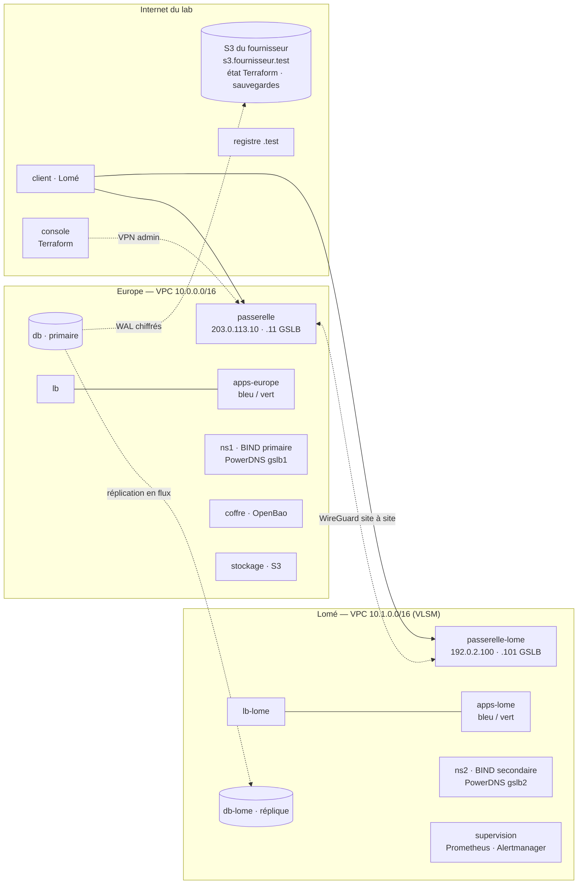

# 🟡 Projet fil rouge Networking & Cloud — Palier 2 : tout en code, deux régions

> **Cours associé :** [02.md](../02.md) — **Durée indicative :** 40 à 60 h — **Machines :** ≈ 22, créées par **votre** Terraform (`./lab/docker/lab.sh up 2`)
>
> **Prérequis :** le Palier 1 validé (`verifier.sh 1` au vert). Vous gardez la console, sa PKI et sa clé SSH ; tout le reste sera reconstruit — par du code.

## Mission

Marché grandit : ses clients de Lomé veulent une région **chez eux**, la direction veut **survivre à la perte d'une région**, et l'équipe ne veut plus jamais configurer une machine à la main. Au Palier 1, vous avez tout câblé vous-même ; ici, **tout** devient du code Terraform, exécuté depuis la console : les réseaux, les machines (immuables : on remplace, on ne répare pas), les zones DNS, les secrets, les buckets, les certificats.

À la fin, deux régions — l'Europe et Lomé — reliées par un VPN site à site ; un DNS qui envoie chaque client vers la région **en bonne santé** la plus proche ; une base répliquée d'un continent à l'autre, sauvegardée **chiffrée** chez le fournisseur et restaurable **à la seconde près** ; des applications sans aucun mot de passe (identifiants **temporaires**) ; des déploiements **sans interruption** avec retour arrière automatique ; une flotte qui **grandit et rétrécit** avec la charge ; une supervision qui **survit** à la région qu'elle surveille. Et la preuve, chiffrée : RTO et RPO **mesurés**, pas estimés.



## Ce que fournit le lab

- **Le fournisseur de cloud** : son **API Docker** (Terraform, fournisseur `kreuzwerker/docker`, crée vos machines — l'équivalent d'EC2), un **S3 managé** avec API IAM (`https://s3.fournisseur.test`, sur Internet, certificat signé par l'AC publique du lab), et les deux réseaux « Internet » de Lomé et d'Europe. `./lab/docker/lab.sh identifiants` : les clés de **votre compte** S3.
- **La console**, avec Terraform 1.16 et un **miroir des fournisseurs** (`docker`, `aws`, `vault`, `powerdns`, `tls`, `random`, `local` : pas besoin d'Internet pour `terraform init`), l'AWS CLI, `bao` (le client OpenBao), `jq`.
- **L'image des machines** : tous les logiciels sont installés et désactivés (OpenBao 2.7, PowerDNS 4 avec LUA, pgBackRest, Prometheus, Alertmanager, blackbox exporter, node exporter, HAProxy 2.8…). Une instance reçoit ses fichiers et son script de démarrage par `upload` (l'équivalent du *user data*) : `lab-init.service` exécute `/lab/init.sh` **à chaque démarrage**, après le réseau, comme cloud-init.
- **Le câble sous-marin** a désormais une **capacité** : 20 Mbit/s par sens, avec un gros tampon chez l'opérateur.

**Passer du Palier 1 au Palier 2** : `./lab/docker/lab.sh passer-palier-2` (supprime vos 8 machines du Palier 1 et leurs réseaux — la console et sa PKI restent), puis `./lab/docker/lab.sh up 2` (ajoute le S3 du fournisseur).

## Conventions (le correcteur les attend)

| Quoi | Convention |
| --- | --- |
| Code Terraform | sur la console, `/root/p2/terraform/<couche>` ; trois couches au moins : **`regions`** (réseaux, machines, certificats, zones), **`plateforme`** (secrets, buckets, IAM), **`trafic`** (DNS de bascule et de découverte) |
| État | `s3://marche-etat-terraform/<couche>/terraform.tfstate`, chez le fournisseur, **versionné et verrouillé** |
| Flotte | `regions/flotte.auto.tfvars.json` : variable `groupes` (`europe-bleu`, `europe-vert`, `lome-bleu`, `lome-vert` → `{taille, version}`) ; `trafic/flotte.auto.tfvars.json` : `couleur_active` (`{europe, lome}` → `bleu`/`vert`) et `retrait` (instances à ne plus publier) |
| Machines | `passerelle`, `lb`, `ns1`, `db`, `stockage`, `coffre` (Europe) ; `passerelle-lome`, `lb-lome`, `ns2`, `db-lome`, `supervision` (Lomé) ; `edge` ; applications : étiquettes `role=app`, `region`, `groupe`, `couleur`, `version` — et **toutes** : `projet=marche`, `equipe`, `env`, `region` |
| Lomé (VLSM) | applications `10.1.0.0/26` (passerelle `.1`), données `10.1.0.64/28` (`.65`, `db-lome` `.70`), public `10.1.0.80/28` (`passerelle-lome` `.81`, `lb-lome` `.82`, `ns2` `.83`, PowerDNS `.84`, `supervision` `.85`) ; adresses publiques `192.0.2.100` (site, DNS) et `192.0.2.101` (GSLB) |
| Europe | comme au Palier 1, plus `coffre` `10.0.3.30` et PowerDNS `10.0.1.54` (publique `203.0.113.11`) ; VPN : Europe `10.99.0.1`, console `.2`, Lomé `.3` |
| DNS | `www` → `CNAME www.gslb.marche.test` ; `gslb.marche.test` délégué à `gslb1`/`gslb2` (PowerDNS, une instance par région, **même contenu**) ; `apps-europe` / `apps-lome` `.gslb.marche.test` : les instances **en service** ; `db.marche.test` : **la primaire**, servie par le résolveur de chaque région |
| Secrets | OpenBao sur `https://coffre.marche.test:8200` ; jeton racine sur la console dans `/root/cles/bao-init.json` ; moteur `database` monté en **`base`**, rôle **`app`** ; `kv/marche/pgbackrest` (`access_key`, `secret_key`) |
| Sauvegardes | pgBackRest, stanza **`marche`**, bucket **`marche-sauvegardes`** chez le fournisseur, `aes-256-cbc` |
| Supervision | Prometheus `:9090`, Alertmanager `:9093` sur `supervision` ; les notifications arrivent dans le journal de l'unité **`pager`** ; règles nommées `SiteIndisponible`, `ErreursServeur`, `CapaciteReduite`, `CoffreIndisponible`, `RepliqueEnRetard`, `ArchivageEnPanne` |
| Rendu | `rendu/palier-2/RUNBOOK.md`, `rendu/palier-2/MESURES.md` |

---

## Étapes

Travaillez **dans l'ordre**. Règle d'or : **aucune** commande à la main sur une instance pour la configurer — tout passe par son *user data* (un rôle, des paramètres) et par Terraform. Une instance mal configurée se **remplace** ; vous vous connectez aux machines pour **mesurer**, jamais pour réparer.

### 0. Le premier jour (M9, M10)
- [ ] Un script `bootstrap` (le seul impératif du projet) : le bucket d'état **versionné**, le profil AWS `fournisseur` de la console (`AWS_CA_BUNDLE` !), les clés WireGuard, `terraform init` de chaque couche avec `-backend-config` (backend `s3`, `use_lockfile = true`, `endpoints`, `use_path_style`).
- [ ] Prouvez le verrou : deux `terraform plan` en même temps sur la même couche — le second doit attendre, puis échouer.

### 1. Un module « instance », et l'Europe reconstruite par Terraform (M9, M10)
- [ ] Un **module** `instance` (le *launch template*) : conteneur privilégié, interfaces nommées, étiquettes, *user data* = un rôle + `/lab/parametres.sh`. **Ne téléverser que le rôle de la machine** : sinon, modifier un rôle remplace toute la flotte.
- [ ] Les **données** hors de l'instance : un `docker_volume` par machine à état (`db`, `coffre`, `stockage`, `ns*`), protégé par `prevent_destroy`. Remplacer `db` ne doit rien perdre.
- [ ] Certificats **émis par Terraform** (`tls_locally_signed_cert`, avec l'intermédiaire de la console), réémis automatiquement avant expiration (`early_renewal_hours`).
- [ ] Zones DNS **comme du code** (split-horizon) : incrémentez la série à chaque modification.

### 2. Lomé, et le VPN site à site (M1, M5, M6)
- [ ] Le VPC `10.1.0.0/16` découpé en **VLSM** (conventions ci-dessus) ; `passerelle-lome` : NAT, pare-feux, ACL des données, résolveur, comme en Europe — **même rôle**, d'autres paramètres.
- [ ] WireGuard **site à site** entre les passerelles ; les deux VPC se joignent par le tunnel, et rien d'autre ne le traverse. Sur la dorsale, on ne doit voir **que** de l'UDP chiffré.
- [ ] La console atteint Lomé **par l'Europe** (hub-and-spoke) : quel est le prix de ce choix quand l'Europe tombe ?

### 3. DNS : deux régions, deux vues, une bascule (M8)
- [ ] `ns2` : **secondaire** des deux vues de `ns1` — une clé TSIG **par vue** (c'est la clé qui choisit la vue, pas l'adresse). Déclarez `ns1` **et** `ns2` au registre.
- [ ] Le résolveur de chaque région interroge **son** serveur interne d'abord (`stub-addr` : les deux). Sans l'Europe, Lomé doit encore résoudre ses noms.
- [ ] PowerDNS dans chaque région, autorité sur `gslb.marche.test` (API, pilotée par Terraform) : `www` en enregistrement **LUA** qui vérifie la **santé L7** de chaque région (`ifurlup` sur une URL `/sante` du répartiteur : 503 quand il n'a plus aucune application) — Lomé d'abord, l'Europe en secours. Un SOA avec un TTL négatif **court**.

### 4. Secrets : plus aucun mot de passe (M11)
- [ ] OpenBao sur `coffre` (stockage Raft, TLS avec votre AC, descellement au démarrage — et ce que ferait la production).
- [ ] Les instances s'authentifient avec **leur certificat** (méthode `cert` : l'équivalent d'un rôle IAM d'instance). L'agent OpenBao écrit la configuration et redémarre le service.
- [ ] Moteur **`database`** : chaque instance reçoit un compte PostgreSQL **temporaire** (1 h, 24 h au plus). Vérifiez la **révocation** : le compte disparaît **et** ses sessions ouvertes sont coupées.

### 5. La base : répliquée, sauvegardée, restaurable (M13, M15)
- [ ] `db-lome` : **réplique en flux** de `db` (slot de réplication), en lecture seule.
- [ ] pgBackRest vers le S3 **du fournisseur** (hors de vos régions), **chiffré côté client** ; archivage **continu** des WAL (`archive_timeout`) ; complètes et différentielles planifiées (minuteries systemd). Un utilisateur IAM qui ne voit **que** ce bucket.
- [ ] **Restaurez** à un instant précis après un `DELETE` sans `WHERE` : application arrêtée, restauration, promotion, réplique reconstruite, identifiants révoqués. Écrivez-en la procédure dans `RUNBOOK.md` — et chronométrez-la.

### 6. La flotte : des groupes, découverts par le DNS (M12, M18)
- [ ] Les applications en **groupes** (`<région>-<couleur>`), de taille et de version **variables**. Le répartiteur ne les connaît pas : il les **découvre** dans `apps-<région>.gslb.marche.test` (HAProxy `server-template` + `resolvers`), publié par la couche `trafic`. Ajouter une instance ne doit **pas** remplacer le répartiteur.
- [ ] Une instance qui s'arrête ne doit coûter **aucune** requête : `retry-on conn-failure`, `redispatch` — et on **dépublie avant d'éteindre** (variable `retrait`).

### 7. Déployer sans interruption (M18)
- [ ] Un pipeline (script, ou vrai outil de CI) : `fmt`/`validate` → **plan enregistré** → approbation → **apply de ce plan** → tests de fumée sur la nouvelle couleur → **bascule** de la découverte → **observation** de l'objectif de service (erreurs, p95) → retrait de l'ancienne couleur. Régression → **retour automatique**.
- [ ] Une **politique** : un plan qui touche autre chose que ce que l'étape doit toucher est **refusé**, même approuvé.
- [ ] Prouvez-le : une sonde qui commande en continu pendant un déploiement ne voit **aucune** erreur ; une version « fonctionnelle mais lente » est rattrapée par l'observation.

### 8. Suivre la charge (M12)
- [ ] Une boucle de contrôle en **suivi de cible** (requêtes/s par instance, mesurées par la supervision) : agrandir tout de suite, réduire lentement (fenêtre de stabilisation), bornes min/max, et **jamais** de décision sans mesure. Faites varier `RPS` du générateur de trafic et mesurez.

### 9. Superviser — depuis l'autre région (M17)
- [ ] `supervision` à **Lomé** : Prometheus (répartiteurs, applications découvertes par DNS, bases via le collecteur *textfile* du node exporter), sondes **synthétiques** (le site vu d'un client, la santé du coffre, la réponse du GSLB), Alertmanager et son « pager ».
- [ ] Des alertes **utiles** : aucune au repos ; chaque panne ci-dessous en déclenche une.

### 10. Le lien intercontinental : la file d'attente (M4)
- [ ] Mesurez l'aller-retour d'une poignée de main TCP d'une application de Lomé vers la base d'Europe, **au repos** puis **pendant un transfert massif** (téléchargements en parallèle). Observez le *bufferbloat*.
- [ ] Reprenez la main : **mise en forme** juste sous la capacité du câble + **file équitable** (fq_codel), sur l'interface du tunnel — avant le chiffrement. Remesurez. Essayez aussi la mise en forme **sans** fq_codel : expliquez.

### 11. Perdre une région (M15, M16)
- [ ] Gelez toutes les machines d'Europe (`docker pause`) : qu'est-ce qui tient seul ? Basculez (la réplique de Lomé devient primaire, `db.marche.test` la suit — une **variable** Terraform), rétablissez (écartez l'ancienne primaire **avant** de dégeler), revenez (planifié, **sans perte**, prouvé par les LSN).
- [ ] Mesurez RTO et RPO avec une sonde qui note chaque commande confirmée ; consignez tout dans `MESURES.md`, avec les **limites** de votre architecture (ce qui n'existe que dans une région).

### 12. Coûts (M19)
- [ ] Étiquettes sur **tout** (`projet`, `equipe`, `env`, `region`) ; rien ne tourne qui ne soit dans un état Terraform. Estimez le coût mensuel de votre architecture chez un vrai fournisseur (instances, trafic inter-régions, stockage des sauvegardes) : qu'est-ce qui coûte le plus, et que feriez-vous pour le réduire ?

---

## Aide-mémoire (ce que le cours ne détaille pas)

- **Terraform hors ligne** : les fournisseurs sont dans `/usr/local/share/terraform/plugins` (miroir déclaré dans la configuration CLI de la console) — fixez leurs versions (`docker 3.9.0`, `aws 6.66.0`, `vault 5.12.0`, `powerdns 1.5.0`).
- **Backend S3 d'un fournisseur non-AWS** : `endpoints = { s3 = "https://s3.fournisseur.test" }`, `use_path_style = true`, `skip_credentials_validation`, `skip_requesting_account_id`, `skip_region_validation`, `use_lockfile = true`.
- **OpenBao 2.7** n'est pas Vault à l'identique : pas de stockage `file`, pas de `disable_mlock` — stockage `raft` (même pour un nœud) avec `cluster_addr`. `bao status` rend **2** quand le coffre est scellé : ce n'est pas une erreur (sous `set -e`, si).
- **PowerDNS** : `launch=gsqlite3`, `enable-lua-records=yes`, API sur `:8081` (`api-key`). SQLite n'accepte **qu'un écrivain** : appliquez la couche qui l'alimente avec `terraform apply -parallelism=1` (destruction comprise). Import d'un enregistrement existant : identifiant JSON `{"zone":"…","id":"nom.:::TYPE"}`.
- **HAProxy** : `server-template app 8 apps-lome.gslb.marche.test:8000` + une section `resolvers` ; `monitor-uri` / `monitor fail if { nbsrv(applications) lt 1 }` pour `/sante` ; `http-request use-service prometheus-exporter` pour les métriques.
- **pgBackRest** : `repo1-type=s3`, `repo1-s3-uri-style=path`, `repo1-cipher-type=aes-256-cbc` ; restauration : `pgbackrest --stanza=marche --delta --type=time --target='…' --target-action=promote restore`, **service `postgresql@16-main` arrêté** (`postgresql` n'est qu'une coquille).
- **CAKE n'est pas dans le noyau de Docker Desktop** : HTB + fq_codel. Les files d'une interface WireGuard disparaissent avec elle : `PostUp` dans `wg0.conf`.

## Critères d'acceptation

**Automatiques** — depuis l'hôte du lab :
```bash
./outils/verifier.sh 2            # ~7 min ; --rapide (~2 min) : sans bascule GSLB, restauration, mise à l'échelle, QoS ni perte de l'Europe
```
47 critères. Le correcteur **provoque** ce qu'il vérifie : il pose un faux verrou sur votre état, arrête le répartiteur de Lomé et chronomètre la bascule du GSLB, emprunte un compte temporaire, ouvre une session et le **révoque**, restaure vos sauvegardes dans une instance jetable, agrandit puis réduit un groupe pendant qu'un client commande, lance un transfert massif et mesure la latence, **gèle toute l'Europe** pendant 75 s et vérifie que le site répond, que Lomé résout ses noms et que la supervision a **alerté**.

**Manuels :**

| Critère | ✔ |
| --- | --- |
| Vous expliquez le découpage en couches (qu'est-ce qui change souvent, qu'est-ce qui ne doit pas pouvoir casser le reste) et le chemin d'une modification jusqu'à la production | |
| Un déploiement complet (deux régions) **mesuré** : durée, erreurs vues par un client (0), et un retour arrière automatique déclenché | |
| Une mise à l'échelle mesurée : charge, instances, erreurs (0), temps de réaction | |
| `RUNBOOK.md` : restauration à un instant, bascule de région, rétablissement, retour — les commandes, dans l'ordre, et **pourquoi cet ordre** | |
| `MESURES.md` : RTO et RPO **mesurés** pour chaque scénario, avant / après vos corrections, et les limites connues | |
| Estimation de coût commentée | |
| `INCIDENTS.md` : les pannes ci-dessous, avec la **mesure** — ou l'**alerte** — qui a trahi chaque cause | |

## Pannes

`./outils/panne.sh liste 2` : neuf pannes, du code à la file d'attente.

1. **Entraînement** : chacune seule (`./outils/panne.sh <nom>`). Commencez par la **supervision** : quelle alerte a sonné ? Puis mesurez, corrigez **par le code** (une correction à la main sur une instance sera effacée au prochain remplacement), notez dans `INCIDENTS.md`.
2. **Manche à l'aveugle** : `./outils/panne.sh aveugle 3 2`, correcteur à 100 % et trois causes écrites avant `./outils/panne.sh revele`.

## Pièges rencontrés en construisant la solution

Tous vécus en déroulant la solution de référence sur ce lab.

**Infrastructure en code**
- **Téléverser tous les rôles sur toutes les machines** : modifier un rôle remplaçait les 14 machines. Chaque instance ne reçoit que **son** rôle.
- **Un « retrait de 8 ressources » a remplacé les 23 machines** : le code de la console avait changé entre-temps, et le plan, affiché, a été appliqué « approuvé d'avance ». D'où la **politique** : l'étape ne touche que son périmètre, sinon refus.
- **Une dérive permanente** : OpenBao rend les instructions SQL sans le saut de ligne final de l'heredoc — un faux changement à **chaque** plan (`chomp()`). Une dérive qu'on s'habitue à voir masque les vraies.
- **Une seule couche pour tout** : chaque bascule bleu/vert attendait 30 s le rafraîchissement des secrets et des buckets. La couche `trafic` à part : 6 s. Et une erreur de DNS ne peut plus toucher aux secrets.
- **Déplacer une ressource d'une couche à l'autre** : `terraform state rm` d'un côté, `terraform import` de l'autre — rien n'est recréé. Dans une même couche, un bloc `moved`.

**Réseau**
- **Une instance remplacée change d'adresse MAC** (Docker 29 : aléatoire) ; ses voisins — le routeur, la dorsale — gardent l'ancienne jusqu'à expiration du cache ARP : **jusqu'à 50 s** de trafic envoyé dans le vide après chaque remplacement. Une annonce **ARP gratuite** au démarrage (`arping -U`), comme VRRP : la coupure d'une bascule de région est passée de 51 s à 27 s.
- **Un pair qui disparaît ne dit rien** — pas même un refus : sans borne, une requête vers la base gelée attend la fin des retransmissions TCP et bloque tous les fils du service (140 s de coupure). `tcp_user_timeout`, keepalives, `connect_timeout` — côté client **et** côté serveur.
- **`pg_basebackup` bloqué pour toujours** sur une connexion morte, et une réplique qui ne se reconstruisait pas parce que la primaire redémarrait **pendant** la copie : bornes TCP, plusieurs essais — et la configuration d'archivage écrite **avant** le démarrage (sinon, un second redémarrage).
- **Le bufferbloat** : une poignée de main de 122 ms passait à 750 ms pendant un transfert. Mettre en forme sans file équitable est **pire** (1 s) : la file a seulement changé de place. Et sur l'interface du tunnel : après chiffrement, tout n'est qu'un flux UDP.
- **DNAT limité à l'interface Internet** : le GSLB de Lomé ne pouvait plus sonder **son** site par l'adresse publique. DNAT pour tout paquet qui vise l'adresse publique, et **NAT en épingle** pour la réponse.

**DNS**
- **« database is locked » au premier déploiement depuis zéro** : quatre enregistrements créés en même temps sur un même PowerDNS, qui stocke ses zones dans SQLite — un seul écrivain, et une transaction qui lit puis écrit échoue **sans attendre** si une autre l'a précédée. Le déploiement incrémental ne l'avait jamais montré (les créations y arrivaient une à une). `-parallelism=1` pour cette couche. Et le déployeur affichait « déployé » malgré l'échec : `| tail` masquait le code de retour (`pipefail`).
- **Délégué trop tard** : le générateur de trafic avait déjà demandé le domaine, « inexistant » restait en cache chez le FAI pendant le TTL négatif du TLD. Déléguer **avant** de démarrer quoi que ce soit.
- **Deux serveurs qui font autorité doivent servir le même contenu** : `apps-europe` publié seulement en Europe — un résolveur qui demandait au serveur de Lomé recevait « inexistant », au hasard.
- **Le SOA par défaut de PowerDNS** (`a.misconfigured.dns.server.invalid`, TTL négatif **1 h**) : le fournisseur Terraform **remplace** un enregistrement quand ses adresses changent (supprimé, puis recréé) ; une requête tombée entre les deux était mise en cache pour une heure.
- **`ifportup(443)` ne voit pas une région malade** : un répartiteur sans aucune application ouvre très bien le port 443 — et renvoie des 503. Santé **L7** (`ifurlup` + `/sante`).

**Secrets et données**
- **PostgreSQL 16 : les révocations échouaient toutes** (`permission denied to reassign objects`) : le créateur d'un rôle n'a plus que l'option ADMIN dessus. `GRANT "{{name}}" TO bao` d'abord. Et `DROP ROLE` ne coupe **pas** les sessions ouvertes : un identifiant révoqué fonctionnait encore — `pg_terminate_backend`.
- **Une restauration laisse sa cible dans `postgresql.auto.conf`** ; `pg_basebackup` la recopiait sur la réplique, qui « atteignait la cible » et se promouvait : **deux primaires**. `ALTER SYSTEM RESET` après la promotion.
- **Une réplique silencieusement bloquée depuis 60 s, promue lors d'un retour « planifié »** : 129 commandes confirmées perdues. On **prouve** que la réplique a reçu le point d'arrêt de la primaire (LSN) avant de promouvoir.
- **Après une bascule, plus aucune sauvegarde complète sur la nouvelle timeline** : restaurer « maintenant » rejouait des heures de WAL à travers chaque bascule. Une nouvelle primaire = une sauvegarde complète.
- **Le coffre n'existe qu'en Europe** : pendant la perte de l'Europe, les identifiants de Lomé ne se renouvellent plus. Ils durent **1 h** : c'est votre RTO maximal pour rétablir le coffre — et la limite de cette architecture.

---

Palier validé ? Comparez avec [solution/palier-2](solution/palier-2/) — puis passez au [Palier 3](palier-3.md).
