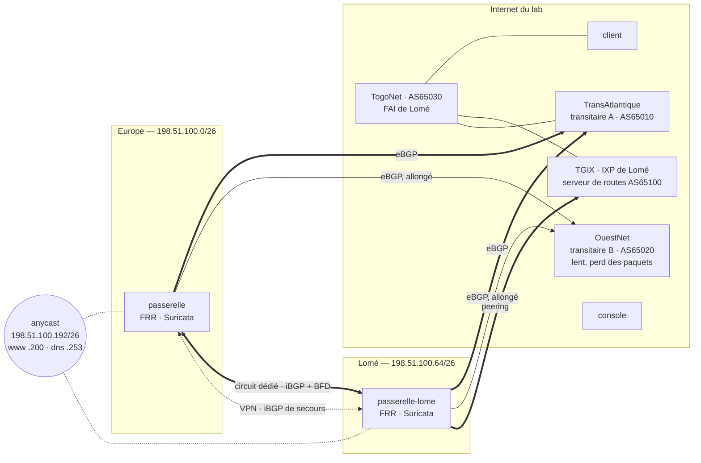

# 🔴 Projet fil rouge Networking & Cloud — Palier 3 : à l'échelle d'Internet

> **Cours associé :** [03.md](../03.md) — **Durée indicative :** 50 à 70 h — **Machines :** ≈ 26 (vos ≈ 22 du Palier 2 + trois fournisseurs et un circuit : `./lab/docker/lab.sh up 3`)
>
> **Prérequis :** le Palier 2 validé (`verifier.sh 2` au vert) : vous gardez tout — le code, l'état, les régions. Le Palier 3 **étend** ce dépôt ; le correcteur rejoue d'ailleurs tout le Palier 2 avant le vôtre.

## Mission

Marché n'est plus un client d'Internet : il en devient un **acteur**. La direction a obtenu un bloc d'adresses à son nom (`198.51.100.0/24`) et un numéro de système autonome (**AS 64500**). Plus question de dépendre d'un seul opérateur, ni de l'adresse que le DNS voudra bien donner : les clients doivent arriver **à la région la plus proche d'eux, par le routage même**, et y rester quand une région tombe.

Dans le même temps, un audit a sévèrement jugé la sécurité du Palier 2 : « un réseau privé n'est pas une preuve d'identité ». Chaque service devra **prouver qui il est** à chaque connexion. Il faudra voir les attaques, en bloquer certaines, et survivre aux autres. L'équipe grandit, donc chaque équipe aura son compte, avec des règles communes vérifiées **en continu**. Enfin, la direction veut des engagements (SLO), un plan de capacité et le **coût d'une commande**.

À la fin :
- Marché annonce ses préfixes en BGP à **deux transitaires** et à un **IXP**, avec une politique écrite : qui préférer, qui ne jamais relayer.
- `www` est **anycast** : la même adresse dans les deux régions, retirée de celle qui tombe.
- Un **circuit dédié** relie les régions, avec détection de panne en moins d'une seconde et le VPN en secours.
- Un **trou noir à distance** contre les attaques volumétriques.
- **Zero Trust** entre tous les services (mTLS, identités de 24 h) et un **IPS** en ligne.
- **BBR** et du **SD-WAN** sur les liens.
- Une **landing zone** multi-comptes, une **surveillance de conformité** continue, des **SLO** avec budget d'erreur, et la capacité et le coût **mesurés**.



## Ce que fournit le lab

`./lab/docker/lab.sh up 3` ajoute, sans toucher à vos machines :

| Qui | Rôle | Où vous le joignez |
| --- | --- | --- |
| **TransAtlantique** (`backbone`, AS 65010) | le transitaire A, celui du Palier 2. Il parle BGP, accepte nos préfixes (et **seulement** eux, jusqu'au /26), et offre un **trou noir** : communauté `65010:666` | Europe `203.0.113.1`, Lomé `192.0.2.1` |
| **OuestNet** (`transit-b`, AS 65020) | le transitaire B : 90 ms de plus, 0,5 % de pertes, 50 Mbit/s. Le secours | Europe `198.18.2.1` (réseau `europe-b`), Lomé `198.18.3.1` (`lome-b`) |
| **TGIX** (`rs-ixp`, AS 65100) | l'IXP de Lomé : un **serveur de routes** (il ne s'insère pas dans le chemin d'AS). TogoNet y est aussi | `198.18.1.254` (réseau `ixp`, `198.18.1.0/24`) |
| **TogoNet** (`fai-lome`, AS 65030) | le FAI des clients de Lomé : il préfère l'IXP (200) au transit (100). Le `client` y est déplacé (`198.18.30.50`) | — |
| **Le circuit** (`circuit`) | un circuit dédié Europe ↔ Lomé : 55 ms, 100 Mbit/s, **non chiffré** | Europe `198.18.9.1` (`fibre-europe`, `198.18.9.0/29`), Lomé `198.18.9.9` (`fibre-lome`, `198.18.9.8/29`) |

Les réseaux Docker s'appellent `marche-cloud_<nom>` (ex. `marche-cloud_fibre-lome`) : à déclarer en `data "docker_network"` dans votre couche `regions`. L'image des machines contient FRR 8.4 (sans `frr-pythontools` : pas de `reload`), Suricata 7, et `nginx` pour les sidecars.

## Conventions (le correcteur les attend)

| Quoi | Convention |
| --- | --- |
| Code | toujours sur la console, `/root/p2/terraform/<couche>` (le dépôt continue) ; une quatrième couche **`fondations`** (la landing zone), appliquée **avant** les autres |
| Adresses | Marché : AS **64500**, `198.51.100.0/24`. L'Europe annonce `198.51.100.0/26` (adresse de la région : `.10`), Lomé `198.51.100.64/26` (`.100`). Les **deux** annoncent l'anycast `198.51.100.192/26` tant qu'elles servent : `www` = `.200`, DNS = `.253`. **Rien d'autre** ne part vers un fournisseur |
| Interfaces | sur les passerelles : `transit-b`, `ixp` (Lomé), `fibre` ; Europe `198.18.2.10`, `198.18.9.2` ; Lomé `198.18.3.100`, `198.18.1.64`, `198.18.9.10` |
| DNS | `www.marche.test` → `198.51.100.200` ; `ns.marche.test` → `198.51.100.253`, délégué au registre ; le GSLB du Palier 2 reste sous `www-gslb` |
| Identités de service | émises par OpenBao, moteur PKI monté en **`pki-services`**, 24 h au plus, dans **`/etc/identite/`** : `service.crt`, `service.key`, `combine.pem` (certificat + clé), `ca.pem` (l'AC des services). Noms : `app.svc.marche.test`, `lb.svc.marche.test`, `supervision.svc.marche.test`, `db.marche.test`. Les applications n'écoutent **que** sur `127.0.0.1:8000` ; un sidecar TLS sur **`:8443`** |
| IDS/IPS | Suricata sur les deux passerelles, `/var/log/suricata/eve.json` ; signatures `9000001` (balayage), `9000002` (SSH depuis Internet), `9000003` (DNS `ANY`, **bloquée**) |
| Landing zone | buckets `marche-prod-donnees`, `marche-dev-donnees`, `marche-journaux` ; identités `marche-{prod,dev}-deploiement` (sortie Terraform `deploiement` : `{prod, dev} → {access_key, secret_key}`) et `marche-securite-audit` (profil AWS **`audit`** de la console) |
| Conformité | sur la console, toutes les 5 min ; métriques `marche_cspm_conforme{regle="…"}` (au moins 8 règles, dont `bucket_public`) et `marche_cspm_derniere_execution`, lues par la supervision |
| Supervision | règles d'enregistrement `marche:sli_erreurs:ratio_rate<fenêtre>` (dont `5m`, `1h`, `6h`), `marche:budget_erreur:restant_1d`, `marche:cout_euros:par_heure{poste}` (au moins 3 postes), `marche:cout_euros:par_commande` ; alertes `BudgetErreurRapide`, `BudgetErreurLent`, `BudgetErreurRapideLab`, `IntrusionDetectee`, `AttaqueBloquee`, `NonConformite` |
| Rendu | `rendu/palier-3/` : `RUNBOOK.md`, `MESURES.md`, `REVUE.md`, et **`trou-noir.sh <europe\|lome> activer\|lever <adresse>`** (lancé depuis l'hôte) |

---

## Étapes

Même règle d'or qu'au Palier 2 : tout passe par le code et le *user data*. Nouveauté : le routage **dynamique** de FRR vit dans les passerelles. Une session BGP se regarde (`vtysh`), elle ne se configure pas à la main.

### 0. La landing zone d'abord (M11)
- [ ] Une couche `fondations` : un « compte » par équipe (`prod`, `dev`), avec ses buckets et une identité de déploiement qui ne voit **que** ses ressources. Un compte `securite` : le bucket central des journaux (chaque compte y **dépose**, sans relire ni effacer) et une identité d'**audit** qui lit tout et n'écrit rien.
- [ ] Les garde-fous communs. Le fournisseur n'accepte **que** des politiques `Allow` : comment empêcher qu'on accorde un jour trop ? (Réponse : le refus par défaut, plus une vérification continue, étape 9. Écrivez ce qu'une SCP `Deny` ferait de mieux.)

### 1. Devenir un système autonome (M1, M2, M4)
- [ ] FRR sur les deux passerelles, généré par le rôle. Sessions eBGP : A et B dans chaque région, et l'IXP à Lomé. Le pare-feu laisse passer `tcp/179` (et BFD, `udp/3784-3785`) **depuis les voisins seulement**.
- [ ] **Politique de sortie** : vos préfixes, et rien d'autre. Relayer vers A ce qu'on a appris de B, c'est une **fuite de routes**, la panne qui a déjà coupé des pays entiers. Vers B : chemin **allongé** (*prepend* ×2), car B ne sert qu'en secours. Vers l'IXP : `no-export`.
- [ ] **Politique d'entrée** : refuser tout ce qui appartient à votre propre espace (quelqu'un d'autre qui annonce vos adresses, c'est un détournement). Préférence locale : IXP 300 > A 200 > B 100. Plafond de préfixes par session.
- [ ] Des **ancres** : BGP n'annonce que ce qui existe dans la table (routes `blackhole` pour vos /26). `rp_filter` en mode **souple** (2) : avec plusieurs liens, le retour d'un paquet ne passe pas forcément par où il est entré.

### 2. Anycast (M4, M13)
- [ ] Le /26 anycast est annoncé par les deux régions, avec DNAT de `.200` vers le répartiteur et de `.253` vers le DNS de la région. Un client de TogoNet doit arriver **à Lomé par l'IXP**.
- [ ] L'annonce **suit la santé** : une sonde qui interroge `/sante` du répartiteur chaque seconde retire l'ancre après deux échecs, et la remet ensuite. Mesurez la bascule et le retour, puis comparez au GSLB du Palier 2 (et à son TTL).
- [ ] Réfléchissez au **DNS anycast** : que se passe-t-il pour une requête en cours quand les routes changent (UDP) ? Et pour une connexion TCP longue ?

### 3. Le circuit dédié, le VPN en secours (M1, M12)
- [ ] **iBGP** entre les passerelles, sur le circuit **et** sur le tunnel. Le circuit est préféré ; le tunnel sert en secours (préférence locale 50). `next-hop-self`.
- [ ] **BFD** sur la session du circuit (300 ms × 3). Coupez le circuit **avec** puis **sans** BFD, et mesurez les deux.
- [ ] L'extrémité du tunnel de secours doit passer **par Internet**, jamais par le circuit qu'il secourt (une route /32 via le transitaire). WireGuard n'utilise pas sa propre table (`Table = off`) : c'est BGP qui décide.
- [ ] L'anycast ne se transmet **pas** en iBGP (une région malade le réapprendrait de l'autre et continuerait de l'annoncer). Et les routes Internet apprises de l'autre région passent **après** vos transitaires : sinon, votre trafic de retour part par l'autre région, et un pare-feu à état qui n'a jamais vu l'aller le jette.
- [ ] Le circuit n'est **pas chiffré** : tout ce qui y passe doit l'être (étape 5).

### 4. Sous attaque : le trou noir à distance (M2, M6)
- [ ] `trou-noir.sh` annonce `<adresse>/32` avec la communauté `65010:666` : A jette alors le trafic **chez lui**. La politique de sortie doit laisser passer **ce** /32, et lui seul.
- [ ] Prouvez que l'adresse visée devient injoignable et que le reste répond. Écrivez **quand** on s'en sert, et pourquoi on ne le fait jamais sur l'adresse anycast.

### 5. Zero Trust (M5)
- [ ] Une AC **des services** dans OpenBao (`pki-services`), des rôles par service (24 h), et l'agent OpenBao qui renouvelle. Au premier démarrage, avant la première identité, une identité **provisoire** permet au service de démarrer : elle ne doit jamais être prise pour la vraie.
- [ ] Les applications n'écoutent plus que sur elles-mêmes. Un **sidecar** TLS exige un certificat client de l'AC des services **et** autorise **par identité** : le répartiteur a droit à l'API, la supervision aux métriques, et personne d'autre à rien.
- [ ] HAProxy et Prometheus présentent leur identité et **vérifient** celle de l'application (`verify required`, nom attendu).
- [ ] PostgreSQL : `hostssl … clientcert=verify-ca` pour les applications, et `hostnossl … reject` pour tout le reste.

### 6. Détection et prévention d'intrusion (M6)
- [ ] Suricata **en ligne** (NFQUEUE) sur les liens amont, avec des règles à vous : balayage, SSH depuis Internet, et DNS `ANY` **bloqué**. `bypass` : si Suricata tombe, le trafic passe. Écrivez ce choix, et quand vous feriez l'inverse.
- [ ] Les alertes deviennent des **métriques**, puis des alertes de la supervision. Un scanner **autorisé** (le vôtre, étape 9) ne doit pas faire sonner : prévoyez une exception étroite.
- [ ] `./outils/attaque.sh balayage|ssh|dns-any <adresse>` : chaque attaque doit être **vue** ; la troisième doit être **bloquée** sans gêner les requêtes ordinaires.

### 7. Performance : TCP et SD-WAN (M3, M8)
- [ ] Mesurez CUBIC puis BBR par le transitaire B (il perd des paquets), et par A pendant un transfert (la latence **des autres**). Choisissez, et appliquez partout où l'on **émet**.
- [ ] **SD-WAN** : le volumineux (stockage objet, port 8333) passe par le tunnel Internet et l'interactif par le circuit (routage par politique : une marque, une table). Une sonde de santé du tunnel ramène le volumineux sur le circuit si le tunnel tombe. Mesurez les octets par lien.

### 8. Objectifs de service (M14, M15)
- [ ] Un SLO de disponibilité (99,5 % des requêtes sans erreur serveur), des SLI **enregistrés** sur plusieurs fenêtres, et le budget restant.
- [ ] Des alertes **multi-fenêtres, multi-taux** : rapide (14,4×, 1 h et 5 min), lente (6×, 6 h et 30 min). À l'échelle du lab, des variantes aux fenêtres divisées par 12 pour les voir sonner.
- [ ] Un **game day** (voir plus bas) : une hypothèse, un rayon d'action, une condition d'arrêt, une mesure.

### 9. Conformité continue (M16)
- [ ] Sur la console, avec l'identité d'**audit**, au moins 8 règles : pas de bucket public, état versionné, sauvegardes chiffrées, pas de droits illimités (exceptions **documentées**), étiquettes, rien hors du code, SSH fermé sur Internet, certificat du site qui n'expire pas bientôt. Les résultats deviennent des métriques, puis une alerte.
- [ ] Provoquez une dérive (un bucket rendu public à la main) et chronométrez sa détection.

### 10. Capacité, périphérie, coûts (M9, M17, M18)
- [ ] Trouvez le **coude** : des paliers de charge, le débit servi et le p95. La loi de Little vous dit où il **devrait** être : vérifiez.
- [ ] Le CDN sert sa copie quand l'origine tombe (`proxy_cache_use_stale`).
- [ ] Le **coût d'une commande**, en continu : coûts par poste (instances, plateforme, trafic inter-régions) ÷ commandes par heure. Qu'est-ce qui le fait baisser ?

### 11. La revue (M10, M19)
- [ ] `REVUE.md` : les six piliers de Well-Architected. Pour chacun : ce qui est en place **et prouvé**, les risques classés, et ce que vous faites ensuite, dans l'ordre.

---

## Aide-mémoire (ce que le cours ne détaille pas)

- **FRR 8.4** : `bgpd=yes` et `bfdd=yes` dans `/etc/frr/daemons`, `service integrated-vtysh-config`. Sans `frr-pythontools`, `systemctl reload frr` échoue : **redémarrez**, ou appliquez à chaud avec `vtysh -c 'configure terminal' -c …`. `soft-reconfiguration inbound` chez vos voisins : `show ip bgp neighbors <ip> received-routes` montre ce que **vous** envoyez.
- **Ce qu'on annonce doit exister** : `network 198.51.100.0/26` n'annonce rien sans une route `198.51.100.0/26` dans la table (`ip route … blackhole` dans FRR).
- **Le serveur de routes de l'IXP** ne met pas son AS dans le chemin : `no bgp enforce-first-as`.
- **La source des paquets de la passerelle elle-même** : vers l'autre région par le circuit, elle prend l'adresse du circuit, qu'on n'attend pas en face. `route-map … set src <adresse interne>` + `ip protocol bgp route-map …`.
- **OpenBao, moteur PKI** : `pkiCert` (modèle de l'agent) **réutilise** un certificat encore valide trouvé dans son fichier de destination. N'y écrivez jamais l'identité provisoire. Une nouvelle politique ne s'applique qu'aux **nouveaux** jetons : redémarrez les agents après la couche `plateforme`.
- **nginx, identité du client** : `ssl_verify_client on`, `ssl_client_certificate /etc/identite/ca.pem`, puis `map $ssl_client_s_dn $identite { ~CN=lb\.svc… lb; … }`.
- **Suricata en ligne** : `suricata -q 0` (unité systemd surchargée) ; la file dans une table nftables **à part**, de priorité -50 (avant la vôtre) : `queue num 0 bypass`, **dans les deux sens**. Exceptions : `threshold.config` (`suppress gen_id 1, sig_id …, track by_src, ip …`).
- **BBR** : `net.ipv4.tcp_congestion_control = bbr`. Ce réglage vaut par machine (espace de noms réseau).
- **Le fournisseur IAM du lab** n'accepte que `Allow`, et ne garde pas les étiquettes des utilisateurs (sinon, dérive permanente). Son S3 ne garde pas non plus les étiquettes passées **à la création** d'un bucket : le premier `apply` les perd, le second les pose.

## Critères d'acceptation

**Automatiques** — depuis l'hôte du lab :
```bash
./outils/verifier.sh 3            # ~30 min (rejoue le Palier 2) ; --rapide (~6 min) : sans bascule anycast, coupure du circuit, arrêt de Suricata, CDN ni budget d'erreur
```
108 critères : les 45 du Palier 2 qui restent valables (deux cèdent la place à leurs équivalents du circuit), puis 63 propres au Palier 3. Les pannes qu'il provoque (l'Europe gelée, 30 % d'erreurs), comme un déploiement qui remplace toutes les machines, laissent des alertes actives quelques minutes. Le critère « au repos, aucune alerte » leur laisse donc 5 minutes pour retomber. Il ignore les alertes de **budget d'erreur** : après de vraies erreurs, elles restent légitimement actives jusqu'à 30 minutes (c'est leur rôle).
Le correcteur rejoue le Palier 2, puis **provoque** ce qu'il vérifie :
- il lit ce que **reçoivent** vos transitaires et votre IXP ;
- il arrête le répartiteur de Lomé et chronomètre l'anycast ;
- il **coupe le circuit** pendant que Lomé commande ;
- il met une de vos adresses au **trou noir** ;
- il se présente aux applications sans identité, avec la mauvaise, puis avec une identité **forgée** ;
- il attaque (balayage, SSH, DNS `ANY`) et arrête Suricata ;
- il mesure les octets par lien ;
- il éprouve l'isolation des comptes ;
- il rend un bucket public ;
- il coupe l'origine du CDN ;
- il fait brûler votre budget d'erreur (30 % d'erreurs) jusqu'à l'alerte.

**Manuels :**

| Critère | ✔ |
| --- | --- |
| Vous dessinez les chemins d'un client de TogoNet et d'un client d'OuestNet vers `www`, à l'aller **et au retour**, en temps normal et quand Lomé tombe | |
| Vous expliquez chaque ligne de votre politique BGP, et la panne qu'elle évite | |
| `MESURES.md` : anycast, circuit (avec et sans BFD), RTBH, BBR/CUBIC, SD-WAN, capacité (le coude et la loi de Little), coût par commande | |
| `RUNBOOK.md` : attaque volumétrique, circuit coupé, identité compromise, IPS (alerte, panne, faux positif) | |
| `REVUE.md` : les six piliers, les risques classés, la suite | |
| **Game day** conduit et consigné (ci-dessous) | |
| `INCIDENTS.md` : les pannes ci-dessous, avec la mesure — ou l'alerte — qui a trahi chaque cause | |

## Pannes

`./outils/panne.sh liste 3` : huit pannes, du routage à la conformité. Plusieurs ne se voient **pas** au premier regard : une politique BGP trop large, un BFD disparu, une sonde arrêtée. Ce sont les plus dangereuses.

1. **Entraînement** : chacune seule (`./outils/panne.sh <nom>`), corrigée **par le code**.
2. **Manche à l'aveugle** : `./outils/panne.sh aveugle 3 3`, correcteur à 100 % et trois causes écrites avant `./outils/panne.sh revele`.

## Game day

Un exercice **planifié**, pas une panne subie (M14). Choisissez un scénario que vous n'avez **jamais** joué, par exemple : « l'IXP disparaît pendant une heure de pointe », « le coffre est scellé et Lomé perd le circuit », ou « une version à 5 % d'erreurs est déployée un vendredi soir ». Écrivez **avant** :

| Avant | |
| --- | --- |
| **Hypothèse** | « Si …, alors les clients … et nous serons prévenus en … » |
| **Rayon d'action** | ce qui peut être touché, et ce qui ne doit pas l'être |
| **Condition d'arrêt** | la mesure qui fait tout arrêter (ex. : plus de 5 % d'erreurs pendant 2 min) |
| **Retour arrière** | la commande exacte, testée |

Puis jouez-le, avec un générateur de charge, et consignez dans `GAMEDAY.md` ce qui a été **mesuré**, les écarts à l'hypothèse, et les actions qui en découlent (avec une date). Un game day qui confirme tout n'a rien appris : cherchez l'écart.

## Pièges rencontrés en construisant la solution

Tous vécus en construisant la solution de référence sur ce lab.

**Routage**
- **L'anycast toujours annoncé par une région malade** : Lomé retirait son annonce… puis réapprenait le même préfixe de l'Europe par iBGP, et continuait de l'annoncer à l'IXP. Les clients arrivaient à Lomé, où le DNAT les envoyait vers un répartiteur arrêté. L'anycast ne se transmet **pas** en iBGP.
- **Des connexions cassées, au hasard** : l'Europe préférait joindre les clients de TogoNet par l'IXP de Lomé (préférence 300, transmise en iBGP). La réponse d'une requête arrivée en Europe repartait par Lomé, dont le pare-feu **à état** n'avait jamais vu la connexion. Préférence 150 pour l'iBGP : chaque région répond par ses propres liens.
- **Le tunnel de secours tombé avec le circuit** : l'adresse de l'autre passerelle, apprise aussi par iBGP, a un moment été jointe par le circuit. WireGuard, qui suit l'adresse des derniers paquets reçus, y a déplacé le tunnel. Il faut une route /32 de l'extrémité via le transitaire.
- **180 s de trou noir** à la coupure du circuit : BGP attendait la fin de son *hold timer*. Avec BFD, 3 commandes en échec.
- **Le trou noir qui ne jetait rien** : chez le transitaire, un *next-hop* vers une route `blackhole` était jugé « injoignable » et la route restait inactive. Une interface de rejet, avec un *next-hop* **sur** elle.
- **Le routeur du circuit jetait le trafic des VPC** : il ne connaissait que ses deux réseaux. Du routage **par interface d'entrée** (ce qui entre d'un côté ressort de l'autre), comme un vrai circuit de niveau 2.
- **Le secours DNS de Lomé mort en silence** : par le circuit, la passerelle interrogeait `ns1` avec l'adresse du circuit, que personne n'attendait. Personne ne l'a vu avant qu'un critère du Palier 2, rejoué, ne compare les séries des zones. `set src`.
- **`systemctl reload frr` échoue** sans `frr-pythontools` : redémarrez.

**Zero Trust et plateforme**
- **L'identité provisoire jamais remplacée** : écrite dans le fichier de destination de `pkiCert`, elle était « encore valide », donc réutilisée par l'agent. La provisoire va **ailleurs**.
- **Des politiques ignorées** : un jeton garde les politiques de sa création. Après la couche `plateforme`, redémarrez les agents.
- **Le coffre coupé de la base, le transit limité au port 8000** : chaque durcissement Zero Trust ouvre de **nouveaux** flux (répartiteur → coffre pour son identité, supervision → 8443). Faites la liste des flux **avant** de fermer.
- **Une identité expirée qui marche encore 5 minutes.** En construisant la panne `identite-perimee`, le certificat de l'instance a expiré, et `openssl s_client` le refusait bien (`certificate has expired`). HAProxy, lui, a gardé l'instance en rotation encore **3 min 20**. Il **reprenait** ses sessions TLS, et une session reprise ne revérifie pas le certificat. L'instance n'est tombée qu'à l'expiration des sessions côté nginx : 5 min après son rechargement, la valeur par défaut de `ssl_session_timeout`. Même chose pour une identité **révoquée**. La durée de vie d'une session TLS fait partie du délai de révocation.
- **Le déployeur échouait** quand toutes les machines venaient d'être remplacées : le coffre démarrait encore **scellé**. Attendre qu'il soit descellé et joignable.

**Sécurité**
- **L'IPS a arrêté les sauvegardes** : il ne voyait que l'entrant. La base ouvrait une connexion vers le S3 du fournisseur, et le SYN-ACK arrivait sans que Suricata ait vu le SYN : rejeté. Les **deux sens** passent par la file. (L'alerte « archivage » l'a signalé.)
- **Une alerte « intrusion » toutes les 5 minutes** : c'était la surveillance de conformité, qui cherche SSH sur nos adresses. Une exception **étroite** (cette source, cette signature) : une alerte qui sonne toujours n'est plus lue.
- **La conformité a attrapé le déployeur** : l'étape qui écrivait les identifiants de la console réécrivait **tout** le fichier et effaçait le profil d'audit. Deux règles sont passées en échec, l'alerte a sonné. N'écrire que **sa** section.
- **Les règles `Deny` refusées par le fournisseur** : seulement `Allow`. Le garde-fou devient le refus par défaut + la vérification continue. **Les étiquettes des utilisateurs IAM non conservées** : dérive permanente, retirées du code.
- **`ArchivageEnPanne` sonnait sur une base au repos** : aucun WAL à archiver ne veut pas dire que l'archivage est en panne. Il faut mesurer les WAL **en attente**.

---

Palier validé ? Comparez avec [solution/palier-3](solution/palier-3/). Vous avez construit, mesuré et défendu une plateforme à l'échelle d'Internet.
