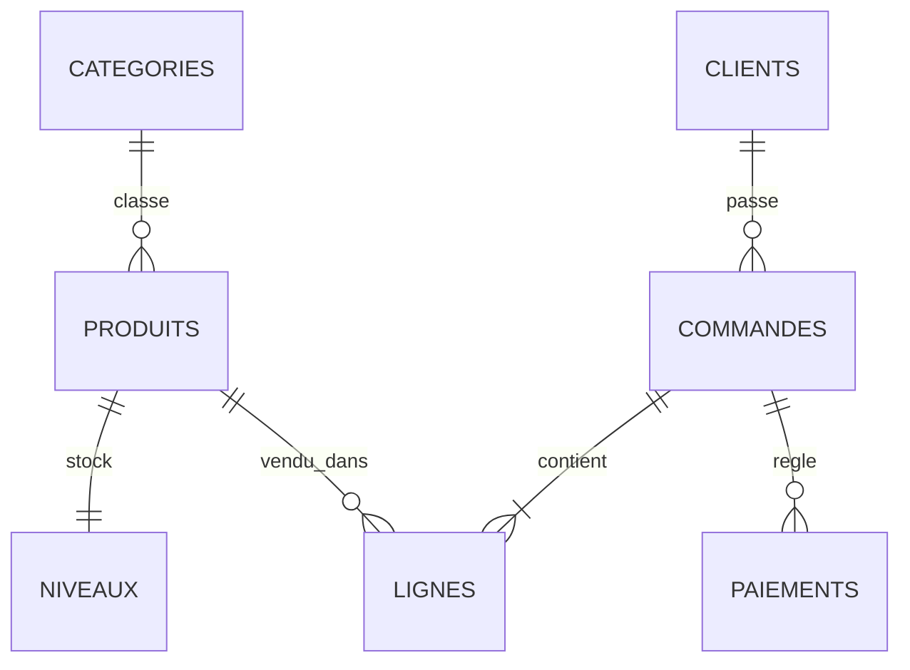
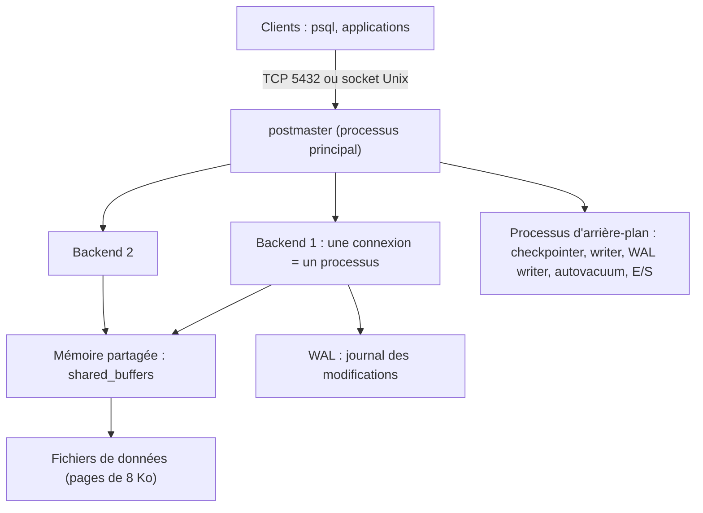
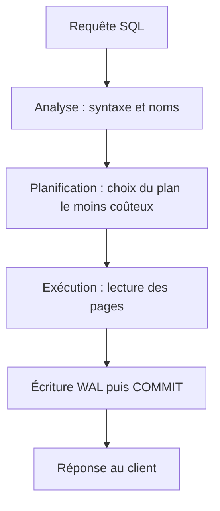

# Bases de données & stockage (PostgreSQL) — Palier 1 : Fondamentaux

*Cours · exercices · projet fil rouge — palier 1 sur 3*

**Durée estimée :** 16 à 22 h · **Prérequis :** Linux à l'aise (terminal, systemd, permissions), notions de Git · **Environnement :** Ubuntu Server 26.04 LTS (PostgreSQL 18 dans l'archive) ou 24.04 LTS (PostgreSQL 18 via le dépôt officiel PGDG, module 2).

## Sommaire

- Où ce cours s'inscrit dans votre parcours
- Mode d'emploi et feuille de route des 3 paliers
- Le projet fil rouge « MonProjet Data »
- Module 0 · Préparer le labo
- Module 1 · Comprendre les bases de données
- Module 2 · Installer et piloter PostgreSQL
- Module 3 · SQL : interroger
- Module 4 · Modéliser
- Module 5 · SQL : écrire et peupler
- Module 6 · Transactions et concurrence
- Module 7 · Index et lecture d'un plan d'exécution
- Module 8 · Sécurité : rôles, authentification, TLS
- Module 9 · Sauvegarde et restauration
- Module 10 · Migrations de schéma
- Module 11 · Accès depuis une application
- Module 12 · Exploitation et dépannage
- Recette finale, évaluation, passerelle vers le palier 2
- Annexes : A aide-mémoire · B scripts de référence · C corrigés

---

## Où ce cours s'inscrit dans votre parcours

Vous savez déjà **opérer** l'infrastructure (Linux, réseau et cloud, conteneurs et Kubernetes), **faire circuler** des données (messagerie et streaming), les **observer** et les **exposer** (observabilité, Nginx). Il manque la brique où les données **vivent et font foi** : la base de données. Un architecte backend y prend ses décisions les plus lourdes de conséquences (modèle, cohérence, volumétrie), un platform engineer y affronte ses opérations les plus délicates (haute disponibilité, sauvegardes, montées de version).

Ordre recommandé pour la suite du parcours :

1. **Bases de données & stockage** (ce cours) : PostgreSQL au centre, puis cache, réplication, haute disponibilité, CDC.
2. **Infrastructure as Code, CI/CD et GitOps** : industrialiser tout ce que vous construisez.
3. **Sécurité et identité cloud-native** : IAM, OIDC, secrets, chaîne d'approvisionnement, politiques en code.
4. **Architecture des systèmes distribués et conception d'API** : DDD, cohérence, sagas, résilience, décisions d'architecture.
5. **SRE et Platform Engineering « produit »** : SLO avancés, gestion d'incidents, plateforme interne, FinOps.

## Mode d'emploi

**À la fin de ce palier, vous saurez :**

- installer, configurer et piloter un serveur PostgreSQL sur Ubuntu ;
- écrire du SQL fiable (lecture, écriture, jointures, agrégations, CTE) ;
- **modéliser** un domaine métier avec clés, contraintes et types adaptés ;
- raisonner sur les **transactions** et la concurrence (isolation, verrous, deadlocks) ;
- créer des **index** utiles et lire un plan d'exécution ;
- sécuriser l'accès (rôles, `pg_hba.conf`, TLS) ;
- **sauvegarder et restaurer**, et prouver que la restauration marche ;
- faire évoluer le schéma par **migrations** sans verrouiller la production ;
- connecter une application proprement et exploiter la base au quotidien.

**Méthode.** Même rythme que les cours précédents : *Objectifs → Cours → Exercices → Jalon du projet → Auto-évaluation*. Avant chaque requête, **prédisez le résultat** ; les corrigés sont en annexe C.

**Légende.** ⚠️ piège · 💡 astuce · 🧩 jalon · ⭐ guidé · ⭐⭐ autonome · ⭐⭐⭐ défi.

**Versions** (début octobre 2026). **PostgreSQL 18** est la version stable de référence (18.6 publiée en août 2026). PostgreSQL 19 est en bêta : sa sortie est attendue à l'automne, ne l'utilisez pas en production avant la version finale et un premier correctif. PostgreSQL 14 ne recevra plus de correctifs après le 12 novembre 2026. Chaque version majeure est supportée 5 ans. Nouveautés de la 18 utilisées ici : `uuidv7()`, colonnes générées virtuelles, `RETURNING OLD/NEW`, sommes de contrôle de pages activées par défaut, authentification MD5 dépréciée.

## Les 3 paliers (plan prévisionnel)

**Palier 1 — Fondamentaux (ce document).** Installer, modéliser, interroger, sécuriser, sauvegarder, migrer, connecter, exploiter.

**Palier 2 — Intermédiaire.**

- Performance : `EXPLAIN` en profondeur, statistiques, index avancés (GIN, GiST, BRIN, partiels, couvrants), `pg_stat_statements`
- Types riches : `jsonb`, tableaux, texte intégral, `pg_trgm`, géométrie légère
- Partitionnement déclaratif, vues matérialisées, fonctions et déclencheurs
- Pool de connexions (PgBouncer), réglage serveur
- Sauvegardes physiques et archivage WAL (introduction au PITR)
- Réplication en flux, répliques de lecture, bascule manuelle
- Redis : cache, files, verrous, expiration, persistance
- Surveillance : `postgres_exporter`, tableaux Grafana, alertes

**Palier 3 — Expert.**

- Internes : MVCC, WAL, checkpoints, `VACUUM`, gonflement, E/S asynchrones
- Haute disponibilité : Patroni, `pgBackRest`, PITR complet, tests de reprise
- Réplication logique et CDC (Debezium vers Kafka), outbox
- Montée en charge : partitionnement à grande échelle, Citus, modèles multi-locataires
- PostgreSQL sur Kubernetes (CloudNativePG), montées de version majeures sans coupure
- Choix polyglotte : recherche, séries temporelles, colonnes, documents ; décisions d'architecture des données

*Ce plan s'ajustera à vos retours à la fin de chaque palier.*

---

## Le projet fil rouge : « MonProjet Data »

Vous construisez, palier après palier, la **couche de données d'une plateforme de commande en ligne** : catalogue, stock, clients, commandes, paiements. Au palier 1, tout tient sur **un serveur PostgreSQL** ; au palier 2, vous la rendez rapide, observée et répliquée ; au palier 3, hautement disponible, restaurable à la seconde près, et branchée sur vos flux de données.



**Cahier des charges du palier 1 :**

1. PostgreSQL 18 installé et piloté ; base `monprojet` en trois schémas : `catalogue`, `stock`, `ventes`.
2. Schéma modélisé avec clés, contraintes et types corrects, **créé par migrations** versionnées dans Git.
3. Jeu de données de volume réaliste (≈ 300 produits, 2 000 clients, 10 000 commandes, ≈ 25 000 lignes).
4. Rôles séparés (migrations, application, lecture seule), `pg_hba.conf` strict, TLS vérifié.
5. Sauvegarde logique **automatisée** (timer systemd) et **test de restauration** automatique.
6. Index justifiés par des plans d'exécution.
7. Script applicatif Python utilisant des requêtes paramétrées et des transactions.
8. Exploitation : journaux utiles, `pg_stat_statements`, runbook.
9. `recette.sh` à 100 % de PASS.

**Arborescence du dépôt `~/monprojet-data` :**

```text
migrations/   V001__schema_initial.sql, V002__…, (suffixe .notx.sql : hors transaction)
sql/          roles.sql, seed.sql, labo.sql
scripts/      migrate.sh, backup.sh, restore-test.sh, app_demo.py
backups/      (ignoré par Git)
recette.sh
```

---

## Module 0 · Préparer le labo

**Objectifs :** une machine prête, un dépôt de travail, des habitudes de départ.

### Cours

**Machine.** Un serveur ou une VM Ubuntu 26.04 ou 24.04 LTS (2 Go de RAM et 10 Go de disque suffisent), avec un utilisateur `sudo`. Les bases de données aiment les disques rapides : en production, SSD/NVMe, système de fichiers `ext4` ou `xfs`, jamais de stockage réseau lent pour les données.

**Outils et dépôt de travail :**

```bash
sudo apt update && sudo apt upgrade -y
sudo apt install -y curl jq git tree python3-venv openssl age
mkdir -p ~/monprojet-data/{migrations,sql,scripts,backups}
cd ~/monprojet-data && git init -q
printf 'backups/\n.venv/\n*.dump\n*.pgpass\n.env\n' > .gitignore
git add -A && git commit -qm "initialisation du dépôt MonProjet Data"
```

**Habitude n°1 : tout ce qui touche au schéma est du code**, donc dans Git ; **les mots de passe, jamais**.

**Habitude n°2 : prédire avant d'exécuter.** Une requête dont on ne sait pas prédire le résultat est une requête qu'on ne comprend pas.

### Check-list de sortie

- [ ] `lsb_release -ds` affiche votre version d'Ubuntu.
- [ ] `git -C ~/monprojet-data log --oneline` affiche un commit.
- [ ] `df -h /var` : au moins 5 Go libres.

---

## Module 1 · Comprendre les bases de données

**Objectifs :** situer PostgreSQL parmi les familles de bases, comprendre ses grands mécanismes (processus, mémoire, journal), poser les mots (ACID, MVCC, WAL).

### Cours

#### 1.1 Les familles de bases de données

- **Relationnelles (SQL)** : tables, relations, contraintes, transactions. PostgreSQL, MySQL/MariaDB, SQL Server, Oracle. Le choix par défaut pour des données métier.
- **Clé-valeur et cache** : Redis, Valkey. Très rapides, structures simples.
- **Documents** : MongoDB, mais aussi `jsonb` dans PostgreSQL.
- **Colonnes / analytique (OLAP)** : ClickHouse, BigQuery. Agrégations sur des milliards de lignes.
- **Séries temporelles**, **recherche** (OpenSearch), **graphes** : cas d'usage spécialisés.
- **Journaux distribués** : Kafka (vu dans votre cours de messagerie) : un journal d'événements, pas un magasin de requêtes.

Règle d'architecte : **commencez par PostgreSQL**, ajoutez un système spécialisé quand une mesure prouve que PostgreSQL ne suffit plus. Ses extensions (`jsonb`, texte intégral, `pg_trgm`, partitionnement…) couvrent une très large part des besoins.

**OLTP contre OLAP.** OLTP : beaucoup de petites transactions (commandes, paiements). OLAP : peu de grosses requêtes d'analyse. Ce cours vise l'OLTP ; l'analytique reviendra au palier 3.

#### 1.2 ACID

- **A**tomicité : une transaction passe entièrement ou pas du tout.
- **C**ohérence : les contraintes sont respectées avant et après.
- **I**solation : des transactions simultanées ne se voient pas à moitié faites (module 6).
- **D**urabilité : une fois validée, une transaction survit à une panne (journal WAL).

Les systèmes distribués posent la question de la **cohérence** à une autre échelle (théorème CAP, modèle PACELC) : une base relationnelle sur un nœud est cohérente et ACID ; dès qu'on la **réplique**, on arbitre entre latence et cohérence (palier 2).

#### 1.3 L'architecture de PostgreSQL



- **Un processus par connexion** : c'est pourquoi on limite `max_connections` et on place un *pooler* (PgBouncer) devant (palier 2).
- **`shared_buffers`** : cache de pages partagé ; le système d'exploitation garde aussi un cache.
- **WAL** (*Write-Ahead Log*) : toute modification est d'abord écrite dans un journal séquentiel, **puis** dans les fichiers de données. À la validation (`COMMIT`), le WAL est forcé sur disque : c'est la **durabilité**. Le WAL sert aussi à la réplication et à la restauration à un instant donné (palier 3).
- **MVCC** : une mise à jour ne modifie pas la ligne, elle en crée une **nouvelle version** ; les lecteurs voient la version qui correspond à leur instantané. Conséquence : lecteurs et écrivains ne se bloquent pas, mais les anciennes versions s'accumulent : le **`VACUUM`** (automatique) les nettoie.
- **Organisation logique** : un **cluster** (une instance, un port) contient des **bases**, qui contiennent des **schémas**, qui contiennent des tables, index, fonctions…

#### 1.4 Le trajet d'une requête



Le **planificateur** décide d'utiliser un index ou de lire toute la table d'après des **statistiques** (lignes, distributions). Statistiques périmées = mauvais plans (modules 7 et 12).

### Exercices

**1.1 ⭐** Pour chacun de ces besoins, choisissez une famille de base et justifiez : panier d'achat temporaire, historique des commandes, moteur de recherche produit, métriques d'un serveur, rapports de ventes sur 5 ans.

**1.2 ⭐** Expliquez pourquoi PostgreSQL peut avoir des lecteurs et des écrivains qui ne se bloquent pas, et quel prix cela a.

### Auto-évaluation

1. Que garantit le WAL, et quand est-il forcé sur disque ?
2. Pourquoi limite-t-on `max_connections` ?
3. Que contient un « cluster » PostgreSQL ?

---

## Module 2 · Installer et piloter PostgreSQL

**Objectifs :** installer PostgreSQL 18, repérer fichiers et service, maîtriser `psql`, configurer en sachant ce qui exige un redémarrage.

### Cours

#### 2.1 Installation

**Ubuntu 26.04 LTS** (PostgreSQL 18 dans l'archive) :

```bash
sudo apt install -y postgresql
```

**Ubuntu 24.04 LTS** (la 16 par défaut) : utilisez le dépôt officiel **PGDG** pour obtenir la 18.

```bash
sudo apt install -y postgresql-common
sudo /usr/share/postgresql-common/pgdg/apt.postgresql.org.sh     # ajoute le dépôt apt.postgresql.org
sudo apt install -y postgresql-18
```

Vérification :

```bash
psql --version
pg_lsclusters            # versions, ports, statut, répertoires
systemctl status postgresql@18-main --no-pager
```

⚠️ Sur Debian et Ubuntu, le paquet crée un **cluster** `main` et démarre le service tout seul. Un système peut héberger plusieurs versions et plusieurs clusters (ports 5432, 5433…) ; les outils `pg_*cluster*` du paquet `postgresql-common` les gèrent.

#### 2.2 Où est quoi

```text
/etc/postgresql/18/main/
├── postgresql.conf       paramètres du serveur
├── pg_hba.conf           qui peut se connecter, d'où, comment
└── pg_ident.conf         correspondances de noms (rare)
/var/lib/postgresql/18/main/     données (jamais à modifier à la main)
/var/log/postgresql/             journaux
/var/run/postgresql/             socket Unix (.s.PGSQL.5432)
```

Service : `postgresql@18-main` (unité systemd par cluster). Utilisateur système : `postgres`.

#### 2.3 `psql`, l'outil du quotidien

```bash
sudo -u postgres psql                  # connexion locale par socket Unix (authentification « peer »)
```

Méta-commandes à connaître (elles commencent par `\`) :

```text
\l            liste des bases           \c base       changer de base
\dn           schémas                   \dt schéma.*  tables
\d+ table     structure détaillée       \du           rôles
\x auto       affichage vertical        \timing       durée des requêtes
\i fichier    exécuter un script        \e            éditer la requête
\copy         import/export (côté client)   \watch 2  répéter toutes les 2 s
\?  et  \h CREATE TABLE      aide psql et aide SQL
```

#### 2.4 Configurer : ce qui exige un redémarrage

Les paramètres vivent dans `postgresql.conf` et `postgresql.auto.conf` (écrit par `ALTER SYSTEM`). Chaque paramètre a un **contexte** :

```sql
SELECT name, setting, unit, context, pending_restart
FROM pg_settings
WHERE name IN ('shared_buffers', 'max_connections', 'work_mem', 'log_min_duration_statement');
```

- `postmaster` : **redémarrage** requis (`shared_buffers`, `max_connections`, `shared_preload_libraries`, `listen_addresses`).
- `sighup` : rechargement suffisant (`SELECT pg_reload_conf();`).
- `user` / `superuser` : modifiable par session (`SET work_mem = '64MB';`).

```sql
ALTER SYSTEM SET log_min_duration_statement = '250ms';   -- écrit dans postgresql.auto.conf
SELECT pg_reload_conf();
SHOW log_min_duration_statement;
```

Après un `ALTER SYSTEM` sur un paramètre `postmaster`, la colonne `pending_restart` passe à `t` jusqu'au redémarrage.

#### 2.5 Créer la base et le premier rôle

```bash
sudo -u postgres psql <<'SQL'
CREATE ROLE monprojet_migrator LOGIN;
\password monprojet_migrator
CREATE DATABASE monprojet OWNER monprojet_migrator;
SQL
```

`\password` demande le mot de passe sans l'afficher ni le laisser dans l'historique. Stockez-le dans `~/.pgpass` (droits `0600`, format `hôte:port:base:rôle:mot_de_passe`) :

```bash
echo '127.0.0.1:5432:monprojet:monprojet_migrator:LE_MOT_DE_PASSE' >> ~/.pgpass
chmod 600 ~/.pgpass
psql -h 127.0.0.1 -U monprojet_migrator -d monprojet -c 'SELECT current_user, version();'
```

La base hérite de l'**encodage** et de la **collation** du cluster (UTF-8 sur Ubuntu). La collation décide de l'ordre de tri et de la comparaison des textes : elle dépend de bibliothèques système (glibc ou ICU). ⚠️ Après une montée de version majeure du système, PostgreSQL peut signaler `collation version mismatch` : les index de texte peuvent être faux tant qu'on ne les a pas reconstruits (`REINDEX`, puis `ALTER DATABASE … REFRESH COLLATION VERSION`).

#### 2.6 Cycle de vie du service

```bash
sudo systemctl restart postgresql@18-main     # coupe les connexions
sudo systemctl reload postgresql@18-main      # recharge la configuration (sighup)
sudo pg_ctlcluster 18 main status
pg_isready                                    # code de retour utilisable en supervision
sudo journalctl -u postgresql@18-main --since "10 min ago"
tail -n 50 /var/log/postgresql/postgresql-18-main.log
```

### Exercices

**2.1 ⭐** Installez PostgreSQL 18, vérifiez `pg_lsclusters`, ouvrez `psql` en tant que `postgres` et listez les bases (`\l`).

**2.2 ⭐** Retrouvez : le fichier de configuration (`SHOW config_file;`), le répertoire des données (`SHOW data_directory;`), le port, `listen_addresses`. Écoute-t-il sur Internet ?

**2.3 ⭐⭐** Pour `shared_buffers`, `max_connections`, `work_mem`, `log_min_duration_statement`, donnez le contexte et dites si un rechargement suffit. Vérifiez en modifiant `log_min_duration_statement` (rechargement) puis `max_connections` (`ALTER SYSTEM`, observez `pending_restart`, puis redémarrez).

**2.4 ⭐⭐** Créez la base et le rôle du § 2.5, connectez-vous par TCP avec `.pgpass`. Que se passe-t-il si `.pgpass` a les droits `0644` ?

**2.5 ⭐⭐⭐** Créez volontairement un second cluster (`sudo pg_createcluster 18 labo --start`) : quel port reçoit-il ? Comment s'y connecter ? Supprimez-le (`sudo pg_dropcluster 18 labo --stop`).

### 🧩 Jalon 1 : PostgreSQL installé, base créée, configuration versionnée

```bash
# versionner la configuration du serveur (comme /etc/nginx dans votre cours Nginx)
sudo git -C /etc/postgresql init -q
echo "alias pgit='sudo git -C /etc/postgresql -c user.name=ops -c user.email=ops@localhost'" >> ~/.bashrc
source ~/.bashrc
pgit add -A && pgit commit -qm "baseline : configuration PostgreSQL d'origine"
```

Dans `~/monprojet-data`, notez dans un fichier `RUNBOOK.md` : version, chemins, commande de connexion, où est la sauvegarde (à venir).

```bash
cd ~/monprojet-data && git add -A && git commit -qm "jalon 1 : PostgreSQL installé"
```

### Auto-évaluation

1. Quelle différence entre `pg_reload_conf()` et un redémarrage, et comment savoir lequel est nécessaire ?
2. Pourquoi `.pgpass` doit-il avoir les droits `0600` ?
3. Qu'est-ce que la collation, et pourquoi une mise à jour du système peut-elle la rendre problématique ?

---

## Module 3 · SQL : interroger

**Objectifs :** lire et filtrer des données, comprendre `NULL`, joindre, agréger, composer avec des CTE.

### Cours

#### 3.1 Un petit jeu de données de labo

Pour s'entraîner sans toucher au projet, créez un schéma `labo` (qu'on supprimera au module 5) :

```bash
cat > ~/monprojet-data/pg-env.sh <<'SH'
export PGHOST=127.0.0.1 PGUSER=monprojet_migrator PGDATABASE=monprojet
SH
echo 'source ~/monprojet-data/pg-env.sh' >> ~/.bashrc && source ~/.bashrc

cat > ~/monprojet-data/sql/labo.sql <<'SQL'
DROP SCHEMA IF EXISTS labo CASCADE;
CREATE SCHEMA labo;

CREATE TABLE labo.produits (
  id int PRIMARY KEY, nom text NOT NULL, categorie text, prix numeric(10,2) NOT NULL);
CREATE TABLE labo.clients (
  id int PRIMARY KEY, nom text NOT NULL, ville text);
CREATE TABLE labo.commandes (
  id int PRIMARY KEY, client_id int NOT NULL REFERENCES labo.clients, date date NOT NULL);
CREATE TABLE labo.lignes (
  commande_id int REFERENCES labo.commandes, produit_id int REFERENCES labo.produits,
  quantite int NOT NULL, PRIMARY KEY (commande_id, produit_id));

INSERT INTO labo.produits VALUES
 (1,'Clavier mécanique','périphériques',89.90), (2,'Souris sans fil','périphériques',24.50),
 (3,'Écran 27 pouces','écrans',229.00),        (4,'Câble HDMI 2 m','câbles',9.90),
 (5,'Webcam HD','périphériques',45.00),        (6,'Hub USB-C','câbles',34.90),
 (7,'Support laptop',NULL,39.00);
INSERT INTO labo.clients VALUES
 (1,'Alice','Paris'), (2,'Bruno','Lyon'), (3,'Chloé','Paris'), (4,'David',NULL), (5,'Emma','Nantes');
INSERT INTO labo.commandes VALUES
 (1,1,'2026-01-05'), (2,1,'2026-02-11'), (3,2,'2026-02-14'), (4,3,'2026-03-02'),
 (5,3,'2026-03-20'), (6,3,'2026-04-08'), (7,4,'2026-04-09');
INSERT INTO labo.lignes VALUES
 (1,1,1),(1,2,1), (2,3,1), (3,4,3),(3,6,1), (4,1,1),(4,5,2),
 (5,2,2),(5,4,1), (6,3,2),(6,6,1), (7,7,1),(7,2,1);
SQL
psql -v ON_ERROR_STOP=1 -f ~/monprojet-data/sql/labo.sql
```

#### 3.2 Lire : `SELECT`, filtrer, trier

```sql
SELECT nom, prix FROM labo.produits WHERE prix BETWEEN 20 AND 100 ORDER BY prix DESC LIMIT 3;
SELECT DISTINCT categorie FROM labo.produits;
SELECT nom, prix * 1.2 AS prix_ttc FROM labo.produits WHERE nom ILIKE '%souris%';
SELECT * FROM labo.produits WHERE id IN (1, 3, 5);
```

Ordre logique d'exécution (≠ ordre d'écriture) : `FROM` → `WHERE` → `GROUP BY` → `HAVING` → `SELECT` → `ORDER BY` → `LIMIT`. C'est pourquoi un alias défini dans `SELECT` n'est pas utilisable dans `WHERE`.

**Pagination.** `LIMIT 20 OFFSET 40` relit et jette 40 lignes : de plus en plus lent. Préférez la **pagination par clé** : `WHERE id > :dernier_id ORDER BY id LIMIT 20` (l'index fait le travail).

#### 3.3 `NULL` : la logique à trois valeurs

`NULL` signifie « inconnu », pas « vide » ni « zéro ». Toute comparaison avec `NULL` donne `NULL` (ni vrai ni faux) :

```sql
SELECT * FROM labo.produits WHERE categorie = NULL;        -- aucune ligne ! (NULL, pas vrai)
SELECT * FROM labo.produits WHERE categorie IS NULL;       -- le produit 7
SELECT COALESCE(categorie, 'sans catégorie') FROM labo.produits;
SELECT count(*), count(categorie) FROM labo.produits;      -- 7 et 6 : count(colonne) ignore NULL
```

⚠️ **Piège de `NOT IN`** : `WHERE categorie NOT IN ('écrans', NULL)` ne renvoie **rien**, car `x <> NULL` est inconnu. Avec une sous-requête susceptible de renvoyer `NULL`, utilisez `NOT EXISTS`.

#### 3.4 Jointures

```sql
-- INNER JOIN : seulement les correspondances
SELECT c.id AS commande, cl.nom
FROM labo.commandes c JOIN labo.clients cl ON cl.id = c.client_id;

-- LEFT JOIN : tous les clients, même sans commande
SELECT cl.nom, count(c.id) AS nb_commandes
FROM labo.clients cl LEFT JOIN labo.commandes c ON c.client_id = cl.id
GROUP BY cl.nom ORDER BY nb_commandes DESC;

-- « anti-jointure » : les clients sans commande
SELECT cl.nom FROM labo.clients cl
WHERE NOT EXISTS (SELECT 1 FROM labo.commandes c WHERE c.client_id = cl.id);
```

`INNER` ne garde que les paires qui correspondent ; `LEFT` garde tout le côté gauche et met `NULL` à droite quand rien ne correspond. Joindre sur des clés **indexées** est ce qui rend les requêtes rapides (module 7).

#### 3.5 Agréger : `GROUP BY` et `HAVING`

```sql
SELECT c.id AS commande, sum(l.quantite * p.prix) AS total
FROM labo.commandes c
JOIN labo.lignes   l ON l.commande_id = c.id
JOIN labo.produits p ON p.id = l.produit_id
GROUP BY c.id
HAVING sum(l.quantite * p.prix) > 100
ORDER BY c.id;
```

`WHERE` filtre les **lignes** avant le regroupement ; `HAVING` filtre les **groupes** après. Toute colonne du `SELECT` doit être dans le `GROUP BY` ou dans une fonction d'agrégat (`sum`, `count`, `avg`, `min`, `max`, `array_agg`, `string_agg`).

#### 3.6 Sous-requêtes et CTE (`WITH`)

Une **CTE** nomme une étape intermédiaire et rend la requête lisible :

```sql
WITH totaux AS (
  SELECT c.id, c.client_id, sum(l.quantite * p.prix) AS total
  FROM labo.commandes c
  JOIN labo.lignes l ON l.commande_id = c.id
  JOIN labo.produits p ON p.id = l.produit_id
  GROUP BY c.id, c.client_id
)
SELECT cl.nom, sum(t.total) AS chiffre_affaires
FROM totaux t JOIN labo.clients cl ON cl.id = t.client_id
GROUP BY cl.nom ORDER BY chiffre_affaires DESC;
```

Depuis PostgreSQL 12, une CTE simple est « inlinée » par le planificateur (elle n'est plus une barrière d'optimisation). On peut forcer le comportement avec `WITH x AS MATERIALIZED (…)` ou `NOT MATERIALIZED`.

#### 3.7 Dates et opérations ensemblistes

```sql
SELECT date_trunc('month', date) AS mois, count(*) FROM labo.commandes GROUP BY 1 ORDER BY 1;
SELECT date, date + 30 AS echeance, age(current_date, date) FROM labo.commandes LIMIT 3;
SELECT nom FROM labo.clients UNION SELECT nom FROM labo.produits;      -- UNION ALL garde les doublons
```

### Exercices

**3.1 ⭐** Quels produits coûtent moins de 40 € ? Triez par prix croissant. Combien en reste-t-il si vous ajoutez `categorie <> 'câbles'` ? Le produit 7 apparaît-il ? Pourquoi ?

**3.2 ⭐** Total (quantité × prix) de **chaque commande**. Prédisez d'abord le total de la commande 6.

**3.3 ⭐⭐** Chiffre d'affaires **par client**, y compris ceux sans commande (avec `0`). Quel client n'a rien acheté ?

**3.4 ⭐⭐** Les produits **jamais commandés** (le jeu fourni n'en contient aucun : ajoutez d'abord un produit 8 pour tester). Écrivez-le de deux façons : `LEFT JOIN … IS NULL` et `NOT EXISTS`.

**3.5 ⭐⭐** Reproduisez le piège de `NOT IN` avec `NULL`, expliquez, corrigez.

**3.6 ⭐⭐⭐** Produit **le plus vendu en quantité** par catégorie (indice : `GROUP BY` + `ORDER BY` + `DISTINCT ON`, ou une fonction de fenêtre au module 5).

### 🧩 Jalon 2 : le carnet de requêtes

Enregistrez vos requêtes réussies dans `sql/requetes-labo.sql`, avec en commentaire le résultat attendu.

```bash
cd ~/monprojet-data && git add -A && git commit -qm "jalon 2 : jeu de labo et requêtes de lecture"
```

### Auto-évaluation

1. Pourquoi `WHERE x = NULL` ne renvoie-t-il jamais rien ?
2. Différence entre `WHERE` et `HAVING` ?
3. Pourquoi préférer la pagination par clé à `OFFSET` ?

---

## Module 4 · Modéliser

**Objectifs :** concevoir un schéma relationnel solide : normalisation, clés, types, contraintes ; écrire le schéma du projet.

### Cours

#### 4.1 Pourquoi modéliser en premier

Le modèle est la décision **la plus difficile à changer** d'un système : le code se réécrit, les données migrent avec peine. Les contraintes de la base sont aussi votre **dernière ligne de défense** : une application peut avoir un bug, une base qui refuse l'incohérence protège les données même contre vos propres erreurs.

#### 4.2 La normalisation, par l'exemple

Une table « plate » :

```text
commandes_plates(commande, client_nom, client_email, produit_nom, prix, quantite)
```

souffre d'**anomalies** : changer l'e-mail d'un client oblige à modifier toutes ses lignes (**mise à jour**) ; impossible d'enregistrer un client sans commande (**insertion**) ; supprimer la dernière commande efface le client (**suppression**).

- **1FN** : des valeurs atomiques (pas de listes dans une colonne), une clé.
- **2FN** : chaque attribut dépend de **toute** la clé (pas d'une partie).
- **3FN** : chaque attribut dépend **uniquement de la clé** (pas d'un autre attribut non-clé).

Règle pratique : « un fait, un seul endroit ». On sépare `clients`, `produits`, `commandes`, `lignes`. On **dénormalise** ensuite, consciemment, quand une mesure l'exige (modèles de lecture, palier 2).

⚠️ Un fait historique n'est pas de la redondance : le **prix au moment de la vente** (`lignes.prix_unitaire_ht`) doit être **copié** et figé, sinon changer le prix d'un produit réécrirait vos factures passées.

#### 4.3 Clés primaires : naturelle, séquentielle ou UUID

- **Clé naturelle** (SKU, e-mail) : porteuse de sens, mais elle **change** parfois. À garder en `UNIQUE`, pas en clé primaire.
- **Entier à identité** : `bigint GENERATED ALWAYS AS IDENTITY`. Compact (8 octets), ordonné, mais prévisible (énumération possible) et difficile à générer hors base.
- **UUID** : générable partout (clients, services), non prévisible. L'ancien `uuidv4` (aléatoire) disperse les insertions dans l'index : mauvaise localité. **`uuidv7()`** (PostgreSQL 18) est **ordonné dans le temps** : bonne localité d'index, et l'horodatage s'extrait (`uuid_extract_timestamp`). Coût : 16 octets, et l'identifiant révèle l'instant de création.

Choix du projet : `uuidv7()` pour les entités exposées (produits, clients, commandes, paiements), `bigint` identité pour les tables internes (catégories) et le numéro de commande lisible.

#### 4.4 Types : les bons réflexes

- **Texte** : `text` (sans limite artificielle ; en PostgreSQL `varchar(n)` n'est pas plus rapide). Une longueur se contrôle par `CHECK`.
- **Argent** : **`numeric(12,2)`**, **jamais** `float` (`0.1 + 0.2 ≠ 0.3`). Décidez la monnaie et l'arrondi, et stockez les montants dans l'unité qui convient.
- **Temps** : **`timestamptz`** (un instant absolu, stocké en UTC, affiché selon `TimeZone`). `timestamp` sans fuseau est une source de bugs.
- **Entiers** : `integer`, `bigint` ; `boolean` ; `date` ; `uuid`.
- **Énumérations** : trois options : type `ENUM` (strict mais modifier est pénible), table de référence (flexible, avec clé étrangère), ou `text` + `CHECK` (simple et facile à migrer : notre choix).
- **`jsonb`** : pour des données réellement semi-structurées (palier 2) ; pas pour éviter de modéliser.

#### 4.5 Contraintes : la base garantit l'intégrité

- `NOT NULL` : par défaut sur tout ce qui est obligatoire.
- `PRIMARY KEY`, `UNIQUE` (peut être un **index unique d'expression** : `lower(email)`).
- `CHECK` : règles de valeur (`quantite > 0`, `statut IN (…)`).
- `FOREIGN KEY` : intégrité référentielle, avec comportement : `NO ACTION` (défaut), `RESTRICT`, `CASCADE`, `SET NULL`. ⚠️ Une clé étrangère **n'est pas indexée automatiquement** (module 7).
- PostgreSQL 18 ajoute les **contraintes temporelles** (`WITHOUT OVERLAPS`, `PERIOD`) pour empêcher les chevauchements de périodes.

#### 4.6 Schémas et nommage

Les **schémas** sont des espaces de noms et des périmètres de droits. Nous en utilisons trois : `catalogue`, `stock`, `ventes`. Convention : `snake_case`, noms explicites, tables au pluriel, colonnes `cree_le` / `maj_le`. Dans les scripts, **qualifiez** toujours les noms (`ventes.commandes`) : le `search_path` est une source d'ambiguïtés (et de failles).

#### 4.7 Le schéma du projet (migration V001)

```bash
cat > ~/monprojet-data/migrations/V001__schema_initial.sql <<'SQL'
-- V001 : schéma initial de MonProjet Data
CREATE SCHEMA catalogue;
CREATE SCHEMA stock;
CREATE SCHEMA ventes;
CREATE SCHEMA util;

CREATE FUNCTION util.set_maj_le() RETURNS trigger LANGUAGE plpgsql AS $$
BEGIN
  NEW.maj_le := now();
  RETURN NEW;
END $$;

CREATE TABLE catalogue.categories (
  id        bigint GENERATED ALWAYS AS IDENTITY PRIMARY KEY,
  nom       text NOT NULL UNIQUE,
  parent_id bigint REFERENCES catalogue.categories (id)
);

CREATE TABLE catalogue.produits (
  id           uuid PRIMARY KEY DEFAULT uuidv7(),
  sku          text NOT NULL UNIQUE CHECK (sku ~ '^[A-Z0-9-]{3,32}$'),
  nom          text NOT NULL CHECK (length(nom) > 0),
  description  text,
  prix_ht      numeric(12,2) NOT NULL CHECK (prix_ht >= 0),
  taux_tva     numeric(5,4)  NOT NULL DEFAULT 0.2000 CHECK (taux_tva BETWEEN 0 AND 1),
  actif        boolean NOT NULL DEFAULT true,
  categorie_id bigint REFERENCES catalogue.categories (id),
  cree_le      timestamptz NOT NULL DEFAULT now(),
  maj_le       timestamptz NOT NULL DEFAULT now()
);

CREATE TABLE stock.niveaux (
  produit_id uuid PRIMARY KEY REFERENCES catalogue.produits (id) ON DELETE CASCADE,
  quantite   integer NOT NULL DEFAULT 0 CHECK (quantite >= 0),
  maj_le     timestamptz NOT NULL DEFAULT now()
);

CREATE TABLE ventes.clients (
  id      uuid PRIMARY KEY DEFAULT uuidv7(),
  email   text NOT NULL,
  nom     text NOT NULL,
  cree_le timestamptz NOT NULL DEFAULT now()
);
CREATE UNIQUE INDEX clients_email_unique ON ventes.clients (lower(email));

CREATE TABLE ventes.commandes (
  id        uuid PRIMARY KEY DEFAULT uuidv7(),
  numero    bigint GENERATED ALWAYS AS IDENTITY UNIQUE,
  client_id uuid NOT NULL REFERENCES ventes.clients (id),
  statut    text NOT NULL DEFAULT 'brouillon'
            CHECK (statut IN ('brouillon','payee','expediee','livree','annulee')),
  cree_le   timestamptz NOT NULL DEFAULT now(),
  maj_le    timestamptz NOT NULL DEFAULT now()
);

CREATE TABLE ventes.lignes (
  commande_id      uuid    NOT NULL REFERENCES ventes.commandes (id) ON DELETE CASCADE,
  numero_ligne     integer NOT NULL CHECK (numero_ligne > 0),
  produit_id       uuid    NOT NULL REFERENCES catalogue.produits (id),
  quantite         integer NOT NULL CHECK (quantite > 0),
  prix_unitaire_ht numeric(12,2) NOT NULL CHECK (prix_unitaire_ht >= 0),   -- prix FIGÉ à la vente
  taux_tva         numeric(5,4)  NOT NULL CHECK (taux_tva BETWEEN 0 AND 1),
  total_ht         numeric(14,2) GENERATED ALWAYS AS (quantite * prix_unitaire_ht) VIRTUAL,
  PRIMARY KEY (commande_id, numero_ligne)
);

CREATE TABLE ventes.paiements (
  id                uuid PRIMARY KEY DEFAULT uuidv7(),
  commande_id       uuid NOT NULL REFERENCES ventes.commandes (id),
  montant           numeric(12,2) NOT NULL CHECK (montant > 0),
  methode           text NOT NULL CHECK (methode IN ('carte','virement','mobile_money')),
  statut            text NOT NULL DEFAULT 'en_attente'
                    CHECK (statut IN ('en_attente','reussi','echoue')),
  reference_externe text,
  cree_le           timestamptz NOT NULL DEFAULT now()
);

CREATE TRIGGER trg_produits_maj  BEFORE UPDATE ON catalogue.produits
  FOR EACH ROW EXECUTE FUNCTION util.set_maj_le();
CREATE TRIGGER trg_niveaux_maj   BEFORE UPDATE ON stock.niveaux
  FOR EACH ROW EXECUTE FUNCTION util.set_maj_le();
CREATE TRIGGER trg_commandes_maj BEFORE UPDATE ON ventes.commandes
  FOR EACH ROW EXECUTE FUNCTION util.set_maj_le();
SQL
psql -v ON_ERROR_STOP=1 --single-transaction -f ~/monprojet-data/migrations/V001__schema_initial.sql
psql -c '\dt *.*' | grep -E 'catalogue|stock|ventes'
```

Un `CREATE` dans une transaction qui échoue est **annulé en bloc** : PostgreSQL a des **DDL transactionnels**, un atout rare qu'on exploite pour les migrations (module 10).

Une colonne générée **virtuelle** (`total_ht`, défaut en 18) est calculée à la lecture et ne prend pas de place ; une colonne `STORED` est écrite et peut être indexée.

#### 4.8 Checklist de revue d'un modèle

- Chaque table a une clé primaire. Chaque relation a sa clé étrangère.
- Aucun `float` pour l'argent ; aucun `timestamp` sans fuseau.
- Chaque règle métier simple est un `CHECK` ou un `UNIQUE`, pas seulement du code applicatif.
- Les faits historiques sont figés (prix, adresse de livraison).
- Les colonnes nullables le sont **par décision**, pas par paresse.
- Les noms sont cohérents et qualifiés par schéma.

### Exercices

**4.1 ⭐** Normalisez sur papier `commandes_plates` en tables 3FN. Quelles anomalies disparaissent ?

**4.2 ⭐** Appliquez V001. Avec `\d+ ventes.lignes`, repérez la clé primaire composite, les `CHECK`, la colonne virtuelle.

**4.3 ⭐⭐** Provoquez et lisez les erreurs : une ligne avec `quantite = 0`, un niveau de stock `-1`, deux clients `A@x.com` et `a@x.com`, une commande pour un client inexistant. Quelle contrainte protège chaque cas ?

**4.4 ⭐⭐** Générez cinq `uuidv7()` puis cinq `gen_random_uuid()` : lesquels sont triés dans l'ordre de création ? Extrayez l'horodatage : `SELECT uuid_extract_timestamp(uuidv7());`.

**4.5 ⭐⭐⭐** Ajoutez au modèle (sur papier, puis en SQL dans `sql/propositions.sql`) : des **adresses de livraison** (un client en a plusieurs, la commande en fige une) et des **avis produits** (une note de 1 à 5, un seul avis par client et produit). Quelles contraintes ?

### 🧩 Jalon 3 : le schéma est dans Git

```bash
cd ~/monprojet-data && git add -A && git commit -qm "jalon 3 : migration V001, schéma initial"
```

### Auto-évaluation

1. Pourquoi stocker le prix unitaire dans `lignes` alors qu'il existe dans `produits` ?
2. Pourquoi `numeric(12,2)` et pas `float` pour l'argent ?
3. Quel avantage d'un `uuidv7()` sur un `uuid` aléatoire pour un index ?

---

## Module 5 · SQL : écrire et peupler

**Objectifs :** insérer, modifier, supprimer, fusionner ; exploiter `RETURNING` ; charger un jeu de données réaliste ; découvrir les fonctions de fenêtre.

### Cours

#### 5.1 Insérer

```sql
INSERT INTO catalogue.categories (nom) VALUES ('Test A'), ('Test B');          -- plusieurs lignes
INSERT INTO labo.clients (id, nom) SELECT 100 + i, 'Client ' || i FROM generate_series(1, 3) i;
INSERT INTO ventes.clients (email, nom) VALUES ('x@exemple.test', 'X')
RETURNING id, cree_le;                                                          -- récupère ce que la base a généré
```

**`RETURNING`** renvoie les lignes touchées (identifiants, valeurs par défaut) **en une seule requête** : indispensable, plus sûr et plus rapide qu'un second `SELECT`.

#### 5.2 `ON CONFLICT` : l'insertion idempotente

```sql
INSERT INTO ventes.clients (email, nom) VALUES ('client1@exemple.test', 'Nouveau nom')
ON CONFLICT ((lower(email))) DO UPDATE SET nom = EXCLUDED.nom
RETURNING id, nom;

INSERT INTO ventes.clients (email, nom) VALUES ('client1@exemple.test', 'Autre')
ON CONFLICT DO NOTHING;                                                         -- ignore silencieusement
```

La cible de conflit désigne la contrainte ou l'index unique ; pour un index d'**expression** elle s'écrit entre doubles parenthèses. `EXCLUDED` désigne la ligne qu'on tentait d'insérer. C'est la brique des opérations **rejouables** (imports, webhooks, paiements).

#### 5.3 Modifier et supprimer

```sql
UPDATE catalogue.produits SET prix_ht = round(prix_ht * 1.10, 2)
WHERE categorie_id = 3
RETURNING sku, OLD.prix_ht AS ancien, NEW.prix_ht AS nouveau, NEW.maj_le;       -- OLD/NEW : PostgreSQL 18

DELETE FROM ventes.lignes l USING ventes.commandes c
WHERE l.commande_id = c.id AND c.statut = 'annulee';                            -- suppression avec jointure
```

⚠️ **Un `UPDATE` ou `DELETE` sans `WHERE` touche toute la table.** Réflexe : écrivez d'abord le `SELECT` avec le même `WHERE`, vérifiez le nombre de lignes, ou travaillez dans `BEGIN; … ROLLBACK;`. `TRUNCATE table RESTART IDENTITY CASCADE` vide une table instantanément (et ses dépendantes).

#### 5.4 `MERGE` : réconcilier en une instruction

```sql
CREATE TEMP TABLE reappro (sku text, quantite int);
INSERT INTO reappro VALUES ('SKU-00001', 50), ('SKU-00002', 20);

MERGE INTO stock.niveaux n
USING (SELECT p.id AS produit_id, r.quantite
       FROM reappro r JOIN catalogue.produits p USING (sku)) s
ON n.produit_id = s.produit_id
WHEN MATCHED THEN UPDATE SET quantite = n.quantite + s.quantite
RETURNING merge_action(), n.produit_id, n.quantite;
```

`MERGE` combine `INSERT` / `UPDATE` / `DELETE` selon la correspondance (`WHEN MATCHED`, `WHEN NOT MATCHED`) ; `merge_action()` indique ce qui a été fait.

#### 5.5 Importer et exporter avec `COPY`

```bash
psql -c "\copy (SELECT sku, nom, prix_ht FROM catalogue.produits ORDER BY sku LIMIT 10) TO '/tmp/produits.csv' CSV HEADER"
head -3 /tmp/produits.csv
```

`\copy` (de `psql`) lit et écrit **côté client** : pas besoin de droits sur le serveur. `COPY` (SQL) lit côté serveur et exige des droits privilégiés. Pour de gros volumes, c'est **de loin** le moyen le plus rapide d'insérer.

#### 5.6 Peupler le projet : le jeu de données

```bash
cat > ~/monprojet-data/sql/seed.sql <<'SQL'
-- jeu de données de labo : à rejouer sur une base dont le schéma est vide de données
BEGIN;

INSERT INTO catalogue.categories (nom) VALUES
  ('Périphériques'), ('Écrans'), ('Câbles'), ('Audio'), ('Réseau'), ('Accessoires');

INSERT INTO catalogue.produits (sku, nom, prix_ht, categorie_id)
SELECT 'SKU-' || lpad(i::text, 5, '0'), 'Produit ' || i,
       round((5 + random() * 495)::numeric, 2), 1 + (i % 6)
FROM generate_series(1, 300) AS i;

INSERT INTO stock.niveaux (produit_id, quantite)
SELECT id, (abs(hashtext(id::text)::bigint) % 200)::int FROM catalogue.produits;

INSERT INTO ventes.clients (email, nom)
SELECT 'client' || i || '@exemple.test', 'Client ' || i FROM generate_series(1, 2000) AS i;

WITH c AS (SELECT array_agg(id) AS ids FROM ventes.clients)
INSERT INTO ventes.commandes (client_id, statut, cree_le)
SELECT c.ids[1 + floor(random() * cardinality(c.ids))::int],
       (ARRAY['brouillon','payee','expediee','livree','annulee'])[1 + floor(random() * 5)::int],
       now() - make_interval(days => (random() * 365)::int)
FROM c, generate_series(1, 10000);

INSERT INTO ventes.lignes (commande_id, numero_ligne, produit_id, quantite, prix_unitaire_ht, taux_tva)
SELECT x.id, x.n, p.id, x.q, p.prix_ht, p.taux_tva
FROM (
  SELECT o.id, n,
         1 + (abs(hashtext(o.id::text || n::text)::bigint) % 300)::int AS rn,
         1 + (abs(hashtext('q' || o.id::text || n::text)::bigint) % 5)::int AS q
  FROM ventes.commandes o
  CROSS JOIN LATERAL generate_series(1, 1 + (abs(hashtext(o.id::text)::bigint) % 4)::int) AS n
) x
JOIN (SELECT row_number() OVER (ORDER BY sku) AS rn, id, prix_ht, taux_tva
      FROM catalogue.produits) p USING (rn);

INSERT INTO ventes.paiements (commande_id, montant, methode, statut)
SELECT c.id,
       round(sum(l.quantite * l.prix_unitaire_ht * (1 + l.taux_tva)), 2),
       (ARRAY['carte','virement','mobile_money'])[1 + (abs(hashtext(c.id::text)::bigint) % 3)::int],
       'reussi'
FROM ventes.commandes c JOIN ventes.lignes l ON l.commande_id = c.id
WHERE c.statut IN ('payee','expediee','livree')
GROUP BY c.id;

COMMIT;
ANALYZE;
SQL
time psql -v ON_ERROR_STOP=1 -f ~/monprojet-data/sql/seed.sql
psql -c "SELECT 'produits' t, count(*) FROM catalogue.produits UNION ALL SELECT 'clients', count(*) FROM ventes.clients UNION ALL SELECT 'commandes', count(*) FROM ventes.commandes UNION ALL SELECT 'lignes', count(*) FROM ventes.lignes UNION ALL SELECT 'paiements', count(*) FROM ventes.paiements"
```

`hashtext()` est une fonction interne non documentée : suffisante pour produire des valeurs pseudo-aléatoires **déterministes par ligne** dans un jeu de labo. Les `random()` se réévaluent à chaque ligne, d'où les sélections variées. `ANALYZE` met à jour les statistiques du planificateur : toujours après un gros chargement.

#### 5.7 Fonctions de fenêtre : calculer sans écraser les lignes

Un agrégat (`GROUP BY`) **réduit** les lignes ; une fonction de fenêtre calcule sur un ensemble de lignes **en les gardant**.

```sql
-- top 3 des produits par chiffre d'affaires dans chaque catégorie
WITH ca AS (
  SELECT p.categorie_id, p.sku, sum(l.total_ht) AS ca_ht
  FROM ventes.lignes l JOIN catalogue.produits p ON p.id = l.produit_id
  GROUP BY p.categorie_id, p.sku
)
SELECT * FROM (
  SELECT categorie_id, sku, ca_ht,
         row_number() OVER (PARTITION BY categorie_id ORDER BY ca_ht DESC) AS rang
  FROM ca
) t WHERE rang <= 3 ORDER BY categorie_id, rang;

-- cumul mensuel du nombre de commandes
SELECT date_trunc('month', cree_le) AS mois, count(*) AS commandes,
       sum(count(*)) OVER (ORDER BY date_trunc('month', cree_le)) AS cumul
FROM ventes.commandes GROUP BY 1 ORDER BY 1;
```

Autres fonctions utiles : `rank()`, `dense_rank()`, `lag()`, `lead()`, `ntile()`, `avg() OVER (… ROWS BETWEEN 6 PRECEDING AND CURRENT ROW)` (moyenne glissante).

### Exercices

**5.1 ⭐** Chargez le jeu de données et vérifiez les ordres de grandeur : 300 produits, 2 000 clients, 10 000 commandes, environ 25 000 lignes, environ 6 000 paiements. Pourquoi pas exactement les mêmes chiffres qu'un voisin ?

**5.2 ⭐** Augmentez de 10 % les produits de la catégorie 3 avec `RETURNING OLD/NEW`. Que devient `maj_le` ? Quel mécanisme du module 4 l'a mis à jour ?

**5.3 ⭐⭐** Insérez un client existant (même e-mail, casse différente) avec `ON CONFLICT` : une fois en mise à jour, une fois en `DO NOTHING`. Vérifiez qu'aucun doublon n'apparaît.

**5.4 ⭐⭐** Réapprovisionnez trois produits avec `MERGE` en une seule instruction. Écrivez ensuite la même opération en `UPDATE … FROM`. Laquelle préférez-vous, pourquoi ?

**5.5 ⭐⭐** Pour chaque mois, le chiffre d'affaires TTC des commandes payées, expédiées ou livrées et sa **variation par rapport au mois précédent** (`lag()`).

**5.6 ⭐⭐⭐** Exportez le chiffre d'affaires mensuel en CSV avec `\copy`, créez une table `labo.ca_mensuel` puis réimportez le fichier. Comparez le temps d'un `COPY` de 100 000 lignes et de 100 000 `INSERT` séparés (boucle `psql`).

### 🧩 Jalon 4 : un jeu de données reproductible

```bash
cd ~/monprojet-data && git add -A && git commit -qm "jalon 4 : seed.sql et exercices d'écriture"
```

### Auto-évaluation

1. Pourquoi `RETURNING` vaut-il mieux qu'un `INSERT` suivi d'un `SELECT` ?
2. Comment écrire un `INSERT` rejouable sans créer de doublon ?
3. Quelle différence entre un agrégat et une fonction de fenêtre ?

---

## Module 6 · Transactions et concurrence

**Objectifs :** raisonner sur ce qui se passe quand deux sessions agissent en même temps ; choisir un niveau d'isolation ; poser des verrous utiles ; prévenir et gérer les deadlocks.

### Cours

#### 6.1 Les transactions

Hors transaction, chaque instruction est validée seule (**autocommit**). Une transaction regroupe plusieurs instructions en un tout :

```sql
BEGIN;
UPDATE stock.niveaux SET quantite = quantite - 5
 WHERE produit_id = (SELECT id FROM catalogue.produits WHERE sku = 'SKU-00001');
SAVEPOINT avant_risque;
UPDATE stock.niveaux SET quantite = -1;          -- viole le CHECK
ROLLBACK TO avant_risque;                        -- annule seulement ce qui suit le point de sauvegarde
COMMIT;
```

Après une erreur, la transaction est **avortée** (`current transaction is aborted, commands ignored until end of transaction block`) : il faut `ROLLBACK` (ou `ROLLBACK TO` un `SAVEPOINT`). Le **DDL est transactionnel** : un `CREATE TABLE` annulé disparaît.

#### 6.2 Les niveaux d'isolation

Deux sessions voient-elles les modifications l'une de l'autre ? Cela dépend du niveau :

- **`READ COMMITTED`** (défaut) : chaque **instruction** voit les données validées au moment où elle démarre.
- **`REPEATABLE READ`** : toute la **transaction** voit un instantané figé au premier ordre. Si elle tente de modifier une ligne changée entre-temps : `could not serialize access due to concurrent update`.
- **`SERIALIZABLE`** : le résultat équivaut à un enchaînement séquentiel ; PostgreSQL détecte les conflits subtils et **avorte** l'une des transactions (code `40001`) : l'application doit **réessayer**.

PostgreSQL n'autorise pas la lecture de données non validées (*dirty read*) : `READ UNCOMMITTED` se comporte comme `READ COMMITTED`.

Anomalies à connaître : **lecture non répétable** (relire donne autre chose), **fantôme** (de nouvelles lignes apparaissent dans un même filtre), **mise à jour perdue** (deux lectures-puis-écritures s'écrasent), **write skew** (deux transactions valident chacune une règle sur des lignes différentes, et ensemble la violent).

#### 6.3 Expérimenter avec deux terminaux

Ouvrez deux terminaux (`psql` dans chacun) ; les sessions seront appelées A et B.

**Lecture non répétable (`READ COMMITTED`).**

```sql
-- A
BEGIN;
SELECT quantite FROM stock.niveaux WHERE produit_id = (SELECT id FROM catalogue.produits WHERE sku='SKU-00001');
-- B
UPDATE stock.niveaux SET quantite = quantite + 100
 WHERE produit_id = (SELECT id FROM catalogue.produits WHERE sku='SKU-00001');
-- A (même requête) : la valeur a changé
SELECT quantite FROM stock.niveaux WHERE produit_id = (SELECT id FROM catalogue.produits WHERE sku='SKU-00001');
COMMIT;
```

Refaites en commençant A par `BEGIN ISOLATION LEVEL REPEATABLE READ;` : A relit **la même valeur**. Si A tente alors un `UPDATE` sur cette ligne, l'erreur de sérialisation survient.

**Mise à jour perdue.**

```sql
-- A et B (en parallèle) : lecture, calcul côté « application », écriture
BEGIN; SELECT quantite FROM stock.niveaux WHERE produit_id = :pid;         -- les deux lisent 10
-- A : UPDATE … SET quantite = 9 ; COMMIT.   B : UPDATE … SET quantite = 9 ; COMMIT.   → 9 au lieu de 8
```

Corrections : (1) **mise à jour atomique** `SET quantite = quantite - 1` ; (2) **verrou explicite** `SELECT … FOR UPDATE` ; (3) **concurrence optimiste** : `WHERE … AND maj_le = :lue` et vérifier qu'une ligne a bien été modifiée.

**Write skew (une règle sur plusieurs lignes).** Règle : au moins un médecin de garde.

```sql
CREATE TABLE labo.garde (medecin text PRIMARY KEY, de_garde boolean NOT NULL);
INSERT INTO labo.garde VALUES ('Ana', true), ('Bob', true);
-- A et B, chacun en REPEATABLE READ :
BEGIN ISOLATION LEVEL REPEATABLE READ;
SELECT count(*) FROM labo.garde WHERE de_garde;                       -- 2 pour les deux
UPDATE labo.garde SET de_garde = false WHERE medecin = 'Ana';         -- A ; (B : 'Bob')
COMMIT;                                                               -- les deux réussissent : plus personne de garde !
```

Rejouez avec `ISOLATION LEVEL SERIALIZABLE` : l'un des `COMMIT` échoue (`40001`) et doit être rejoué.

#### 6.4 Verrous

- **Verrous de ligne** : `SELECT … FOR UPDATE` (je vais modifier), `FOR NO KEY UPDATE`, `FOR SHARE`, `FOR KEY SHARE`. Ajoutez `NOWAIT` (échoue si verrouillé) ou **`SKIP LOCKED`** (saute les lignes verrouillées).
- **Verrous de table** : posés implicitement ; un `ALTER TABLE` prend un verrou **`ACCESS EXCLUSIVE`** qui bloque même les lectures (d'où le soin des migrations, module 10).
- **Voir qui bloque qui** :

```sql
SELECT pid, state, wait_event_type, wait_event, pg_blocking_pids(pid) AS bloque_par, left(query, 60) AS requete
FROM pg_stat_activity WHERE datname = 'monprojet';
```

**File de tâches avec `SKIP LOCKED`** (plusieurs travailleurs sans collision) :

```sql
CREATE TABLE labo.jobs (id serial PRIMARY KEY, statut text NOT NULL DEFAULT 'a_faire');
INSERT INTO labo.jobs (statut) SELECT 'a_faire' FROM generate_series(1, 5);
-- chaque travailleur :
BEGIN;
SELECT id FROM labo.jobs WHERE statut = 'a_faire' ORDER BY id FOR UPDATE SKIP LOCKED LIMIT 1;
-- (traiter), puis : UPDATE labo.jobs SET statut = 'fait' WHERE id = …;
COMMIT;
```

#### 6.5 Les deadlocks

Deux transactions s'attendent mutuellement : PostgreSQL détecte le cycle après `deadlock_timeout` (1 s) et **avorte** l'une (`ERROR: deadlock detected`, code `40P01`).

```sql
-- A : BEGIN; UPDATE labo.jobs SET statut = 'x' WHERE id = 1;
-- B : BEGIN; UPDATE labo.jobs SET statut = 'x' WHERE id = 2;
-- A : UPDATE labo.jobs SET statut = 'y' WHERE id = 2;   -- attend B
-- B : UPDATE labo.jobs SET statut = 'y' WHERE id = 1;   -- cycle → l'une des deux échoue
```

Prévention : **verrouiller dans un ordre constant** (trier les identifiants), **transactions courtes**, éviter d'attendre l'utilisateur dans une transaction. Comme pour `40001`, l'application doit **réessayer** `40P01`.

#### 6.6 Garde-fous de durée

```sql
SET lock_timeout = '2s';                          -- n'attend pas un verrou plus de 2 s
SET statement_timeout = '5s';                     -- une requête ne dure pas plus de 5 s
SET idle_in_transaction_session_timeout = '30s';  -- tue une session « ouverte et oubliée »
SET transaction_timeout = '1min';                 -- durée maximale d'une transaction (PostgreSQL 17+)
```

Une transaction **longue ou ouverte et inactive** (`idle in transaction`) retient d'anciennes versions de lignes, bloque le nettoyage (`VACUUM`) et peut tenir des verrous : c'est l'une des pannes les plus classiques.

#### 6.7 Patrons à retenir

- **Réservation de stock atomique**, sans verrou explicite :

```sql
UPDATE stock.niveaux SET quantite = quantite - :n
WHERE produit_id = :pid AND quantite >= :n
RETURNING quantite;               -- 0 ligne renvoyée : stock insuffisant
```

- **Idempotence** : un identifiant fourni par le client (clé d'idempotence, référence de paiement) + contrainte `UNIQUE` + `ON CONFLICT DO NOTHING`.
- **Réessayer** proprement sur `40001` et `40P01`, avec un nombre borné d'essais.
- Garder les transactions **courtes** : pas d'appel réseau ni d'attente humaine entre `BEGIN` et `COMMIT`.

### Exercices

**6.1 ⭐** Reproduisez la lecture non répétable en `READ COMMITTED`, puis l'absence d'anomalie en `REPEATABLE READ`. Que se passe-t-il quand A veut modifier la ligne modifiée par B ?

**6.2 ⭐⭐** Mise à jour perdue : reproduisez-la, puis corrigez de trois façons (atomique, `FOR UPDATE`, optimiste). Laquelle est la plus simple ? la plus sûre ?

**6.3 ⭐⭐** Write skew : reproduisez-le en `REPEATABLE READ`, puis observez l'échec `40001` en `SERIALIZABLE`.

**6.4 ⭐⭐** Deadlock : provoquez-le, lisez le détail dans le journal (`/var/log/postgresql/…`) : quelles requêtes et quels verrous ?

**6.5 ⭐⭐⭐** `SKIP LOCKED` : lancez trois travailleurs qui traitent chacun une tâche simultanément (`pg_sleep(10)` dans la transaction) : prouvez qu'ils reçoivent des tâches différentes.

**6.6 ⭐⭐⭐** Écrivez la réservation atomique pour une commande de 3 articles de produits différents **dans une transaction** : comment éviter un deadlock si deux commandes réservent les mêmes produits dans des ordres différents ?

### 🧩 Jalon 5 : le carnet de concurrence

Consignez dans `sql/concurrence.md` : chaque expérience, le niveau d'isolation, ce que vous avez prédit, ce qui s'est passé. Puis nettoyez le labo :

```bash
psql -c 'DROP SCHEMA labo CASCADE'
cd ~/monprojet-data && git add -A && git commit -qm "jalon 5 : expériences de concurrence"
```

### Auto-évaluation

1. Quelle anomalie le niveau `REPEATABLE READ` évite-t-il, laquelle peut-il laisser passer ?
2. Que doit faire une application qui reçoit une erreur `40001` ou `40P01` ?
3. Pourquoi `UPDATE … SET quantite = quantite - 1` est-il sûr sans verrou explicite ?

---

## Module 7 · Index et lecture d'un plan d'exécution

**Objectifs :** comprendre ce que fait un index, lire `EXPLAIN`, choisir et construire les bons index, repérer les requêtes qui les ignorent.

### Cours

#### 7.1 À quoi sert un index

Sans index, trouver les commandes d'un client oblige à lire **toute** la table (*sequential scan*). Un index **B-tree** est une structure triée et équilibrée : trouver une valeur coûte quelques lectures (logarithmique) au lieu de N. Le prix : de l'espace disque et **un surcoût à chaque écriture** (chaque `INSERT`/`UPDATE` doit aussi mettre à jour les index). Un index se justifie par des lectures **fréquentes et sélectives**.

#### 7.2 Lire `EXPLAIN`

```sql
EXPLAIN SELECT * FROM ventes.commandes WHERE statut = 'payee';              -- plan estimé, sans exécuter
EXPLAIN (ANALYZE) SELECT * FROM ventes.commandes WHERE statut = 'payee';    -- exécute et mesure
```

Depuis PostgreSQL 18, `EXPLAIN ANALYZE` affiche aussi les accès aux tampons (`Buffers:`) par défaut. Exemple de lecture :

```text
Seq Scan on commandes  (cost=0.00..250.00 rows=3300 width=60) (actual time=0.02..3.1 rows=3367 loops=1)
  Filter: (statut = 'payee'::text)
  Rows Removed by Filter: 6633
  Buffers: shared hit=100
Planning Time: 0.1 ms   Execution Time: 3.6 ms
```

- `cost=a..b` : coût estimé (démarrage..total), en unités arbitraires ; sert à comparer des plans.
- `rows` estimé contre `actual rows` : un **grand écart** signale des statistiques périmées ou trompeuses.
- `Buffers: shared hit` (cache) / `read` (disque) : le vrai coût d'E/S.
- `loops` : nombre de fois où le nœud a été exécuté (à multiplier).
- Nœuds fréquents : `Seq Scan`, `Index Scan`, `Index Only Scan` (sans toucher la table), `Bitmap Heap Scan` (plusieurs correspondances), `Nested Loop`, `Hash Join`, `Merge Join`, `Sort`, `Aggregate`.

Le planificateur compare les coûts : pour récupérer **la moitié** de la table, le `Seq Scan` est **meilleur** qu'un index. Un index n'aide qu'une requête **sélective**.

#### 7.3 Expérience : avant / après

```bash
CID=$(psql -Atc "SELECT id FROM ventes.clients WHERE email = 'client42@exemple.test'")
psql -c "EXPLAIN (ANALYZE) SELECT * FROM ventes.commandes WHERE client_id = '$CID'"
psql -c "CREATE INDEX commandes_client_idx ON ventes.commandes (client_id, cree_le DESC)"
psql -c "EXPLAIN (ANALYZE) SELECT * FROM ventes.commandes WHERE client_id = '$CID'"
```

Attendu : `Seq Scan` avant (toute la table, quelques milliers de lignes retirées), `Index Scan`/`Bitmap Heap Scan` après, avec une chute du temps et des tampons lus.

⚠️ **Les clés étrangères ne sont pas indexées automatiquement.** Une clé étrangère non indexée ralentit les jointures **et** les suppressions dans la table référencée (PostgreSQL doit retrouver les lignes enfants). Indexez vos clés étrangères.

#### 7.4 Concevoir ses index

- **Index composite** : l'**ordre des colonnes** compte. Mettez d'abord les colonnes testées par **égalité**, puis celles par **intervalle ou tri**. `(client_id, cree_le DESC)` sert `WHERE client_id = … ORDER BY cree_le DESC LIMIT 20` **sans** étape de tri. (PostgreSQL 18 ajoute des *skip scans* qui atténuent la règle du « préfixe gauche », sans la supprimer.)
- **Index partiel** : `CREATE INDEX … WHERE statut = 'brouillon'` indexe un petit sous-ensemble : minuscule et très efficace pour « les brouillons à purger ».
- **Index d'expression** : `CREATE INDEX … ON ventes.clients (lower(email))` sert `WHERE lower(email) = …`.
- **Index couvrant** : `CREATE INDEX … (client_id) INCLUDE (statut)` permet un `Index Only Scan` (si la table est « visible » : `VACUUM` tenu à jour).
- **Index unique** : garantit une règle **et** accélère la recherche.
- Autres types, au palier 2 : GIN (jsonb, tableaux, texte), GiST, BRIN (grandes tables ordonnées), hash.

**Créer en production sans bloquer les écritures :**

```sql
CREATE INDEX CONCURRENTLY commandes_statut_idx ON ventes.commandes (statut, cree_le);
```

`CONCURRENTLY` est plus lent, interdit dans une transaction, et peut **échouer en laissant un index invalide** (`indisvalid = false` dans `pg_index`) : il faut alors le supprimer et recommencer. `REINDEX … CONCURRENTLY` reconstruit sans verrou long.

#### 7.5 Les statistiques

Le planificateur s'appuie sur des statistiques (`pg_stats`) recalculées par `ANALYZE` (automatique après beaucoup de modifications, et à lancer à la main après un gros chargement). Des statistiques fausses mènent à des plans faux : vérifiez toujours **estimé contre réel**.

```sql
SELECT attname, n_distinct, null_frac, most_common_vals FROM pg_stats
WHERE schemaname = 'ventes' AND tablename = 'commandes';

SELECT relname, seq_scan, idx_scan, n_live_tup, n_dead_tup FROM pg_stat_user_tables WHERE schemaname = 'ventes';
SELECT indexrelname, idx_scan, pg_size_pretty(pg_relation_size(indexrelid)) AS taille
FROM pg_stat_user_indexes WHERE schemaname = 'ventes' ORDER BY idx_scan;      -- les index jamais utilisés
```

#### 7.6 Pourquoi mon index est-il ignoré ?

- **Fonction sur la colonne indexée** : `WHERE date_trunc('day', cree_le) = '2026-03-01'` n'utilise pas l'index sur `cree_le`. Réécrivez en intervalle : `WHERE cree_le >= '2026-03-01' AND cree_le < '2026-03-02'`.
- **Joker en tête** : `LIKE '%souris'` ne peut pas utiliser un B-tree (le palier 2 y répond avec `pg_trgm`).
- **Conversion implicite** de type (comparer un `text` à un nombre).
- **Requête peu sélective** : le `Seq Scan` est alors le bon choix.
- **Statistiques périmées** ou table minuscule.
- `COUNT(*)` sur une grande table lit tout (MVCC) : pour un ordre de grandeur, `SELECT reltuples::bigint FROM pg_class WHERE oid = 'ventes.commandes'::regclass`.

Pour une **expérience** (jamais en production) : `SET enable_seqscan = off;` force le planificateur à essayer l'index et montre son coût réel.

### Exercices

**7.1 ⭐** Mesurez avant/après l'index `commandes_client_idx` : temps d'exécution, type de nœud, tampons lus.

**7.2 ⭐⭐** Pour `WHERE statut = 'payee' ORDER BY cree_le DESC LIMIT 20`, créez l'index adapté. Le nœud `Sort` disparaît-il ? Pourquoi l'ordre des colonnes du § 7.4 compte-t-il ?

**7.3 ⭐⭐** Créez un index **partiel** pour les commandes `brouillon`, comparez sa taille (`\di+`) à celle d'un index complet sur `statut`.

**7.4 ⭐⭐** Écrivez la requête « commandes du 1er mars » avec `date_trunc` puis avec un intervalle, après avoir indexé `cree_le`. Laquelle utilise l'index ?

**7.5 ⭐⭐⭐** Index **couvrant** : obtenez un `Index Only Scan` avec `Heap Fetches: 0` (indice : `VACUUM` la table).

**7.6 ⭐⭐⭐** Après avoir lancé des requêtes variées, listez les index jamais utilisés (`idx_scan = 0`) : lesquels supprimeriez-vous, lesquels non (contraintes) ?

### 🧩 Jalon 6 : index du projet (migration V002)

```bash
psql -c 'DROP INDEX IF EXISTS ventes.commandes_client_idx'
cat > ~/monprojet-data/migrations/V002__index_cles_etrangeres.notx.sql <<'SQL'
-- V002 : index sur les clés étrangères et idempotence des paiements
-- (CONCURRENTLY : pas de transaction -> suffixe .notx.sql)
CREATE INDEX CONCURRENTLY IF NOT EXISTS commandes_client_idx
  ON ventes.commandes (client_id, cree_le DESC);
CREATE INDEX CONCURRENTLY IF NOT EXISTS lignes_produit_idx
  ON ventes.lignes (produit_id);
CREATE INDEX CONCURRENTLY IF NOT EXISTS paiements_commande_idx
  ON ventes.paiements (commande_id);
CREATE INDEX CONCURRENTLY IF NOT EXISTS produits_categorie_idx
  ON catalogue.produits (categorie_id);
CREATE UNIQUE INDEX CONCURRENTLY IF NOT EXISTS paiements_reference_unique
  ON ventes.paiements (reference_externe) WHERE reference_externe IS NOT NULL;
SQL
psql -v ON_ERROR_STOP=1 -f ~/monprojet-data/migrations/V002__index_cles_etrangeres.notx.sql
psql -c "SELECT indexrelid::regclass, indisvalid FROM pg_index WHERE indrelid IN ('ventes.commandes'::regclass, 'ventes.lignes'::regclass, 'ventes.paiements'::regclass)"
cd ~/monprojet-data && git add -A && git commit -qm "jalon 6 : migration V002, index des clés étrangères"
```

### Auto-évaluation

1. Pourquoi un `Seq Scan` peut-il être meilleur qu'un index ?
2. Que signifie un grand écart entre `rows` estimé et réel, et que faire ?
3. Pourquoi `WHERE date_trunc('day', cree_le) = …` n'utilise-t-il pas l'index ?

---

## Module 8 · Sécurité : rôles, authentification, TLS

**Objectifs :** appliquer le moindre privilège (rôles), maîtriser `pg_hba.conf`, chiffrer les connexions, ne pas exposer la base.

### Cours

#### 8.1 Le modèle de rôles

En PostgreSQL, utilisateurs et groupes sont tous des **rôles**. On sépare :

- des rôles de **groupe** sans connexion (`NOLOGIN`) qui portent les **droits** (`app_rw`, `app_ro`) ;
- des rôles de **connexion** (un par service ou par personne), **membres** des groupes.

Rôles du projet : `monprojet_migrator` (propriétaire des objets, joue les migrations), `monprojet_app` (lecture/écriture des données, **aucun DDL**), `monprojet_report` (lecture seule), `monprojet_backup` (lecture complète, pour les sauvegardes à distance). Le super-utilisateur `postgres` n'est **jamais** utilisé par une application.

```bash
cat > ~/monprojet-data/sql/roles.sql <<'SQL'
-- droits portés par des rôles de groupe
CREATE ROLE app_rw NOLOGIN;
CREATE ROLE app_ro NOLOGIN;

-- rôles de connexion (mots de passe fournis par psql -v, jamais dans le fichier)
CREATE ROLE monprojet_app    LOGIN PASSWORD :'pwd_app'    IN ROLE app_rw;
CREATE ROLE monprojet_report LOGIN PASSWORD :'pwd_report' IN ROLE app_ro;
CREATE ROLE monprojet_backup LOGIN PASSWORD :'pwd_backup' IN ROLE pg_read_all_data;

-- par défaut, PUBLIC (tout le monde) peut se connecter : on retire
REVOKE ALL ON DATABASE monprojet FROM PUBLIC;
GRANT CONNECT ON DATABASE monprojet TO app_rw, app_ro, monprojet_backup;

GRANT USAGE ON SCHEMA catalogue, stock, ventes, util TO app_rw, app_ro;
GRANT SELECT ON ALL TABLES IN SCHEMA catalogue, stock, ventes TO app_ro;
GRANT SELECT, INSERT, UPDATE, DELETE ON ALL TABLES IN SCHEMA catalogue, stock, ventes TO app_rw;
GRANT USAGE ON ALL SEQUENCES IN SCHEMA catalogue, stock, ventes TO app_rw;

-- tables et séquences FUTURES créées par le migrator héritent des mêmes droits
ALTER DEFAULT PRIVILEGES FOR ROLE monprojet_migrator IN SCHEMA catalogue, stock, ventes
  GRANT SELECT ON TABLES TO app_ro;
ALTER DEFAULT PRIVILEGES FOR ROLE monprojet_migrator IN SCHEMA catalogue, stock, ventes
  GRANT SELECT, INSERT, UPDATE, DELETE ON TABLES TO app_rw;
ALTER DEFAULT PRIVILEGES FOR ROLE monprojet_migrator IN SCHEMA catalogue, stock, ventes
  GRANT USAGE ON SEQUENCES TO app_rw;
SQL

# génération des mots de passe, rangés dans ~/.pgpass (jamais affichés ni versionnés)
for r in app report backup; do
  p=$(openssl rand -base64 36 | tr -dc 'A-Za-z0-9' | cut -c1-24)
  echo "127.0.0.1:5432:monprojet:monprojet_$r:$p" >> ~/.pgpass
  export "SECRET_$r=$p"
done
chmod 600 ~/.pgpass
psql -v ON_ERROR_STOP=1 -v pwd_app="$SECRET_app" -v pwd_report="$SECRET_report" -v pwd_backup="$SECRET_backup" \
     -f ~/monprojet-data/sql/roles.sql
unset SECRET_app SECRET_report SECRET_backup
```

Vérifications :

```bash
psql -U monprojet_app -c "SELECT count(*) FROM ventes.clients"                  # OK
psql -U monprojet_app -c "CREATE TABLE ventes.x (i int)"                         # permission denied
psql -U monprojet_report -c "UPDATE ventes.clients SET nom = 'x'"                # permission denied
```

Le schéma `public` : depuis PostgreSQL 15, `PUBLIC` n'a plus le droit d'y créer des objets, et il appartient à `pg_database_owner`. Gardez ce défaut ; ne créez rien d'applicatif dans `public`.

#### 8.2 `pg_hba.conf` : qui entre, d'où, comment

Chaque ligne : **type** (`local` socket Unix, `host` TCP, `hostssl` TCP **avec TLS**), **base**, **rôle**, **adresse**, **méthode**. Le serveur applique la **première ligne qui correspond** ; sans correspondance, la connexion est **refusée** (`no pg_hba.conf entry for host …`).

Méthodes : `peer` (le nom d'utilisateur Unix = le rôle ; pour les sockets locales), **`scram-sha-256`** (mot de passe, robuste), `cert` (certificat client), `reject`. Bannissez **`trust`** (aucune vérification) et **`md5`** (déprécié dans PostgreSQL 18).

```text
# TYPE   DATABASE    USER                 ADDRESS         METHOD
local    all         postgres                             peer
local    all         all                                  peer
host     monprojet   monprojet_migrator   127.0.0.1/32    scram-sha-256
host     monprojet   monprojet_app        127.0.0.1/32    scram-sha-256
host     monprojet   monprojet_report     127.0.0.1/32    scram-sha-256
host     monprojet   monprojet_backup     127.0.0.1/32    scram-sha-256
# un réseau privé, TLS obligatoire (palier 2) :
# hostssl monprojet  monprojet_app        10.0.0.0/24     scram-sha-256
```

**Procédure sûre** : gardez une session ouverte, éditez, **vérifiez la syntaxe avant de recharger**, rechargez, testez :

```bash
sudoedit /etc/postgresql/18/main/pg_hba.conf
sudo -u postgres psql -c "SELECT line_number, type, database, user_name, address, auth_method, error FROM pg_hba_file_rules"
sudo -u postgres psql -c "SELECT pg_reload_conf()"
```

La colonne `error` de `pg_hba_file_rules` signale les lignes invalides **sans** que le rechargement ne casse rien. Gardez aussi les lignes `replication` fournies par défaut tant que vous ne gérez pas la réplication.

#### 8.3 Chiffrer : TLS

Le paquet Debian/Ubuntu active déjà TLS avec un **certificat auto-signé** (`ssl = on`). Il chiffre, mais n'**authentifie** pas le serveur.

```sql
SHOW ssl;
SELECT ssl, version, cipher FROM pg_stat_ssl WHERE pid = pg_backend_pid();     -- votre connexion est-elle chiffrée ?
```

Côté client, `sslmode` : `disable`, `allow`, `prefer` (défaut : TLS si possible, sans vérification), `require` (chiffré, sans vérifier le serveur), `verify-ca`, **`verify-full`** (chiffré **et** serveur authentifié : certificat valide et nom correct). En production : un certificat d'une autorité de confiance (`ssl_cert_file`, `ssl_key_file`, clé en `0600` propriété de `postgres`, `ssl_min_protocol_version = 'TLSv1.2'`) et des clients en `verify-full`. Le rechargement d'un certificat renouvelé suit la logique que vous connaissez avec Nginx : un hook de déploiement qui recharge le service.

#### 8.4 Ne pas exposer la base

- `listen_addresses = 'localhost'` (défaut Debian) : la base n'écoute que sur la boucle locale. Ne passez à `'*'` que derrière un **réseau privé** et un pare-feu.
- **Jamais** le port 5432 ouvert à Internet (scans et attaques par force brute en quelques minutes).
- Accès d'administration à distance : tunnel SSH (`ssh -N -L 15432:127.0.0.1:5432 vous@serveur`) ou VPN.
- Avec un pare-feu UFW : `sudo ufw allow from 10.0.0.0/24 to any port 5432 proto tcp`.
- Les clients PostgreSQL 17 et plus savent négocier TLS **directement** (`sslnegotiation=direct`) : un proxy de niveau 4 comme le module `stream` de Nginx peut alors router par SNI (palier 3).

#### 8.5 Sécurité au niveau des lignes (RLS)

Les droits `GRANT` portent sur des **tables**. La **RLS** restreint les **lignes** visibles selon une politique : base du cloisonnement multi-locataire.

```sql
CREATE SCHEMA demo;
CREATE TABLE demo.notes (id serial PRIMARY KEY, proprietaire text NOT NULL, texte text);
INSERT INTO demo.notes (proprietaire, texte) VALUES ('alice','a1'), ('bob','b1'), ('alice','a2');
GRANT USAGE ON SCHEMA demo TO app_ro;  GRANT SELECT ON demo.notes TO app_ro;

ALTER TABLE demo.notes ENABLE ROW LEVEL SECURITY;
CREATE POLICY mes_notes ON demo.notes FOR SELECT
  USING (proprietaire = current_setting('app.utilisateur', true));
-- l'application fait, dans sa transaction : SET LOCAL app.utilisateur = 'alice';
```

⚠️ Le **propriétaire** de la table et les rôles `BYPASSRLS` ignorent la RLS (sauf `ALTER TABLE … FORCE ROW LEVEL SECURITY`) : testez avec un rôle ordinaire.

#### 8.6 Hygiène

- Un rôle **par service**, mots de passe longs et aléatoires dans un gestionnaire de secrets ; rotation avec `ALTER ROLE … PASSWORD`, échéance avec `VALID UNTIL`.
- Aucun secret dans Git, dans les variables d'environnement visibles de tous, ni dans l'historique du shell (`\password`, `-v`, `.pgpass`).
- `log_connections` et `log_disconnections` à `on` ; `log_statement = 'ddl'` pour tracer les changements de schéma (l'extension `pgaudit` pour aller plus loin, palier 2).
- Fonctions `SECURITY DEFINER` : à manier avec précaution, **toujours** avec un `SET search_path` explicite.
- Mettez à jour : PostgreSQL publie des correctifs de sécurité à chaque version mineure.

### Exercices

**8.1 ⭐** Créez les rôles. Dressez la **matrice des droits** (`monprojet_app`, `monprojet_report`, `monprojet_backup`) : `SELECT`, `INSERT`, `DDL`. Vérifiez chaque case par un essai réel.

**8.2 ⭐⭐** Un rôle quelconque (`CREATE ROLE intrus LOGIN`) peut-il se connecter à `monprojet` ? Pourquoi non ? Ne lui accordez que `CONNECT`, que peut-il lire ?

**8.3 ⭐⭐** Réécrivez `pg_hba.conf` comme au § 8.2 selon la procédure sûre. Provoquez `no pg_hba.conf entry` (mauvaise adresse ou mauvais rôle) et un échec `password authentication failed`. Différenciez les deux dans les journaux.

**8.4 ⭐⭐** Vérifiez le chiffrement (`pg_stat_ssl`). Connectez-vous avec `PGSSLMODE=require`, puis `verify-full` : pourquoi ce dernier échoue-t-il avec le certificat auto-signé ?

**8.5 ⭐⭐⭐** RLS : reproduisez l'exemple ; vérifiez qu'`app_ro` voit seulement les notes d'Alice quand `app.utilisateur = 'alice'`, et **rien** quand le paramètre est absent. Que voit le propriétaire ?

**8.6 ⭐⭐⭐** Auditez : requête sur `information_schema.role_table_grants` listant les droits effectifs de `app_rw` ; comparez à vos intentions et notez ce que vous n'aviez pas prévu (par exemple l'accès au schéma `util`).

### 🧩 Jalon 7 : une base verrouillée

```bash
psql -c 'DROP SCHEMA IF EXISTS demo CASCADE'
pgit add -A && pgit commit -qm "jalon 7 : pg_hba.conf strict"
cd ~/monprojet-data && git add -A && git commit -qm "jalon 7 : rôles et droits (roles.sql)"
```

### Auto-évaluation

1. Pourquoi séparer rôles de groupe et rôles de connexion ?
2. Que se passe-t-il quand aucune ligne de `pg_hba.conf` ne correspond ?
3. Quelle différence entre `sslmode=require` et `verify-full` ?

---

## Module 9 · Sauvegarde et restauration

**Objectifs :** concevoir une stratégie de sauvegarde, produire et restaurer des sauvegardes logiques, automatiser, chiffrer, et surtout **prouver** que la restauration fonctionne.

### Cours

#### 9.1 Les mots qui comptent

- **RPO** (*Recovery Point Objective*) : combien de données peut-on perdre ? Un dump quotidien = jusqu'à 24 h.
- **RTO** (*Recovery Time Objective*) : en combien de temps doit-on être reparti ?
- **Réplication ≠ sauvegarde** : une réplique copie fidèlement… vos erreurs (un `DROP TABLE` accidentel se réplique en une seconde).
- **Règle 3-2-1** : 3 copies, sur 2 supports différents, dont 1 **hors site**.
- **Une sauvegarde qu'on n'a jamais restaurée n'existe pas.**

#### 9.2 Logique ou physique

- **Logique** (`pg_dump`) : un export SQL ou binaire de la structure et des données. Portable entre versions et architectures, restauration partielle possible ; plus lent sur de gros volumes, pas de restauration « à l'instant T » (palier 3).
- **Physique** (`pg_basebackup`, `pgBackRest`) : copie des fichiers + archivage du journal WAL. Rapide, base du **PITR** (retour à un instant précis) : paliers 2 et 3.

Ce palier couvre la sauvegarde **logique**, le socle de toute stratégie.

#### 9.3 `pg_dump`

```bash
sudo -u postgres pg_dump -Fc monprojet -f /tmp/monprojet.dump        # format « custom » : compressé, sélectif
sudo -u postgres pg_dump -Fd -j 4 monprojet -f /tmp/monprojet.dir    # format répertoire : dump parallèle
sudo -u postgres pg_dump -Fp -s monprojet > /tmp/schema.sql          # SQL lisible, structure seule (-s)
sudo -u postgres pg_dumpall --globals-only > /tmp/globals.sql        # rôles et tablespaces (hors dump d'une base)
```

`pg_dump` lit un **instantané cohérent** (comme une transaction `REPEATABLE READ`) : il ne bloque pas les écritures. Contreparties : un dump très long **retient** de vieilles versions de lignes (nettoyage retardé), et il prend un verrou léger qui peut gêner un `ALTER TABLE` pendant sa durée.

⚠️ Un dump d'**une** base ne contient **pas** les rôles (ils sont globaux au cluster) : sauvegardez aussi `--globals-only`.

#### 9.4 Restaurer

```bash
pg_restore -l /tmp/monprojet.dump | head                             # table des matières du dump
sudo -u postgres createdb monprojet_copie
sudo -u postgres pg_restore --exit-on-error --no-owner -j 2 -d monprojet_copie /tmp/monprojet.dump
# restauration sélective d'une table :
sudo -u postgres pg_restore --no-owner -d monprojet_copie -n ventes -t paiements --data-only /tmp/monprojet.dump
# dump SQL « plain » : on le rejoue avec psql
psql -v ON_ERROR_STOP=1 --single-transaction -d autre_base -f /tmp/schema.sql
```

`--clean --if-exists` supprime puis recrée les objets ; `--create` crée la base ; `-j N` parallélise la restauration (les index se reconstruisent en parallèle). `--no-owner --no-privileges` évite les erreurs quand les rôles d'origine n'existent pas.

#### 9.5 Automatiser : script et timer systemd

```bash
cat > ~/monprojet-data/scripts/backup.sh <<'SH'
#!/usr/bin/env bash
# Sauvegarde logique : dump compressé + rôles, empreinte, rétention.
set -euo pipefail
DEST="${BACKUP_DIR:-/var/backups/monprojet}"
KEEP_DAYS="${KEEP_DAYS:-14}"
DB="${PGDATABASE:-monprojet}"
STAMP="$(date +%Y%m%d-%H%M%S)"
umask 077
mkdir -p "$DEST"
pg_dump --format=custom --compress=zstd:3 --file="$DEST/$DB-$STAMP.dump" "$DB"
pg_dumpall --globals-only > "$DEST/globals-$STAMP.sql"
( cd "$DEST" && sha256sum "$DB-$STAMP.dump" "globals-$STAMP.sql" > "$DB-$STAMP.sha256" )
find "$DEST" -type f -mtime +"$KEEP_DAYS" -delete
echo "OK : $DEST/$DB-$STAMP.dump ($(du -h "$DEST/$DB-$STAMP.dump" | cut -f1))"
SH
chmod +x ~/monprojet-data/scripts/backup.sh
sudo install -m 0755 ~/monprojet-data/scripts/backup.sh /usr/local/bin/monprojet-backup
sudo install -d -o postgres -g postgres -m 0700 /var/backups/monprojet

sudo tee /etc/systemd/system/monprojet-backup.service >/dev/null <<'UNIT'
[Unit]
Description=Sauvegarde logique MonProjet
After=postgresql@18-main.service

[Service]
Type=oneshot
User=postgres
Environment=PGDATABASE=monprojet
ExecStart=/usr/local/bin/monprojet-backup
UNIT

sudo tee /etc/systemd/system/monprojet-backup.timer >/dev/null <<'UNIT'
[Unit]
Description=Sauvegarde quotidienne MonProjet

[Timer]
OnCalendar=*-*-* 02:30:00
RandomizedDelaySec=10min
Persistent=true

[Install]
WantedBy=timers.target
UNIT
sudo systemctl daemon-reload
sudo systemctl enable --now monprojet-backup.timer
sudo systemctl start monprojet-backup.service && journalctl -u monprojet-backup -n 5 --no-pager
systemctl list-timers monprojet-backup.timer --no-pager
```

Le service tourne sous l'utilisateur système `postgres` : l'authentification locale `peer` suffit, **aucun mot de passe** à stocker. `--compress=zstd:3` demande PostgreSQL 16 ou plus ; `--compress=6` donne du gzip. `Persistent=true` rattrape une exécution manquée (machine éteinte) au prochain démarrage.

#### 9.6 Tester la restauration : le script qui compte

```bash
cat > ~/monprojet-data/scripts/restore-test.sh <<'SH'
#!/usr/bin/env bash
# Restaure la dernière sauvegarde dans une base jetable et compare les volumes.
set -euo pipefail
DEST="${BACKUP_DIR:-/var/backups/monprojet}"
SRC="${PGDATABASE:-monprojet}"
TMPDB="${SRC}_restore_test"
LAST="$(ls -1t "$DEST/$SRC"-*.dump | head -1)"
echo "Sauvegarde testée : $LAST"
( cd "$DEST" && sha256sum -c "$(basename "${LAST%.dump}").sha256" --quiet )
dropdb --if-exists "$TMPDB"
createdb "$TMPDB"
pg_restore --exit-on-error --no-owner --no-privileges -j 2 -d "$TMPDB" "$LAST"
ok=1
for t in catalogue.categories catalogue.produits stock.niveaux ventes.clients \
         ventes.commandes ventes.lignes ventes.paiements; do
  a="$(psql -Atq -d "$SRC"   -c "SELECT count(*) FROM $t")"
  b="$(psql -Atq -d "$TMPDB" -c "SELECT count(*) FROM $t")"
  [ "$a" = "$b" ] || { echo "ÉCART $t : source=$a restauré=$b"; ok=0; }
done
dropdb "$TMPDB"
[ "$ok" = 1 ] && echo "RESTAURATION VÉRIFIÉE" || { echo "ÉCHEC DE LA VÉRIFICATION"; exit 1; }
SH
chmod +x ~/monprojet-data/scripts/restore-test.sh
sudo install -m 0755 ~/monprojet-data/scripts/restore-test.sh /usr/local/bin/monprojet-restore-test
sudo -u postgres env PGDATABASE=monprojet /usr/local/bin/monprojet-restore-test
```

⚠️ En production, des écritures continuent après le dump : les comptes peuvent légitimement différer. On vérifie alors des **invariants** (comptes à l'instant du dump enregistrés avec la sauvegarde, sommes de contrôle d'agrégats, requêtes métier). L'essentiel : automatiser un test **qui échoue bruyamment** et le **chronométrer** (c'est votre RTO réel).

#### 9.7 Chiffrer et sortir du serveur

Une sauvegarde sur le même disque que la base ne protège de rien. Copiez-la **hors du serveur**, **chiffrée** :

```bash
# une fois : générer une paire de clés (la clé privée reste HORS du serveur de sauvegarde)
age-keygen -o ~/age-sauvegardes.txt                       # affiche la clé publique « age1… »
# à chaque sauvegarde :
age -r age1VOTRE_CLE_PUBLIQUE -o /var/backups/monprojet/dernier.dump.age /var/backups/monprojet/monprojet-DATE.dump
rclone copy /var/backups/monprojet remote:bucket-sauvegardes   # ou rsync -a vers une autre machine
```

Conservez la clé privée dans un coffre ; une sauvegarde chiffrée dont on a perdu la clé est perdue. Activez la **conservation immuable** (verrouillage d'objets, versions) côté stockage pour résister à un rançongiciel.

#### 9.8 Scénarios de sinistre

- **Suppression accidentelle d'une table** : restauration sélective depuis le dump dans une base temporaire, puis réinjection ciblée.
- **Perte du serveur** : nouvelle machine, installation, restauration des rôles (`globals`) puis de la base ; mesurez le temps.
- **Corruption de pages** : les sommes de contrôle (activées par défaut en PostgreSQL 18) la détectent ; sauvegarde saine + palier 3.
- **Erreur de déploiement qui corrompt les données** : seule une restauration à l'instant T (PITR, palier 3) limite la perte.

### Exercices

**9.1 ⭐** Produisez trois dumps (`-Fc`, `-Fd -j 4`, `-Fp`) : tailles et durées ? Que contient `pg_restore -l` ?

**9.2 ⭐⭐** Dans une base `monprojet_copie` restaurée, supprimez `ventes.paiements`, puis restaurez **seulement** cette table depuis le dump. Les clés étrangères sont-elles toutes rétablies ?

**9.3 ⭐⭐** Installez le script, le service et le timer. Lancez la sauvegarde à la main, lisez le journal, vérifiez les droits du dossier (`0700 postgres`). Prouvez que la rétention marche (`touch -d '20 days ago'` sur un faux fichier, puis relance).

**9.4 ⭐⭐** Lancez le test de restauration. Cassez volontairement le dump (`truncate -s 1000`) : le test échoue-t-il, à quelle étape ?

**9.5 ⭐⭐⭐** Mesurez votre **RTO** : temps de restauration avec `-j 1` puis `-j 4`. Extrapolez à 100 fois plus de données : acceptable ?

**9.6 ⭐⭐⭐** Exercice de sinistre : sur une base vierge `monprojet_dr`, rejouez `globals-*.sql` puis le dump ; vérifiez rôles, droits, comptes. Chiffrez le dump avec `age`, supprimez l'original, déchiffrez et restaurez.

### 🧩 Jalon 8 : sauvegarde automatique et vérifiée

- Scripts, service et timer installés ; première sauvegarde et test de restauration réussis.
- Section « Sauvegarde et restauration » du `RUNBOOK.md` : emplacement, fréquence, rétention, RPO/RTO mesurés, procédure pas à pas.

```bash
cd ~/monprojet-data && git add -A && git commit -qm "jalon 8 : sauvegarde logique automatisée et testée"
```

### Auto-évaluation

1. Pourquoi une réplique ne remplace-t-elle pas une sauvegarde ?
2. Qu'oublie un `pg_dump` d'une seule base, et comment y remédier ?
3. Pourquoi chronométrer le test de restauration ?

---

## Module 10 · Migrations de schéma

**Objectifs :** gérer le schéma comme du code, l'appliquer de façon **reproductible**, et le modifier sans bloquer la production.

### Cours

#### 10.1 Le schéma est du code

Modifier le schéma « à la main » en production crée des environnements qui **divergent**. Le principe : des **migrations** : fichiers SQL numérotés, versionnés dans Git, appliqués dans l'ordre, **une seule fois chacun**, avec une table qui enregistre ce qui est déjà passé. De zéro, rejouer toutes les migrations doit **reconstruire exactement** le schéma.

Règles :

- **Une migration appliquée ne se modifie plus** (on en ajoute une nouvelle). Une empreinte (*checksum*) détecte les modifications.
- Petites, ciblées, relues comme du code.
- On préfère **aller de l'avant** (*roll forward*) plutôt que des migrations « descendantes », rarement sûres avec des données.
- **Un seul outil** possède le schéma ; l'application ne fait pas de DDL en production (son rôle n'en a pas le droit : module 8).

#### 10.2 Les outils

En projet réel, utilisez l'outil de votre pile : **Django** (`makemigrations`, `migrate`, `sqlmigrate` pour voir le SQL), **Laravel** (`artisan migrate`, `--pretend`), Alembic (SQLAlchemy), ou des outils indépendants du langage (Flyway, Liquibase, Sqitch, dbmate, golang-migrate). Ils font tous la même chose que le petit exécuteur ci-dessous, que nous écrivons pour **comprendre le mécanisme**.

#### 10.3 Un exécuteur minimal

```bash
cat > ~/monprojet-data/scripts/migrate.sh <<'SH'
#!/usr/bin/env bash
# Applique les migrations manquantes dans l'ordre, une fois chacune.
#   migrate.sh                    applique tout ce qui manque
#   migrate.sh --baseline V002    marque V001..V002 comme déjà appliquées (adoption d'une base existante)
set -euo pipefail
DB="${PGDATABASE:-monprojet}"
DIR="$(cd "$(dirname "$0")/../migrations" && pwd)"
BASELINE=""; [ "${1:-}" = "--baseline" ] && BASELINE="${2:?version attendue}"

psql -v ON_ERROR_STOP=1 -q -d "$DB" <<'SQL'
CREATE TABLE IF NOT EXISTS public.schema_migrations (
  version      text PRIMARY KEY,
  checksum     text NOT NULL,
  appliquee_le timestamptz NOT NULL DEFAULT now()
);
SQL

applied=0
for f in "$DIR"/V*.sql; do
  [ -e "$f" ] || continue
  v="$(basename "$f" | cut -d_ -f1)"                       # ex. V001
  sum="$(sha256sum "$f" | cut -d' ' -f1)"
  known="$(psql -Atq -d "$DB" -c "SELECT checksum FROM public.schema_migrations WHERE version = '$v'")"
  if [ -n "$known" ]; then
    [ "$known" = "$sum" ] || { echo "ERREUR : $v a été modifiée après application" >&2; exit 1; }
    continue
  fi
  record="INSERT INTO public.schema_migrations (version, checksum) VALUES ('$v', '$sum')"
  if [ -n "$BASELINE" ] && { [[ "$v" < "$BASELINE" ]] || [ "$v" = "$BASELINE" ]; }; then
    echo "• $v marquée comme déjà appliquée"
    psql -v ON_ERROR_STOP=1 -q -d "$DB" -c "$record"
    continue
  fi
  echo "→ application de $(basename "$f")"
  case "$f" in
    *.notx.sql) psql -v ON_ERROR_STOP=1 -q -d "$DB" -f "$f"
                psql -v ON_ERROR_STOP=1 -q -d "$DB" -c "$record" ;;
    *)          psql -v ON_ERROR_STOP=1 -q -d "$DB" --single-transaction -f "$f" -c "$record" ;;
  esac
  applied=$((applied + 1))
done
[ "$applied" -gt 0 ] && echo "$applied migration(s) appliquée(s)" || echo "rien à faire : schéma à jour"
SH
chmod +x ~/monprojet-data/scripts/migrate.sh
```

Chaque migration est jouée dans **une transaction** avec l'enregistrement de son passage : tout ou rien (les DDL de PostgreSQL sont transactionnels). Les migrations qui utilisent `CREATE INDEX CONCURRENTLY` ne peuvent pas être dans une transaction : suffixe **`.notx.sql`**. Deux exécuteurs simultanés se piétineraient : en CI/CD, on garantit **un seul** à la fois (`flock`, ou verrou consultatif).

#### 10.4 Migrer sans bloquer : les règles d'or

Un `ALTER TABLE` prend souvent un verrou **`ACCESS EXCLUSIVE`** : il attend que toutes les transactions en cours sur la table finissent, et **tout le monde fait la queue derrière lui**, y compris de simples lectures. Résultat : une migration anodine peut **geler le site**.

- **`SET lock_timeout = '3s';` en tête de migration** : échouer vite plutôt que bloquer ; on réessaie.
- `ADD COLUMN` avec une valeur par défaut **constante** : instantané (depuis PostgreSQL 11). Un défaut **volatile** (`random()`, `gen_random_uuid()`) réécrit toute la table.
- `ALTER COLUMN … TYPE` : en général une **réécriture complète** : à éviter sur grosse table (procédure en plusieurs étapes).
- **Contrainte sans bloquer longtemps** : `ADD CONSTRAINT … NOT VALID` (rapide), puis, plus tard, `VALIDATE CONSTRAINT` (verrou léger). Vaut pour `CHECK` et `FOREIGN KEY`.
- **`SET NOT NULL`** : ajoutez d'abord `CHECK (col IS NOT NULL) NOT VALID`, validez, puis `SET NOT NULL` (instantané grâce à la contrainte validée).
- **Index** : `CREATE INDEX CONCURRENTLY` ; suppression par `DROP INDEX CONCURRENTLY`.
- **Renommer ou supprimer une colonne** : jamais d'un coup. **Étendre puis contracter** : (1) ajouter la nouvelle colonne, (2) l'application écrit dans les deux, (3) **remplir** l'historique **par lots**, (4) basculer les lectures, (5) supprimer l'ancienne dans une migration ultérieure.
- **Remplissages par lots** (1 000 à 10 000 lignes, `COMMIT` entre chaque) : une seule gigantesque `UPDATE` produit énormément de WAL, de gonflement et de verrous.

Exemples (V003 ajoute une colonne et une contrainte non validée ; V004 la valide) :

```bash
cd ~/monprojet-data/migrations
cat > V003__clients_telephone.sql <<'SQL'
SET lock_timeout = '3s';
ALTER TABLE ventes.clients ADD COLUMN telephone text;
ALTER TABLE ventes.clients ADD CONSTRAINT clients_telephone_format
  CHECK (telephone IS NULL OR telephone ~ '^\+?[0-9 ]{6,20}$') NOT VALID;
SQL
cat > V004__valider_clients_telephone.sql <<'SQL'
SET lock_timeout = '3s';
ALTER TABLE ventes.clients VALIDATE CONSTRAINT clients_telephone_format;
SQL
cd .. && scripts/migrate.sh --baseline V002 && scripts/migrate.sh
psql -c 'SELECT version, appliquee_le FROM public.schema_migrations ORDER BY 1'
```

#### 10.5 Détecter la dérive

Comparez le schéma d'une base à celui reconstruit par les migrations :

```bash
createdb -O monprojet_migrator monprojet_neuve
PGDATABASE=monprojet_neuve scripts/migrate.sh
diff <(pg_dump -s --no-owner --no-privileges monprojet) <(pg_dump -s --no-owner --no-privileges monprojet_neuve) \
  && echo "schémas identiques"
dropdb monprojet_neuve
```

En CI, le même test (« reconstruire de zéro puis comparer ») détecte quelqu'un qui a modifié la production à la main.

### Exercices

**10.1 ⭐** Mettez en place l'exécuteur, adoptez la base existante (`--baseline V002`) et appliquez V003 et V004. Relancez : que dit-il ?

**10.2 ⭐** Prouvez la reproductibilité avec `monprojet_neuve` et le `diff` de schéma.

**10.3 ⭐⭐** Modifiez une migration déjà appliquée (ajoutez un commentaire) : que fait l'exécuteur ? Pourquoi est-ce voulu ?

**10.4 ⭐⭐⭐ Le piège de la file d'attente.** Session A : `BEGIN; SELECT * FROM ventes.clients LIMIT 1;` (ne la terminez pas). Session B : `SET lock_timeout='30s'; ALTER TABLE ventes.clients ADD COLUMN test int;` (attend). Session C : un simple `SELECT * FROM ventes.clients LIMIT 1;` : bloqué ! Observez avec `pg_stat_activity` / `pg_blocking_pids`. Concluez sur l'utilité de `lock_timeout`, puis terminez A.

**10.5 ⭐⭐⭐** Ajoutez `NOT NULL` à une colonne de `ventes.clients` en suivant le patron sans blocage long (contrainte `NOT VALID`, `VALIDATE`, `SET NOT NULL`, suppression de la contrainte).

**10.6 ⭐⭐⭐** Remplissez `telephone` pour les 2 000 clients **par lots de 500** (une boucle `psql` avec `UPDATE … WHERE id IN (SELECT id … LIMIT 500)`), avec un `COMMIT` par lot. Mesurez, comparez à une seule `UPDATE`.

### 🧩 Jalon 9 : reproductible de zéro

```bash
cd ~/monprojet-data && git add -A && git commit -qm "jalon 9 : exécuteur de migrations, V003 et V004"
```

### Auto-évaluation

1. Pourquoi ne modifie-t-on jamais une migration déjà appliquée ?
2. Pourquoi `lock_timeout` protège-t-il la production pendant un `ALTER TABLE` ?
3. Comment supprimer une colonne utilisée par l'application sans coupure ?

---

## Module 11 · Accès depuis une application

**Objectifs :** connecter une application correctement (chaîne de connexion, droits, délais), écrire des requêtes **paramétrées**, gérer transactions et réessais, éviter le piège N+1.

### Cours

#### 11.1 Se connecter

Une connexion se décrit par une **URI** ou par des variables d'environnement `libpq` (`PGHOST`, `PGPORT`, `PGDATABASE`, `PGUSER`, `PGSSLMODE`…) ; le mot de passe vient de `~/.pgpass` ou d'un gestionnaire de secrets, **pas du code**.

```text
postgresql://monprojet_app@127.0.0.1:5432/monprojet?sslmode=verify-full&connect_timeout=3&application_name=api
```

- **`connect_timeout`** : sans lui, une base injoignable bloque l'application.
- **`application_name`** : visible dans `pg_stat_activity` et les journaux : indispensable pour savoir **qui** fait une requête lente.
- **`options=-c statement_timeout=5000`** : plafonne la durée de chaque requête de cette connexion.
- Un rôle **dédié** et **sans droits de DDL** (module 8).

#### 11.2 Python avec `psycopg` 3

```bash
cd ~/monprojet-data
python3 -m venv .venv && . .venv/bin/activate
pip install "psycopg[binary,pool]"
```

Le script suivant rassemble les réflexes à acquérir :

```bash
cat > ~/monprojet-data/scripts/app_demo.py <<'PY'
#!/usr/bin/env python3
"""Accès applicatif : requêtes paramétrées, transactions atomiques, réessais, N+1."""
import os
import time

import psycopg
from psycopg import errors
from psycopg.rows import dict_row

DSN = os.environ.get(
    "DATABASE_URL",
    "postgresql://monprojet_app@127.0.0.1:5432/monprojet"
    "?connect_timeout=3&application_name=app_demo&sslmode=prefer",
)


def demo_injection(conn):
    """Pourquoi on ne concatène JAMAIS une entrée utilisateur dans du SQL."""
    entree = "x' OR '1'='1"
    dangereux = conn.execute(
        f"SELECT count(*) AS n FROM ventes.clients WHERE email = '{entree}'"
    ).fetchone()["n"]
    sur = conn.execute(
        "SELECT count(*) AS n FROM ventes.clients WHERE email = %s", (entree,)
    ).fetchone()["n"]
    print(f"injection : concaténation -> {dangereux} lignes ; paramétrée -> {sur} ligne")


def creer_commande(conn, email, panier):
    """panier : liste de (sku, quantite). Atomique : tout ou rien."""
    with conn.transaction():
        client = conn.execute(
            "SELECT id FROM ventes.clients WHERE lower(email) = lower(%s)", (email,)
        ).fetchone()
        if client is None:
            raise LookupError(f"client inconnu : {email}")
        cmd_id = conn.execute(
            "INSERT INTO ventes.commandes (client_id, statut) VALUES (%s, 'payee') RETURNING id",
            (client["id"],),
        ).fetchone()["id"]
        # ordre constant des produits : évite les deadlocks entre commandes concurrentes
        for n, (sku, qte) in enumerate(sorted(panier), start=1):
            prod = conn.execute(
                "SELECT id, prix_ht, taux_tva FROM catalogue.produits WHERE sku = %s AND actif",
                (sku,),
            ).fetchone()
            if prod is None:
                raise LookupError(f"produit inconnu : {sku}")
            reserve = conn.execute(
                "UPDATE stock.niveaux SET quantite = quantite - %s "
                "WHERE produit_id = %s AND quantite >= %s RETURNING quantite",
                (qte, prod["id"], qte),
            ).fetchone()
            if reserve is None:
                raise ValueError(f"stock insuffisant pour {sku}")
            conn.execute(
                "INSERT INTO ventes.lignes (commande_id, numero_ligne, produit_id, quantite,"
                " prix_unitaire_ht, taux_tva) VALUES (%s, %s, %s, %s, %s, %s)",
                (cmd_id, n, prod["id"], qte, prod["prix_ht"], prod["taux_tva"]),
            )
        return cmd_id


def avec_reessais(fonction, essais=3):
    """Rejoue une transaction sur conflit de sérialisation ou deadlock (40001, 40P01)."""
    for i in range(1, essais + 1):
        try:
            return fonction()
        except (errors.SerializationFailure, errors.DeadlockDetected):
            if i == essais:
                raise
            time.sleep(0.05 * 2 ** i)


def nplus1(conn, limite=20):
    """Anti-patron : 1 requête pour la liste + 1 requête PAR élément."""
    n = 1
    commandes = conn.execute(
        "SELECT id FROM ventes.commandes ORDER BY cree_le DESC LIMIT %s", (limite,)
    ).fetchall()
    totaux = {}
    for c in commandes:
        ligne = conn.execute(
            "SELECT sum(total_ht) AS t FROM ventes.lignes WHERE commande_id = %s", (c["id"],)
        ).fetchone()
        n += 1
        totaux[c["id"]] = ligne["t"]
    return n, totaux


def une_requete(conn, limite=20):
    """Même résultat en une seule requête (jointure + agrégat)."""
    rows = conn.execute(
        "SELECT c.id, sum(l.total_ht) AS t "
        "FROM (SELECT id FROM ventes.commandes ORDER BY cree_le DESC LIMIT %s) c "
        "JOIN ventes.lignes l ON l.commande_id = c.id GROUP BY c.id",
        (limite,),
    ).fetchall()
    return 1, {r["id"]: r["t"] for r in rows}


def main():
    with psycopg.connect(DSN, row_factory=dict_row, autocommit=True) as conn:
        conn.execute("SET statement_timeout = '5s'")
        print("connexion :", conn.execute("SELECT current_user AS u").fetchone())
        demo_injection(conn)

        conn.execute(
            "UPDATE stock.niveaux SET quantite = quantite + 100 WHERE produit_id IN "
            "(SELECT id FROM catalogue.produits WHERE sku IN ('SKU-00001', 'SKU-00002'))"
        )
        cmd = avec_reessais(
            lambda: creer_commande(conn, "client42@exemple.test", [("SKU-00001", 1), ("SKU-00002", 2)])
        )
        print("commande créée :", cmd)
        try:
            creer_commande(conn, "client42@exemple.test", [("SKU-00001", 10**6)])
        except ValueError as e:
            print("refus attendu :", e)

        n1, t1 = nplus1(conn)
        n2, t2 = une_requete(conn)
        print(f"N+1 : {n1} requêtes — jointure : {n2} requête — résultats identiques : {t1 == t2}")


if __name__ == "__main__":
    main()
PY
. ~/monprojet-data/.venv/bin/activate && python ~/monprojet-data/scripts/app_demo.py
```

Points clés du script :

- **Requêtes paramétrées** (`%s` + tuple) : les valeurs voyagent **séparément** du texte SQL ; une entrée malveillante reste une simple valeur. Seule la **concaténation** ouvre à l'**injection SQL** (le script en montre l'effet : 2 000 lignes renvoyées au lieu de 0).
- **`with conn.transaction():`** : `COMMIT` en sortie normale, `ROLLBACK` sur exception : un stock insuffisant annule **toute** la commande.
- **Réservation atomique** (`UPDATE … WHERE quantite >= n RETURNING`) : aucune lecture-puis-écriture, donc pas de mise à jour perdue (module 6).
- **Réessais** sur `40001` / `40P01`, bornés et espacés.
- **Ordre constant** des verrous (produits triés) contre les deadlocks.

#### 11.3 Le piège N+1 et les ORM

Une liste de 20 commandes suivie d'**une requête par commande** fait **21 requêtes** là où une jointure en fait **une** ; avec 1 000 éléments et 2 ms de latence réseau, c'est 2 s au lieu de quelques ms. Les ORM le cachent derrière l'accès aux relations : **Django** `select_related()` (jointure) et `prefetch_related()` (deuxième requête groupée), **Laravel** `with('relation')` (chargement anticipé). Vérifiez toujours **le nombre de requêtes** (Django : `connection.queries`, `assertNumQueries` ; Laravel : `DB::listen`, Telescope).

#### 11.4 Réglages côté frameworks

```python
# Django — settings.py
DATABASES = {"default": {
    "ENGINE": "django.db.backends.postgresql",
    "NAME": "monprojet", "USER": "monprojet_app", "HOST": "127.0.0.1", "PORT": "5432",
    "CONN_MAX_AGE": 60,            # connexions réutilisées (sinon : une par requête)
    "CONN_HEALTH_CHECKS": True,
    "OPTIONS": {"sslmode": "prefer", "connect_timeout": 3, "options": "-c statement_timeout=5000",
                "application_name": "monprojet-api"},
}}
```

```text
# Laravel — .env
DB_CONNECTION=pgsql
DB_HOST=127.0.0.1
DB_PORT=5432
DB_DATABASE=monprojet
DB_USERNAME=monprojet_app
DB_PASSWORD=…                  # jamais dans Git
DB_SSLMODE=prefer
```

#### 11.5 Autres réflexes

- **Une connexion = un processus serveur** : ne créez pas une connexion par requête HTTP. Utilisez un **pool** applicatif (`psycopg_pool.ConnectionPool`, `CONN_MAX_AGE`) et, à plus grande échelle, **PgBouncer** (palier 2).
- **Insertions en masse** : `cursor.copy()` (protocole `COPY`) plutôt qu'une boucle d'`INSERT`.
- **Pagination par clé**, jamais de requête sans `LIMIT` exposée à un utilisateur.
- **Transactions courtes** : jamais d'appel HTTP ou d'attente humaine entre `BEGIN` et `COMMIT`.
- **Idempotence** des écritures déclenchées par des appels réessayés (clés uniques, `ON CONFLICT`).

### Exercices

**11.1 ⭐** Exécutez le script, expliquez chaque ligne de sortie. Pourquoi l'injection renvoie-t-elle 2 000 lignes ?

**11.2 ⭐⭐** Provoquez un stock insuffisant : après l'échec, la commande créée **avant** l'erreur existe-t-elle ? Prouvez-le par une requête.

**11.3 ⭐⭐** Mesurez l'écart de durée entre `nplus1` et `une_requete` pour 200 commandes ; activez `log_min_duration_statement = 0` temporairement et comptez les requêtes dans le journal.

**11.4 ⭐⭐** Utilisez `application_name` pour identifier le script dans `pg_stat_activity` pendant qu'il tourne (ajoutez `pg_sleep(10)`).

**11.5 ⭐⭐⭐** Lancez deux exemplaires du script qui réservent les **mêmes** produits dans des ordres opposés **sans** le tri : provoquez un deadlock, puis corrigez avec `sorted(...)`.

**11.6 ⭐⭐⭐** Importez 50 000 clients avec `cursor.copy()` ; comparez à une boucle d'`INSERT` (même transaction, puis un `COMMIT` par ligne).

### 🧩 Jalon 10 : une application correctement branchée

```bash
cd ~/monprojet-data && git add -A && git commit -qm "jalon 10 : script d'accès applicatif (psycopg)"
```

### Auto-évaluation

1. Pourquoi une requête paramétrée neutralise-t-elle l'injection SQL ?
2. Qu'est-ce que le problème N+1 et comment le repérer ?
3. Pourquoi un pool de connexions est-il nécessaire avec PostgreSQL ?

---

## Module 12 · Exploitation et dépannage

**Objectifs :** observer la base au quotidien, régler les journaux, comprendre le nettoyage (`VACUUM`), connaître les réglages de départ, diagnostiquer les pannes classiques.

### Cours

#### 12.1 Des journaux utiles

```sql
ALTER SYSTEM SET log_min_duration_statement = '250ms';      -- trace les requêtes lentes
ALTER SYSTEM SET log_line_prefix = '%m [%p] %q%u@%d/%a ';   -- horodatage, pid, utilisateur, base, application
ALTER SYSTEM SET log_lock_waits = on;                        -- trace les attentes de verrou (> deadlock_timeout)
ALTER SYSTEM SET log_temp_files = '10MB';                    -- tris/hachages qui débordent sur disque
ALTER SYSTEM SET log_autovacuum_min_duration = '1s';
SELECT pg_reload_conf();
```

`log_connections` / `log_disconnections` (selon vos exigences d'audit) et `log_statement = 'ddl'` complètent la traçabilité. Les journaux sont dans `/var/log/postgresql/` (rotation assurée par logrotate sur Ubuntu).

#### 12.2 `pg_stat_statements` : la requête coûteuse, c'est laquelle ?

Cette extension agrège les statistiques **par forme de requête**. Elle exige un **redémarrage** (`shared_preload_libraries`).

```bash
sudo -u postgres psql -c "ALTER SYSTEM SET shared_preload_libraries = 'pg_stat_statements'"
sudo systemctl restart postgresql@18-main
sudo -u postgres psql -d monprojet -c "CREATE EXTENSION pg_stat_statements"
sudo -u postgres psql -c "GRANT pg_read_all_stats TO monprojet_report"
```

```sql
SELECT calls, round(total_exec_time::numeric, 1) AS total_ms, round(mean_exec_time::numeric, 2) AS moyenne_ms,
       rows, left(query, 70) AS requete
FROM pg_stat_statements ORDER BY total_exec_time DESC LIMIT 10;
SELECT pg_stat_statements_reset();           -- repartir de zéro avant une mesure
```

Trier par `total_exec_time` révèle ce qui **pèse le plus**, pas seulement ce qui est lent à l'unité : une requête de 2 ms exécutée 5 millions de fois coûte plus qu'une requête de 5 s lancée deux fois.

#### 12.3 Qui fait quoi, qui bloque qui

```sql
SELECT pid, usename, application_name, state, now() - xact_start AS duree_tx,
       wait_event_type, wait_event, pg_blocking_pids(pid) AS bloque_par, left(query, 60) AS requete
FROM pg_stat_activity
WHERE state <> 'idle' AND pid <> pg_backend_pid() ORDER BY xact_start;

SELECT state, count(*) FROM pg_stat_activity GROUP BY 1;          -- combien de connexions, dans quel état

SELECT pg_cancel_backend(12345);       -- annule la requête en cours (douce)
SELECT pg_terminate_backend(12345);    -- ferme la session (dure)
```

À surveiller : les sessions **`idle in transaction`** anciennes, les requêtes longues, les chaînes de blocage.

#### 12.4 `VACUUM`, `ANALYZE` et le gonflement

À cause de MVCC, chaque `UPDATE`/`DELETE` laisse une ancienne version de ligne (« tuple mort »). L'**autovacuum** nettoie en arrière-plan et met à jour les statistiques.

```sql
SELECT relname, n_live_tup, n_dead_tup, last_autovacuum, last_autoanalyze
FROM pg_stat_user_tables WHERE schemaname = 'ventes' ORDER BY n_dead_tup DESC;
VACUUM (VERBOSE, ANALYZE) ventes.commandes;                       -- à la demande
SELECT pg_size_pretty(pg_total_relation_size('ventes.lignes'));   -- table + index + TOAST
```

- Gardez l'autovacuum **activé** ; si une grosse table gonfle, c'est que les transactions longues ou le réglage l'empêchent de suivre (palier 3).
- **`VACUUM FULL`** réécrit la table sous verrou exclusif : à éviter en production.
- Après un gros chargement : `ANALYZE` (module 7).

#### 12.5 Réglages de départ (à mesurer, pas à copier)

```text
shared_buffers           ~25 % de la RAM            (redémarrage)
effective_cache_size     50 à 75 % de la RAM        (indication pour le planificateur)
work_mem                 4 à 64 Mo : PAR opération de tri/hachage, donc × requêtes × connexions !
maintenance_work_mem     256 Mo à 1 Go              (VACUUM, création d'index)
max_connections          100 + un pooler            (chaque connexion = un processus)
random_page_cost         1.1 sur SSD
wal_compression, checkpoint_timeout (15 min), max_wal_size (2 à 8 Go)
```

Méfiez-vous des générateurs de configuration copiés aveuglément : mesurez avant/après (`pg_stat_statements`, temps de réponse). **Disque plein** : ne supprimez **jamais** à la main des fichiers de `pg_wal/` (corruption) ; libérez de la place ailleurs (journaux, vieilles sauvegardes) et cherchez la cause (réplication à l'arrêt, archivage en échec, transaction très longue).

#### 12.6 Catalogue des pannes classiques

- `FATAL: password authentication failed for user …` : mot de passe faux (`.pgpass`, secret), ou méthode `pg_hba.conf` inattendue.
- `FATAL: no pg_hba.conf entry for host …` : aucune règle ne correspond (adresse, base, rôle, TLS).
- `connection refused` / `No such file or directory (socket)` : service arrêté, mauvais port ou `listen_addresses`.
- `FATAL: sorry, too many clients already` / `remaining connection slots are reserved` : `max_connections` atteint → cherchez les `idle in transaction`, ajoutez un pooler.
- `ERROR: relation "x" does not exist` : faute de frappe, schéma non qualifié (`search_path`), mauvaise base.
- `ERROR: permission denied for table/schema …` : droits (module 8).
- `ERROR: duplicate key value violates unique constraint …` (SQLSTATE `23505`) : doublon ; idempotence ?
- `ERROR: insert or update on table … violates foreign key constraint` (`23503`) : parent inexistant.
- `ERROR: deadlock detected` (`40P01`) / `could not serialize access` (`40001`) : réessayer, ordre des verrous.
- `canceling statement due to statement timeout` (`57014`) / `lock timeout` (`55P03`) : requête trop longue ou verrou tenu.
- `PANIC: could not write to file … No space left on device` : disque plein (voir plus haut).
- Requêtes soudain lentes après un chargement : **`ANALYZE`** oublié.
- `WARNING: database "x" has a collation version mismatch` : reconstruire les index (module 2).

#### 12.7 Le réflexe de diagnostic

1. **Le service tourne-t-il ?** `pg_lsclusters`, `pg_isready`, `systemctl status postgresql@18-main`.
2. **Que dit le journal ?** `tail -n 100 /var/log/postgresql/postgresql-18-main.log`.
3. **Qui est connecté, qui attend ?** `pg_stat_activity` (§ 12.3).
4. **Quelle est la requête fautive ?** `pg_stat_statements` (§ 12.2), puis `EXPLAIN (ANALYZE)`.
5. **Les statistiques et le nettoyage sont-ils à jour ?** `pg_stat_user_tables`.
6. **La ressource manque-t-elle ?** disque (`df -h`), mémoire, E/S.

### Exercices

**12.1 ⭐** Appliquez la configuration de journaux et `pg_stat_statements`. Lancez le script du module 11 et quelques requêtes ; retrouvez les dix requêtes les plus coûteuses.

**12.2 ⭐⭐** Reproduisez une chaîne de blocage (session A : `BEGIN; UPDATE … ;` et on attend ; session B : même ligne). Identifiez avec `pg_blocking_pids`, puis levez le blocage avec `pg_cancel_backend`/`pg_terminate_backend`. Que trouvez-vous dans le journal grâce à `log_lock_waits` ?

**12.3 ⭐⭐** Créez des tuples morts (`UPDATE ventes.commandes SET statut = statut`), observez `n_dead_tup`, lancez `VACUUM`, comparez.

**12.4 ⭐⭐ Le TP des pannes.** Appliquez **une** mutation à la fois, diagnostiquez avec le § 12.7 **sans regarder le corrigé**, puis restaurez : (1) une faute dans `pg_hba.conf` suivie d'un rechargement ; (2) `sudo systemctl stop postgresql@18-main` ; (3) `ALTER ROLE monprojet_app CONNECTION LIMIT 1` puis deux clients ; (4) `REVOKE SELECT ON ventes.clients FROM app_rw` ; (5) une requête sans schéma (`SELECT * FROM clients`) ; (6) `ALTER ROLE monprojet_report SET statement_timeout = '1ms'`.

**12.5 ⭐⭐⭐** Complétez `RUNBOOK.md` : architecture, connexions, sauvegarde et restauration (RPO/RTO mesurés), migrations, tableau des pannes avec leurs diagnostics.

### 🧩 Jalon 11 : exploitable par quelqu'un d'autre

```bash
cd ~/monprojet-data && git add -A && git commit -qm "jalon 11 : journaux, pg_stat_statements, runbook"
pgit add -A && pgit commit -qm "jalon 11 : configuration d'exploitation" || true
```

### Auto-évaluation

1. Pourquoi trier `pg_stat_statements` par `total_exec_time` plutôt que par durée moyenne ?
2. Que faire (et ne jamais faire) quand le disque est plein ?
3. Pourquoi les sessions `idle in transaction` sont-elles dangereuses ?

---

## Recette finale, évaluation, passerelle

### Recette automatisée

Enregistrez ce script sous `~/monprojet-data/recette.sh` et lancez-le : `bash ~/monprojet-data/recette.sh`. Il demande une fois votre mot de passe `sudo`.

```bash
#!/usr/bin/env bash
# recette.sh : valide « MonProjet Data » (palier 1)
DB=monprojet
ok=0; ko=0
source ~/monprojet-data/pg-env.sh
sudo -v

t() {  # t "libellé" 'expression shell'
  if eval "$2" >/dev/null 2>&1; then echo "PASS  $1"; ((ok++))
  else echo "FAIL  $1"; ((ko++)); fi
}
pg()  { sudo -u postgres psql -d "$DB" -Atqc "$1"; }
app() { psql -h 127.0.0.1 -U monprojet_app    -d "$DB" -Atqc "$1"; }
rpt() { psql -h 127.0.0.1 -U monprojet_report -d "$DB" -Atqc "$1"; }
n_schemas() { pg "SELECT count(*) FROM pg_namespace WHERE nspname IN ('catalogue','stock','ventes')"; }
n_tables()  { pg "SELECT count(*) FROM pg_tables WHERE schemaname IN ('catalogue','stock','ventes')"; }
n_fk()      { pg "SELECT count(*) FROM pg_constraint WHERE contype = 'f' AND connamespace::regnamespace::text IN ('catalogue','stock','ventes')"; }
n_check()   { pg "SELECT count(*) FROM pg_constraint WHERE contype = 'c' AND conrelid = 'ventes.lignes'::regclass"; }
n_trust()   { pg "SELECT count(*) FROM pg_hba_file_rules WHERE auth_method IN ('trust','md5')"; }
idx()       { pg "SELECT count(*) FROM pg_indexes WHERE indexname = '$1'"; }
ext()       { pg "SELECT count(*) FROM pg_extension WHERE extname = '$1'"; }
plan_index() {
  local cid; cid="$(pg "SELECT client_id FROM ventes.commandes LIMIT 1")"
  pg "EXPLAIN SELECT * FROM ventes.commandes WHERE client_id = '$cid'" | grep -qi index
}

t "serveur PostgreSQL en ligne"             'pg_isready -q'
t "PostgreSQL 18 ou plus"                   '[ "$(pg "SHOW server_version_num")" -ge 180000 ]'
t "base en UTF-8"                           '[ "$(pg "SELECT pg_encoding_to_char(encoding) FROM pg_database WHERE datname = current_database()")" = UTF8 ]'
t "trois schémas métier"                    '[ "$(n_schemas)" = 3 ]'
t "sept tables"                             '[ "$(n_tables)" = 7 ]'
t "clés étrangères (7)"                     '[ "$(n_fk)" -ge 7 ]'
t "contraintes CHECK sur les lignes"        '[ "$(n_check)" -ge 4 ]'
t "jeu de données : 300 produits"           '[ "$(pg "SELECT count(*) FROM catalogue.produits")" -ge 300 ]'
t "jeu de données : 10 000 commandes"       '[ "$(pg "SELECT count(*) FROM ventes.commandes")" -ge 10000 ]'
t "index sur les commandes par client"      '[ "$(idx commandes_client_idx)" = 1 ]'
t "le plan utilise l'index"                 'plan_index'
t "le stock négatif est refusé"             '! pg "UPDATE stock.niveaux SET quantite = -1 WHERE produit_id = (SELECT produit_id FROM stock.niveaux LIMIT 1)"'
t "l'application lit les clients"           '[ "$(app "SELECT count(*) FROM ventes.clients")" -gt 0 ]'
t "l'application ne peut pas faire de DDL"  '! app "CREATE TABLE ventes.zz (i int)"'
t "le rôle de lecture ne peut pas écrire"   '! rpt "UPDATE ventes.clients SET nom = nom"'
t "pg_hba.conf sans trust ni md5"           '[ "$(n_trust)" = 0 ]'
t "écoute locale uniquement"                '[ "$(pg "SHOW listen_addresses")" = localhost ]'
t "TLS disponible"                          '[ "$(pg "SHOW ssl")" = on ]'
t ".pgpass en 0600"                         '[ "$(stat -c %a ~/.pgpass)" = 600 ]'
t "migrations : au moins 4 enregistrées"    '[ "$(psql -Atqc "SELECT count(*) FROM public.schema_migrations")" -ge 4 ]'
t "migrations : schéma à jour"              'bash ~/monprojet-data/scripts/migrate.sh | grep -q "schéma à jour"'
t "timer de sauvegarde actif"               'systemctl is-active --quiet monprojet-backup.timer'
t "restauration vérifiée"                   'sudo -u postgres env PGDATABASE=monprojet /usr/local/bin/monprojet-restore-test'
t "pg_stat_statements installé"             '[ "$(ext pg_stat_statements)" = 1 ]'
t "requêtes lentes journalisées"            '[ "$(pg "SHOW log_min_duration_statement")" != -1 ]'
t "script applicatif"                       '~/monprojet-data/.venv/bin/python ~/monprojet-data/scripts/app_demo.py'
t "historique Git (≥ 10 commits)"           '[ "$(git -C ~/monprojet-data rev-list --count HEAD)" -ge 10 ]'
t "configuration du serveur versionnée"     '[ "$(sudo git -C /etc/postgresql rev-list --count HEAD)" -ge 2 ]'

echo; echo "Résultat : $ok PASS, $ko FAIL"
[ "$ko" -eq 0 ]
```

**Critères de réussite :** 100 % de PASS, un `RUNBOOK.md` complet (architecture, connexions, sauvegarde et restauration avec RPO/RTO **mesurés**, migrations, tableau des pannes), et une reconstruction de zéro par les migrations prouvée (exercice 10.2).

### Évaluation finale (12 questions)

1. Pourquoi une connexion PostgreSQL coûte-t-elle cher, et quelle conséquence sur l'architecture ?
2. Quelle différence entre `READ COMMITTED` et `REPEATABLE READ` ? Quand `SERIALIZABLE` ?
3. Écrivez la réservation de stock qui évite la mise à jour perdue sans verrou explicite.
4. Que fait `ON CONFLICT` et pourquoi est-il central pour l'idempotence ?
5. Un index existe sur `cree_le` mais `WHERE date_trunc('day', cree_le) = …` fait un `Seq Scan` : pourquoi, et comment réécrire ?
6. Pourquoi indexer les clés étrangères ?
7. Décrivez le modèle de rôles du projet et pourquoi l'application n'a pas de droits de DDL.
8. Que fait le serveur quand aucune ligne de `pg_hba.conf` ne correspond ? Quelle méthode proscrire ?
9. Quelle est la différence entre réplication et sauvegarde ? Qu'est-ce que le RPO d'un dump quotidien ?
10. Comment prouvez-vous qu'une sauvegarde est exploitable ?
11. Pourquoi `SET lock_timeout` en tête d'une migration, et comment supprimer une colonne sans coupure ?
12. Qu'est-ce que le problème N+1 ? Donnez deux façons de le corriger.

### Passerelle vers le palier 2

Vous êtes prêt si vous savez, sans notes : modéliser un domaine avec les bonnes contraintes, lire un plan `EXPLAIN (ANALYZE)` et justifier un index, expliquer les niveaux d'isolation sur un exemple concret, restaurer une base depuis une sauvegarde chiffrée, migrer un schéma sans verrou long, et diagnostiquer une panne avec le § 12.7.

**Prochaine étape : le palier 2 (Intermédiaire)** : performance et `EXPLAIN` avancé, `jsonb` et texte intégral, partitionnement, PgBouncer, sauvegardes physiques et archivage WAL, réplication en flux, Redis, et la supervision (`postgres_exporter`, Grafana). Dites « palier 2 » quand vous êtes prêt.

---

## Annexe A · Aide-mémoire

**`psql`**

```text
\l \c base \dn \dt s.* \d+ t \du \df \dx \di+ \x auto \timing \i f.sql \e \watch 2 \copy \conninfo \password
psql -h H -p P -U U -d DB -f script.sql -v ON_ERROR_STOP=1 --single-transaction -At -c "SQL"
```

**Utilitaires du système**

```text
pg_lsclusters · pg_ctlcluster 18 main status|reload|restart · pg_isready
createdb · dropdb · createuser · pg_dump · pg_dumpall --globals-only · pg_restore -l · pg_basebackup (palier 2)
journalctl -u postgresql@18-main · /var/log/postgresql/postgresql-18-main.log
```

**Vues et fonctions d'observation**

```text
pg_stat_activity · pg_locks · pg_blocking_pids(pid) · pg_cancel_backend · pg_terminate_backend
pg_stat_user_tables · pg_stat_user_indexes · pg_stat_statements · pg_stats · pg_settings · pg_hba_file_rules
pg_size_pretty(pg_total_relation_size('s.t')) · pg_database_size('db') · pg_stat_ssl
```

**Codes d'erreur (SQLSTATE) à connaître**

```text
23505 unique_violation        23503 foreign_key_violation     23514 check_violation   23502 not_null_violation
40001 serialization_failure   40P01 deadlock_detected         55P03 lock_not_available
57014 query_canceled (timeout) 42501 insufficient_privilege   42P01 undefined_table   28P01 invalid_password
```

**Patrons SQL**

```sql
INSERT … ON CONFLICT (…) DO UPDATE SET … RETURNING …;          -- insertion idempotente
UPDATE t SET q = q - $1 WHERE id = $2 AND q >= $1 RETURNING q;  -- réservation atomique
SELECT … FOR UPDATE SKIP LOCKED LIMIT 1;                        -- file de tâches
CREATE INDEX CONCURRENTLY …;  ALTER TABLE … ADD CONSTRAINT … NOT VALID; … VALIDATE CONSTRAINT …;
EXPLAIN (ANALYZE) …;  VACUUM (VERBOSE, ANALYZE) t;
```

---

## Annexe B · Scripts et arborescence de référence

```text
~/monprojet-data/
├── migrations/
│   ├── V001__schema_initial.sql
│   ├── V002__index_cles_etrangeres.notx.sql
│   ├── V003__clients_telephone.sql
│   └── V004__valider_clients_telephone.sql
├── sql/        labo.sql · seed.sql · roles.sql · requetes-labo.sql · concurrence.md
├── scripts/    migrate.sh · backup.sh · restore-test.sh · app_demo.py
├── pg-env.sh   RUNBOOK.md   recette.sh   .gitignore
/usr/local/bin/monprojet-backup · monprojet-restore-test
/etc/systemd/system/monprojet-backup.{service,timer}
/etc/postgresql/18/main/{postgresql.conf, postgresql.auto.conf, pg_hba.conf}   (versionné avec pgit)
~/.pgpass (0600)      /var/backups/monprojet (0700 postgres)
```

**Plan du `RUNBOOK.md`**

1. Architecture : version, cluster, chemins, ports, rôles et leur usage.
2. Se connecter : commandes, `.pgpass`, TLS.
3. Sauvegarde et restauration : fréquence, rétention, hors site, chiffrement, **RPO et RTO mesurés**, procédure de sinistre pas à pas.
4. Migrations : comment appliquer, règles de verrouillage, retour en avant.
5. Surveillance : requêtes utiles, `pg_stat_statements`, seuils.
6. Pannes : tableau symptôme → cause → action (module 12).
7. Contacts et décisions (ADR courtes : pourquoi uuidv7, pourquoi `text` + `CHECK`, etc.).

---

## Annexe C · Corrigés

### Auto-évaluations

**Module 1.** (1) Le WAL est le journal des modifications, écrit **avant** les fichiers de données et forcé sur disque au `COMMIT` : durabilité, reprise après crash, base de la réplication. (2) Une connexion = un processus : mémoire et commutations ; on limite et on place un pooler. (3) Un cluster : une instance (postmaster, port, répertoire de données) contenant plusieurs bases et les rôles globaux.

**Module 2.** (1) Un rechargement relit les paramètres `sighup` sans coupure ; les paramètres `postmaster` exigent un redémarrage ; `pg_settings.context` et `pending_restart` le disent. (2) `libpq` ignore un `.pgpass` lisible par d'autres : protection des mots de passe. (3) C'est la règle de tri et de comparaison des textes (glibc/ICU) ; une mise à jour de bibliothèque peut la changer et invalider les index de texte (`REINDEX`).

**Module 3.** (1) `x = NULL` vaut `NULL` (inconnu), jamais vrai ; on écrit `IS NULL`. (2) `WHERE` filtre les lignes avant le regroupement, `HAVING` les groupes après. (3) `OFFSET` relit et jette des lignes (coût croissant) et n'est pas stable ; la clé exploite l'index.

**Module 4.** (1) C'est un fait historique : changer le prix du produit ne doit pas réécrire les ventes passées. (2) `float` est binaire et inexact ; `numeric` est exact. (3) `uuidv7` est ordonné dans le temps : insertions groupées dans l'index, meilleure localité.

**Module 5.** (1) Un seul aller-retour, valeurs générées récupérées sans course. (2) `INSERT … ON CONFLICT DO NOTHING/UPDATE` sur une contrainte unique. (3) Un agrégat réduit à une ligne par groupe ; une fonction de fenêtre garde chaque ligne.

**Module 6.** (1) `REPEATABLE READ` évite lecture non répétable et fantômes ; il peut laisser passer un *write skew*, que `SERIALIZABLE` détecte. (2) Rejouer **toute** la transaction, un nombre borné de fois, avec attente croissante. (3) L'`UPDATE` prend le verrou de ligne et recalcule sur la valeur courante : lecture-modification-écriture atomique.

**Module 7.** (1) Requête peu sélective ou petite table : lire séquentiellement coûte moins que des accès aléatoires. (2) Statistiques périmées ou trompeuses : `ANALYZE`. (3) La fonction appliquée à la colonne empêche d'utiliser l'index sur la valeur brute : réécrire en intervalle, ou créer un index d'expression.

**Module 8.** (1) Droits gérés en un seul endroit ; on ajoute ou retire des membres sans retoucher les `GRANT`. (2) La connexion est refusée (`no pg_hba.conf entry`). (3) `require` chiffre sans vérifier l'identité du serveur ; `verify-full` vérifie la chaîne et le nom.

**Module 9.** (1) Elle réplique aussi les erreurs (`DROP`, corruption logique) : pas de retour en arrière. (2) Les rôles et tablespaces (`pg_dumpall --globals-only`). (3) C'est votre RTO réel, et la preuve que ça marche.

**Module 10.** (1) Les environnements divergeraient ; l'empreinte le détecte ; on corrige par une **nouvelle** migration. (2) Pour échouer vite au lieu de faire la queue derrière un verrou et de geler toutes les requêtes. (3) Étendre puis contracter : ajouter, écrire dans les deux, remplir par lots, basculer les lectures, supprimer plus tard.

**Module 11.** (1) Les valeurs voyagent séparément du texte SQL : jamais interprétées comme du SQL. (2) Une requête pour la liste plus une par élément ; on compte les requêtes (journaux, `pg_stat_statements`, outils d'ORM) et on corrige par jointure ou chargement anticipé. (3) Un processus par connexion : on réutilise les connexions et on borne `max_connections`.

**Module 12.** (1) Le coût total est la somme des durées : une requête rapide très fréquente peut peser plus qu'une lente et rare. (2) Libérer de la place ailleurs et chercher la cause ; **jamais** supprimer des fichiers de `pg_wal/`. (3) Elles retiennent des instantanés (nettoyage bloqué), tiennent parfois des verrous et occupent des connexions.

### Exercices clés

**3.1.** Quatre produits à moins de 40 € (HDMI 9,90 ; Souris 24,50 ; Hub 34,90 ; Support 39,00). Avec `categorie <> 'câbles'` il ne reste que la souris : le produit 7 disparaît car `NULL <> 'câbles'` est inconnu.

**3.2.** Totaux : 114,40 · 229,00 · 64,60 · 179,90 · 58,90 · 492,90 · 63,50 (commande 6 : 2 × 229,00 + 34,90).

**3.3.** Alice 343,40 · Bruno 64,60 · Chloé 731,70 · David 63,50 · Emma 0 (`LEFT JOIN` + `COALESCE`).

**3.4.** Aucun produit du jeu fourni n'est invendu ; après ajout du produit 8, `LEFT JOIN … IS NULL` et `NOT EXISTS` le renvoient tous deux.

**3.5.** `WHERE categorie NOT IN (SELECT categorie FROM labo.produits)` renvoie **0 ligne** : la liste contient un `NULL`. Corriger par `NOT EXISTS`.

**3.6.** Souris sans fil (4) ; Écran 27 pouces (3) ; Câble HDMI 2 m (4) ; Support laptop (1, catégorie `NULL`).

**4.3.** `quantite = 0` : `CHECK` de `lignes` ; stock −1 : `CHECK` de `niveaux` ; `A@x.com` puis `a@x.com` : index unique `lower(email)` ; client inexistant : clé étrangère.

**6.1–6.3.** `READ COMMITTED` : la seconde lecture voit la modification de B ; `REPEATABLE READ` : même valeur, et une modification de la ligne par A échoue (`could not serialize access`). Mise à jour perdue : 9 au lieu de 8 ; corrigée par `SET q = q - 1`. *Write skew* : les deux `COMMIT` passent en `REPEATABLE READ` ; en `SERIALIZABLE`, l'un échoue (`40001`).

**7.1.** `Seq Scan` (toute la table, \~100 tampons) devient `Index Scan` ou `Bitmap Heap Scan` (quelques tampons), de plusieurs ms à moins d'1 ms. **7.2.** Avec `(statut, cree_le DESC)` le nœud `Sort` disparaît : l'égalité d'abord, le tri ensuite.

**8.1.** `monprojet_app` : `SELECT`/`INSERT`/`UPDATE`/`DELETE` oui, DDL non ; `monprojet_report` : `SELECT` seulement ; `monprojet_backup` : lecture complète. **8.6.** `app_rw` a `USAGE` sur `util` (nécessaire aux déclencheurs) mais aucun `CREATE` ; vérifiez qu'aucun autre droit ne dépasse vos intentions.

**9.2.** La restauration sélective recrée la table et ses données ; les clés étrangères **sortantes** (vers `commandes`) sont recréées avec elle si la table parente existe.

**10.1.** `--baseline V002` marque V001 et V002 ; V003 et V004 s'appliquent ; la relance affiche « rien à faire ». **10.3.** L'exécuteur refuse : « V00x a été modifiée après application » (c'est voulu). **10.4.** La session C reste bloquée tant que l'`ALTER` de B attend A : d'où `lock_timeout`.

**11.1.** La concaténation transforme l'entrée en condition toujours vraie : 2 000 lignes ; la requête paramétrée renvoie 0. **11.2.** Aucune commande orpheline : le `ROLLBACK` annule aussi l'`INSERT` de la commande.

### Le TP des pannes (ex. 12.4)

```text
1 faute dans pg_hba.conf   rechargement refusé, anciennes règles conservées ; journal « pg_hba.conf not reloaded » ;
                           pg_hba_file_rules.error indique la ligne
2 service arrêté           connection refused ; pg_lsclusters : down ; systemctl start
3 CONNECTION LIMIT 1       FATAL: too many connections for role "monprojet_app"
4 REVOKE SELECT            ERROR: permission denied for table clients
5 table sans schéma        ERROR: relation "clients" does not exist (search_path)
6 statement_timeout 1ms    canceling statement due to statement timeout ; ALTER ROLE … RESET statement_timeout
```

### Évaluation finale

1. Un processus par connexion (mémoire, commutations) : limiter `max_connections`, pools applicatifs, PgBouncer. 2. `READ COMMITTED` : chaque instruction voit les données validées ; `REPEATABLE READ` : un instantané pour toute la transaction ; `SERIALIZABLE` quand des règles portent sur plusieurs lignes (avec réessais). 3. `UPDATE stock.niveaux SET quantite = quantite - n WHERE produit_id = … AND quantite >= n RETURNING quantite`. 4. Gère le conflit sur une contrainte unique (ignorer ou mettre à jour) : rejouer sans doublon. 5. La fonction sur la colonne empêche l'index ; écrire `cree_le >= d AND cree_le < d + 1`. 6. Jointures et suppressions côté parent : sans index, PostgreSQL balaie la table enfant. 7. `monprojet_migrator` (propriétaire, DDL), `monprojet_app` (DML), `monprojet_report` (lecture), `monprojet_backup` : moindre privilège, limite l'impact d'une faille. 8. Refus ; proscrire `trust` et `md5`. 9. La réplique copie aussi les erreurs ; RPO d'un dump quotidien = jusqu'à 24 h. 10. En le restaurant dans une base jetable, automatiquement, avec vérification et chronométrage. 11. Pour échouer vite plutôt que bloquer ; supprimer une colonne : étendre puis contracter. 12. Une requête par élément d'une liste ; corriger par jointure/agrégat ou chargement anticipé (`select_related`, `with`).

---

*Fin du palier 1 du cours « Bases de données & stockage ». Prochaine étape : palier 2 — Intermédiaire.*