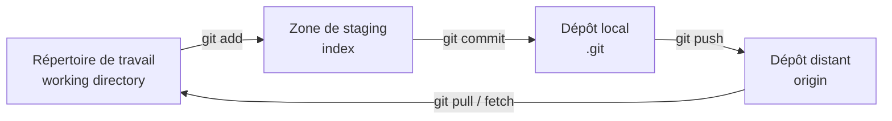
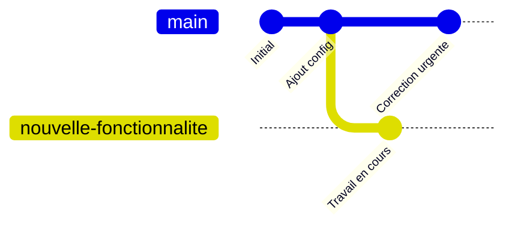

# 🧭 Cours complet — Git, le contrôle de version

### De Zéro à Expert

---

## 🗺️ Vue d'ensemble du cursus

| Palier | Thème | Contenu clé |
| --- | --- | --- |
| 🟢 **1 — Fondamentaux** | Comprendre & utiliser au quotidien | Concepts, cycle modifier/stager/committer, historique, branches, remotes, `.gitignore` |
| 🟡 **2 — Intermédiaire** | Travailler en équipe efficacement | Rebase, stash, cherry-pick, tags, conflits avancés, hooks, workflows (Git Flow, trunk-based) |
| 🔴 **3 — Expert** | Maîtriser en profondeur | Internals de Git, réécriture d'historique, submodules/subtrees, signature de commits, dépôts self-hosted |

---

# 🟢 PALIER 1 — FONDAMENTAUX

## Objectifs de ce palier

À la fin de ce palier, vous saurez :

- Expliquer ce qu'est Git et pourquoi le contrôle de version distribué a changé la donne
- Comprendre les 3 zones de Git (répertoire de travail, zone de staging, dépôt)
- Faire le cycle complet modifier → stager → committer au quotidien
- Créer et naviguer entre des branches
- Synchroniser votre travail avec un dépôt distant (GitHub, GitLab, ou un serveur self-hosted)
- Ignorer les bons fichiers avec `.gitignore`

---

## 1. Qu'est-ce que Git ?

Git est un système de contrôle de version **distribué** créé par Linus Torvalds en 2005 pour le développement du noyau Linux. Contrairement à un système centralisé (comme l'ancien SVN), chaque développeur possède une **copie complète de l'historique** du projet sur sa machine — pas besoin d'être connecté à un serveur central pour consulter l'historique, créer des branches, ou faire des commits.

|  | Système centralisé (ex. SVN) | Git (distribué) |
| --- | --- | --- |
| Historique complet | Uniquement sur le serveur central | Sur chaque machine |
| Travail hors ligne | Très limité | Complet (commit, branches, historique) |
| Vitesse | Dépend du réseau | Quasi instantanée en local |
| Panne du serveur central | Bloquant | Sans impact — chacun a déjà tout |

---

## 2. Installation et configuration initiale

```bash
# Debian / Ubuntu
sudo apt update && sudo apt install git

# macOS
brew install git

# Vérifier la version
git --version
```

### Configuration obligatoire (une seule fois par machine)

```bash
git config --global user.name "Votre Nom"
git config --global user.email "vous@exemple.com"
git config --global core.editor "vim"     # ou "nano" selon votre préférence
git config --global init.defaultBranch main
```

`--global` applique la configuration à tous vos dépôts. Sans cette option, la configuration ne vaut que pour le dépôt courant.

---

## 3. Les 3 zones de Git — le concept fondamental



| Zone | Rôle |
| --- | --- |
| **Répertoire de travail** | Les fichiers tels que vous les voyez et modifiez sur votre disque |
| **Zone de staging (index)** | La "salle d'attente" : ce que vous avez préparé pour le prochain commit |
| **Dépôt local (`.git`)** | L'historique complet des commits, stocké dans le dossier caché `.git` |
| **Dépôt distant** | Une copie partagée du dépôt, hébergée sur GitHub, GitLab, ou un serveur self-hosted |

**Pourquoi une zone de staging ?** Elle permet de choisir précisément **quelles modifications** entrent dans le prochain commit, même si plusieurs fichiers ont été modifiés — vous n'êtes jamais forcé de tout committer en bloc.

---

## 4. Initialiser et cloner un dépôt

```bash
git init                       # transformer le dossier courant en dépôt Git
git clone <url-du-depot>       # copier un dépôt existant (avec tout son historique)
```

---

## 5. Le cycle de base : modifier → stager → committer

```bash
git status                     # voir l'état actuel (fichiers modifiés, stagés...)
git add fichier.py             # ajouter un fichier précis à la zone de staging
git add .                      # ajouter TOUS les fichiers modifiés du dossier courant
git commit -m "Message clair et concis"
```

### Voir les différences avant de committer

```bash
git diff                       # différences non stagées (working dir vs staging)
git diff --staged              # différences stagées (staging vs dernier commit)
```

### Bonnes pratiques pour un message de commit

- Une ligne courte (≤ 50 caractères) résumant le changement, à l'impératif : `"Corrige le bug de pagination"` plutôt que `"J'ai corrigé..."`
- Un commit = **un changement logique cohérent**, pas un fourre-tout de fin de journée

---

## 6. Consulter l'historique

```bash
git log                                    # historique complet, détaillé
git log --oneline                          # une ligne par commit, compact
git log --oneline --graph --all            # avec le graphe des branches
git show <hash-du-commit>                  # détail d'un commit précis
```

---

## 7. Les branches — concept de base

Une branche n'est rien d'autre qu'un **pointeur mobile** vers un commit. Créer une branche est donc quasi instantané et ne duplique rien.

```bash
git branch                       # lister les branches (celle avec * est active)
git branch nouvelle-fonctionnalite     # créer une branche
git switch nouvelle-fonctionnalite     # basculer dessus (moderne)
git checkout nouvelle-fonctionnalite   # basculer dessus (ancienne syntaxe, toujours valide)

git switch -c nouvelle-fonctionnalite  # créer ET basculer en une seule commande
```



---

## 8. Fusionner une branche

```bash
git switch main
git merge nouvelle-fonctionnalite
```

| Type de fusion | Quand ça arrive |
| --- | --- |
| **Fast-forward** | Aucun nouveau commit sur `main` depuis la création de la branche : Git avance simplement le pointeur |
| **Merge commit** | `main` a évolué en parallèle : Git crée un commit spécial à deux parents |

### En cas de conflit

Si les deux branches ont modifié les mêmes lignes, Git marque le fichier avec des balises :

```
<<<<<<< HEAD
version de la branche courante
=======
version de la branche fusionnée
>>>>>>> nouvelle-fonctionnalite
```

Il faut alors éditer le fichier à la main pour garder la bonne version, supprimer les balises, puis :

```bash
git add fichier-en-conflit.py
git commit
```

*(La résolution de conflits complexes et les stratégies avancées seront approfondies au Palier 2.)*

---

## 9. Travailler avec un dépôt distant

```bash
git remote add origin <url>      # lier un dépôt distant nommé "origin"
git remote -v                     # lister les remotes configurés

git push origin main               # envoyer vos commits locaux vers le distant
git pull origin main                # récupérer ET fusionner les commits distants
git fetch origin                    # récupérer les commits distants SANS fusionner
```

| Commande | Effet |
| --- | --- |
| `git fetch` | Télécharge les nouveautés du distant, mais ne touche pas à votre travail courant |
| `git pull` | Équivaut à `git fetch` + `git merge` : récupère **et** fusionne immédiatement |
| `git push` | Envoie vos commits locaux vers le dépôt distant |

---

## 10. Ignorer des fichiers avec `.gitignore`

Certains fichiers ne doivent jamais être versionnés : dépendances installées, secrets, fichiers générés.

### Exemple pour un projet Django/Node (cohérent avec une stack Python + Next.js)

```gitignore
# Python
__pycache__/
*.pyc
venv/
.env

# Node.js
node_modules/
.next/

# Général
.DS_Store
*.log
```

Un fichier déjà suivi par Git avant d'être ajouté à `.gitignore` continue d'être suivi — il faut alors le retirer explicitement avec `git rm --cached fichier`.

---

## 11. Annuler des changements (les bases)

| Commande | Effet | Portée |
| --- | --- | --- |
| `git restore fichier.py` | Annule les modifications non stagées d'un fichier | Répertoire de travail |
| `git restore --staged fichier.py` | Retire un fichier de la zone de staging (sans perdre les modifications) | Zone de staging |
| `git revert <hash>` | Crée un **nouveau commit** qui annule les effets d'un commit passé | Historique (sûr, ne réécrit rien) |

> `git reset` (plus puissant et plus dangereux, car il peut réécrire l'historique) sera couvert en détail au Palier 2, avec les précautions à connaître.

---

## 📋 Récapitulatif — commandes essentielles du Palier 1

```
CONFIG      git config --global user.name / user.email / core.editor
DÉMARRER    git init   git clone <url>
CYCLE       git status   git add   git commit -m "..."   git diff
HISTORIQUE  git log --oneline --graph --all   git show <hash>
BRANCHES    git branch   git switch -c <nom>   git merge <nom>
DISTANT     git remote add origin <url>   git push   git pull   git fetch
ANNULER     git restore   git restore --staged   git revert <hash>
```

---

## 📖 Glossaire

| Terme | Définition |
| --- | --- |
| **Repository (repo)** | Un projet suivi par Git, avec tout son historique |
| **Commit** | Un instantané enregistré des modifications, avec un identifiant unique (hash) |
| **Staging area (index)** | La zone intermédiaire où l'on prépare le contenu du prochain commit |
| **HEAD** | Un pointeur spécial qui indique où vous vous trouvez actuellement (généralement la pointe de la branche active) |
| **Branche** | Un pointeur mobile vers un commit, permettant de développer en parallèle |
| **Remote** | Une référence vers un dépôt distant (souvent nommée `origin`) |
| **Fast-forward** | Un type de fusion où le pointeur de branche avance simplement, sans commit de fusion |

---

## 🧪 Exercice pratique du Palier 1

- [ ] Initialiser un dépôt Git dans un nouveau dossier
- [ ] Créer un fichier, le stager, le committer avec un message clair
- [ ] Créer une branche, y faire un commit, puis la fusionner dans `main`
- [ ] Provoquer volontairement un conflit de fusion entre deux branches et le résoudre à la main
- [ ] Créer un dépôt sur GitHub/GitLab (ou un serveur self-hosted), le lier avec `git remote add`, et y pousser votre travail
- [ ] Écrire un `.gitignore` adapté à l'un de vos projets et vérifier qu'il fonctionne
- [ ] Annuler un commit avec `git revert` sans perdre l'historique

---

## ✅ Checklist avant de passer au Palier 2

- [ ] Le cycle modifier → stager → committer est un réflexe
- [ ] Vous savez créer, basculer et fusionner des branches sans hésiter
- [ ] Vous comprenez la différence entre `fetch`, `pull` et `push`
- [ ] Vous savez résoudre un conflit de fusion simple
- [ ] Vous savez ce que fait `.gitignore` et pourquoi c'est important

---

## 🟡 Aperçu du Palier 2 — Intermédiaire

- `git rebase` : réécrire l'historique local pour un historique plus propre
- `git stash` : mettre de côté un travail en cours sans committer
- `git cherry-pick` : appliquer un commit précis d'une branche à une autre
- Tags (`git tag`) pour marquer des versions (ex. `v1.0.0`)
- Résolution de conflits avancée et stratégies de merge (`ours`, `theirs`, `recursive`)
- Git hooks (déclencher des scripts automatiquement à certains événements)
- Workflows d'équipe : Git Flow, trunk-based development, pull/merge requests
- `git bisect` pour retrouver le commit responsable d'un bug

## 🔴 Aperçu du Palier 3 — Expert

- Le fonctionnement interne de Git (objects, blobs, trees, commits, packfiles)
- Réécriture avancée de l'historique (`rebase -i` complexe, `filter-repo`)
- Submodules et subtrees pour gérer des dépendances multi-dépôts
- Signature de commits (GPG/SSH) pour garantir leur authenticité
- Optimisation pour les gros dépôts (`sparse-checkout`, `partial clone`, `shallow clone`)
- Héberger son propre serveur Git (Gitea, GitLab self-hosted) — cohérent avec une approche souveraine des données
- Intégration de Git dans des pipelines CI/CD

---

*Fin du Palier 1. Dites-moi quand vous êtes prêt pour le Palier 2, ou si un point de ce palier mérite d'être approfondi avant de continuer.*