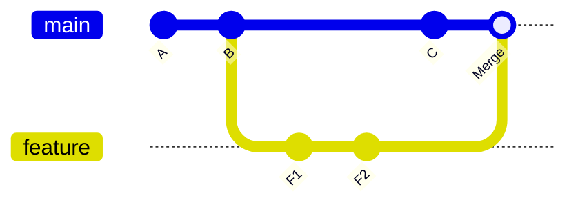
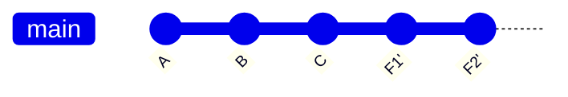
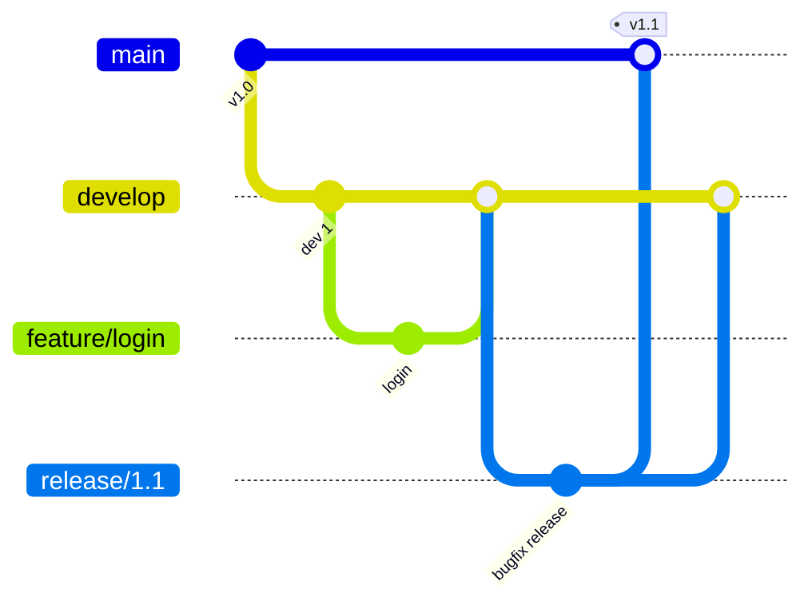

# 🧭 Cours complet — Git, le contrôle de version

### De Zéro à Expert

---

## 🗺️ Rappel du cursus

| Palier | Thème | Statut |
| --- | --- | --- |
| 🟢 **1 — Fondamentaux** | Concepts, cycle modifier/stager/committer, branches, remotes, `.gitignore` | ✅ Vu |
| 🟡 **2 — Intermédiaire** | Rebase, stash, reset, reflog, cherry-pick, tags, conflits, hooks, workflows, bisect | 📍 Ce document |
| 🔴 **3 — Expert** | Internals, réécriture d'historique, submodules, signature, dépôts self-hosted | À venir |

**Prérequis** : maîtriser le cycle de base (`add`, `commit`, `status`), les branches, `merge`, et `push`/`pull`/`fetch`.

---

# 🟡 PALIER 2 — INTERMÉDIAIRE

## Objectifs de ce palier

À la fin de ce palier, vous saurez :

- Réécrire proprement l'historique local avec `rebase` et `commit --amend`
- Mettre du travail de côté avec `stash`
- Utiliser `reset` sans danger, et rattraper une erreur grâce au `reflog`
- Reporter un commit précis d'une branche à l'autre avec `cherry-pick`
- Marquer des versions avec les tags
- Résoudre des conflits complexes avec méthode
- Automatiser des contrôles avec les hooks
- Choisir et appliquer un workflow d'équipe (Git Flow, GitHub Flow, trunk-based)
- Retrouver le commit responsable d'un bug avec `bisect`

---

## 1. Corriger le dernier commit : `--amend`

Vous venez de committer et vous avez oublié un fichier, ou une faute de frappe dans le message :

```bash
git add fichier-oublie.py
git commit --amend                 # modifie le dernier commit (fichiers + message)
git commit --amend --no-edit       # ajoute les changements stagés sans toucher au message
git commit --amend -m "Nouveau message"
```

> ⚠️ `--amend` **remplace** le commit par un nouveau (nouveau hash). N'amendez jamais un commit déjà poussé et partagé avec d'autres.

---

## 2. `git stash` — mettre le travail de côté

Vous êtes en plein travail, une urgence arrive, et vous devez changer de branche sans committer un travail inachevé.

```bash
git stash push -m "WIP: formulaire de contact"   # met de côté les modifications suivies
git stash push -u                                  # inclut aussi les fichiers non suivis (untracked)
git stash list                                     # liste des stashs
git stash show -p stash@{0}                        # voir le contenu d'un stash
git stash pop                                      # réapplique le dernier stash ET le supprime
git stash apply stash@{1}                          # réapplique sans supprimer
git stash drop stash@{0}                           # supprime un stash
git stash branch nouvelle-branche stash@{0}        # crée une branche à partir d'un stash
```

| Commande | Réapplique | Supprime le stash |
| --- | --- | --- |
| `git stash pop` | ✅ | ✅ |
| `git stash apply` | ✅ | ❌ |

---

## 3. `git reset` — déplacer HEAD (et plus si besoin)

`git reset` déplace la branche courante vers un autre commit. Son comportement dépend de l'option :

| Option | Historique (HEAD) | Zone de staging | Répertoire de travail |
| --- | --- | --- | --- |
| `--soft` | Reculé | **Conservée** (changements restent stagés) | Conservé |
| `--mixed` *(défaut)* | Reculé | Vidée | **Conservé** (changements non stagés) |
| `--hard` | Reculé | Vidée | ⚠️ **Écrasé** (modifications perdues) |

```bash
git reset --soft HEAD~1      # annule le dernier commit, garde tout prêt à recommiter
git reset HEAD~1             # annule le dernier commit, garde les fichiers modifiés
git reset --hard HEAD~1      # annule le dernier commit ET détruit les modifications
git reset --hard origin/main # aligne la branche locale sur le distant (destructif)
```

### `reset` vs `revert`

|  | `git reset` | `git revert` |
| --- | --- | --- |
| Effet | Réécrit l'historique (déplace le pointeur) | Ajoute un commit qui annule un commit passé |
| Sûr sur une branche partagée ? | ❌ Non | ✅ Oui |
| Usage typique | Nettoyer son travail local | Annuler proprement un commit déjà publié |

---

## 4. `git reflog` — le filet de sécurité

Le reflog garde la trace de **tous les déplacements de HEAD** en local (commits, resets, rebases, changements de branche), y compris pour des commits qui ne sont plus atteignables par aucune branche. C'est ce qui permet de rattraper un `reset --hard` malheureux.

```bash
git reflog
# a1b2c3d HEAD@{0}: reset: moving to HEAD~2
# 9f8e7d6 HEAD@{1}: commit: Ajoute la page contact
# 4c5d6e7 HEAD@{2}: commit: Corrige le header
```

```bash
git reset --hard HEAD@{1}            # revient à l'état avant le reset
git switch -c recuperation 9f8e7d6   # crée une branche sur un commit "perdu"
```

> Le reflog est **local** (il n'est pas poussé) et les entrées expirent après quelques semaines (90 jours par défaut pour les entrées atteignables, 30 pour les autres). Tant que c'est récent, rien n'est vraiment perdu.

---

## 5. `git rebase` — un historique linéaire et propre

### Merge vs Rebase



*Avec `merge` : l'historique conserve la bifurcation et ajoute un commit de fusion.*



*Avec `rebase` puis fast-forward : les commits de la branche sont rejoués **au-dessus** de `main`, l'historique est linéaire (les commits F1' et F2' ont de nouveaux hash).*

### Utilisation de base

```bash
git switch feature
git rebase main                # rejoue les commits de feature au-dessus de main
```

En cas de conflit pendant le rebase :

```bash
# 1. corriger le fichier en conflit
git add fichier.py
git rebase --continue          # passer au commit suivant
# ou
git rebase --skip              # ignorer ce commit
git rebase --abort             # tout annuler, retour à l'état initial
```

### Récupérer les changements distants proprement

```bash
git pull --rebase                          # fetch + rebase au lieu de fetch + merge
git config --global pull.rebase true       # en faire le comportement par défaut
```

### 🚨 La règle d'or du rebase

> **Ne rebasez jamais des commits déjà poussés et utilisés par d'autres.** Le rebase crée de nouveaux commits : si des collègues ont basé leur travail sur les anciens, vous créez un chaos d'historiques divergents.

Si vous devez pousser une branche personnelle rebasée :

```bash
git push --force-with-lease     # refuse d'écraser si quelqu'un d'autre a poussé entre-temps
```

Préférez toujours `--force-with-lease` à `--force`.

### Rebase interactif (nettoyer avant de partager)

```bash
git rebase -i HEAD~4            # réorganiser les 4 derniers commits
```

Git ouvre l'éditeur avec la liste des commits :

```
pick   a1b2c3d Ajoute le formulaire
pick   b2c3d4e Corrige typo
pick   c3d4e5f WIP
pick   d4e5f6a Ajoute la validation
```

| Commande | Effet |
| --- | --- |
| `pick` | Garder le commit tel quel |
| `reword` | Garder le commit, modifier son message |
| `squash` | Fusionner avec le commit précédent (en combinant les messages) |
| `fixup` | Fusionner avec le commit précédent (en jetant ce message) |
| `drop` | Supprimer le commit |

Astuce : `git commit --fixup <hash>` puis `git rebase -i --autosquash <base>` réordonne et fusionne automatiquement les commits de correction.

---

## 6. `git cherry-pick` — prendre un commit précis

Appliquer **un commit isolé** d'une branche sur une autre, sans fusionner tout le reste :

```bash
git switch main
git cherry-pick 9f8e7d6                  # applique ce commit sur la branche courante
git cherry-pick A^..B                    # applique une plage de commits (de A à B inclus)
git cherry-pick -x 9f8e7d6               # ajoute "(cherry picked from commit ...)" au message
git cherry-pick --no-commit 9f8e7d6      # applique les changements sans committer
```

En cas de conflit : résoudre, `git add`, puis `git cherry-pick --continue` (ou `--abort`).

**Cas d'usage typique** : un correctif urgent fait sur `develop` doit aussi partir en production sur une branche `release`.

---

## 7. Les tags — marquer des versions

| Type | Commande | Usage |
| --- | --- | --- |
| **Léger** | `git tag v1.0.0` | Simple étiquette sur un commit |
| **Annoté** | `git tag -a v1.0.0 -m "Première version stable"` | Objet complet (auteur, date, message) — **recommandé pour les releases** |

```bash
git tag                                   # lister les tags
git tag -a v1.2.0 9f8e7d6 -m "Release"    # tagger un commit passé
git push origin v1.2.0                    # pousser un tag précis
git push origin --tags                    # pousser tous les tags
git tag -d v1.0.0                         # supprimer localement
git push origin --delete v1.0.0           # supprimer sur le distant
git switch --detach v1.0.0                # examiner le code à une version donnée
```

Convention courante : le **versionnement sémantique** `MAJEUR.MINEUR.CORRECTIF` (ex. `2.4.1`) — MAJEUR pour les ruptures de compatibilité, MINEUR pour les nouvelles fonctionnalités compatibles, CORRECTIF pour les corrections de bugs.

---

## 8. Résolution de conflits avancée

### Méthode pas à pas

```bash
git status                       # liste les fichiers "both modified"
# éditer chaque fichier, résoudre les balises <<<<<<< ======= >>>>>>>
git add fichier.py
git merge --continue             # (ou git commit)
git merge --abort                # abandonner et revenir à l'état d'avant la fusion
```

### Rendre les conflits plus lisibles

```bash
git config --global merge.conflictstyle zdiff3
```

Ce style affiche aussi la version **ancêtre commun** entre les balises, ce qui permet de comprendre ce que chaque côté a réellement changé (disponible à partir de Git 2.35 ; `diff3` sur les versions plus anciennes).

### Choisir un côté pour un fichier entier

```bash
git checkout --ours fichier.py      # garde la version de la branche courante
git checkout --theirs fichier.py    # garde la version de la branche fusionnée
```

> ⚠️ Pendant un **rebase**, `ours` et `theirs` sont **inversés** : `ours` désigne la branche sur laquelle vous rejouez (par exemple `main`), et `theirs` désigne votre commit en cours de rejeu.

### Stratégies et options de fusion

| Commande | Effet |
| --- | --- |
| `git merge -X ours <branche>` | Fusionne normalement, mais en cas de conflit sur une même zone, privilégie **notre** version |
| `git merge -X theirs <branche>` | Idem, mais privilégie **leur** version |
| `git merge -s ours <branche>` | Enregistre la fusion **sans prendre aucun de leurs changements** (garde uniquement notre contenu) |

Ne confondez pas `-X ours` (option, résout les conflits) et `-s ours` (stratégie, ignore tout le contenu de l'autre branche).

### Outils utiles

```bash
git mergetool                             # ouvre un outil de fusion graphique configuré
git config --global rerere.enabled true   # mémorise vos résolutions et les rejoue automatiquement
```

`rerere` ("reuse recorded resolution") est précieux quand vous rebasez plusieurs fois la même branche et retombez sur les mêmes conflits.

---

## 9. Explorer l'historique plus finement

```bash
git blame fichier.py                    # qui a modifié chaque ligne, et dans quel commit
git log -p fichier.py                   # historique d'un fichier avec les diffs
git log -S"ma_fonction"                 # commits qui ont ajouté/supprimé cette chaîne
git log --author="Nom" --since="2 weeks ago"
git log main..feature                   # commits présents sur feature mais pas sur main
git diff main...feature                 # changements introduits par feature depuis la bifurcation
git grep "TODO"                         # recherche dans les fichiers versionnés
```

---

## 10. `git bisect` — trouver le commit coupable

Un bug est apparu, vous savez qu'il fonctionnait avant. `bisect` fait une **recherche dichotomique** dans l'historique : avec 1000 commits, environ 10 étapes suffisent.

```bash
git bisect start
git bisect bad                    # le commit actuel est cassé
git bisect good v1.0.0            # cette version fonctionnait
# Git checkout un commit intermédiaire : testez, puis répondez
git bisect good                   # ou : git bisect bad
# ... répéter jusqu'à ce que Git désigne le premier mauvais commit
git bisect reset                  # revenir à la branche d'origine
```

### Automatiser avec un script de test

```bash
git bisect start HEAD v1.0.0
git bisect run ./tester.sh        # le script doit retourner 0 si OK, non nul si le bug est présent
```

---

## 11. Les hooks Git — automatiser des contrôles

Les hooks sont des scripts exécutés automatiquement à certains moments du cycle Git. Ils vivent dans `.git/hooks/`.

| Hook | Déclenché | Usage typique |
| --- | --- | --- |
| `pre-commit` | Avant chaque commit | Lint, formatage, bloquer les secrets |
| `commit-msg` | Après saisie du message | Valider le format du message |
| `pre-push` | Avant un push | Lancer les tests |
| `post-merge` | Après une fusion | Réinstaller les dépendances |

### Exemple : bloquer le commit d'un fichier `.env`

```bash
#!/usr/bin/env bash
# .git/hooks/pre-commit  (à rendre exécutable : chmod +x)
if git diff --cached --name-only | grep -qE '(^|/)\.env$'; then
  echo "❌ Commit bloqué : un fichier .env est dans la zone de staging."
  exit 1
fi
```

Un hook qui retourne un code non nul **interrompt** l'opération.

### Partager les hooks avec l'équipe

Le dossier `.git/` n'est pas versionné : les hooks n'y sont donc pas partagés. Solution courante :

```bash
mkdir .githooks
git config core.hooksPath .githooks      # à faire par chaque développeur (ou via un script d'installation)
```

Les scripts placés dans `.githooks/` sont alors versionnés avec le projet. Des outils comme le framework **pre-commit** (Python) ou **Husky** (Node.js) automatisent cette mise en place.

> `git commit --no-verify` contourne les hooks côté client : ils sont une aide, pas une garantie. Pour une garantie, doublez-les d'un contrôle en CI.

---

## 12. Workflows d'équipe

|  | **Git Flow** | **GitHub Flow** | **Trunk-based** |
| --- | --- | --- | --- |
| Branches | `main`, `develop`, `feature/*`, `release/*`, `hotfix/*` | `main` + branches de fonctionnalité courtes | `main` (le "tronc") + branches très courtes ou commit direct |
| Releases | Planifiées, versionnées | Déploiement continu depuis `main` | Déploiement continu, *feature flags* pour masquer le travail inachevé |
| Complexité | Élevée | Faible | Faible (mais exige de bons tests et une bonne CI) |
| Adapté à | Logiciels versionnés, cycles de release longs | Applications web, équipes petites/moyennes | Équipes avec CI/CD mature et déploiements fréquents |



### Pull requests / Merge requests

- Une PR = **une intention claire**, petite et relisable
- Protégez `main` : revue obligatoire, CI verte requise, pas de push direct
- Trois façons de fusionner une PR :

| Méthode | Résultat |
| --- | --- |
| **Merge commit** | Conserve tous les commits + un commit de fusion |
| **Squash and merge** | Tous les commits de la PR deviennent un seul commit sur `main` |
| **Rebase and merge** | Commits rejoués linéairement sur `main`, sans commit de fusion |

### Messages de commit : Conventional Commits

```
feat: ajoute l'authentification par lien magique
fix: corrige la pagination de la liste des produits
docs: met à jour le README
refactor: extrait la logique de paiement dans un service
chore: met à jour les dépendances
```

Ce format permet de générer automatiquement des changelogs et de déterminer le prochain numéro de version.

---

## 📋 Récapitulatif — commandes du Palier 2

```
CORRIGER    git commit --amend   git reset --soft/--mixed/--hard   git revert
SAUVER      git stash push -m / pop / apply / list   git reflog
RÉÉCRIRE    git rebase <base>   git rebase -i HEAD~N   git pull --rebase
            git push --force-with-lease
REPORTER    git cherry-pick <hash>   git cherry-pick A^..B
VERSIONS    git tag -a v1.0.0 -m "..."   git push origin --tags
CONFLITS    git merge --abort   git checkout --ours/--theirs   git config rerere.enabled true
EXPLORER    git blame   git log -p / -S / --author   git bisect start/good/bad/run
HOOKS       .git/hooks/pre-commit   git config core.hooksPath .githooks
```

---

## 📖 Glossaire complémentaire

| Terme | Définition |
| --- | --- |
| **Rebase** | Rejouer une série de commits sur une nouvelle base, en créant de nouveaux commits |
| **Reflog** | Journal local de tous les déplacements de HEAD, utile pour rattraper une erreur |
| **Cherry-pick** | Appliquer un commit précis d'une branche sur une autre |
| **Stash** | Pile de modifications mises de côté temporairement |
| **Detached HEAD** | État où HEAD pointe directement sur un commit (ex. un tag) plutôt que sur une branche |
| **Tag annoté** | Objet Git complet (auteur, date, message) qui marque une version |
| **Hook** | Script déclenché automatiquement par un événement Git |
| **Trunk-based** | Workflow où tout le monde intègre très fréquemment dans la branche principale |
| **Feature flag** | Interrupteur permettant de déployer du code inachevé sans l'activer pour les utilisateurs |

---

## 🧪 Exercice pratique du Palier 2

- [ ] Amender un commit pour ajouter un fichier oublié, puis corriger son message
- [ ] Mettre un travail en cours de côté avec `stash -u`, changer de branche, puis le récupérer avec `pop`
- [ ] Faire un `reset --hard` volontaire sur un dépôt de test, puis récupérer l'état perdu avec `reflog`
- [ ] Créer une branche avec 4 commits (dont un "WIP"), puis les nettoyer en 2 commits propres avec `rebase -i`
- [ ] Rebaser une branche de fonctionnalité sur `main` après que `main` a évolué, en résolvant un conflit
- [ ] Reporter un correctif de `develop` vers `main` avec `cherry-pick`
- [ ] Créer un tag annoté `v1.0.0` et le pousser sur le distant
- [ ] Écrire un hook `pre-commit` qui bloque le commit d'un fichier `.env`, et le partager via `core.hooksPath`
- [ ] Introduire un bug volontaire dans l'historique d'un dépôt de test et le retrouver avec `bisect run`
- [ ] Configurer `rerere` et `merge.conflictstyle zdiff3`

---

## ✅ Checklist avant de passer au Palier 3

- [ ] Vous savez choisir entre `reset` et `revert` selon que la branche est partagée ou non
- [ ] Vous connaissez la règle d'or du rebase et utilisez `--force-with-lease`
- [ ] Vous savez retrouver un commit "perdu" avec le reflog
- [ ] Vous savez nettoyer un historique local avec `rebase -i` avant de le partager
- [ ] Vous comprenez la différence entre `-X ours` et `-s ours`
- [ ] Vous pouvez expliquer les trois grands workflows et choisir le bon pour un projet donné

---

## 🔴 Aperçu du Palier 3 — Expert

- Le fonctionnement interne de Git (objets blob/tree/commit/tag, packfiles, références)
- Réécriture avancée de l'historique (`rebase -i` complexe, `git filter-repo`, purge de secrets)
- Submodules et subtrees pour gérer des dépendances multi-dépôts
- Worktrees : plusieurs branches checkoutées en parallèle sans cloner
- Signature de commits et de tags (GPG/SSH) pour garantir leur authenticité
- Optimisation des gros dépôts (`sparse-checkout`, `partial clone`, `shallow clone`, monorepos)
- Héberger son propre serveur Git (Gitea, GitLab self-hosted)
- Intégration de Git dans des pipelines CI/CD et pratiques GitOps

---

*Fin du Palier 2. Dites-moi quand vous êtes prêt pour le Palier 3, ou si un point de ce palier mérite d'être approfondi avant de continuer.*