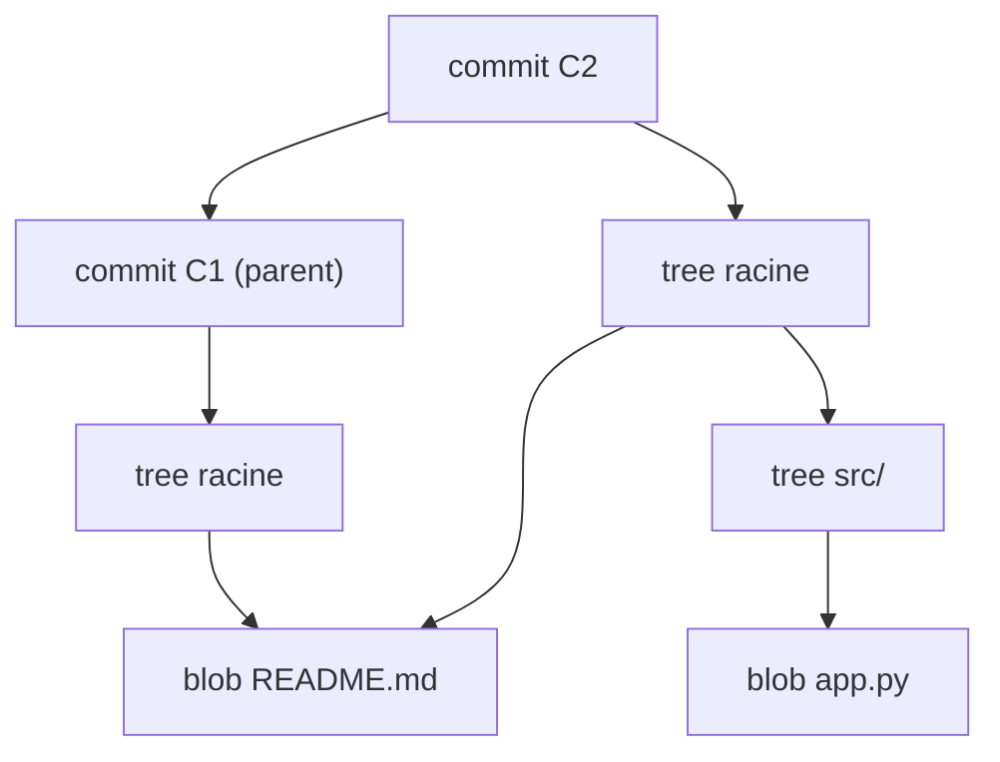

# 🧭 Cours complet — Git, le contrôle de version

### De Zéro à Expert

---

## 🗺️ Rappel du cursus

| Palier | Thème | Statut |
| --- | --- | --- |
| 🟢 **1 — Fondamentaux** | Concepts, cycle modifier/stager/committer, branches, remotes, `.gitignore` | ✅ Vu |
| 🟡 **2 — Intermédiaire** | Rebase, stash, reset, reflog, cherry-pick, tags, conflits, hooks, workflows, bisect | ✅ Vu |
| 🔴 **3 — Expert** | Internals, réécriture d'historique, worktrees, submodules, signature, gros dépôts, self-hosting, CI/GitOps | 📍 Ce document |

**Prérequis** : être à l'aise avec `rebase`, `reset`, `reflog`, `cherry-pick`, les hooks et les workflows d'équipe.

---

# 🔴 PALIER 3 — EXPERT

## Objectifs de ce palier

À la fin de ce palier, vous saurez :

- Expliquer comment Git stocke réellement les données (blobs, trees, commits, refs, packfiles) et fabriquer un commit « à la main »
- Réécrire l'historique en profondeur (rebase avancé, `filter-repo`) et purger un secret d'un dépôt
- Travailler sur plusieurs branches en parallèle avec les worktrees
- Gérer des dépendances multi-dépôts avec submodules ou subtrees
- Signer vos commits et vos tags (GPG ou SSH)
- Faire tenir de gros dépôts et des monorepos en performance
- Héberger votre propre serveur Git (Gitea) et l'intégrer à vos pipelines CI/CD et à une démarche GitOps

---

## 1. Les entrailles de Git

### Le dossier `.git`

```
.git/
├── HEAD              # référence symbolique vers la branche courante (ou un commit)
├── config            # configuration locale du dépôt
├── hooks/            # scripts déclenchés par les événements Git
├── index             # la zone de staging (fichier binaire)
├── objects/          # la base de données d'objets (contenu adressable)
│   ├── ab/cdef…      # objets « en vrac » (loose), nommés d'après leur hash
│   └── pack/         # objets regroupés et compressés (packfiles)
├── refs/
│   ├── heads/        # une branche = un fichier contenant un hash de commit
│   ├── tags/
│   └── remotes/
└── logs/             # le reflog
```

### Git est une base de données clé/valeur

Git stocke tout sous forme d'**objets** identifiés par le hash de leur contenu (SHA-1 par défaut ; SHA-256 est disponible en mode expérimental). Deux contenus identiques produisent le même hash : c'est ce qu'on appelle le stockage **adressable par le contenu**.

| Objet | Contient |
| --- | --- |
| **blob** | Le contenu brut d'un fichier (sans son nom) |
| **tree** | Une liste de noms de fichiers/dossiers pointant vers des blobs ou d'autres trees |
| **commit** | Un pointeur vers un tree racine, le ou les commits parents, l'auteur, la date, le message |
| **tag annoté** | Un pointeur vers un objet (souvent un commit) + auteur, date, message, signature éventuelle |



Remarquez que `README.md`, inchangé entre C1 et C2, n'est **stocké qu'une seule fois** : les deux trees pointent vers le même blob.

Une **branche** n'est qu'un fichier de 41 octets (`.git/refs/heads/main`) qui contient le hash d'un commit. `HEAD` est un fichier qui contient `ref: refs/heads/main`. C'est pour cela que créer une branche est instantané.

### Commandes de « plomberie » (plumbing)

Git distingue les commandes *porcelain* (celles que vous utilisez au quotidien) des commandes *plumbing* (les briques de bas niveau) :

```bash
git cat-file -t <hash>          # type d'un objet (blob, tree, commit, tag)
git cat-file -p <hash>          # afficher le contenu d'un objet
git cat-file -p HEAD^{tree}     # afficher le tree racine du dernier commit
git ls-tree -r HEAD             # lister récursivement tous les fichiers d'un commit
git ls-files -s                 # contenu de l'index (mode, hash, numéro de stage, chemin)
git rev-parse HEAD              # résoudre une référence en hash
git count-objects -vH           # statistiques sur les objets (vrac vs packés)
```

### Atelier : fabriquer un commit sans `git add` ni `git commit`

```bash
mkdir demo-plomberie && cd demo-plomberie
git init -b main

# 1. Créer un blob à partir de contenu
BLOB=$(echo "bonjour" | git hash-object -w --stdin)
git cat-file -t $BLOB            # → blob
git cat-file -p $BLOB            # → bonjour

# 2. L'inscrire dans l'index sous un nom de fichier
git update-index --add --cacheinfo 100644,$BLOB,hello.txt

# 3. Écrire le tree correspondant à l'index
TREE=$(git write-tree)

# 4. Créer un commit pointant vers ce tree
COMMIT=$(echo "Premier commit manuel" | git commit-tree $TREE)

# 5. Faire avancer la branche main vers ce commit
git update-ref refs/heads/main $COMMIT

git log --oneline                # le commit apparaît comme n'importe quel autre
```

Vous venez de refaire à la main ce que `git add hello.txt && git commit` fait en interne.

### Packfiles et garbage collection

Les objets fraîchement créés sont stockés « en vrac » (un fichier par objet). Périodiquement, `git gc` (ou `git maintenance`) les regroupe dans des **packfiles** et applique une **compression par delta** : au lieu de stocker deux versions presque identiques d'un gros fichier, Git stocke l'une entière et l'autre comme différence.

```bash
git gc                            # regroupe les objets en vrac, supprime les inaccessibles anciens
git count-objects -vH             # avant/après pour constater le gain
git verify-pack -v .git/objects/pack/pack-*.idx | head
```

---

## 2. Réécriture avancée de l'historique

### Rebase interactif avancé

Au-delà de `pick/squash/fixup/reword/drop` vus au Palier 2 :

| Commande | Effet |
| --- | --- |
| `edit` | S'arrête sur ce commit pour vous laisser le modifier ou le découper |
| `exec <cmd>` | Exécute une commande shell après le commit précédent (ex. lancer les tests) |
| `break` | Marque une pause pour inspecter l'état |
| `label` / `reset` / `merge` | Reconstruisent des fusions avec `--rebase-merges` |

**Vérifier que chaque commit compile/passe les tests avant de partager :**

```bash
git rebase -i main --exec "npm test"      # ou "pytest -q", "php artisan test"…
```

**Découper un commit en deux :**

```bash
git rebase -i HEAD~3            # marquer le commit à découper avec "edit"
git reset HEAD^                 # défait le commit, garde les changements non stagés
git add -p                      # sélectionner la première partie
git commit -m "Partie 1 : extraction du service"
git add -p
git commit -m "Partie 2 : ajout des tests"
git rebase --continue
```

### `rebase --onto` — greffer une branche ailleurs

Situation classique : `feature-b` a été créée à partir de `feature-a`, puis `feature-a` a été fusionnée (souvent en *squash*) dans `main`. Un rebase classique de `feature-b` rejouerait aussi les anciens commits de `feature-a`.

```bash
# « Prends les commits de feature-b qui ne sont pas dans feature-a, et rejoue-les sur main »
git rebase --onto main feature-a feature-b
```

Syntaxe : `git rebase --onto <nouvelle-base> <ancienne-base> <branche>`.

### Branches empilées (stacked branches)

```bash
git config --global rebase.updateRefs true    # Git ≥ 2.38
```

Quand vous rebasez la branche du haut d'une pile, Git met automatiquement à jour les pointeurs des branches intermédiaires.

### Comparer deux versions d'une série de commits : `range-diff`

Après un rebase, comment vérifier ce qui a réellement changé entre l'ancienne et la nouvelle version de votre branche ?

```bash
git range-diff main ancienne-tete nouvelle-tete
```

### Purger un fichier ou un secret de tout l'historique : `git filter-repo`

`git filter-repo` remplace l'ancien `git filter-branch` (lent et piégeux). Il s'installe séparément (`pip install git-filter-repo`).

> 🚨 **Si un secret (mot de passe, clé d'API, token) a été poussé : révoquez-le et régénérez-le d'abord.** Le purger de l'historique ne suffit pas : il a pu être copié, cloné ou mis en cache.

```bash
git clone <url> nettoyage && cd nettoyage         # travaillez sur un clone frais

# Supprimer un fichier de tout l'historique
git filter-repo --path config/secrets.env --invert-paths

# Ou remplacer des chaînes dans tous les fichiers de tout l'historique
cat > expressions.txt <<'EOF'
literal:MON_MOT_DE_PASSE==>***SUPPRIME***
regex:AKIA[0-9A-Z]{16}==>***CLE-AWS-SUPPRIMEE***
EOF
git filter-repo --replace-text expressions.txt

# filter-repo retire le remote "origin" par sécurité : à ré-ajouter
git remote add origin <url>
git push origin --force --all
git push origin --force --tags
```

Points d'attention :

- **Tous les hash changent** : chaque collaborateur doit re-cloner (ou réaligner proprement) son dépôt
- Les forks, les caches de plateforme et les références de pull requests peuvent conserver les anciens objets : voyez avec le support de votre hébergeur
- Alternative historique : BFG Repo-Cleaner

Autres usages de `filter-repo` : extraire un sous-dossier en un nouveau dépôt (`--subdirectory-filter`), réécrire les auteurs (`--mailmap`), déplacer tout le dépôt dans un sous-dossier avant de l'intégrer à un monorepo (`--to-subdirectory-filter`).

---

## 3. Worktrees — plusieurs branches en parallèle

Un **worktree** est un second (ou troisième…) répertoire de travail lié au **même** dépôt : pas de nouveau clone, pas de duplication de l'historique, et plus besoin de `stash` pour changer de contexte.

```bash
git worktree add ../projet-hotfix -b hotfix/urgent main    # nouvelle branche dans un nouveau dossier
git worktree add ../projet-review feature/login            # branche existante dans un autre dossier
git worktree add --detach ../projet-v1 v1.0.0              # examiner un tag sans branche
git worktree list                                           # voir tous les worktrees
git worktree remove ../projet-hotfix                        # supprimer proprement
git worktree prune                                          # nettoyer les références orphelines
```

Règle : **une même branche ne peut être checkoutée que dans un seul worktree à la fois**.

Cas d'usage : corriger un bug en production pendant qu'un long build ou une longue suite de tests tourne sur une autre branche ; relire une pull request dans un dossier séparé sans toucher à votre travail en cours.

---

## 4. Submodules et subtrees

Deux approches pour inclure un dépôt externe dans un autre.

### Submodules

Le dépôt parent ne stocke pas le code du sous-module : il stocke **l'URL** (dans `.gitmodules`) et **le hash exact du commit** utilisé (un « gitlink »).

```bash
git submodule add https://exemple.com/lib.git libs/lib
git commit -m "Ajoute le sous-module lib"

git clone --recurse-submodules <url>                # cloner avec les sous-modules
git submodule update --init --recursive             # les initialiser après un clone classique
git submodule update --remote --merge               # les mettre à jour vers la dernière version distante
git config --global submodule.recurse true          # propager checkout/pull aux sous-modules
git push --recurse-submodules=on-demand             # pousser d'abord les sous-modules modifiés
```

Pièges classiques :

- Le sous-module est en **detached HEAD** par défaut : créez/basculez sur une branche avant de le modifier
- Oublier de **pousser le sous-module avant le parent** : le parent référence alors un commit inexistant pour les autres
- Oublier `git add libs/lib` après avoir mis à jour le sous-module : le nouveau pointeur n'est pas enregistré

### Subtrees

Le code de l'autre dépôt est **copié dans votre historique** (dans un sous-dossier). Aucun outil spécial n'est nécessaire pour ceux qui clonent.

```bash
git subtree add  --prefix=libs/lib https://exemple.com/lib.git main --squash
git subtree pull --prefix=libs/lib https://exemple.com/lib.git main --squash
git subtree push --prefix=libs/lib https://exemple.com/lib.git ma-branche
```

### Lequel choisir ?

|  | **Submodule** | **Subtree** |
| --- | --- | --- |
| Ce qui est stocké | Un pointeur (URL + commit) | Le code lui-même |
| Simplicité pour les contributeurs | Demande de connaître `--recurse-submodules` | Transparent |
| Taille de l'historique | Légère | Plus lourde |
| Contribuer en amont | Naturel (c'est un vrai dépôt) | Possible via `subtree push`, plus lourd |
| Idéal pour | Dépendance versionnée précisément, développée séparément | Code vendorisé, rarement modifié |

Pensez aussi aux alternatives : un gestionnaire de paquets (npm, pip, Composer) est presque toujours plus simple qu'un submodule pour partager du code.

---

## 5. Signer ses commits et ses tags

Sans signature, **n'importe qui peut écrire n'importe quel nom et e-mail** dans le champ « auteur » d'un commit. Une signature prouve que le commit a été créé par le détenteur d'une clé privée donnée.

### Option A : signature SSH (Git ≥ 2.34) — la plus simple si vous avez déjà une clé SSH

```bash
git config --global gpg.format ssh
git config --global user.signingkey ~/.ssh/id_ed25519.pub
git config --global commit.gpgsign true       # signer tous les commits
git config --global tag.gpgsign true          # signer tous les tags

# Pour pouvoir VÉRIFIER les signatures localement
mkdir -p ~/.config/git
echo "vous@exemple.com $(cat ~/.ssh/id_ed25519.pub)" > ~/.config/git/allowed_signers
git config --global gpg.ssh.allowedSignersFile ~/.config/git/allowed_signers
```

### Option B : signature GPG

```bash
gpg --full-generate-key
gpg --list-secret-keys --keyid-format=long          # repérer l'identifiant de la clé
git config --global user.signingkey <ID-DE-CLE>
git config --global commit.gpgsign true
```

### Signer et vérifier

```bash
git commit -S -m "Commit signé"        # -S explicite si commit.gpgsign n'est pas activé
git tag -s v1.0.0 -m "Release signée"
git log --show-signature -3
git verify-commit <hash>
git verify-tag v1.0.0
```

Sur GitHub, GitLab ou Gitea, il faut aussi **enregistrer la clé publique comme clé de signature** dans votre profil pour voir apparaître le badge « Verified ». Vous pouvez ensuite exiger des commits signés via les règles de protection de branche.

> Une signature valide prouve la **possession de la clé**, pas l'identité de la personne : la confiance dans la clé reste à établir (échange de clés, liste d'auteurs autorisés).

---

## 6. Gros dépôts et monorepos

### Réduire ce qu'on télécharge

```bash
git clone --depth 1 <url>                                # clone superficiel : dernier commit seulement
git clone --filter=blob:none <url>                       # clone partiel « blobless » : historique complet,
                                                         # contenus des fichiers téléchargés à la demande
git clone --filter=blob:none --sparse <url>              # + n'extraire qu'une partie de l'arborescence
cd projet
git sparse-checkout set services/api docs                # ne matérialiser que ces dossiers
git sparse-checkout add services/web                     # en ajouter un autre
```

| Technique | Historique | Fichiers sur disque | Usage typique |
| --- | --- | --- | --- |
| `--depth 1` | Tronqué | Tous | CI, build one-shot |
| `--filter=blob:none` | Complet | Tous (téléchargés à la demande) | Développement quotidien sur un gros dépôt |
| `sparse-checkout` | Complet ou partiel | Un sous-ensemble | Monorepo dont on ne touche qu'une partie |

### Accélérer les opérations locales

```bash
git maintenance start                       # planifie des tâches de fond (gc, commit-graph, prefetch…)
git commit-graph write --reachable          # accélère log/merge-base sur de longs historiques
git config --global feature.manyFiles true  # active des optimisations pour les dépôts à nombreux fichiers
```

### Fichiers binaires volumineux : Git LFS

Git est conçu pour du texte. Pour de gros binaires (design, vidéos, datasets), **Git LFS** ne versionne dans le dépôt qu'un petit pointeur et stocke le fichier réel sur un serveur dédié.

```bash
git lfs install
git lfs track "*.psd" "*.mp4"
git add .gitattributes                      # le suivi LFS est décrit dans ce fichier : à versionner
```

Rappel : un gros fichier déjà committé reste dans l'historique ; pour l'en sortir, utilisez `git lfs migrate import` ou `git filter-repo`.

### Monorepo : bonnes pratiques

- **Propriété du code** : un fichier `CODEOWNERS` route automatiquement les revues vers les bonnes équipes par dossier
- **CI ciblée** : ne lancer les jobs que pour les dossiers modifiés (filtres `paths:` dans la CI, ou outils de graphe de tâches comme Nx ou Turborepo)
- **Workspaces** : pnpm, npm ou Yarn workspaces (Node), Cargo workspaces (Rust), etc. pour partager les dépendances
- **Commits atomiques** : un changement qui touche l'API *et* ses consommateurs part dans une seule PR — c'est l'un des grands avantages du monorepo
- **Hygiène** : sparse-checkout et clones partiels dès que le dépôt grossit

---

## 7. Héberger son propre serveur Git

### Les options

| Solution | Profil |
| --- | --- |
| **Dépôt bare + SSH** | Le strict minimum : aucun outil, aucune interface web |
| **Gitea** | Léger, rapide à déployer, interface proche de GitHub, CI intégrée (Gitea Actions) |
| **Forgejo** | Fork communautaire de Gitea, gouvernance associative |
| **GitLab CE** | Plateforme complète (CI/CD, registre, issues…), beaucoup plus gourmande en ressources |

### Le minimum vital : un dépôt bare sur un serveur SSH

```bash
# Sur le serveur
git init --bare /srv/git/projet.git

# Sur votre machine
git remote add origin ssh://utilisateur@serveur/srv/git/projet.git
git push -u origin main
```

Un dépôt *bare* n'a pas de répertoire de travail : c'est uniquement le contenu de `.git`, prévu pour recevoir des pushes.

### Gitea avec Docker Compose

```yaml
services:
  gitea:
    image: gitea/gitea:latest          # en production, épinglez une version précise
    container_name: gitea
    restart: unless-stopped
    environment:
      - USER_UID=1000
      - USER_GID=1000
      - GITEA__service__DISABLE_REGISTRATION=true    # pas d'inscription publique
      - GITEA__metrics__ENABLED=true                 # expose /metrics pour Prometheus
    volumes:
      - ./gitea-data:/data
      - /etc/timezone:/etc/timezone:ro
      - /etc/localtime:/etc/localtime:ro
    ports:
      - "3000:3000"      # interface web
      - "2222:22"        # SSH Git
```

```bash
git remote add origin ssh://git@votre-serveur:2222/equipe/projet.git
```

Bonnes pratiques de production :

- Placez Gitea derrière un **reverse proxy avec TLS** (Caddy, Nginx) : n'exposez pas le port 3000 en clair
- **Sauvegardez** le volume `/data` (dépôts, base, configuration) et testez la restauration ; Gitea propose aussi `gitea dump`
- Utilisez des **miroirs** (push mirrors) vers un second hébergeur pour disposer d'une copie hors site
- Pour du multi-utilisateurs sérieux, préférez PostgreSQL à SQLite
- La métrique `/metrics` peut être scrutée par Prometheus, exactement comme dans le cours d'observabilité

---

## 8. Git en CI/CD et GitOps

### Hooks côté serveur

Sur un dépôt distant, trois hooks agissent au moment de la réception d'un push :

| Hook | Moment | Usage |
| --- | --- | --- |
| `pre-receive` | Avant d'accepter le push | Rejeter les force-push, les messages non conformes, les fichiers interdits |
| `update` | Une fois **par branche** poussée | Règles par branche |
| `post-receive` | Après acceptation | Déclencher un déploiement, une notification |

```bash
#!/usr/bin/env bash
# /srv/git/projet.git/hooks/post-receive   (chmod +x)
while read oldrev newrev ref; do
  if [ "$ref" = "refs/heads/main" ]; then
    GIT_WORK_TREE=/var/www/projet git checkout -f main
    # docker compose -f /var/www/projet/docker-compose.yml up -d --build
  fi
done
```

### Contrôles automatiques en CI

```yaml
# .github/workflows/qualite.yml  (le principe est identique sur Gitea Actions / GitLab CI)
name: Qualité du dépôt

on:
  pull_request:

jobs:
  secrets:
    runs-on: ubuntu-latest
    steps:
      - uses: actions/checkout@v4
        with:
          fetch-depth: 0            # historique complet, nécessaire pour scanner tous les commits
      - name: Détecter les secrets dans l'historique
        run: |
          docker run --rm -v "$PWD:/repo" ghcr.io/gitleaks/gitleaks:latest \
            detect --source /repo --verbose
```

Complétez avec : lint des messages de commit (Conventional Commits), vérification des signatures, tests, protection de la branche `main` (CI verte + revue obligatoire + commits signés).

### GitOps

Le principe : **Git est la source de vérité de l'état souhaité de l'infrastructure**. On ne modifie plus les serveurs à la main ; on modifie un dépôt, et un mécanisme réconcilie l'infrastructure avec ce qui est dans Git.

| Modèle | Fonctionnement | Exemples |
| --- | --- | --- |
| **Push** | La CI se connecte à l'infrastructure et applique les changements | Job de déploiement SSH + `docker compose up -d` |
| **Pull** | Un agent *dans* l'infrastructure surveille le dépôt et se synchronise | Argo CD, Flux (Kubernetes) ; un simple `git pull` planifié pour Docker Compose |

Avantages : audit complet (`git log` = journal des changements de production), retour arrière par `git revert`, revue de code sur l'infrastructure, reproductibilité.

---

## 9. La boîte à outils du power user

### Sélecteurs de révisions

| Syntaxe | Signification |
| --- | --- |
| `HEAD~3` | Le 3ᵉ ancêtre (en suivant le premier parent) |
| `HEAD^2` | Le **second parent** d'un commit de fusion |
| `@{u}` | La branche amont (upstream) de la branche courante |
| `main@{yesterday}` | Où pointait `main` hier (via le reflog) |
| `:/texte` | Le commit le plus récent dont le message contient « texte » |
| `A..B` | Commits atteignables depuis B mais pas depuis A |
| `A...B` | Commits présents dans l'une des deux branches mais pas dans les deux |

### Commandes qui changent la vie

```bash
git add -p                            # stager par morceaux (hunks) plutôt que par fichier
git restore -p                        # annuler par morceaux
git log -L :ma_fonction:fichier.py    # historique d'UNE fonction
git diff --word-diff                  # différences mot à mot
git switch -                          # revenir à la branche précédente
git fsck --lost-found                 # retrouver des objets orphelins
git bundle create depot.bundle --all  # exporter tout le dépôt dans un seul fichier (transport hors ligne)
git clone depot.bundle projet-copie   # le recréer ailleurs
git notes add -m "Vérifié en préprod" <hash>   # annoter un commit sans le modifier
```

### Alias utiles

```bash
git config --global alias.lg "log --oneline --graph --decorate --all"
git config --global alias.st "status -sb"
git config --global alias.undo "reset --soft HEAD~1"
```

---

## 📋 Récapitulatif — commandes du Palier 3

```
PLOMBERIE   git cat-file -t/-p   git ls-tree -r   git hash-object -w   git write-tree
            git commit-tree   git update-ref   git count-objects -vH   git gc
RÉÉCRIRE    git rebase -i --exec "<cmd>"   git rebase --onto <base> <ancienne> <branche>
            git range-diff   git filter-repo --path <f> --invert-paths / --replace-text
PARALLÈLE   git worktree add / list / remove / prune
DÉPENDANCES git submodule add / update --init --recursive / update --remote
            git subtree add / pull / push --prefix=<dossier> --squash
SIGNER      gpg.format ssh   commit.gpgsign true   git commit -S   git tag -s   git verify-commit
GROS DÉPÔTS git clone --depth 1 / --filter=blob:none / --sparse   git sparse-checkout set
            git maintenance start   git lfs track
SERVEUR     git init --bare   hooks pre-receive / update / post-receive   Gitea (Docker)
```

---

## 📖 Glossaire de l'expert

| Terme | Définition |
| --- | --- |
| **Objet Git** | Élément stocké dans `.git/objects`, identifié par le hash de son contenu (blob, tree, commit, tag) |
| **Plumbing / Porcelain** | Commandes de bas niveau (briques) / commandes de haut niveau (usage quotidien) |
| **Packfile** | Fichier regroupant de nombreux objets avec compression par delta |
| **Ref** | Nom symbolique (branche, tag) pointant vers un objet |
| **Gitlink** | Entrée spéciale d'un tree qui pointe vers un commit d'un autre dépôt (submodule) |
| **Worktree** | Répertoire de travail supplémentaire lié au même dépôt |
| **Partial clone** | Clone qui ne télécharge pas tous les objets, mais les récupère à la demande |
| **Sparse checkout** | Ne matérialiser sur disque qu'une partie de l'arborescence |
| **Bare repository** | Dépôt sans répertoire de travail, destiné à recevoir des pushes |
| **GitOps** | Piloter l'infrastructure à partir d'un dépôt Git, source de vérité de l'état souhaité |

---

## 🧪 Projet capstone du Palier 3

- [ ] Fabriquer un commit à la main avec `hash-object`, `update-index`, `write-tree`, `commit-tree` et `update-ref`
- [ ] Explorer un vrai dépôt avec `cat-file` et `ls-tree`, et constater le partage de blobs entre deux commits
- [ ] Découper un commit en deux avec `rebase -i` + `edit`, et lancer les tests sur chaque commit avec `--exec`
- [ ] Greffer une branche avec `rebase --onto` après un squash-merge de sa branche parente
- [ ] Sur un dépôt de test, y introduire un faux secret puis le purger de tout l'historique avec `git filter-repo`
- [ ] Créer un worktree pour un hotfix pendant qu'une autre branche reste ouverte
- [ ] Intégrer une bibliothèque externe une fois par submodule, une fois par subtree, et comparer
- [ ] Configurer la signature SSH de vos commits et vérifier une signature avec `git log --show-signature`
- [ ] Cloner un gros dépôt public en `--filter=blob:none --sparse` et n'extraire qu'un dossier
- [ ] Déployer Gitea en Docker Compose, y pousser un dépôt en SSH, et activer `/metrics`
- [ ] Ajouter un job CI de détection de secrets et protéger la branche `main`

---

## ✅ Checklist finale

- [ ] Vous pouvez expliquer ce qu'est un blob, un tree, un commit et une ref, et pourquoi une branche est « gratuite »
- [ ] Vous savez purger un secret de l'historique, en sachant que la **révocation** du secret passe avant tout
- [ ] Vous choisissez sciemment entre submodule, subtree et gestionnaire de paquets
- [ ] Vos commits sont signés et vérifiables
- [ ] Vous savez faire tenir un gros dépôt en performance (clone partiel, sparse checkout, LFS)
- [ ] Vous savez héberger, sécuriser et sauvegarder un serveur Git auto-hébergé
- [ ] Vous comprenez le principe GitOps et la différence entre modèle push et modèle pull

---

## 🏁 Récapitulatif du cursus complet

- **Fondamentaux** : les 3 zones, le cycle de base, les branches, les remotes, `.gitignore`
- **Intermédiaire** : réécrire et rattraper l'historique (`rebase`, `reset`, `reflog`), `stash`, `cherry-pick`, tags, hooks, workflows d'équipe, `bisect`
- **Expert** : internals, réécriture profonde, worktrees, submodules/subtrees, signature, gros dépôts, self-hosting, CI/CD et GitOps

Vous disposez maintenant d'une compréhension de Git du modèle de données jusqu'à l'exploitation en équipe et en production.

---

*Fin du cursus Git. Dites-moi si vous voulez approfondir un point précis, ou enchaîner sur un autre cours (par exemple le Palier 2 de Vim).*