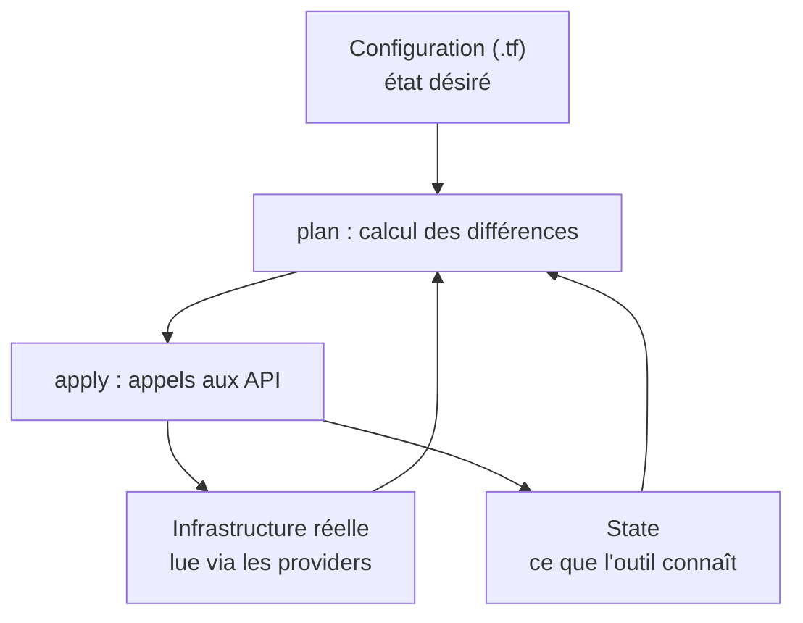
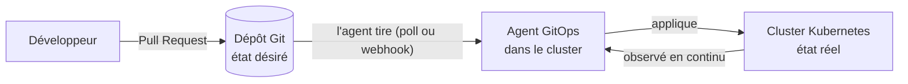
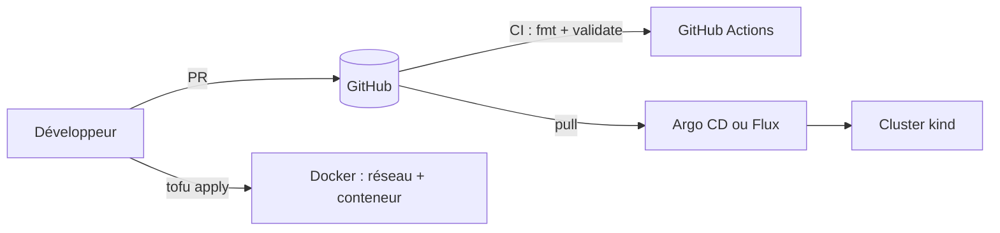

# Infrastructure as Code & GitOps — Palier 1 : Fundamentals

> **Fiche du palier**
> - **Public** : développeurs, administrateurs système, étudiants, premiers pas en DevOps/SRE
> - **Durée estimée** : 16 à 20 h (lecture + labs)
> - **Prérequis** : ligne de commande (Linux, macOS ou WSL), bases de Git (commit, branche), lecture de YAML, Docker installé
> - **Compte cloud** : *non requis* — tous les labs tournent en local (fichiers, Docker, cluster `kind`)
> - **Dernière mise à jour** : octobre 2026

Les outils évoluent vite : les commandes de ce document suivent les documentations officielles consultées à la date ci-dessus. En cas de doute, la documentation officielle (liens en annexe C) fait foi.

---

## Vue d'ensemble du cours en 3 paliers

| Palier | Fichier | Question centrale | Vous saurez à la fin |
|---|---|---|---|
| **1 — Fundamentals** *(ce document)* | `Fundamentals.md` | Qu'est-ce que l'IaC et le GitOps, et comment démarrer proprement ? | Écrire et appliquer une configuration OpenTofu/Terraform, raisonner en « état désiré », travailler avec Git, PR et CI, déployer une application avec Argo CD ou Flux |
| **2 — Intermédiaire** | `Intermediate.md` | Comment industrialiser pour une équipe ? | Modules réutilisables, state distant, multi-environnements, tests et policy-as-code, CI/CD complet, secrets, Helm/Kustomize, ApplicationSets, promotion entre environnements |
| **3 — Expert** | `Expert.md` | Comment opérer à grande échelle, en sécurité, dans la durée ? | Multi-cluster et multi-tenant, plateforme interne (Crossplane, Cluster API), progressive delivery, sécurité de la chaîne d'approvisionnement, reprise après sinistre, gouvernance et FinOps |

**Fil rouge** : les trois paliers construisent la même petite « plateforme applicative ». Au palier 1, elle tourne sur votre machine ; au palier 2, elle passe dans le cloud avec state distant et pipeline complet ; au palier 3, elle devient une plateforme multi-cluster.

---

## Comment suivre ce cours

- **Rythme conseillé** : un module par séance de 1 à 3 h. Ne sautez pas les labs : l'IaC s'apprend en cassant des choses dans un environnement jetable.
- **Dossier de travail** : créez `~/iac-gitops/` ; chaque lab a son sous-dossier.
- **Conventions** :
  - **Objectifs** : ce que vous saurez faire après le module.
  - **À retenir** : l'essentiel en quelques lignes.
  - **Piège** : erreur fréquente à éviter.
  - **Lab** : travaux pratiques guidés (durée indiquée).
  - **Quiz** : auto-évaluation, réponses repliées sous les questions.
- **Substitution des commandes** : les exemples utilisent `tofu` (OpenTofu). Si vous préférez Terraform, remplacez `tofu` par `terraform` : commandes et syntaxe de ce palier sont identiques.
- **Environnement jetable** : tous les labs créent des ressources locales, détruites en fin de lab (`tofu destroy`, `kind delete cluster`).

## Sommaire

1. Pourquoi l'Infrastructure as Code ?
2. OpenTofu & Terraform : les fondamentaux
3. Gestion de configuration et panorama des outils
4. Git, source de vérité
5. CI pour l'infrastructure
6. GitOps : principes et modèle pull
7. Kubernetes : le minimum pour faire du GitOps
8. Argo CD et Flux : premiers déploiements
9. Projet fil rouge du palier 1
10. Annexes : A. Glossaire · B. Aide-mémoire · C. Ressources · D. Prêt pour le palier 2 ? · E. Aperçu des paliers 2 et 3

---

## 1. Pourquoi l'Infrastructure as Code ?

> **Durée** : ≈ 1 h
> **Objectifs** : définir l'IaC ; distinguer approches déclarative et impérative ; maîtriser idempotence, dérive et infrastructure immuable ; situer les grandes familles d'outils.

### 1.1 Le problème : l'infrastructure « artisanale »

Une application tourne en production. Le serveur a été créé à la main dans une console web, configuré en SSH, corrigé « temporairement » à 2 h du matin. Six mois plus tard :

- **Serveurs « flocons de neige » (*snowflake servers*)** : chaque machine est unique ; personne ne sait la reconstruire à l'identique.
- **Dérive de configuration** : les corrections manuelles s'accumulent ; développement, préproduction et production divergent.
- **Savoir tribal** : la procédure vit dans la tête d'une seule personne (le fameux *bus factor*).
- **Aucune traçabilité** : qui a ouvert ce port, quand, et pourquoi ?
- **Reprise après sinistre lente et incertaine** : « on la recréera à la main » n'est pas un plan.
- **Changements risqués** : aucun moyen de prévisualiser l'effet d'une modification avant de l'appliquer.

Cette pratique a un nom : le *ClickOps*.

### 1.2 Définition

> **Infrastructure as Code (IaC)** : décrire l'infrastructure — réseaux, machines, bases de données, droits d'accès, DNS, clusters — dans des fichiers lisibles par un humain et exécutables par une machine, versionnés comme du code, puis laisser des outils créer et modifier l'infrastructure réelle à partir de ces fichiers.

« Infrastructure » est à prendre au sens large : réseau (VPC, sous-réseaux, DNS), calcul (VM, conteneurs, clusters), stockage et bases, identités et permissions (IAM), supervision, et même des services SaaS (organisations GitHub, tableaux de bord, alertes) via des *providers*.

### 1.3 Ce que l'IaC apporte

| Besoin | Sans IaC | Avec IaC |
|---|---|---|
| Reproductibilité | recréer un environnement prend des jours, résultat incertain | relancer le code : même résultat, en minutes |
| Traçabilité | « qui a changé quoi ? » devient une enquête | historique Git : auteur, date, raison (commit, PR) |
| Qualité | contrôles ad hoc | revue par les pairs, tests et analyses automatiques |
| Cohérence | environnements qui divergent | mêmes définitions, paramétrées par environnement |
| Vitesse | tickets et attente | self-service, environnements éphémères |
| Sécurité et conformité | audits manuels et ponctuels | règles vérifiées automatiquement (*policy as code*), moindre privilège versionné |
| Coûts | ressources oubliées | environnements détruits automatiquement, inventaire exact |
| Documentation | wiki obsolète | le code *est* la documentation, et comme il est exécuté, il est à jour |

> **Piège — l'IaC n'est pas magique.** Elle ajoute de la complexité (apprentissage, gestion du state) et un `apply` malheureux peut supprimer beaucoup de ressources très vite. Les paliers suivants montrent comment limiter ce « rayon d'explosion » (*blast radius*).

### 1.4 Déclaratif vs impératif

Deux façons de démarrer un serveur web local avec Docker.

**Impératif** : vous écrivez la *procédure*.

```bash
docker run -d --name web -p 8080:80 nginx:1.27-alpine
# 2e exécution → erreur : le nom de conteneur « web » est déjà utilisé
# Pour changer le port : docker stop web && docker rm web && docker run ...
```

**Déclaratif** : vous décrivez le *résultat attendu*.

```hcl
resource "docker_image" "nginx" {
  name = "nginx:1.27-alpine"
}

resource "docker_container" "web" {
  name  = "web"
  image = docker_image.nginx.image_id

  ports {
    internal = 80
    external = 8080
  }
}
# 2e exécution → « No changes. »
# Changer le port → l'outil calcule seul les étapes nécessaires.
```

| | Impératif | Déclaratif |
|---|---|---|
| Vous écrivez | une suite d'étapes | l'état final attendu |
| Ré-exécution | dépend du script (souvent une erreur ou un doublon) | sans effet si l'état est déjà conforme |
| Prévisualisation | rare, à construire soi-même | native (`plan`) |
| Exemples | scripts shell, appels CLI d'un cloud | OpenTofu/Terraform, CloudFormation, manifestes Kubernetes |

> **Nuance** : Ansible est *procédural* dans sa structure (une liste de tâches ordonnées) mais ses modules sont conçus pour être *idempotents* : on les écrit comme des états désirés (`state: present`). Nous y reviendrons au module 3.

### 1.5 Trois notions fondamentales

- **Idempotence** : appliquer une opération une fois ou dix fois donne le même résultat. `mkdir -p /data` est idempotent ; `echo "ligne" >> fichier.txt` ne l'est pas (une ligne de plus à chaque fois).
- **Convergence** : l'outil compare l'état désiré à l'état réel et n'exécute que la différence.
- **Dérive (*drift*)** : écart entre ce que décrit le code et ce qui existe réellement (modification manuelle en console, autre automatisme, ressource modifiée par un tiers). On la détecte en comparant régulièrement (`plan`) ou en réconciliant en continu (GitOps, module 6) ; on la corrige soit en ré-appliquant le code, soit en intégrant le changement légitime dans le code via une PR.

### 1.6 Infrastructure mutable ou immuable

- **Mutable** : on modifie les machines en place (patchs, mises à jour, correctifs manuels). Avec le temps, chaque machine devient unique.
- **Immuable** : on ne modifie jamais une machine ou un conteneur en service ; on le *remplace* par une nouvelle version construite à partir d'une image. Le retour arrière consiste à redéployer la version précédente.

L'analogie classique : les serveurs *animaux de compagnie* (*pets*) — uniques, nommés, soignés — contre le *bétail* (*cattle*) — interchangeable, numéroté, remplacé sans état d'âme. L'IaC, les images (Packer, Docker) et les orchestrateurs (Kubernetes) poussent vers le second modèle. Tout n'est pas immuable pour autant : les bases de données, par exemple, portent un état qu'on ne remplace pas à la légère.

### 1.7 Le cycle de vie de l'IaC


### 1.8 Les grandes familles d'outils

| Famille | Rôle | Exemples |
|---|---|---|
| Provisioning | créer et lier des ressources via des API | OpenTofu/Terraform, Pulumi, CloudFormation, AWS CDK, Azure Bicep |
| Gestion de configuration | configurer l'intérieur des machines (paquets, services, fichiers) | Ansible, Puppet, Chef, Salt |
| Construction d'images | produire des images immuables | Packer, Docker/BuildKit |
| Manifestes Kubernetes | décrire ce qui tourne dans un cluster | YAML, Helm, Kustomize |
| Livraison continue / GitOps | synchroniser un cluster avec Git | Argo CD, Flux |
| Politique et conformité (palier 2) | vérifier les règles automatiquement | OPA/Conftest, Kyverno, Checkov |

> **À retenir**
> - L'IaC remplace les gestes manuels par du code versionné, relu et rejouable.
> - Déclaratif = on décrit le résultat ; l'outil calcule les actions.
> - Idempotence, convergence et dérive sont les trois notions qui reviennent dans tout le cours.
> - Préférez remplacer (immuable) à modifier (mutable) dès que c'est possible.

### Quiz — module 1

1. En deux phrases, quelle différence entre une approche déclarative et une approche impérative ?
2. Pourquoi `mkdir -p /data` est-il idempotent alors que `echo "ligne" >> fichier.txt` ne l'est pas ?
3. Qu'est-ce que la dérive ? Citez deux causes et une façon de la détecter.
4. Pourquoi l'infrastructure immuable simplifie-t-elle les mises à jour à grande échelle ?
5. Citez trois bénéfices de l'IaC pour la sécurité et la conformité.

<details>
<summary>Réponses</summary>

1. Déclaratif : on décrit l'état final et l'outil calcule les actions. Impératif : on écrit la suite d'étapes à exécuter, dans l'ordre.
2. Le résultat de `mkdir -p` est le même quel que soit le nombre d'exécutions (le dossier existe). L'opérateur `>>` ajoute une ligne à chaque exécution.
3. Écart entre le code et la réalité. Causes : modification manuelle en console, autre automatisme, changement fait par un tiers. Détection : `plan` régulier (ou `plan -refresh-only`), réconciliation continue avec GitOps.
4. On remplace au lieu de modifier : pas d'état intermédiaire inconnu, parc homogène, retour arrière = redéployer la version précédente.
5. Par exemple : revue des changements avant application, règles réseau et droits en moindre privilège versionnés, contrôles de conformité automatiques, historique d'audit complet, reconstruction rapide après incident.

</details>

---

## 2. OpenTofu & Terraform : les fondamentaux

> **Durée** : ≈ 4 à 5 h (dont 2 labs)
> **Objectifs** : installer l'outil ; lire et écrire du HCL ; maîtriser le cycle `init → plan → apply → destroy` ; comprendre le state ; lire un plan sans surprise.

### 2.1 Terraform, OpenTofu : de quoi parle-t-on ?

**Terraform** (HashiCorp, 2014) est l'outil d'IaC déclaratif le plus répandu. En août 2023, HashiCorp a fait passer ses produits de la licence open source MPL 2.0 à la *Business Source License* (BSL 1.1), une licence « source disponible » : elle s'applique aux versions 1.6 et suivantes. En réaction, la communauté a créé **OpenTofu**, un fork sous licence MPL 2.0, hébergé par la Linux Foundation depuis septembre 2023, puis accepté à la CNCF (niveau *sandbox*) en avril 2025.

- Le langage (**HCL**), le modèle (state, plan/apply) et les *providers* sont communs aux deux outils.
- Les deux projets divergent progressivement, chacun ajoutant ses fonctionnalités. Exemple côté OpenTofu : le chiffrement natif du state (palier 2).
- OpenTofu dispose de son propre registre de providers ; les providers Terraform courants y sont accessibles.

> **Dans ce cours** : exemples avec `tofu`. Remplacez par `terraform` si c'est votre outil.
> **Lequel choisir ?** Pour apprendre, les deux conviennent. En entreprise, la décision se joue sur la licence, le support et l'écosystème (voir §3.5).

### 2.2 Installation

- OpenTofu : <https://opentofu.org/docs/intro/install/> (macOS : `brew install opentofu`).
- Terraform : <https://developer.hashicorp.com/terraform/install>.
- **Plusieurs versions** : un gestionnaire de versions comme [`tenv`](https://github.com/tofuutils/tenv) (compatible OpenTofu et Terraform) évite les surprises entre projets.

```bash
tofu version        # doit afficher une version >= 1.6
```

### 2.3 Anatomie d'un projet

```text
mon-projet/
├── versions.tf          # version de l'outil + providers requis
├── main.tf              # ressources
├── variables.tf         # entrées
├── outputs.tf           # sorties
├── terraform.tfvars     # valeurs des variables (jamais de secrets !)
├── .terraform.lock.hcl  # empreintes des providers → À COMMITER
├── .terraform/          # providers téléchargés → ignoré par Git
└── terraform.tfstate    # état local → JAMAIS dans Git
```

L'outil lit **tous** les fichiers `.tf` du dossier comme une seule configuration : les noms de fichiers ne sont que des conventions.

### 2.4 Le langage HCL en 10 minutes

Un fichier HCL est fait de **blocs** contenant des **arguments** :

```hcl
<TYPE_DE_BLOC> "<LABEL_1>" "<LABEL_2>" {
  argument = expression
}
```

| Bloc | Rôle | Exemple |
|---|---|---|
| `terraform` | contraintes de version, providers requis | `required_version = ">= 1.6.0"` |
| `provider` | configure l'accès à une plateforme | `provider "docker" {}` |
| `resource` | un objet à créer et gérer | `resource "docker_container" "web" { ... }` |
| `data` | lit une information existante (lecture seule) | `data "local_file" "cfg" { ... }` |
| `variable` | une entrée paramétrable | `variable "http_port" { ... }` |
| `locals` | valeurs calculées internes | `locals { prefix = "demo-${var.environment}" }` |
| `output` | une valeur exposée en sortie | `output "url" { ... }` |
| `module` | appelle un ensemble réutilisable (palier 2) | `module "network" { ... }` |

**Types** : `string`, `number`, `bool`, `list(...)`, `set(...)`, `map(...)`, `object({...})`.

**Références** : `var.nom`, `local.nom`, `<type>.<nom>.<attribut>` (ex. `docker_image.nginx.image_id`), `data.<type>.<nom>.<attribut>`, `each.key`, `count.index`, `path.module`.

```hcl
variable "environment" {
  description = "Nom de l'environnement (dev, staging, prod)"
  type        = string
  default     = "dev"

  validation {
    condition     = contains(["dev", "staging", "prod"], var.environment)
    error_message = "environment doit valoir dev, staging ou prod."
  }
}

variable "tags" {
  type    = map(string)
  default = { owner = "equipe-plateforme" }
}

locals {
  name_prefix = "demo-${var.environment}"
  replicas    = var.environment == "prod" ? 3 : 1
}

output "name_prefix" {
  value = local.name_prefix
}
```

Fonctions courantes : `length`, `join`, `format`, `lookup`, `merge`, `toset`, `contains`, `file`, `templatefile`, `upper`. Testez-les dans `tofu console` avant de les intégrer au code.

### 2.5 Le cycle de travail

| Commande | Rôle | Modifie l'infra ? |
|---|---|---|
| `tofu init` | télécharge providers et modules, initialise le backend | non |
| `tofu fmt` | formate le code (`-check` : vérifie sans écrire) | non |
| `tofu validate` | vérifie syntaxe et cohérence interne | non |
| `tofu plan` | calcule et affiche les changements nécessaires | non |
| `tofu apply` | exécute le plan (demande confirmation) | **oui** |
| `tofu destroy` | détruit tout ce que la configuration gère | **oui** |
| `tofu output` | affiche les sorties | non |
| `tofu show`, `tofu state list` | inspecte l'état | non |

Comment `plan` raisonne : il confronte trois sources.



> **À retenir** : `plan` est votre filet de sécurité — lisez-le toujours. Pour appliquer *exactement* ce que vous avez relu : `tofu plan -out=tfplan`, puis `tofu apply tfplan`.

### 2.6 Lab 1 — Votre première infrastructure, sans cloud (≈ 25 min)

**Objectif** : générer un fichier « message du jour » à partir de deux ressources, puis observer idempotence, dérive et destruction.

```bash
mkdir -p ~/iac-gitops/lab1 && cd ~/iac-gitops/lab1
```

**`versions.tf`**

```hcl
terraform {
  required_version = ">= 1.6.0"

  required_providers {
    local = {
      source  = "hashicorp/local"
      version = "~> 2.5"
    }
    random = {
      source  = "hashicorp/random"
      version = "~> 3.6"
    }
  }
}
```

**`variables.tf`**

```hcl
variable "environment" {
  description = "Nom de l'environnement"
  type        = string
  default     = "dev"
}
```

**`main.tf`**

```hcl
resource "random_pet" "server" {
  length = 2
}

resource "local_file" "motd" {
  filename = "${path.module}/out/motd-${var.environment}.txt"
  content  = <<-EOT
    Bienvenue sur ${random_pet.server.id}
    Environnement : ${var.environment}
  EOT
}
```

**`outputs.tf`**

```hcl
output "server_name" {
  value = random_pet.server.id
}

output "motd_path" {
  value = local_file.motd.filename
}
```

**Exécution**

```bash
tofu init                 # télécharge les 2 providers, crée .terraform.lock.hcl
tofu fmt -check           # aucun message = code bien formaté
tofu validate             # "Success! The configuration is valid."
tofu plan                 # "Plan: 2 to add, 0 to change, 0 to destroy."
tofu apply                # tapez "yes" pour confirmer
cat out/motd-dev.txt
tofu output
```

**Exercices**

1. **Idempotence** : relancez `tofu apply`. Résultat attendu : *No changes.* Pourquoi le nom généré par `random_pet` ne change-t-il pas ?
2. **Dérive** : modifiez ou supprimez `out/motd-dev.txt` à la main, puis lancez `tofu plan`. L'outil détecte l'écart et propose de recréer le fichier. Lancez `tofu apply` : l'état réel converge de nouveau vers le code.
3. **Changement de variable** : `tofu plan -var environment=staging`. Que devient `local_file.motd` ? (Réponse : un remplacement `-/+`, car le nom de fichier change ; `random_pet` n'est pas touché.)
4. **Plan sauvegardé** : `tofu plan -out=tfplan` puis `tofu apply tfplan`.
5. **Nettoyage** : `tofu destroy`, puis vérifiez que `out/motd-dev.txt` a disparu.

### 2.7 Lire un plan

| Symbole | Signification |
|---|---|
| `+` | ressource à créer |
| `-` | ressource à détruire |
| `~` | modification en place |
| `-/+` | **remplacement** : destruction puis recréation (*must be replaced*) |
| `<=` | donnée (*data source*) à lire |

Extrait typique lorsqu'on change le port d'un conteneur :

```text
OpenTofu will perform the following actions:

  # docker_container.web must be replaced
-/+ resource "docker_container" "web" {
      ~ id   = "3f2a…" -> (known after apply)
        name = "iac-demo-web"
        # (… autres attributs …)

      ~ ports {
          ~ external = 8080 -> 8081 # forces replacement
            # (2 unchanged attributes hidden)
        }
    }

Plan: 1 to add, 0 to change, 1 to destroy.
```

**Quatre questions à se poser devant tout plan**

1. Combien de ressources sont détruites ou remplacées ?
2. Un remplacement touche-t-il des données (base, volume, disque) ?
3. Le périmètre correspond-il à ce que je voulais changer ?
4. Y a-t-il des changements inattendus (dérive, montée de version d'un provider) ?

> **Piège** : un remplacement `-/+` sur une ressource en production signifie souvent une interruption de service, voire une perte de données. Un plan qui « recrée tout » doit toujours vous arrêter.

### 2.8 Lab 2 — Un conteneur piloté par du code (≈ 30 min, Docker requis)

**Objectif** : gérer un vrai service local (nginx), voir un remplacement dans un plan, constater la dérive et la convergence.

```bash
mkdir -p ~/iac-gitops/lab2 && cd ~/iac-gitops/lab2
```

**`versions.tf`**

```hcl
terraform {
  required_version = ">= 1.6.0"

  required_providers {
    docker = {
      source  = "kreuzwerker/docker"
      version = "~> 3.0"
    }
  }
}
```

**`variables.tf`**

```hcl
variable "http_port" {
  description = "Port local exposé pour nginx"
  type        = number
  default     = 8080
}
```

**`main.tf`**

```hcl
provider "docker" {}

resource "docker_image" "nginx" {
  name         = "nginx:1.27-alpine"
  keep_locally = true
}

resource "docker_container" "web" {
  name  = "iac-demo-web"
  image = docker_image.nginx.image_id

  ports {
    internal = 80
    external = var.http_port
  }
}
```

**`outputs.tf`**

```hcl
output "url" {
  value = "http://localhost:${var.http_port}"
}
```

**Exécution**

```bash
tofu init
tofu plan
tofu apply
curl -I http://localhost:8080      # HTTP/1.1 200 OK
docker ps --filter name=iac-demo-web
```

> **Docker Desktop, Colima, Podman** : si le socket Docker n'est pas à l'emplacement par défaut, exportez `DOCKER_HOST` (ex. `export DOCKER_HOST=unix:///chemin/vers/docker.sock`) ou renseignez l'argument `host` du provider.

**Exercices**

1. **Remplacement** : `tofu apply -var http_port=8081`. Lisez le plan : repérez `-/+` et `forces replacement`. Vérifiez avec `curl -I http://localhost:8081`.
2. **Dérive** : `docker rm -f iac-demo-web`, puis `tofu plan`. Le conteneur est de nouveau à créer. `tofu apply` le recrée.
3. **Dépendance implicite** : observez dans le plan que `docker_image.nginx` est traité avant `docker_container.web`. Qu'est-ce qui crée ce lien ? (La référence `docker_image.nginx.image_id`.)
4. **Nettoyage** : `tofu destroy`.

### 2.9 Le state

Le **state** (par défaut `terraform.tfstate`, un fichier JSON) est la mémoire de l'outil : il relie chaque ressource du code (`docker_container.web`) à l'objet réel (son identifiant côté Docker, le cloud, etc.) et enregistre ses attributs.

**Pourquoi il existe**

1. Associer une adresse du code à un objet réel (sans lui, impossible de savoir ce qu'on gère).
2. Éviter de relire toute l'infrastructure à chaque `plan` (performance).
3. Conserver des métadonnées (dépendances, ordre de destruction).
4. Mémoriser des valeurs impossibles à relire (mot de passe généré, par exemple).

```bash
tofu state list                       # adresses des ressources gérées
tofu state show docker_container.web  # attributs d'une ressource
tofu show                             # vue lisible de l'état complet
tofu plan -refresh-only               # ne montre que la dérive, sans proposer de changement de code
```

**Risques et parades**

| Risque | Pourquoi | Parade |
|---|---|---|
| Secrets en clair | le state contient tous les attributs, mots de passe générés compris | ne jamais le commiter ; backend chiffré à accès restreint |
| Perte du state | l'outil « oublie » ce qu'il gère : doublons, orphelins | backend distant avec versionnement |
| Écritures concurrentes | deux `apply` simultanés peuvent le corrompre | backend avec verrouillage (*locking*) |
| Édition manuelle | incohérences difficiles à diagnostiquer | n'utiliser que `tofu state ...`, `import`, `moved` |

> **Piège** : `sensitive = true` sur une variable ou une sortie masque la valeur à l'affichage, mais **ne la chiffre pas** dans le state. Les backends distants, le verrouillage et le chiffrement sont détaillés au palier 2.

### 2.10 Dépendances et graphe

- **Implicite** : dès qu'un argument référence un attribut d'une autre ressource, l'outil déduit l'ordre.
- **Explicite** : `depends_on = [...]` quand le lien n'apparaît dans aucune référence (à utiliser avec parcimonie).
- L'outil construit un graphe orienté acyclique (DAG) et crée en parallèle ce qui est indépendant (10 opérations simultanées par défaut, réglable avec `-parallelism=N`).
- `tofu graph` produit une description du graphe au format DOT.

Une dépendance circulaire provoque l'erreur `Cycle:` : il faut casser la boucle (extraire une ressource, supprimer une référence).

### 2.11 Répéter une ressource : `count` et `for_each`

```hcl
variable "services" {
  type    = set(string)
  default = ["api", "web", "worker"]
}

resource "local_file" "service_conf" {
  for_each = var.services
  filename = "${path.module}/out/${each.key}.conf"
  content  = "service=${each.key}\n"
}
```

- `count` identifie les instances par **position** (0, 1, 2…) : retirer un élément du milieu décale les index et provoque des destructions/recréations inutiles.
- `for_each` identifie les instances par **clé stable** (`api`, `web`…) : c'est le bon choix dès que les éléments ont un nom.
- Règle pratique : `count` pour un « interrupteur » (`count = var.enabled ? 1 : 0`), `for_each` pour tout le reste.

### 2.12 Bonnes pratiques de base

1. **Épingler les versions** : `required_version` pour l'outil, contraintes `~>` pour les providers.
2. **Commiter `.terraform.lock.hcl`** pour des installations reproductibles.
3. **Exécuter `fmt` et `validate`** systématiquement (automatiser en CI, module 5).
4. **Lire chaque plan** ; en CI, sauvegarder le plan (`-out`) et appliquer *ce* plan.
5. **Aucun secret dans le code ni dans les `.tfvars` versionnés** : variables d'environnement (`TF_VAR_nom`) ou gestionnaire de secrets ; le state reste un lieu sensible.
6. **Nommer clairement** (snake_case, noms parlants) et **étiqueter** les ressources (propriétaire, environnement, centre de coûts).
7. **Protéger les ressources critiques** avec `lifecycle { prevent_destroy = true }` : l'outil refusera de les détruire.
8. **Ne jamais appliquer à la main en production** : passer par un pipeline (module 5).

```hcl
resource "docker_volume" "data" {
  name = "demo-data"

  lifecycle {
    prevent_destroy = true # un `destroy` échouera tant que cette ligne est présente
  }
}
```

### 2.13 Dépannage

| Symptôme | Cause probable | Piste |
|---|---|---|
| `Failed to query available provider packages` | réseau, proxy, mauvaise valeur de `source` | vérifier `source`, la connexion et le proxy |
| `Error acquiring the state lock` | un autre run est en cours, ou un verrou est resté orphelin | attendre ; `force-unlock` en dernier recours, après vérification |
| `Cycle: ...` | dépendances circulaires | casser la boucle |
| Le plan veut tout recréer | attribut qui force le remplacement, ou state perdu/mauvais | lire le plan ligne à ligne ; `moved` / `import` (palier 2) |
| `Cannot connect to the Docker daemon` | Docker arrêté ou socket non standard | démarrer Docker ; `DOCKER_HOST` |
| `Unsupported Terraform Core version` | `required_version` incompatible avec l'outil installé | adapter la contrainte ou l'outil |
| `Provider produced inconsistent result after apply` | bug du provider ou cohérence éventuelle de l'API | relancer, mettre à jour le provider, consulter ses *issues* |

> **À retenir**
> - Cycle de travail : `init` → `fmt` → `validate` → `plan` → relire → `apply`.
> - Le state est la mémoire de l'outil : sensible, jamais dans Git, distant et verrouillé en équipe.
> - Un `-/+` est un remplacement : à examiner avec attention.
> - `for_each` avec des clés stables, `count` seulement comme interrupteur.

### Quiz — module 2

1. Quel est le rôle de `tofu plan` ? Modifie-t-il l'infrastructure ?
2. Pourquoi ne faut-il pas commiter `terraform.tfstate` ?
3. Que signifie `-/+` dans un plan ? Pourquoi est-ce important en production ?
4. Quelle différence entre `count` et `for_each` ? Lequel préférer pour une liste de noms ?
5. À quoi sert `.terraform.lock.hcl` ? Doit-il être commité ?
6. Une variable `sensitive = true` est-elle chiffrée dans le state ?

<details>
<summary>Réponses</summary>

1. `plan` calcule et affiche les changements nécessaires pour faire converger l'infrastructure vers le code. Il ne modifie rien.
2. Le state peut contenir des secrets en clair et n'est pas fait pour être fusionné comme du code. On utilise un backend distant chiffré, avec verrouillage.
3. Remplacement : destruction puis recréation. En production, cela peut causer une interruption de service ou une perte de données si la ressource porte des données.
4. `count` indexe par position ; `for_each` par clé stable. Préférer `for_each` pour une liste de noms, afin d'éviter les recréations lorsqu'on retire un élément.
5. Il fige les versions et empreintes des providers utilisés. Oui, il se commite pour que tout le monde (et la CI) utilise les mêmes versions.
6. Non : `sensitive` masque la valeur à l'affichage, mais elle reste en clair dans le state.

</details>

## 3. Gestion de configuration et panorama des outils

> **Durée** : ≈ 1 h 30 (dont 1 mini-lab)
> **Objectifs** : distinguer provisioning et configuration ; lire un playbook Ansible simple ; connaître les alternatives à OpenTofu/Terraform ; savoir comment choisir.

### 3.1 Provisioning ≠ configuration

- **Provisioning** : *créer* l'infrastructure (réseau, machines, bases, droits) en appelant des API. Outil typique : OpenTofu/Terraform.
- **Configuration** : *préparer l'intérieur* d'une machine (paquets, services, fichiers, utilisateurs). Outil typique : Ansible.

Exemple : OpenTofu crée une VM et son réseau, puis Ansible installe et configure nginx dessus. Avec les conteneurs et les images immuables, la seconde étape glisse vers la **construction d'images** (Packer, Dockerfile) : la configuration est « cuite » dans l'image au lieu d'être appliquée sur une machine vivante.

### 3.2 Ansible en 15 minutes

Ansible est **sans agent** : il se connecte aux machines en SSH (ou en local), exécute des **modules** décrits dans des **playbooks** YAML, et s'appuie sur un **inventaire** (la liste des machines).

```ini
# inventory.ini
[web]
web1.example.org
web2.example.org
```

```yaml
# site.yml
- name: Configurer les serveurs web
  hosts: web
  become: true
  tasks:
    - name: Installer nginx
      ansible.builtin.package:
        name: nginx
        state: present

    - name: S'assurer que nginx est démarré et activé
      ansible.builtin.service:
        name: nginx
        state: started
        enabled: true
```

```bash
ansible-playbook -i inventory.ini site.yml --check --diff   # simulation : montre ce qui changerait
ansible-playbook -i inventory.ini site.yml                  # application
```

**Points d'attention**

- Les modules (`package`, `service`, `file`, `copy`, `template`…) sont **idempotents** : ils décrivent un état (`state: present`).
- `ansible.builtin.command` et `ansible.builtin.shell` exécutent une commande brute : **non idempotents** par nature (sauf garde `creates:` ou `when:`). À éviter quand un module dédié existe.
- Pas de state ni de graphe de dépendances : l'ordre est celui des tâches. Le mode `--check` est une simulation utile mais pas toujours fiable selon les modules.

### Mini-lab 3 — L'idempotence d'Ansible sans toucher à votre système (≈ 15 min)

Installation : `pipx install ansible-core` (ou `pip install --user ansible-core`).

```yaml
# demo.yml
- name: Démonstration d'idempotence
  hosts: localhost
  connection: local
  gather_facts: false
  tasks:
    - name: Créer un répertoire de travail
      ansible.builtin.file:
        path: /tmp/ansible-demo
        state: directory
        mode: "0755"

    - name: Déposer un fichier de configuration
      ansible.builtin.copy:
        dest: /tmp/ansible-demo/app.conf
        content: |
          port=8080
          mode=demo
        mode: "0644"
```

```bash
ansible-playbook -i localhost, demo.yml                  # 1re exécution : changed=2
ansible-playbook -i localhost, demo.yml                  # 2e exécution : changed=0 → idempotence
echo "# hack" >> /tmp/ansible-demo/app.conf              # dérive manuelle
ansible-playbook -i localhost, demo.yml --check --diff   # montre l'écart sans rien changer
ansible-playbook -i localhost, demo.yml                  # reconverge : changed=1
rm -rf /tmp/ansible-demo                                 # nettoyage
```

### 3.3 Packer et images immuables

**Packer** construit des images machine (AMI, image de VM, image Docker…) à partir d'un modèle HCL, de façon reproductible. Le schéma moderne : la CI **construit** l'image versionnée, l'IaC ou GitOps **déploie** cette version, et on **remplace** plutôt qu'on ne patche. Pour les conteneurs, le `Dockerfile` joue le même rôle.

### 3.4 Panorama comparatif

| Outil | Langage | Modèle | State | Points forts | Points d'attention |
|---|---|---|---|---|---|
| **OpenTofu / Terraform** | HCL | déclaratif | oui (fichier ou backend distant) | écosystème de providers très large, `plan` clair, multi-cloud | gestion du state ; HCL limité pour la logique complexe |
| **Pulumi** | TypeScript, Python, Go, C#, Java, YAML | déclaratif (via un programme) | oui (service Pulumi Cloud ou backend auto-hébergé) | vrais langages, tests unitaires, abstractions | demande une culture de développeur ; risque de « trop de logique » |
| **CloudFormation / AWS CDK** | JSON/YAML ; CDK : langages généralistes | déclaratif | géré par AWS (*stacks*) | intégration profonde à AWS, aucun state à gérer soi-même | AWS uniquement |
| **Azure Bicep** | DSL Bicep | déclaratif | géré par Azure | natif Azure, lisible | Azure uniquement |
| **Ansible** | YAML + Jinja2 | procédural, modules idempotents | aucun | sans agent, configuration d'OS et d'applications | pas de `plan` strict, dérive moins visible |
| **Crossplane** | YAML (CRD, compositions) | déclaratif, boucle de réconciliation Kubernetes | dans l'API Kubernetes (etcd) | une seule API pour tout, GitOps naturel | courbe d'apprentissage, requiert un cluster de gestion |
| **Kubernetes YAML / Helm / Kustomize** | YAML, templates | déclaratif | dans l'API Kubernetes | standard de fait pour Kubernetes | limité à Kubernetes |

### 3.5 Comment choisir

Posez-vous ces questions dans l'ordre :

1. **Quelle couche** ? Créer des ressources cloud, configurer des machines, déployer dans Kubernetes ?
2. **Quel périmètre** ? Un seul cloud ou plusieurs ? Du SaaS à piloter aussi ?
3. **Quelles compétences** dans l'équipe ? Un outil que vous ne savez pas opérer est un risque.
4. **Quelle gouvernance de licence** ? Open source (OpenTofu) ou source disponible (Terraform) : à valider avec vos juristes si vous revendez ou hébergez un service.
5. **Quel écosystème** ? Providers, modules, communauté, facilité de recrutement.
6. **Quel modèle de state** ? Géré par vous, par le fournisseur, ou par l'API Kubernetes.
7. **Quelle intégration** avec vos pipelines, vos règles de conformité et votre audit ?

Règle pratique : **un outil par couche**, évitez « l'outil unique pour tout », et préférez la pile que votre équipe peut réellement exploiter.

> **À retenir**
> - Provisioning (créer) et configuration (préparer) sont deux métiers distincts, souvent deux outils.
> - Un module Ansible idempotent décrit un état ; `command`/`shell` casse l'idempotence.
> - Il n'y a pas de « meilleur » outil universel : on choisit par couche, compétences et contraintes.

### Quiz — module 3

1. Pour créer un réseau virtuel et une base managée : OpenTofu/Terraform ou Ansible ? Et pour installer et configurer nginx sur une VM existante ?
2. Pourquoi `ansible.builtin.command` pose-t-il problème du point de vue de l'idempotence ?
3. Quel avantage apporte une image immuable face à la configuration d'une machine vivante ?

<details>
<summary>Réponses</summary>

1. Créer réseau et base : OpenTofu/Terraform (provisioning via les API du cloud). Configurer nginx sur une VM existante : Ansible (configuration).
2. Il exécute une commande brute sans savoir si l'état souhaité est déjà atteint : chaque exécution la rejoue. Il faut ajouter une garde (`creates:`, `when:`) ou utiliser un module dédié.
3. Le résultat est identique partout, le retour arrière consiste à redéployer la version précédente, et on évite les écarts causés par des interventions manuelles successives.

</details>

---

## 4. Git, source de vérité

> **Durée** : ≈ 1 h 30
> **Objectifs** : organiser un dépôt d'infrastructure ; mettre en place un workflow PR avec revue ; savoir ce qui ne doit jamais être commité ; automatiser les contrôles locaux.

### 4.1 Pourquoi Git est le cœur du dispositif

Git apporte à l'infrastructure ce qu'il apporte au code : un **historique complet** (qui, quand, pourquoi), la **revue par les pairs** (Pull/Merge Request), le **retour arrière** (`git revert`), la **collaboration** sans écrasement et l'**intégration** avec la CI. En GitOps (module 6), Git devient en plus la **source unique de vérité** de l'état désiré.

### 4.2 Un workflow simple et sûr

1. Créer une branche courte (`feat/ajout-bucket-logs`).
2. Modifier le code et lancer les contrôles locaux (`tofu fmt`, `tofu validate`).
3. Ouvrir une **Pull Request** (ou *Merge Request* sur GitLab) : la CI exécute les contrôles.
4. Obtenir la revue d'au moins une personne (deux pour la production).
5. Fusionner dans `main` ; l'application se fait par le pipeline ou par l'agent GitOps.

**Garde-fous recommandés**

- **Branche `main` protégée** : pas de push direct, PR obligatoire, contrôles CI requis, pas de *force-push*.
- **`CODEOWNERS`** : les chemins sensibles exigent l'avis des bonnes personnes.
- **Petites PR** : un changement cohérent à la fois.
- **Messages de commit explicites**, par exemple selon *Conventional Commits* (`feat:`, `fix:`, `chore:`, `docs:`).
- **Tags semver** (`v1.2.0`) pour versionner modules et releases.

```text
# .github/CODEOWNERS
/infra/prod/      @mon-org/plateforme-sre
/infra/modules/   @mon-org/plateforme-sre
/gitops/prod/     @mon-org/plateforme-sre
*                 @mon-org/developpeurs
```

### 4.3 Structure d'un dépôt

| | Mono-repo | Plusieurs dépôts |
|---|---|---|
| Atouts | vue d'ensemble, changements atomiques (infra + manifestes), outillage unique | droits d'accès fins, cycles de vie indépendants, périmètre d'impact réduit |
| Limites | droits plus grossiers, CI à optimiser (n'exécuter que ce qui a changé) | cohérence entre dépôts à gérer, davantage de dépôts à maintenir |
| Pour qui | petites équipes, apprentissage | organisations plus grandes, séparation des responsabilités |

Pour ce palier, un **mono-repo** suffit :

```text
iac-gitops/
├── README.md
├── .gitignore
├── .github/
│   ├── CODEOWNERS
│   └── workflows/
│       └── iac-checks.yml
├── infra/                 # OpenTofu : ce qui existe « autour » du cluster
│   ├── versions.tf
│   ├── main.tf
│   ├── variables.tf
│   └── outputs.tf
└── gitops/                # manifestes Kubernetes suivis par Argo CD ou Flux
    └── apps/
        └── hello/
            ├── deployment.yaml
            └── service.yaml
```

La séparation entre dépôt d'application et dépôt de configuration est traitée au module 6.

### 4.4 Ce qui n'a pas sa place dans Git

- **Secrets en clair** : mots de passe, clés d'API, jetons, clés privées, kubeconfig. (Solutions chiffrées au palier 2 : SOPS, External Secrets.)
- **Fichiers de state** (`*.tfstate`).
- **Fichiers générés** (`.terraform/`, plans sauvegardés).

> **Piège** : un secret commité reste dans l'historique même après la suppression du fichier. Considérez-le comme compromis : **révoquez-le et régénérez-le** d'abord, nettoyez l'historique ensuite.

```gitignore
# Providers et modules téléchargés
**/.terraform/*

# State (peut contenir des secrets)
*.tfstate
*.tfstate.*

# Journaux de crash
crash.log
crash.*.log

# Plans sauvegardés
*.tfplan
tfplan

# Fichiers de variables contenant des secrets
secrets.tfvars
*.secret.tfvars

# Surcharges locales
override.tf
override.tf.json
*_override.tf
*_override.tf.json

# Configuration CLI locale
.terraformrc
terraform.rc

# Sorties de labs
out/
```

`.terraform.lock.hcl` n'est volontairement **pas** ignoré : il se commite.

### 4.5 Contrôles locaux avant commit

Le framework [`pre-commit`](https://pre-commit.com/) exécute des vérifications à chaque `git commit`. Exemple minimal avec un hook local (aucune dépendance externe à épingler) :

```yaml
# .pre-commit-config.yaml
repos:
  - repo: local
    hooks:
      - id: tofu-fmt
        name: tofu fmt (vérification)
        entry: tofu fmt -check -recursive
        language: system
        files: \.tf$
        pass_filenames: false
```

```bash
pip install pre-commit   # ou pipx install pre-commit
pre-commit install       # active le hook dans ce dépôt
```

Une collection plus riche existe : [`pre-commit-terraform`](https://github.com/antonbabenko/pre-commit-terraform) (fmt, validate, TFLint, génération de documentation).

### 4.6 Relire une PR d'infrastructure : checklist

- Le plan correspond-il à l'intention ? Combien de ressources détruites ou remplacées ?
- **Droits (IAM)** : élargis ? présence de jokers `*` ?
- **Réseau** : ports ou plages CIDR ouverts à `0.0.0.0/0` ?
- **Données** : chiffrement, sauvegardes, `prevent_destroy` sur les ressources critiques ?
- **Secrets** : aucun en clair ?
- **Coûts** : taille et nombre d'instances ?
- **Impacts** sur d'autres environnements ou équipes ?
- **Versions** de providers et de modules épinglées ?

> **À retenir**
> - Tout changement passe par une branche, une PR, une revue et des contrôles automatiques.
> - Ni secret en clair ni state dans Git ; le lock file, lui, se commite.
> - Un dépôt lisible et protégé est la première ligne de défense de votre infrastructure.

### Quiz — module 4

1. Pourquoi protéger la branche `main` et exiger des contrôles CI ?
2. Un collègue a commité une clé d'API puis supprimé le fichier au commit suivant. Est-ce réglé ? Que faites-vous ?
3. Citez deux critères pour choisir entre mono-repo et plusieurs dépôts.

<details>
<summary>Réponses</summary>

1. Pour qu'aucun changement n'atteigne l'infrastructure sans revue ni vérification automatique, et garder un historique propre et traçable.
2. Non : la clé reste dans l'historique. Il faut la révoquer et en générer une nouvelle immédiatement, puis nettoyer l'historique si nécessaire.
3. Par exemple : taille de l'équipe et séparation des droits d'accès, cycles de vie indépendants des composants, besoin de changements atomiques, maturité de la CI.

</details>

---

## 5. CI pour l'infrastructure

> **Durée** : ≈ 1 h
> **Objectifs** : décrire un pipeline IaC minimal ; écrire un workflow de contrôle qui n'exige aucun secret ; comprendre pourquoi on n'applique pas depuis un poste ; préparer la transition vers GitOps.

### 5.1 Pourquoi automatiser ?

Même code + même procédure à chaque exécution = résultats reproductibles. La CI rend les contrôles **obligatoires** (une PR rouge ne se fusionne pas) et sort l'`apply` des postes individuels : traçabilité, identifiants centralisés, aucune « version qui marche chez moi ».

### 5.2 Un pipeline minimal


Dans ce palier, nous automatisons **fmt** et **validate** (aucun identifiant ni state distant requis). Le `plan` sur PR et l'`apply` après fusion arrivent au palier 2, avec backend distant et identités fédérées.

### 5.3 Workflow GitHub Actions de contrôle

```yaml
# .github/workflows/iac-checks.yml
name: iac-checks

on:
  pull_request:
    paths:
      - "infra/**"

permissions:
  contents: read

jobs:
  validate:
    runs-on: ubuntu-latest
    defaults:
      run:
        working-directory: infra
    steps:
      - uses: actions/checkout@v4

      - uses: opentofu/setup-opentofu@v1
        # with:
        #   tofu_version: "1.10.0"   # épinglez la version en production

      - name: Format
        run: tofu fmt -check -recursive

      - name: Init (sans backend)
        run: tofu init -backend=false -input=false

      - name: Validate
        run: tofu validate
```

- `paths` : le workflow ne se déclenche que si `infra/` change.
- `permissions: contents: read` : moindre privilège pour le jeton du workflow.
- `init -backend=false` : aucun accès au state ; suffisant pour `validate`.
- `-input=false` : jamais d'invite interactive en CI.
- Épinglez la version d'OpenTofu en production et revoyez périodiquement les versions majeures des actions utilisées.
- Déclarez ce workflow comme **contrôle obligatoire** dans la protection de branche (§4.2).

### 5.4 Push ou pull ? La question des identifiants

- **Push** : le pipeline détient des identifiants capables de modifier l'infrastructure et « pousse » les changements vers la cible. Simple et universel (cloud, SaaS), mais ces identifiants sont une cible de choix.
- **Pull** : un agent situé *dans* l'environnement cible tire l'état désiré depuis Git (GitOps, module 6). Aucun identifiant d'administration n'a besoin d'être confié à la CI.

Bonnes pratiques côté CI : éviter les clés longue durée stockées comme secrets quand une identité fédérée (OIDC) est possible (palier 2), appliquer le moindre privilège, protéger les environnements de production par approbation, journaliser les exécutions.

> **Piège** : « je teste en local puis j'applique depuis mon poste en production » contourne la revue, la traçabilité et le contrôle des identifiants. Réservez l'`apply` local aux environnements jetables.

### 5.5 Outils spécialisés (aperçu)

Des outils orchestrent `plan` et `apply` sur les PR avec approbations et historique : Atlantis, Spacelift, env0, Scalr, HCP Terraform. Ils sont comparés au palier 2.

> **À retenir**
> - La CI rend `fmt` et `validate` obligatoires ; le `plan` s'y ajoute dès qu'un backend distant existe.
> - On n'applique pas en production depuis un poste.
> - Push = le pipeline détient les clés ; pull = un agent dans la cible tire l'état désiré (GitOps).

### Quiz — module 5

1. Pourquoi `tofu init -backend=false` suffit-il pour un job `validate` ?
2. Citez un risque du modèle push pour les identifiants.
3. Pourquoi interdire l'`apply` depuis un poste en production ?

<details>
<summary>Réponses</summary>

1. `validate` ne vérifie que la syntaxe et la cohérence interne de la configuration ; il n'a besoin ni du state ni d'un accès à l'infrastructure.
2. Le pipeline concentre des identifiants puissants : s'il est compromis, l'attaquant peut modifier l'infrastructure.
3. Cela contourne la revue, l'historique d'audit et le contrôle centralisé des identifiants, et fait dépendre le résultat d'un poste particulier.

</details>

---

## 6. GitOps : principes et modèle pull

> **Durée** : ≈ 1 h 30
> **Objectifs** : définir le GitOps ; énoncer les quatre principes OpenGitOps ; comparer push et pull ; situer GitOps par rapport à l'IaC et à la CI/CD ; reconnaître les anti-patterns.

### 6.1 Définition

Le **GitOps** est un mode d'exploitation dans lequel l'**état désiré** d'un système est décrit de façon déclarative dans **Git**, et où des **agents automatiques** observent l'état réel pour le **réconcilier en continu** avec ce que dit Git. Le terme a été popularisé en 2017 par Weaveworks, à l'origine de Flux. L'intuition tient en une phrase : *Git dit ce qui doit être ; l'agent fait en sorte que ce soit.*

### 6.2 Les quatre principes (OpenGitOps v1.0.0)

Le groupe de travail GitOps de la CNCF a formalisé quatre principes, reformulés ici avec leur traduction concrète :

| # | Principe | En pratique |
|---|---|---|
| 1 | **Déclaratif** | l'état désiré est *décrit* (manifestes YAML, HCL), pas codé en suite d'étapes |
| 2 | **Versionné et immuable** | l'état désiré est stocké de façon à garder tout l'historique et à empêcher la réécriture silencieuse (Git, tags, commits signés) |
| 3 | **Tiré automatiquement** (*pulled*) | des agents logiciels vont chercher eux-mêmes l'état désiré à la source |
| 4 | **Réconcilié en continu** | des agents observent en permanence l'état réel et tentent de le ramener à l'état désiré |

### 6.3 La boucle de réconciliation



À chaque cycle, l'agent :

1. **récupère** la dernière version de l'état désiré dans Git ;
2. **compare** cet état avec celui du cluster (le *diff*) ;
3. **corrige** l'écart en appliquant les manifestes (*sync*).

Si quelqu'un modifie le cluster à la main (dérive), l'agent le détecte et, lorsque l'auto-correction est activée, remet l'état conforme à Git. La fréquence est configurable : Argo CD interroge Git environ toutes les 3 minutes par défaut, Flux selon l'`interval` de chaque objet ; des webhooks permettent de réagir plus vite.

### 6.4 Push ou pull ?

| | Push (CI/CD classique) | Pull (GitOps) |
|---|---|---|
| Qui agit ? | un pipeline externe exécute `kubectl apply` ou `tofu apply` | un agent situé dans la cible tire et applique |
| Identifiants | la CI détient des droits d'écriture sur la cible | le cluster n'a pas besoin d'être joignable par la CI ; l'agent n'a besoin que de *lire* Git |
| Dérive | non détectée entre deux déploiements | détectée et corrigée en continu |
| Audit | journaux de pipeline | historique Git + événements de l'agent |
| Reprise | rejouer les pipelines | pointer un nouveau cluster vers le même dépôt |
| Limites | identifiants puissants hors de la cible | surtout mûr pour Kubernetes ; secrets et ordre de déploiement demandent des outils dédiés |

### 6.5 GitOps, IaC, CI/CD : qui fait quoi ?

- **IaC** : *décrire* l'infrastructure dans des fichiers.
- **CI** : *construire et vérifier* (tests, images, analyses, `plan`).
- **GitOps (la partie CD)** : *livrer et maintenir* en appliquant et en réconciliant en continu l'état décrit dans Git.

GitOps n'est pas un outil, c'est une **pratique** : IaC + workflow Git (PR, revue) + réconciliation continue par un agent. Il ne remplace pas l'IaC, il s'appuie dessus.

- Pour **Kubernetes**, Argo CD et Flux s'appliquent directement.
- Pour l'**infrastructure hors Kubernetes** (ressources cloud), on pratique un GitOps « par PR » (plan sur PR, apply après fusion) ou on pilote le cloud *depuis* Kubernetes avec des contrôleurs (Crossplane, contrôleurs OpenTofu/Terraform) : paliers 2 et 3.

### 6.6 Organiser les dépôts : application et configuration

On sépare généralement le **dépôt de l'application** (code, tests, Dockerfile) du **dépôt de configuration** (manifestes de déploiement) :

- cycles de vie différents (code applicatif vs déploiement) ;
- droits différents (développeurs vs plateforme/production) ;
- évite les boucles où un commit de configuration relance la CI de l'application ;
- historique de déploiement lisible.

Flux typique :

1. Une fusion dans `app-repo` déclenche la CI : tests, construction de l'image `app:1.4.2`, publication dans le registre.
2. Une automatisation (la CI, ou un outil d'automatisation d'images) met à jour le tag `1.4.2` dans `config-repo`, idéalement via une PR.
3. L'agent GitOps détecte le changement et déploie.

```text
gitops-config/
├── apps/
│   └── hello/
│       ├── deployment.yaml
│       └── service.yaml
└── clusters/
    └── dev/
        └── hello-app.yaml    # déclare l'application à suivre (Application Argo CD ou Kustomization Flux)
```

La structure multi-environnements (dev, staging, prod) est traitée au palier 2.

### 6.7 Anti-patterns

| Anti-pattern | Pourquoi c'est un problème | Alternative |
|---|---|---|
| `kubectl edit` / `apply` direct en production | contourne Git ; sera annulé par l'auto-correction ou créera de la dérive durable | passer par une PR |
| Secrets en clair dans le dépôt | fuite permanente dans l'historique | secrets chiffrés ou externalisés (palier 2) |
| Tag d'image mouvant (`latest`) | déploiement non reproductible, retour arrière impossible | tags immuables ou *digests* |
| Branche non protégée pour la production | un mauvais commit atteint directement la prod | branches protégées, revues obligatoires |
| Désactiver l'auto-correction « temporairement » et l'oublier | dérive durable et invisible | dérogation tracée, avec échéance |
| Git comme base de données (commits automatiques massifs de données d'exécution) | historique pollué, conflits | Git pour l'état *désiré*, pas pour l'état d'exécution |

> **À retenir**
> - GitOps = état désiré dans Git + agent qui tire et réconcilie en continu.
> - Quatre principes : déclaratif, versionné et immuable, tiré automatiquement, réconcilié en continu.
> - Le modèle pull évite de confier des identifiants puissants à la CI et corrige la dérive.
> - GitOps s'appuie sur l'IaC ; il ne la remplace pas.

### Quiz — module 6

1. Citez les quatre principes OpenGitOps.
2. En quoi le modèle pull réduit-il l'exposition des identifiants ?
3. Un administrateur fait `kubectl scale` en production alors que l'agent est configuré pour corriger automatiquement la dérive. Que se passe-t-il ?
4. Pourquoi séparer le dépôt d'application du dépôt de configuration ?
5. GitOps remplace-t-il l'IaC ? Expliquez.

<details>
<summary>Réponses</summary>

1. Déclaratif ; versionné et immuable ; tiré automatiquement ; réconcilié en continu.
2. L'agent tourne dans la cible et n'a besoin que d'un accès en lecture à Git : la CI n'a plus besoin de détenir des identifiants d'écriture sur le cluster.
3. L'agent détecte l'écart avec Git et ramène le nombre de répliques à la valeur déclarée dans Git.
4. Cycles de vie et droits différents, historique de déploiement plus lisible, et pas de boucle entre commits de configuration et CI applicative.
5. Non : GitOps s'appuie sur des descriptions déclaratives (de l'IaC) et ajoute le workflow Git et la réconciliation continue par un agent.

</details>

---

## 7. Kubernetes : le minimum pour faire du GitOps

> **Durée** : ≈ 1 h 30 (dont 1 lab)
> **Objectifs** : comprendre le modèle déclaratif de Kubernetes ; lire un Deployment et un Service ; créer un cluster local avec `kind` ; constater ce que Kubernetes ne corrige pas tout seul.
> *Vous connaissez déjà Kubernetes ? Parcourez le lab (§7.4) puis passez au module 8.*

### 7.1 Kubernetes est déjà un système de réconciliation

Kubernetes stocke l'état désiré (des objets décrits en YAML) dans son API, et des **contrôleurs** travaillent sans relâche pour y faire converger l'état réel : si un Pod disparaît, le contrôleur du Deployment en recrée un. GitOps étend ce principe d'un cran : **Git devient la source de l'état désiré** et un agent synchronise l'API Kubernetes avec Git.

### 7.2 Les objets à connaître

| Objet | Rôle |
|---|---|
| **Namespace** | espace de noms : regroupe et isole des ressources |
| **Pod** | plus petite unité exécutable : un ou plusieurs conteneurs |
| **Deployment** | maintient N répliques d'un Pod et gère les mises à jour progressives |
| **Service** | point d'accès réseau stable vers un ensemble de Pods |
| **ConfigMap** | configuration non sensible |
| **Secret** | données sensibles, encodées en base64 — **pas chiffrées** par défaut |

### 7.3 Lire un manifeste

```yaml
# apps/hello/deployment.yaml
apiVersion: apps/v1
kind: Deployment
metadata:
  name: hello
  labels:
    app: hello
spec:
  replicas: 2                  # nombre de Pods désiré
  selector:
    matchLabels:
      app: hello               # doit correspondre aux labels du template
  template:
    metadata:
      labels:
        app: hello
    spec:
      containers:
        - name: hello
          image: nginx:1.27-alpine   # tag épinglé : jamais « latest »
          ports:
            - containerPort: 80
```

```yaml
# apps/hello/service.yaml
apiVersion: v1
kind: Service
metadata:
  name: hello
  labels:
    app: hello
spec:
  selector:
    app: hello
  ports:
    - port: 80
      targetPort: 80
```

Tout manifeste suit la même ossature : `apiVersion`, `kind`, `metadata`, `spec`. Deux styles de commandes coexistent :

- **impératif** : `kubectl create`, `kubectl run`, `kubectl scale` (on donne des ordres) ;
- **déclaratif** : `kubectl apply -f fichier.yaml` (on fournit l'état désiré). C'est ce style qu'un agent GitOps automatise.

### 7.4 Lab 3 — Cluster local et déploiement manuel (≈ 30 min)

**Prérequis** : Docker, [`kubectl`](https://kubernetes.io/docs/tasks/tools/), [`kind`](https://kind.sigs.k8s.io/), Git.

```bash
kind create cluster --name gitops-lab
kubectl cluster-info --context kind-gitops-lab
kubectl get nodes
```

Créez le dépôt de configuration qui servira aussi au module 8 :

```bash
mkdir -p ~/iac-gitops/gitops-demo/apps/hello && cd ~/iac-gitops/gitops-demo
git init -b main
```

Ajoutez `apps/hello/deployment.yaml` et `apps/hello/service.yaml` (contenus du §7.3), puis :

```bash
git add . && git commit -m "feat: première version de l'application hello"

kubectl create namespace hello
kubectl apply -f apps/hello/ -n hello
kubectl get all -n hello
kubectl port-forward svc/hello -n hello 8081:80    # puis, dans un autre terminal : curl -I http://localhost:8081
```

**Expérience A — Kubernetes répare les Pods**

```bash
kubectl delete pod -n hello -l app=hello --wait=false
kubectl get pods -n hello -w      # de nouveaux Pods apparaissent (Ctrl+C pour quitter)
```

**Expérience B — Kubernetes ne rétablit pas un objet supprimé**

```bash
kubectl delete deployment hello -n hello
kubectl get pods -n hello         # plus rien… et personne ne recrée le Deployment
```

Git contient pourtant la bonne définition, mais rien ne la ré-applique : c'est exactement le trou que comble un agent GitOps.

**Expérience C — La dérive persiste**

```bash
kubectl apply -f apps/hello/ -n hello
kubectl scale deployment hello -n hello --replicas=5
kubectl get deployment hello -n hello     # reste à 5 : personne ne ramène à 2
```

**Nettoyage** (gardez le cluster pour le module 8) :

```bash
kubectl delete namespace hello
```

> **À retenir**
> - Kubernetes réconcilie *les Pods d'un Deployment*, pas *vos manifestes avec Git*.
> - `kubectl apply` est déclaratif mais manuel : l'agent GitOps l'automatise et le rend continu.
> - Un Secret Kubernetes n'est qu'encodé : ne le commitez jamais tel quel.

### Quiz — module 7

1. Quelle est la différence entre `kubectl scale` et `kubectl apply -f` ?
2. Si on supprime à la main un Deployment, qui le recrée dans un cluster sans GitOps ?
3. Un Secret Kubernetes est-il chiffré dans un manifeste YAML ?

<details>
<summary>Réponses</summary>

1. `scale` est un ordre impératif ponctuel ; `apply -f` envoie un état désiré complet (déclaratif).
2. Personne : les contrôleurs recréent les Pods d'un Deployment existant, mais rien ne recrée l'objet Deployment lui-même. Un agent GitOps le fait.
3. Non : il est simplement encodé en base64, ce qui est réversible trivialement.

</details>

---

## 8. Argo CD et Flux : premiers déploiements

> **Durée** : ≈ 3 h (deux labs : un seul suffit, les deux sont un bon exercice de comparaison)
> **Objectifs** : décrire l'architecture de base d'Argo CD et de Flux ; déployer une application depuis Git avec l'un et l'autre ; observer l'auto-correction de la dérive, la propagation d'un changement et le retour arrière.

Les deux projets sont diplômés à la CNCF et répondent au même besoin avec des philosophies différentes. **Choisissez-en un pour le projet fil rouge** (module 9).

### 8.1 Argo CD en bref

- **Architecture** : un serveur API/UI, un *repo-server* (récupère le dépôt et produit les manifestes : YAML brut, Helm, Kustomize) et un *application-controller* (compare l'état désiré à l'état réel et synchronise).
- **Objet central** : l'`Application`, une ressource Kubernetes qui relie une **source** (dépôt, chemin, révision) à une **destination** (cluster, namespace) avec une **politique de synchronisation**.
- **Deux états à lire** : le *Sync status* (`Synced` ou `OutOfSync`) et la *Health* (`Healthy`, `Progressing`, `Degraded`, `Missing`).
- **Politique de synchronisation** : manuelle par défaut ; en mode `automated`, deux options clés : `prune` (supprime du cluster ce qui a disparu de Git) et `selfHeal` (corrige la dérive).
- **Interfaces** : UI web riche et CLI `argocd`.

### 8.2 Flux en bref

- **Architecture** : une « boîte à outils » (*GitOps Toolkit*) de contrôleurs spécialisés : *source-controller* (récupère Git, OCI, Helm), *kustomize-controller* (applique des `Kustomization`), *helm-controller* (gère des `HelmRelease`), *notification-controller* (alertes et webhooks) ; des contrôleurs d'automatisation d'images sont disponibles en option.
- **Objets centraux** : une **source** (`GitRepository`) et une `Kustomization` (quoi appliquer, d'où, à quelle fréquence).
- **Installation** : `flux bootstrap` installe Flux et configure sa propre synchronisation via Git (Flux se gère lui-même depuis le dépôt) ; `flux install` installe simplement les contrôleurs.
- **Interfaces** : CLI `flux` et ressources Kubernetes ; pas d'interface web intégrée au cœur du projet (des interfaces tierces existent).

> **Piège de vocabulaire** : la `Kustomization` de Flux (API `kustomize.toolkit.fluxcd.io`) n'est **pas** le fichier `kustomization.yaml` de l'outil Kustomize. Les deux coexistent et se complètent.

### 8.3 Comparaison

| Critère | Argo CD | Flux |
|---|---|---|
| Philosophie | centré « application », visibilité immédiate | boîte à outils de contrôleurs, pilotée par CRD et CLI |
| Interface | UI web riche + CLI `argocd` | CLI `flux` ; pas d'UI web au cœur du projet |
| Objets principaux | `Application`, `ApplicationSet`, `AppProject` | `GitRepository`, `OCIRepository`, `HelmRepository`, `Kustomization`, `HelmRelease` |
| Installation | manifestes ou chart Helm | `flux bootstrap` (autogéré via Git) ou `flux install` |
| Multi-cluster | une instance centrale peut piloter plusieurs clusters (elle détient alors leurs identifiants) | typiquement une instance par cluster ; pilotage distant possible |
| Helm / Kustomize | oui (rendu par le repo-server) | oui (`helm-controller`, `kustomize-controller`) |
| Notifications | module intégré | `notification-controller` |
| Mise à jour automatique d'images | composant séparé (Argo CD Image Updater) | contrôleurs d'automatisation d'images, optionnels |
| Statut CNCF | diplômé | diplômé |

### 8.4 Lab 4 — Argo CD (≈ 45 min)

**Prérequis** : le cluster `kind` du lab 3, le dépôt local `gitops-demo` (module 7), un compte GitHub.

**Étape 1 — Publier le dépôt.** Créez sur GitHub un dépôt **public** vide nommé `gitops-demo` (sans README), puis :

```bash
cd ~/iac-gitops/gitops-demo
git remote add origin https://github.com/<votre-compte>/gitops-demo.git
git push -u origin main
```

**Étape 2 — Installer Argo CD.**

```bash
kubectl create namespace argocd
kubectl apply -n argocd --server-side --force-conflicts \
  -f https://raw.githubusercontent.com/argoproj/argo-cd/stable/manifests/install.yaml
kubectl -n argocd rollout status deploy/argocd-server
```

`--server-side` est nécessaire car certaines CRD d'Argo CD (ApplicationSet) dépassent la limite de taille (262 Ko) de l'annotation utilisée par `kubectl apply` côté client. En production, remplacez `stable` par un **tag de version précis** (voir les *releases* du projet).

**Étape 3 — Accéder à l'interface.**

```bash
# mot de passe initial du compte admin
kubectl -n argocd get secret argocd-initial-admin-secret -o jsonpath="{.data.password}" | base64 -d; echo

# laisser ce terminal ouvert
kubectl port-forward svc/argocd-server -n argocd 8080:443
```

Ouvrez <https://localhost:8080> (certificat auto-signé : acceptez l'avertissement), utilisateur `admin`. Avec la CLI `argocd` installée, `argocd admin initial-password -n argocd` donne aussi ce mot de passe. En production : changez le mot de passe, puis supprimez le secret `argocd-initial-admin-secret`.

**Étape 4 — Déclarer l'application.** Créez `application.yaml` (hors du dossier `apps/`) :

```yaml
apiVersion: argoproj.io/v1alpha1
kind: Application
metadata:
  name: hello
  namespace: argocd
spec:
  project: default
  source:
    repoURL: https://github.com/<votre-compte>/gitops-demo.git
    targetRevision: main
    path: apps/hello
  destination:
    server: https://kubernetes.default.svc
    namespace: hello
  syncPolicy:
    automated:
      prune: true
      selfHeal: true
    syncOptions:
      - CreateNamespace=true
```

```bash
kubectl apply -f application.yaml
kubectl get applications -n argocd
kubectl get pods -n hello
```

Lecture du manifeste : `source` dit *où lire* ; `destination` dit *où déployer* (`https://kubernetes.default.svc` désigne le cluster où tourne Argo CD) ; `prune` supprime ce qui n'est plus dans Git ; `selfHeal` corrige la dérive ; `CreateNamespace` crée le namespace s'il n'existe pas. Dans l'UI, l'application doit afficher **Synced** et **Healthy**.

**Étape 5 — Expériences.**

| # | Action | Résultat attendu |
|---|---|---|
| A | **Dérive** : `kubectl scale deployment hello -n hello --replicas=5` | Argo CD détecte l'écart (brièvement `OutOfSync`) et ramène à 2 répliques en quelques secondes grâce à `selfHeal` |
| B | **Changement par Git** : passez `replicas: 2` à `3` dans `apps/hello/deployment.yaml`, puis `git commit -am "feat(hello): 3 répliques" && git push` | au prochain cycle (≈ 3 min par défaut, ou bouton **Refresh**), 3 Pods tournent |
| C | **Retour arrière** : `git revert HEAD --no-edit && git push` | retour à 2 répliques : annuler un déploiement = un commit |
| D | **Prune** : `git rm apps/hello/service.yaml && git commit -m "chore: retire le Service" && git push` | le Service disparaît du cluster (`kubectl get svc -n hello`) ; `git revert HEAD --no-edit && git push` le restaure |

Avec la CLI `argocd` (optionnelle) : `argocd login localhost:8080 --username admin --password <mot-de-passe> --insecure`, puis `argocd app get hello` et `argocd app sync hello`.

> **À retenir** : vous n'avez plus jamais exécuté `kubectl apply` sur l'application `hello`. Le seul levier de déploiement est devenu **un commit dans Git**.

### 8.5 Lab 5 — Flux, sans bootstrap (≈ 45 min)

Cette variante reste 100 % locale : elle suit le dépôt public `gitops-demo` sans jeton GitHub. **Repartez d'un cluster neuf** pour éviter tout conflit avec le lab 4.

```bash
kind delete cluster --name gitops-lab      # si le lab 4 est terminé
kind create cluster --name gitops-lab
brew install fluxcd/tap/flux               # ou autre méthode : https://fluxcd.io/flux/installation/
flux check --pre                           # vérifie les prérequis du cluster
flux install                               # installe les contrôleurs Flux
```

Déclarez la source et la `Kustomization` :

```bash
flux create source git hello \
  --url=https://github.com/<votre-compte>/gitops-demo \
  --branch=main \
  --interval=1m

flux create kustomization hello \
  --source=hello \
  --path="./apps/hello" \
  --target-namespace=default \
  --prune=true \
  --wait=true \
  --interval=1m

flux get kustomizations --watch
kubectl get deployments,services -n default
```

**Expériences**

| # | Action | Résultat attendu |
|---|---|---|
| A | **Dérive** : `kubectl scale deployment hello -n default --replicas=5`, puis `flux reconcile kustomization hello --with-source` | retour à 2 répliques (sinon, au prochain `interval`) |
| B | **Changement par Git** : modifiez `replicas`, commit, push, puis `flux reconcile source git hello` | le nouveau nombre de répliques est appliqué sans attendre l'intervalle |
| C | **Suspension** : `flux suspend kustomization hello`, scalez à 5 : rien ne revient ; `flux resume kustomization hello` | la réconciliation reprend et l'état de Git est rétabli |
| D | **Prune** : supprimez `service.yaml` de Git, push | le Service disparaît du cluster |

**En production : `flux bootstrap`.** Au lieu de `flux install`, on utilise `flux bootstrap`, qui crée (ou réutilise) un dépôt, y commit les manifestes de Flux, déploie les contrôleurs et configure leur synchronisation : Flux est alors lui-même géré par GitOps.

```bash
export GITHUB_TOKEN=<votre-jeton>
export GITHUB_USER=<votre-compte>

flux bootstrap github \
  --owner=$GITHUB_USER \
  --repository=fleet-infra \
  --branch=main \
  --path=./clusters/my-cluster \
  --personal
```

Pour un jeton, préférez en production un compte dédié et des jetons à granularité fine, limités au strict nécessaire. Ce mode est approfondi au palier 2.

### 8.6 Dépannage rapide

**Argo CD**

- `OutOfSync` sans rien qui change : la synchronisation automatique est peut-être désactivée, ou le rendu des manifestes échoue. Consultez les conditions de l'application dans l'UI ou `kubectl describe application hello -n argocd`.
- Erreur de dépôt (`repository not found`) : URL erronée, ou dépôt privé sans identifiants déclarés (palier 2).
- `Degraded` ou `Progressing` interminable : le problème est côté charge de travail (`kubectl describe pod`, `kubectl logs`).
- Supprimer l'objet `Application` ne supprime les ressources déployées que si le finalizer `resources-finalizer.argocd.argoproj.io` est présent.

**Flux**

- Vue d'ensemble : `flux get all -A` ; détail d'une erreur : `kubectl describe kustomization hello -n flux-system` et `kubectl -n flux-system logs deploy/kustomize-controller`.
- `path not found` : valeur de `--path` incorrecte (relative à la racine du dépôt).
- Source non prête : URL ou branche incorrecte, dépôt privé sans secret d'accès.

### 8.7 Argo CD ou Flux ?

- **Argo CD** : visibilité immédiate (UI), adoption large, pilotage de plusieurs clusters depuis un point central ; idéal pour des équipes qui veulent *voir* l'état des applications.
- **Flux** : modulaire, léger, très « Kubernetes-natif », autogéré via `bootstrap` ; idéal pour des équipes à l'aise avec les CRD et la CLI.

Les deux sont de bons choix. Apprenez-en un à fond ; les concepts (source, état désiré, réconciliation, prune, auto-correction) se transposent. Le palier 2 couvre les deux sur les mêmes cas d'usage.

### Quiz — module 8

1. Que fait `prune: true` dans une `Application` Argo CD ? Et `selfHeal: true` ?
2. Quelle est la différence entre le *Sync status* et la *Health* d'une application Argo CD ?
3. Quel objet Flux décrit *où lire* ? Lequel décrit *quoi appliquer* ?
4. Comment annule-t-on un déploiement dans un workflow GitOps ?

<details>
<summary>Réponses</summary>

1. `prune: true` supprime du cluster les ressources qui ont disparu de Git ; `selfHeal: true` corrige automatiquement les modifications faites directement sur le cluster (dérive).
2. *Sync status* compare le cluster à Git (`Synced`/`OutOfSync`) ; *Health* indique si les ressources fonctionnent (`Healthy`, `Progressing`, `Degraded`, `Missing`).
3. `GitRepository` (la source) décrit où lire ; `Kustomization` décrit quoi appliquer (chemin, fréquence, nettoyage).
4. Par un `git revert` du commit fautif, poussé via le workflow habituel ; l'agent réconcilie vers l'état précédent.

</details>

---

## 9. Projet fil rouge du palier 1

> **Durée** : ≈ 3 h
> **Objectif** : assembler tout le palier dans un dépôt GitHub reproductible : une partie IaC (OpenTofu), des contrôles CI et une application déployée par GitOps (Argo CD ou Flux).

### 9.1 Cahier des charges

**Livrable** : un dépôt public `iac-gitops-fundamentals`, organisé comme au §4.3 :

```text
iac-gitops-fundamentals/
├── README.md
├── .gitignore
├── .pre-commit-config.yaml
├── .github/
│   ├── CODEOWNERS
│   └── workflows/
│       └── iac-checks.yml
├── infra/
│   ├── versions.tf
│   ├── main.tf
│   ├── variables.tf
│   └── outputs.tf
└── gitops/
    ├── apps/
    │   └── hello/
    │       ├── deployment.yaml
    │       └── service.yaml
    └── bootstrap/
        └── application.yaml       # ou, avec Flux : source.yaml et kustomization.yaml
```

**Partie IaC (`infra/`)**

- Une configuration OpenTofu qui gère au moins **deux ressources liées** (par exemple un réseau Docker et un conteneur nginx rattaché à ce réseau), **paramétrée** par au moins deux variables (port, environnement) et exposant une sortie utile.
- Versions épinglées (`required_version`, providers) et `.terraform.lock.hcl` commité.
- `tofu fmt -check` et `tofu validate` passent.

Indice pour la liaison entre ressources (avec la ressource `docker_image` du lab 2) :

```hcl
resource "docker_network" "lab" {
  name = "lab-${var.environment}"
}

resource "docker_container" "web" {
  name  = "web-${var.environment}"
  image = docker_image.nginx.image_id

  ports {
    internal = 80
    external = var.http_port
  }

  networks_advanced {
    name = docker_network.lab.name
  }
}
```

**Partie CI**

- Le workflow `iac-checks.yml` (§5.3) est vert sur chaque PR qui modifie `infra/`.
- La branche `main` est protégée : PR obligatoire, contrôle `validate` requis.
- Un fichier `CODEOWNERS` est présent.

**Partie GitOps**

- L'application `hello` est déployée par Argo CD **ou** Flux depuis `gitops/apps/hello`, avec auto-correction et prune activés.
- Aucun `kubectl apply` manuel sur l'application.

**Démonstrations à documenter dans le README** (captures ou sorties de commandes)

1. `tofu apply` initial, puis second `tofu apply` : *No changes*.
2. Dérive IaC : suppression manuelle du conteneur, `tofu plan` la détecte, `tofu apply` la corrige.
3. PR d'infrastructure : changement d'une variable via PR, CI verte, fusion.
4. Dérive GitOps : un `kubectl scale` manuel est annulé par l'agent.
5. Déploiement par Git : changement du nombre de répliques via PR, observé dans l'UI ou la CLI.
6. Retour arrière : `git revert` d'un changement.

**README attendu**

- Un schéma d'architecture, par exemple :



- Les prérequis et les commandes pour tout reproduire **de zéro**.
- Les décisions prises (Argo CD ou Flux ? mono-repo ?) et leur justification.
- Les limites connues et pistes d'amélioration (secrets, multi-environnements : palier 2).

### 9.2 Grille d'auto-évaluation

| Critère | À reprendre | Acquis | Solide |
|---|---|---|---|
| **IaC** | versions non épinglées, `validate` en échec | applique et détruit proprement, versions épinglées | variables validées, sorties utiles, lock file commité, ressources critiques protégées |
| **Git** | commits directs sur `main` | PR et revue | PR petites, messages explicites, `CODEOWNERS`, branche protégée |
| **CI** | aucune automatisation | `fmt` et `validate` sur PR | contrôles requis, permissions minimales, version d'outil épinglée |
| **GitOps** | déploiement manuel | application synchronisée par l'agent | auto-correction et prune, démonstrations de dérive et de retour arrière documentées |
| **Documentation** | absente | README reproductible | schéma, décisions, limites et suite |

### 9.3 Pour aller plus loin (facultatif)

- Ajoutez un second environnement (`dev` et `staging`) : cela préfigure le palier 2.
- Remplacez le YAML brut par Kustomize (`base` et `overlays`).
- Ajoutez un hook `pre-commit` supplémentaire (`tofu validate`) et une analyse statique (TFLint, Checkov) : palier 2.

---

## 10. Annexes

### A. Glossaire

| Terme | Définition |
|---|---|
| **Apply** | exécution des changements calculés par `plan` |
| **Backend** | lieu de stockage du state (local ou distant) |
| **Blast radius** | étendue des dégâts possibles d'un changement erroné |
| **CI/CD** | intégration continue / livraison (ou déploiement) continue |
| **ClickOps** | gestion de l'infrastructure par clics dans des consoles |
| **CRD** | *Custom Resource Definition* : extension de l'API Kubernetes |
| **Déclaratif** | décrire l'état final plutôt que les étapes |
| **Dérive (drift)** | écart entre l'état désiré (code) et l'état réel |
| **État désiré / réel** | ce que le code ou Git décrit / ce qui existe effectivement |
| **GitOps** | état désiré dans Git + agents qui le réconcilient en continu |
| **HCL** | *HashiCorp Configuration Language*, le langage d'OpenTofu et Terraform |
| **Idempotence** | appliquer une opération N fois donne le même résultat qu'une fois |
| **IaC** | *Infrastructure as Code* |
| **Immuable** | qualifie une infrastructure qu'on remplace au lieu de la modifier |
| **Lock file** | `.terraform.lock.hcl` : fige versions et empreintes des providers |
| **Module** | ensemble réutilisable de ressources (palier 2) |
| **Plan** | prévisualisation des changements à appliquer |
| **Provider** | plugin qui dialogue avec une API (cloud, SaaS, Docker…) |
| **Prune** | suppression des ressources retirées de Git |
| **Réconciliation** | action de ramener l'état réel vers l'état désiré |
| **Registry** | catalogue de providers et de modules |
| **Resource** | objet géré par l'IaC |
| **Self-heal** | correction automatique de la dérive par l'agent GitOps |
| **State** | mémoire de l'outil : lien entre le code et les objets réels |
| **Sync** | synchronisation du cluster avec Git (terme d'Argo CD) |

### B. Aide-mémoire

**OpenTofu / Terraform**

```bash
tofu init                       # initialise (providers, modules, backend)
tofu fmt -recursive             # formate le code
tofu validate                   # vérifie la configuration
tofu plan -out=tfplan           # calcule et sauvegarde le plan
tofu apply tfplan               # applique exactement ce plan
tofu destroy                    # détruit tout ce qui est géré
tofu output                     # affiche les sorties
tofu show                       # affiche l'état courant
tofu state list                 # liste les ressources du state
tofu state show <adresse>       # détaille une ressource
tofu plan -refresh-only         # ne montre que la dérive
tofu console                    # teste des expressions
```

**Git**

```bash
git switch -c feat/ma-branche           # nouvelle branche
git add -p && git commit -m "feat: …"   # commit sélectif
git push -u origin feat/ma-branche      # publie la branche
git revert <sha> --no-edit              # annule un commit par un nouveau commit
git log --oneline --graph               # historique compact
```

**kubectl et kind**

```bash
kind create cluster --name gitops-lab
kind delete cluster --name gitops-lab
kubectl get nodes
kubectl get pods,deploy,svc -n <ns>
kubectl apply -f <fichier-ou-dossier> -n <ns>
kubectl describe <type> <nom> -n <ns>
kubectl logs deploy/<nom> -n <ns>
kubectl scale deployment <nom> --replicas=N -n <ns>
kubectl port-forward svc/<nom> 8081:80 -n <ns>
```

**Argo CD et Flux**

```bash
# Argo CD
kubectl get applications -n argocd
argocd app get <app>
argocd app diff <app>
argocd app sync <app>

# Flux
flux check --pre
flux get all -A
flux reconcile source git <nom>
flux reconcile kustomization <nom> --with-source
flux suspend kustomization <nom>
flux resume kustomization <nom>
flux events
```

### C. Ressources

- OpenTofu : <https://opentofu.org/docs/>
- Terraform : <https://developer.hashicorp.com/terraform/docs>
- Provider Docker : <https://registry.terraform.io/providers/kreuzwerker/docker/latest/docs>
- Ansible : <https://docs.ansible.com/>
- Pro Git (français) : <https://git-scm.com/book/fr/v2>
- Conventional Commits : <https://www.conventionalcommits.org/fr/v1.0.0/>
- Gestion sémantique de version : <https://semver.org/lang/fr/>
- pre-commit : <https://pre-commit.com/>
- GitHub Actions : <https://docs.github.com/actions> ; action `setup-opentofu` : <https://github.com/opentofu/setup-opentofu>
- OpenGitOps (principes) : <https://opengitops.dev/>
- Kubernetes : <https://kubernetes.io/fr/docs/home/> ; kind : <https://kind.sigs.k8s.io/>
- Argo CD : <https://argo-cd.readthedocs.io/> ; démarrage : <https://argo-cd.readthedocs.io/en/stable/getting_started/> ; applications d'exemple : <https://github.com/argoproj/argocd-example-apps>
- Flux : <https://fluxcd.io/flux/> ; démarrage : <https://fluxcd.io/flux/get-started/>

### D. Prêt pour le palier 2 ?

- [ ] Je sais expliquer idempotence, dérive, état désiré et état réel avec mes propres mots.
- [ ] Je lis un `plan` et je repère les remplacements (`-/+`) avant d'appliquer.
- [ ] Je sais pourquoi le state est sensible et pourquoi il ne va pas dans Git.
- [ ] J'utilise `for_each` plutôt que `count` pour des éléments nommés.
- [ ] Je peux monter un dépôt avec PR, branche protégée et `CODEOWNERS`.
- [ ] Ma CI `fmt` + `validate` bloque les PR non conformes.
- [ ] Je peux énoncer les quatre principes OpenGitOps et comparer push et pull.
- [ ] J'ai déployé une application avec Argo CD ou Flux et démontré dérive corrigée et retour arrière par `git revert`.
- [ ] J'ai terminé le projet fil rouge.

**Barème indicatif** : 7 cases cochées sur 9 ou plus : passez au palier 2. Sinon, reprenez les modules correspondants (concepts : 1 ; OpenTofu : 2 ; Git et CI : 4-5 ; GitOps : 6-8).

### E. Aperçu des paliers 2 et 3

**Palier 2 — Intermédiaire** (`Intermediate.md`)

1. Modules OpenTofu/Terraform réutilisables : entrées/sorties, versionnement, `moved`, `import`.
2. State distant, verrouillage, chiffrement ; environnements (workspaces, dossiers, Terragrunt).
3. Un cloud réel : réseau, calcul, base de données ; identités et fédération OIDC.
4. Tests et qualité : `tofu test`, TFLint, Checkov/Trivy, Terratest ; policy-as-code (OPA/Conftest).
5. CI/CD complet : `plan` sur PR, `apply` après fusion, Atlantis/Spacelift/GitHub Actions, détection de dérive planifiée.
6. Secrets : SOPS, Sealed Secrets, External Secrets Operator, Vault.
7. Helm et Kustomize ; organisation multi-environnements (`base` et `overlays`).
8. Argo CD et Flux avancés : ApplicationSets, *app-of-apps*, dépendances, notifications, automatisation d'images, dépôts privés, RBAC.
9. Promotion entre environnements et stratégies de branches.
10. Projet fil rouge : plateforme cloud multi-environnements.

**Palier 3 — Expert** (`Expert.md`)

1. Architecture multi-cluster et multi-tenant (flottes, Cluster API, *hub-and-spoke*).
2. Plateforme interne : Crossplane, compositions, Backstage, *golden paths*.
3. Progressive delivery : Argo Rollouts, Flagger, canary, blue/green.
4. Sécurité de la chaîne d'approvisionnement : signatures (Sigstore/cosign), SBOM, SLSA, vérification à l'admission.
5. Politiques à grande échelle : Kyverno/Gatekeeper, conformité as code, séparation des tâches.
6. Opérations sur le state : refactoring à grande échelle, `import`/`moved`/`removed`, découpage de monolithes, reprise après sinistre.
7. Observabilité et SLO du GitOps ; passage à l'échelle (sharding, performances).
8. FinOps et gouvernance : coûts as code, étiquetage, quotas.
9. Migration et adoption : sortir du ClickOps et du legacy, conduite du changement.
10. Projet de synthèse : plateforme de production multi-cluster avec reprise après sinistre testée.

---

*Fin du palier 1. Prochain fichier : `Intermediate.md`.*