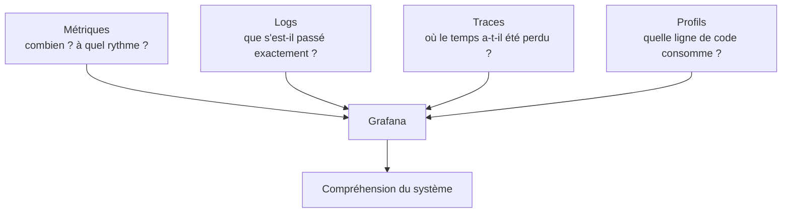
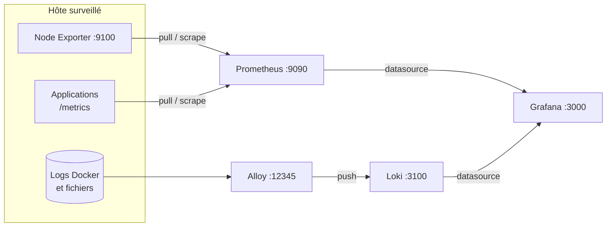
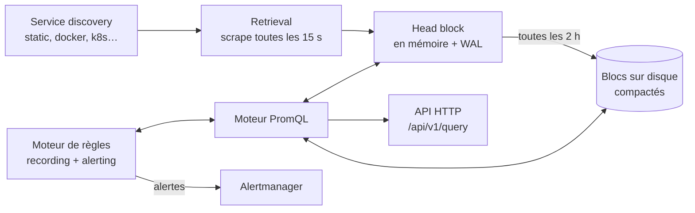
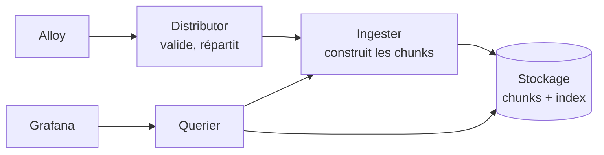
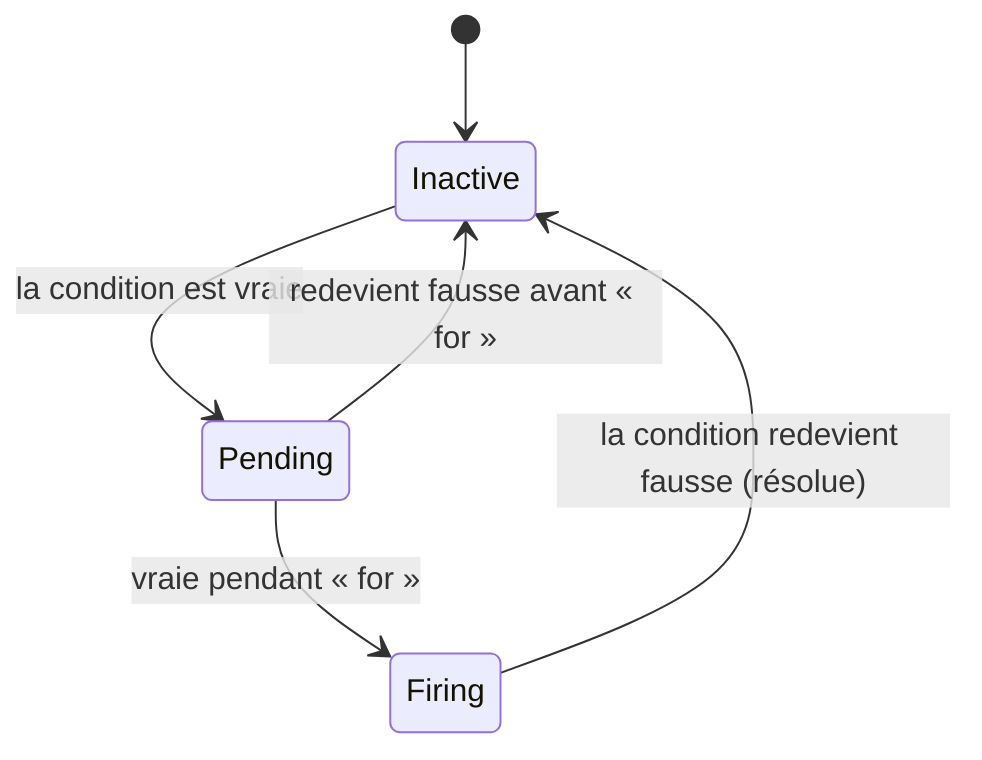

# 🧭 Observabilité — Palier 1 : Fondamentaux

### Prometheus • Node Exporter • Loki • Alloy • Grafana

---

## À propos de ce cours

**Public visé :** toute personne à l'aise avec Docker et la ligne de commande Linux (voir les cours `devops/01 linux`) qui veut passer de « je regarde des graphiques » à « je comprends et j'interroge mon système ».

**Comment l'utiliser :**
- Gardez un terminal et un navigateur ouverts. **Tapez** chaque commande, **exécutez** chaque requête : l'observabilité s'apprend en interrogeant de vraies données.
- Faites les exercices avant d'ouvrir la solution (`💡 Solution`).
- Le cours a un **projet fil rouge** : [`projet-fil-rouge/palier-1.md`](projet-fil-rouge/palier-1.md). Chaque module indique quelle étape du projet il débloque. Terminer le projet = maîtriser le palier.

**Conventions :**
- ⚠️ risque ou erreur fréquente, 💡 astuce de terrain, 🪤 piège classique, 🔗 lien vers le projet fil rouge.
- Les blocs de code sont copiables tels quels (sans prompt `$`).
- Les versions sont **épinglées** et ont été testées ensemble (septembre 2026) :

| Composant | Version | Composant | Version |
| --- | --- | --- | --- |
| Prometheus | v3.15.0 | Grafana | 13.2.2 |
| Node Exporter | v1.12.1 | Loki | 3.7.8 |
| Grafana Alloy | v1.20.0 | Docker Compose | v2 (`docker compose`) |

**Place dans le parcours :**

| Palier | Thème | Contenu clé |
| --- | --- | --- |
| 🟢 **1 — Fondamentaux** *(ce document)* | Comprendre & déployer | Concepts, stack Compose, modèle de données, PromQL, LogQL, Grafana |
| 🟡 **2 — Intermédiaire** | Fiabiliser & industrialiser | Instrumentation, alerting, exporters, service discovery, dashboards avancés, provisioning, RBAC |
| 🔴 **3 — Expert** | Passer à l'échelle | Traces (OpenTelemetry, Tempo), corrélation, Mimir, HA, SLO, sécurité, GitOps |

---

## Sommaire

**Partie 1 — Comprendre**
1. Qu'est-ce que l'observabilité ?
2. Panorama et architecture de la stack

**Partie 2 — Déployer**
3. Le lab Docker Compose
4. Prometheus en pratique
5. Le modèle de données des métriques

**Partie 3 — Interroger et visualiser**
6. PromQL, de zéro à autonome
7. Node Exporter et la méthode USE
8. Les logs avec Loki, Alloy et LogQL
9. Grafana : explorer, visualiser, construire un dashboard
10. Aperçu de l'alerting
11. Dépannage

**Partie 4 — Synthèse**
12. Projet fil rouge, auto-évaluation, cheat-sheet, glossaire, checklist

---

## Objectifs de ce palier

À la fin de ce palier, vous saurez :

- Expliquer ce qu'est l'observabilité, en quoi elle diffère du monitoring, et à quoi sert chaque signal
- Choisir la bonne méthode d'analyse (USE, RED, Golden Signals) selon ce que vous observez
- Déployer une stack auto-hébergée Prometheus + Node Exporter + Loki + Alloy + Grafana
- Lire le format d'exposition Prometheus et raisonner en séries temporelles (nom + labels)
- Écrire des requêtes PromQL correctes (rate, agrégations, jointures, prédictions) et éviter ses pièges
- Collecter, étiqueter et interroger des logs avec Alloy et LogQL (filtres, parsers, métriques de logs)
- Construire un dashboard Grafana lisible qui combine métriques et logs
- Diagnostiquer une stack qui ne remonte rien

---

# Partie 1 — Comprendre

## Module 1 — Qu'est-ce que l'observabilité ?

### 1.1 Monitoring vs observabilité

- **Monitoring** : vous surveillez des indicateurs que vous avez **anticipés** (*known unknowns*). « Le disque dépasse 90 % ? » « Le site répond-il ? » Indispensable, mais limité à ce que vous avez prévu.
- **Observabilité** : la capacité à **poser de nouvelles questions à votre système sans redéployer de code**, y compris sur des pannes jamais imaginées (*unknown unknowns*). « Pourquoi les paiements mobile money des clients de Kara sont-ils plus lents depuis mardi 14 h, alors que les paiements par carte vont bien ? »

Le terme vient de la théorie du contrôle : un système est *observable* si l'on peut déduire son état interne à partir de ses sorties. En informatique, les « sorties » sont les **signaux de télémétrie** que le système émet.

> En résumé : le monitoring vous dit **que** quelque chose ne va pas. L'observabilité vous aide à comprendre **pourquoi**. Le monitoring est une *activité* ; l'observabilité est une *propriété* du système — qu'on construit en l'instrumentant correctement.

Conséquence pratique : une bonne observabilité exige des données **riches en contexte** (labels, champs structurés, identifiants de requête) et des outils qui permettent de **découper** ces données à la volée (par client, par version, par région…).

### 1.2 Les signaux de télémétrie



| Signal | Définition | Question type | Coût / volume | Outil (ce cursus) |
| --- | --- | --- | --- | --- |
| **Métriques** | Valeurs numériques agrégées, échantillonnées dans le temps | « Combien de requêtes/s ? Quel taux d'erreur ? » | Faible et **prévisible** (dépend du nombre de séries, pas du trafic) | Prometheus |
| **Logs** | Événements textuels horodatés, idéalement structurés | « Que s'est-il passé pour la commande 4521 ? » | Proportionnel au trafic, peut exploser | Loki |
| **Traces** | Parcours d'une requête à travers les services, découpé en *spans* | « Quel service a rendu cette requête lente ? » | Proportionnel au trafic (d'où l'échantillonnage) | Tempo *(Palier 3)* |
| **Profils** | Où le CPU/la mémoire sont consommés dans le code | « Quelle fonction brûle le CPU ? » | Modéré | Pyroscope *(aperçu Palier 3)* |

Chaque signal a ses forces : les métriques **détectent** (peu coûteuses, parfaites pour alerter), les traces **localisent** (quel service, quel appel), les logs **expliquent** (le détail de l'événement). Le vrai pouvoir vient de leur **corrélation** : passer d'un pic sur un graphique à la trace d'une requête lente, puis aux logs de cette requête précise (Palier 3).

💡 Les *événements* (déploiements, changements de configuration) sont un signal souvent oublié : la moitié des incidents suivent un changement. On les affiche en **annotations** sur les graphiques (Palier 2).

### 1.3 Trois méthodes pour savoir quoi regarder

Face à un système, la question n'est pas « quelles métriques existent ? » (il y en a des milliers) mais « **lesquelles regarder en premier** ? ». Trois méthodes complémentaires :

| Méthode | Pour quoi | Ce qu'on mesure | Auteur |
| --- | --- | --- | --- |
| **USE** | Les **ressources** (CPU, mémoire, disque, réseau) | **U**tilisation (% du temps occupé), **S**aturation (travail en attente), **E**rreurs | Brendan Gregg |
| **RED** | Les **services** (API, microservices) | **R**ate (requêtes/s), **E**rrors (échecs/s), **D**uration (latence) | Tom Wilkie |
| **4 Golden Signals** | Tout système orienté utilisateur | Latence, Trafic, Erreurs, Saturation | Google SRE Book |

Règle simple : **RED pour ce que vos utilisateurs vivent, USE pour ce que vos machines subissent.** Une alerte « latence élevée » (RED) vous dit que les utilisateurs souffrent ; un graphique « disque saturé » (USE) vous dit peut-être pourquoi.

### 1.4 Pull ou push ?

| | **Pull** (Prometheus) | **Push** (Loki, OpenTelemetry) |
| --- | --- | --- |
| Qui initie ? | Le serveur interroge les cibles à intervalle fixe | L'agent/l'application envoie au serveur |
| Avantage | Le serveur sait qui est vivant (`up`), contrôle le rythme | Fonctionne derrière un NAT, pour les jobs courts, les événements |
| Inconvénient | Il faut que le serveur puisse joindre chaque cible | Un client silencieux est-il en panne ou juste calme ? |

Dans notre stack : Prometheus **tire** les métriques, Alloy **pousse** les logs vers Loki.

### 1.5 La cardinalité, notion centrale

La **cardinalité** d'une métrique est le nombre de combinaisons distinctes de ses labels — donc le nombre de **séries temporelles** qu'elle crée. C'est **le** facteur de coût des métriques (mémoire, disque, vitesse des requêtes).

```
http_requests_total{method, route, status}
  4 méthodes × 20 routes × 8 statuts          = 640 séries          ✅
http_requests_total{method, route, status, user_id}
  640 × 50 000 utilisateurs                    = 32 000 000 séries   💥
```

🪤 **Jamais** d'identifiant (utilisateur, commande, requête, e-mail, IP client) en label de métrique. Ces informations vont dans les **logs** ou les **traces**. On y reviendra à chaque palier.

### Exercice 1.1
Classez chaque question dans le signal le plus adapté : (a) « Combien de commandes par minute depuis ce matin ? » (b) « Pourquoi la commande 8812 a-t-elle échoué ? » (c) « Quel service ralentit le paiement ? » (d) « Le disque va-t-il être plein ce week-end ? »

<details><summary>💡 Solution</summary>

(a) Métriques (un compteur, agrégé dans le temps). (b) Logs (l'événement précis, avec son message d'erreur) — ou traces si l'échec implique plusieurs services. (c) Traces (le découpage du temps par service). (d) Métriques (tendance + `predict_linear`, Module 6).
</details>

### Exercice 1.2
Pour un service d'API de paiement, donnez un indicateur **RED** et, pour la base de données qu'il utilise, un indicateur **USE**.

<details><summary>💡 Solution</summary>

RED : taux de réponses 5xx de l'API par seconde (Errors), ou 95ᵉ centile de latence (Duration). USE : nombre de connexions en attente dans le pool (Saturation), % de CPU utilisé par PostgreSQL (Utilisation). Plusieurs réponses sont valables : l'important est que RED décrit le **service vu du client**, USE la **ressource**.
</details>

---

## Module 2 — Panorama et architecture de la stack

### 2.1 Les briques

| Outil | Rôle | Analogie |
| --- | --- | --- |
| **Prometheus** | Base de séries temporelles (TSDB) qui **scrape** périodiquement des cibles HTTP, stocke les échantillons, évalue des règles, et répond aux requêtes PromQL | Le collecteur + l'entrepôt des métriques |
| **Exporter** | Programme qui traduit l'état d'un système tiers (Linux, PostgreSQL, Nginx…) au format Prometheus, sur un endpoint `/metrics` | L'interprète |
| **Node Exporter** | L'exporter des métriques système Linux (CPU, mémoire, disque, réseau) | Le capteur posé sur chaque serveur |
| **Loki** | Base de logs de Grafana Labs qui n'indexe **que les labels**, pas le texte | « Prometheus, mais pour les logs » |
| **Grafana Alloy** | Collecteur de télémétrie (logs, métriques, traces, profils) : découvre les sources, les transforme et les envoie | Le facteur, qui trie aussi le courrier |
| **Grafana** | Interface unique qui interroge toutes ces sources et affiche dashboards, alertes, exploration | La tour de contrôle |

> ⚠️ **Promtail est en fin de vie.** L'agent historique de Loki a été déprécié début 2025 ; son support a pris fin le **2 mars 2026**. Idem pour l'ancien *Grafana Agent* (fin de vie le 1ᵉʳ novembre 2025). Le remplaçant officiel est **Grafana Alloy**, utilisé dans tout ce cursus. Vous croiserez encore des `promtail-config.yaml` dans des projets existants : Alloy sait les convertir (`alloy convert --source-format=promtail`).

### 2.2 Comment les briques s'articulent



### 2.3 À l'intérieur de Prometheus



- Les échantillons récents vivent en mémoire (*head block*), protégés par un journal (**WAL**) qui permet de redémarrer sans perte.
- Toutes les 2 h, le head est écrit en **bloc** immuable sur disque ; les blocs sont ensuite **compactés** (fusionnés) et supprimés au-delà de la **rétention**.
- Prometheus est volontairement **mono-nœud** : pas de cluster, pas de réplication. La haute disponibilité et le long terme se font avec d'autres outils (Mimir/Thanos, Palier 3).

### 2.4 À l'intérieur de Loki

Loki range les logs en **streams** : un stream = un ensemble unique de labels (`{service="orders", level="error"}`). Pour chaque stream, les lignes sont compressées en **chunks**. L'**index** ne contient que les labels → il reste minuscule. Une requête sélectionne d'abord les streams par leurs labels (rapide), puis **parcourt** le contenu des chunks pour filtrer le texte (le coût est là).



Conséquence : **on choisit les labels Loki avec soin** (peu nombreux, peu variables) et on filtre le contenu au moment de la requête. C'est ce qui rend Loki économe comparé à Elasticsearch, qui indexe chaque mot.

---

# Partie 2 — Déployer

## Module 3 — Le lab Docker Compose

🔗 Ce module correspond à l'**étape 1** du projet fil rouge.

### 3.1 Prérequis

- Docker Engine 24+ avec Compose v2 (`docker compose version`), 4 Go de RAM libres, ports 3000, 3100, 9090, 9100 et 12345 disponibles.
- **Windows / macOS (Docker Desktop)** : les conteneurs tournent dans une **machine virtuelle Linux**. Node Exporter mesure donc *cette VM*, pas votre Windows ou votre Mac. C'est normal et suffisant pour apprendre ; sur un vrai serveur Linux, il mesure la machine.

### 3.2 Arborescence

```
observabilite-lab/
├── docker-compose.yml
├── prometheus/
│   └── prometheus.yml
├── loki/
│   └── loki-config.yaml
└── alloy/
    └── config.alloy
```

### 3.3 `docker-compose.yml`

```yaml
name: obslab

services:
  prometheus:
    image: prom/prometheus:v3.15.0
    container_name: prometheus
    command:
      - --config.file=/etc/prometheus/prometheus.yml
      - --storage.tsdb.path=/prometheus
      - --storage.tsdb.retention.time=15d
      - --web.enable-lifecycle            # autorise POST /-/reload
    volumes:
      - ./prometheus/prometheus.yml:/etc/prometheus/prometheus.yml:ro
      - prometheus_data:/prometheus
    ports:
      - "9090:9090"
    restart: unless-stopped

  node-exporter:
    image: prom/node-exporter:v1.12.1
    container_name: node-exporter
    command:
      - --path.rootfs=/host
    pid: host
    volumes:
      - /:/host:ro      # sur un serveur Linux : /:/host:ro,rslave (refusé par Docker Desktop)
    ports:
      - "9100:9100"
    restart: unless-stopped

  loki:
    image: grafana/loki:3.7.8
    container_name: loki
    command: -config.file=/etc/loki/loki-config.yaml
    volumes:
      - ./loki/loki-config.yaml:/etc/loki/loki-config.yaml:ro
      - loki_data:/loki
    ports:
      - "3100:3100"
    restart: unless-stopped

  alloy:
    image: grafana/alloy:v1.20.0
    container_name: alloy
    command:
      - run
      - /etc/alloy/config.alloy
      - --server.http.listen-addr=0.0.0.0:12345
      - --storage.path=/var/lib/alloy/data
    volumes:
      - ./alloy/config.alloy:/etc/alloy/config.alloy:ro
      - /var/run/docker.sock:/var/run/docker.sock:ro
      - alloy_data:/var/lib/alloy/data
    ports:
      - "12345:12345"
    depends_on: [loki]
    restart: unless-stopped

  grafana:
    image: grafana/grafana:13.2.2
    container_name: grafana
    environment:
      GF_SECURITY_ADMIN_PASSWORD: changeme     # lab uniquement ! Palier 3 : secrets
    volumes:
      - grafana_data:/var/lib/grafana
    ports:
      - "3000:3000"
    depends_on: [prometheus, loki]
    restart: unless-stopped

  # Deux générateurs de faux logs web, pour s'entraîner à LogQL
  flog-json:
    image: mingrammer/flog:0.4.3
    container_name: flog-json
    command: ["--format", "json", "--loop", "--delay", "250ms"]
    restart: unless-stopped

  flog-apache:
    image: mingrammer/flog:0.4.3
    container_name: flog-apache
    command: ["--format", "apache_common", "--loop", "--delay", "500ms"]
    restart: unless-stopped

volumes:
  prometheus_data:
  loki_data:
  alloy_data:
  grafana_data:
```

Points à comprendre :

- **Versions épinglées** (`v3.15.0`, jamais `latest`) : un `docker compose pull` ne doit pas changer votre stack à votre insu. On met à jour volontairement, après lecture des notes de version.
- **Volumes nommés** (`prometheus_data`…) : les données survivent à `docker compose down`. Seul `docker compose down -v` les efface.
- La clé `version: "3.8"` que l'on voit dans de vieux tutoriels est **obsolète** : Compose v2 l'ignore.
- `name: obslab` fixe le nom du projet Compose (préfixe des volumes, réseau, et label `com.docker.compose.project` qu'Alloy utilisera pour filtrer).
- Node Exporter a besoin de `pid: host` et du système de fichiers de l'hôte en lecture seule pour voir la machine plutôt que son propre conteneur.

### 3.4 `prometheus/prometheus.yml`

```yaml
global:
  scrape_interval: 15s       # fréquence de collecte par défaut
  evaluation_interval: 15s   # fréquence d'évaluation des règles (Palier 2)

scrape_configs:
  - job_name: prometheus     # Prometheus se surveille lui-même
    static_configs:
      - targets: ["localhost:9090"]

  - job_name: node
    static_configs:
      - targets: ["node-exporter:9100"]

  - job_name: loki           # toute la stack expose ses propres métriques
    static_configs:
      - targets: ["loki:3100"]

  - job_name: alloy
    static_configs:
      - targets: ["alloy:12345"]
```

### 3.5 `loki/loki-config.yaml` (monolithique, stockage fichier)

```yaml
auth_enabled: false            # mono-tenant ; multi-tenant au Palier 3

server:
  http_listen_port: 3100
  grpc_listen_port: 9096
  log_level: warn

common:
  instance_addr: 127.0.0.1
  path_prefix: /loki
  storage:
    filesystem:
      chunks_directory: /loki/chunks
      rules_directory: /loki/rules
  replication_factor: 1
  ring:
    kvstore:
      store: inmemory

schema_config:
  configs:
    - from: 2024-01-01
      store: tsdb              # index TSDB : le seul recommandé aujourd'hui
      object_store: filesystem
      schema: v13
      index:
        prefix: index_
        period: 24h

limits_config:
  retention_period: 168h       # 7 jours…
  allow_structured_metadata: true

compactor:                     # …appliqués par le compacteur
  working_directory: /loki/compactor
  retention_enabled: true
  delete_request_store: filesystem

analytics:
  reporting_enabled: false
```

🪤 Sans bloc `compactor` avec `retention_enabled: true`, `retention_period` n'a **aucun effet** : les logs s'accumulent indéfiniment.

### 3.6 `alloy/config.alloy`

Alloy se configure avec son propre langage : des **composants** (`type "label" { … }`) dont les sorties alimentent les entrées d'autres composants, formant un pipeline.

```alloy
// 1. Découvrir les conteneurs via l'API Docker — uniquement ceux du projet « obslab »
discovery.docker "containers" {
  host = "unix:///var/run/docker.sock"
  filter {
    name   = "label"
    values = ["com.docker.compose.project=obslab"]
  }
}

// 2. Transformer les métadonnées Docker en labels Loki (peu nombreux, peu variables)
discovery.relabel "containers" {
  targets = []

  rule {
    source_labels = ["__meta_docker_container_label_com_docker_compose_service"]
    target_label  = "service"
  }
  rule {
    source_labels = ["__meta_docker_container_name"]
    regex         = "/(.*)"
    target_label  = "container"
  }
}

// 3. Lire les logs de ces conteneurs
loki.source.docker "containers" {
  host          = "unix:///var/run/docker.sock"
  targets       = discovery.docker.containers.targets
  relabel_rules = discovery.relabel.containers.rules
  labels        = { job = "docker" }
  forward_to    = [loki.write.local.receiver]
}

// 4. Envoyer à Loki
loki.write "local" {
  endpoint {
    url = "http://loki:3100/loki/api/v1/push"
  }
}
```

🪤 **Filtrez dans `discovery.docker`, pas avec une règle `keep`** dans `discovery.relabel`. Testé sur ce lab : `loki.source.docker` continue de lire les conteneurs dont les règles de relabel ont supprimé les labels, et envoie leurs logs **sans aucun label** — y compris ceux de tous les autres projets Docker de la machine, avec des horodatages anciens que Loki rejette (`timestamp too old`).

### 3.7 Lancer et vérifier

```bash
cd observabilite-lab
docker compose up -d
docker compose ps
```

| Vérification | Commande / URL | Attendu |
| --- | --- | --- |
| Prometheus prêt | `curl -s localhost:9090/-/ready` | `Prometheus Server is Ready.` |
| Cibles scrapées | http://localhost:9090/targets | 4 cibles **UP** |
| Loki prêt | `curl -s localhost:3100/ready` | `ready` (après ~15 s) |
| Labels reçus par Loki | `curl -s localhost:3100/loki/api/v1/label/service/values` | `flog-json`, `prometheus`, … |
| Alloy | http://localhost:12345 | Graphe des composants, tous *healthy* |
| Grafana | http://localhost:3000 | Login `admin` / `changeme` |

### Exercice 3.1
Ajoutez à la cible `node` un label `env="lab"`, rechargez la configuration **sans redémarrer** Prometheus, et vérifiez que la série `up{job="node"}` porte le nouveau label.

<details><summary>💡 Solution</summary>

```yaml
  - job_name: node
    static_configs:
      - targets: ["node-exporter:9100"]
        labels:
          env: lab
```

```bash
docker run --rm -v "$PWD/prometheus:/p" --entrypoint promtool prom/prometheus:v3.15.0 check config /p/prometheus.yml
curl -X POST localhost:9090/-/reload       # possible grâce à --web.enable-lifecycle
curl -sG localhost:9090/api/v1/query --data-urlencode 'query=up{job="node"}'
```
Toujours **valider** avec `promtool` avant de recharger : une config invalide est refusée au reload (Prometheus garde l'ancienne), mais **fait échouer un redémarrage**.
</details>

---

## Module 4 — Prometheus en pratique

### 4.1 Anatomie d'un job de scrape

```yaml
scrape_configs:
  - job_name: mon-api            # devient le label job="mon-api"
    scrape_interval: 30s         # surcharge le global
    scrape_timeout: 10s          # doit être ≤ scrape_interval
    metrics_path: /metrics       # défaut
    scheme: http                 # ou https
    static_configs:
      - targets: ["api-1:8080", "api-2:8080"]   # chaque cible → label instance="api-1:8080"
        labels:
          equipe: paiements      # labels ajoutés à toutes les séries de ces cibles
```

Pour chaque cible, Prometheus ajoute automatiquement `job` et `instance`, et crée quelques séries de santé :

| Série | Signification |
| --- | --- |
| `up` | 1 si le dernier scrape a réussi, 0 sinon |
| `scrape_duration_seconds` | Durée du scrape |
| `scrape_samples_scraped` | Nombre d'échantillons récupérés (surveillez les explosions de cardinalité !) |
| `scrape_series_added` | Nouvelles séries créées par ce scrape |

### 4.2 Le format d'exposition

Regardez ce que Prometheus lit réellement :

```bash
curl -s localhost:9100/metrics | grep -A3 "node_load1 "
curl -s localhost:9100/metrics | grep -E "^# (HELP|TYPE) node_cpu_seconds_total" -A3
```

```
# HELP node_cpu_seconds_total Seconds the CPUs spent in each mode.
# TYPE node_cpu_seconds_total counter
node_cpu_seconds_total{cpu="0",mode="idle"} 18432.51
node_cpu_seconds_total{cpu="0",mode="user"} 1204.33
```

- `# HELP` : description ; `# TYPE` : type (counter, gauge, histogram, summary).
- Chaque ligne : `nom{labels} valeur [horodatage]`. L'horodatage est normalement absent : Prometheus utilise l'heure du scrape.
- Il existe un format plus strict, **OpenMetrics**, négocié via l'en-tête `Accept` ; il ajoute notamment les *exemplars* (Palier 3).

### 4.3 Recharger, valider, explorer

| Action | Comment |
| --- | --- |
| Valider la config | `promtool check config prometheus.yml` |
| Recharger | `curl -X POST localhost:9090/-/reload` (avec `--web.enable-lifecycle`) ou `docker kill -s HUP prometheus` |
| Voir la config effective | UI → *Status → Configuration* |
| Voir les cibles et leurs erreurs | UI → *Status → Target health* |
| Voir la découverte de cibles | UI → *Status → Service discovery* (labels avant/après relabeling) |
| Diagnostiquer la cardinalité | UI → *Status → TSDB status* : métriques et labels qui créent le plus de séries |

### 4.4 L'API HTTP

Tout ce que fait l'UI passe par une API JSON — utile pour les scripts et la CI :

```bash
# Requête instantanée
curl -sG localhost:9090/api/v1/query --data-urlencode 'query=up'

# Requête sur une plage (ce que fait un graphique)
curl -sG localhost:9090/api/v1/query_range \
  --data-urlencode 'query=rate(node_network_receive_bytes_total[5m])' \
  --data-urlencode "start=$(date -d '-1 hour' +%s)" --data-urlencode "end=$(date +%s)" \
  --data-urlencode 'step=60'

# Lister les valeurs d'un label
curl -s localhost:9090/api/v1/label/job/values
```

### 4.5 Rétention et dimensionnement

La documentation de Prometheus donne une formule simple :

```
disque ≈ durée de rétention (s) × échantillons ingérés par seconde × 1 à 2 octets
```

Exemple : 50 000 séries scrapées toutes les 15 s = 3 333 échantillons/s. Sur 15 jours : `1 296 000 s × 3 333 × 2 o ≈ 8,6 Go`. La mémoire, elle, dépend surtout du **nombre de séries actives** (comptez quelques Ko par série dans le head).

Deux limites de rétention, combinables : `--storage.tsdb.retention.time=15d` et `--storage.tsdb.retention.size=20GB` (la première atteinte gagne).

### Exercice 4.1
Avec l'API, trouvez combien d'échantillons chaque job produit à chaque scrape, et le nombre total de séries actives dans Prometheus.

<details><summary>💡 Solution</summary>

```bash
curl -sG localhost:9090/api/v1/query --data-urlencode 'query=sum by (job) (scrape_samples_scraped)'
curl -sG localhost:9090/api/v1/query --data-urlencode 'query=prometheus_tsdb_head_series'
```
Node Exporter produit à lui seul plusieurs centaines à milliers de séries : c'est normal, et c'est pourquoi on désactive les collecteurs inutiles en production.
</details>

---

## Module 5 — Le modèle de données des métriques

### 5.1 Une série temporelle = un nom + des labels

```
node_filesystem_avail_bytes{device="/dev/sda1", fstype="ext4", instance="node-exporter:9100", job="node", mountpoint="/"}
└──────────── nom ─────────┘└──────────────────────────────── labels ──────────────────────────────────────────┘
```

- Le nom est en réalité un label spécial : `__name__`. `node_load1` ≡ `{__name__="node_load1"}`.
- **Changer un seul label = une autre série.** Renommer un label, c'est casser la continuité des graphiques.
- Un **échantillon** = (horodatage en ms, valeur `float64`).

### 5.2 Conventions de nommage

| Règle | Bon | Mauvais |
| --- | --- | --- |
| snake_case, préfixe = domaine | `marche_orders_total` | `OrdersCount` |
| Unités de base SI, en suffixe | `_seconds`, `_bytes`, `_ratio` | `_ms`, `_mb`, `_percent` |
| Compteur → `_total` | `http_requests_total` | `http_requests` |
| Métrique d'information → `_info`, valeur 1 | `node_uname_info` | — |
| Pas de label dans le nom | `http_requests_total{method="GET"}` | `http_get_requests_total` |

### 5.3 Les quatre types

| Type | Comportement | Exemple | Fonction PromQL associée |
| --- | --- | --- | --- |
| **Counter** | Ne fait qu'augmenter ; revient à 0 au redémarrage du processus | `node_network_receive_bytes_total` | `rate()`, `increase()` — jamais la valeur brute |
| **Gauge** | Monte et descend | `node_memory_MemAvailable_bytes` | valeur directe, `*_over_time()`, `deriv()` |
| **Histogram** | Compte les observations par tranche (*bucket*) + somme + nombre | `prometheus_http_request_duration_seconds` | `histogram_quantile()` |
| **Summary** | Quantiles calculés **côté client** | `go_gc_duration_seconds` | lecture directe (non agrégeable) |

Un histogramme « classique » expose trois familles de séries :

```
prometheus_http_request_duration_seconds_bucket{handler="/api/v1/query", le="0.1"}   120   ← requêtes ≤ 0,1 s
prometheus_http_request_duration_seconds_bucket{handler="/api/v1/query", le="0.2"}   131   ← ≤ 0,2 s (cumulatif !)
prometheus_http_request_duration_seconds_bucket{handler="/api/v1/query", le="+Inf"}  135   ← toutes
prometheus_http_request_duration_seconds_sum{handler="/api/v1/query"}                 9.87  ← somme des durées
prometheus_http_request_duration_seconds_count{handler="/api/v1/query"}               135   ← nombre (= bucket +Inf)
```

🪤 Les buckets sont **cumulatifs** : `le="0.2"` inclut les requêtes de `le="0.1"`.

**Histogram ou summary ?** Préférez l'histogramme : ses buckets s'**additionnent** entre instances (on peut calculer le p95 de 10 réplicas), alors qu'on ne peut pas moyenner des quantiles de summaries.

💡 **Histogrammes natifs.** Depuis Prometheus 3.8, les *native histograms* sont stables : des buckets exponentiels automatiques, bien plus précis et moins coûteux, sans avoir à choisir ses buckets. Ils restent **optionnels** (`scrape_native_histograms: true` dans le job) et exigent une bibliothèque cliente qui les émet. Ce cursus utilise les histogrammes classiques, universellement supportés ; retenez que l'avenir va vers les natifs.

### 5.4 Choisir ses labels

| ✅ Bon label | ❌ Mauvais label |
| --- | --- |
| Ensemble **fini et petit** de valeurs : `method`, `status`, `route` (modèle `/orders/{id}`), `env`, `region` | Valeurs **illimitées** : `user_id`, `order_id`, `email`, `ip`, chemin brut `/orders/8812`, message d'erreur complet |

### Exercice 5.1
Un développeur propose `http_request_duration_ms{path="/api/orders/1234", user="awa@exemple.tg"}` en *summary*. Listez tous les problèmes.

<details><summary>💡 Solution</summary>

1. Unité non SI : `_ms` → `http_request_duration_seconds`. 2. `path` brut contient un identifiant → cardinalité infinie ; utiliser le **modèle de route** `/api/orders/{order_id}`. 3. `user` (e-mail) : cardinalité infinie **et** donnée personnelle dans un système non conçu pour ça. 4. Summary : non agrégeable entre instances → histogramme.
</details>

---

# Partie 3 — Interroger et visualiser

## Module 6 — PromQL, de zéro à autonome

🔗 Étape 2 du projet fil rouge. Testez chaque requête dans http://localhost:9090/query (onglets *Table* et *Graph*).

### 6.1 Les types de résultats

| Type | Ce que c'est | Exemple |
| --- | --- | --- |
| **Instant vector** | Une valeur par série, à un instant | `node_load1` |
| **Range vector** | Une **liste** de valeurs par série, sur une fenêtre | `node_load1[5m]` |
| **Scalar** | Un nombre seul | `42`, `time()` |

Un graphique ne peut afficher qu'un instant vector. Les range vectors servent d'**entrée** aux fonctions comme `rate()` ou `avg_over_time()`.

### 6.2 Sélecteurs et matchers

```promql
up                                              # toutes les séries « up »
up{job="node"}                                  # égalité
node_cpu_seconds_total{mode=~"user|system"}     # regex
node_cpu_seconds_total{mode!~"idle|iowait"}     # regex négative
{__name__=~"node_memory_Mem.*_bytes"}           # sélection par nom
```

| Matcher | Sens |
| --- | --- |
| `=` / `!=` | égal / différent |
| `=~` / `!~` | correspond / ne correspond pas à la regex |

🪤 Les regex PromQL sont **ancrées** : `mode=~"use"` ne matche **pas** `user`. Écrivez `mode=~"use.*"`.

### 6.3 Fenêtres, décalages et `@`

```promql
node_cpu_seconds_total{mode="idle", cpu="0"}[1m]              # range vector : ~4 échantillons (1 toutes les 15 s)
rate(node_cpu_seconds_total{mode="idle", cpu="0"}[5m] offset 1h)   # la même chose, il y a une heure
node_load1 @ 1790550000                                        # valeur à un instant précis (timestamp Unix)
```

Unités de durée : `ms`, `s`, `m`, `h`, `d`, `w`, `y`.

### 6.4 Les compteurs : `rate`, `irate`, `increase`

La valeur brute d'un compteur n'a aucun intérêt (« 18 432 secondes de CPU idle depuis le boot »). Ce qui compte, c'est sa **vitesse** :

```promql
rate(node_network_receive_bytes_total[5m])        # octets/s, moyenne sur 5 min
irate(node_network_receive_bytes_total[5m])       # octets/s entre les 2 DERNIERS points (très réactif, bruité)
increase(node_network_receive_bytes_total[1h])    # octets reçus sur la dernière heure (= rate × 3600)
```

- `rate()` **gère les remises à zéro** (redémarrage du processus) : si la valeur baisse, il comprend qu'il y a eu un reset.
- `rate()` **extrapole** aux bords de la fenêtre : `increase()` peut donc renvoyer des valeurs non entières sur un compteur entier. C'est normal.
- **La fenêtre doit contenir au moins 4 points** : avec un scrape de 15 s, `[1m]` est un minimum, `[5m]` un bon défaut. Dans Grafana, utilisez `$__rate_interval` qui calcule la bonne valeur (Module 9).
- `irate` pour des graphiques très réactifs sur de courtes périodes ; `rate` pour les alertes et les tendances.

🪤 **Toujours `rate` puis `sum`, jamais l'inverse.** `rate(sum(x)[5m])` n'est d'ailleurs pas du PromQL valide sans sous-requête, et `sum` avant `rate` casse la détection des resets : si un seul processus redémarre, la somme baisse et `rate` y voit un faux reset géant.

### 6.5 Agrégation

```promql
sum by (mode) (rate(node_cpu_seconds_total[5m]))                  # garder le label mode, sommer le reste
avg without (cpu) (rate(node_cpu_seconds_total{mode="idle"}[5m]))  # agréger sur cpu, garder tout le reste
count without (cpu, mode) (node_cpu_seconds_total{mode="idle"})    # nombre de cœurs par machine
topk(3, sum by (mode) (rate(node_cpu_seconds_total[5m])))          # les 3 modes les plus consommateurs
```

| Opérateur | Rôle |
| --- | --- |
| `sum`, `avg`, `min`, `max` | Classiques |
| `count`, `count_values` | Nombre de séries ; nombre de séries par valeur |
| `topk(k, …)`, `bottomk(k, …)` | Les k plus grandes / petites séries |
| `quantile(φ, …)` | Quantile **entre séries** (pas dans le temps) |
| `stddev`, `stdvar` | Dispersion |
| `by (l1, l2)` / `without (l1)` | Labels conservés / retirés |

💡 Préférez `without` quand vous voulez « tout garder sauf » : la requête reste correcte si quelqu'un ajoute un label utile (`region`) plus tard.

### 6.6 Opérateurs arithmétiques, de comparaison et logiques

```promql
1 - node_memory_MemAvailable_bytes / node_memory_MemTotal_bytes   # arithmétique entre séries
node_filesystem_avail_bytes / node_filesystem_size_bytes < 0.1    # comparaison = FILTRE : ne garde que les séries < 10 %
node_load1 > bool 1                                               # avec bool : renvoie 0 ou 1 au lieu de filtrer
up == 0 or vector(0)                                              # or : union ; ici « 0 si rien n'est down »
```

- Comparaison **sans** `bool` : filtre (les séries qui ne satisfont pas disparaissent). C'est ce qu'on écrit dans les alertes.
- `and`, `or`, `unless` : opérations d'**ensembles** sur les séries (par labels), pas des booléens sur les valeurs.

### 6.7 Jointures : `on`, `ignoring`, `group_left`

Deux vecteurs ne se combinent que si leurs labels correspondent **exactement**. Sinon, on précise la correspondance :

```promql
# Débit réseau + nom d'hôte, pris dans la métrique d'info node_uname_info (valeur 1)
sum by (instance, nodename) (
  rate(node_network_receive_bytes_total[5m])
  * on (instance) group_left (nodename) node_uname_info
)

# Charge par cœur : diviser par le nombre de CPU de CHAQUE machine
node_load1 / on (instance) count by (instance) (node_cpu_seconds_total{mode="idle"})
```

- `on (instance)` : ne comparer que ce label. `ignoring (x)` : tous sauf `x`.
- `group_left (nodename)` : jointure **plusieurs-vers-un** (plusieurs interfaces réseau pour un seul `node_uname_info`), en **copiant** le label `nodename` du côté droit. C'est le pattern standard pour enrichir des métriques avec une métrique `_info`.

### 6.8 Fonctions indispensables

| Fonction | Usage | Exemple |
| --- | --- | --- |
| `avg_over_time`, `max_over_time`, `min_over_time`, `quantile_over_time` | Statistique **dans le temps** d'une gauge | `max_over_time(node_load1[1h])` |
| `deriv(g[…])` | Pente d'une gauge (par seconde) | fuite mémoire |
| `predict_linear(g[…], s)` | Valeur prévue dans `s` secondes | disque plein ? |
| `delta(g[…])` | Variation d'une gauge sur la fenêtre | |
| `changes(x[…])` / `resets(c[…])` | Nombre de changements / de resets | redémarrages |
| `absent(sel)` / `absent_over_time(sel[…])` | 1 si **aucune** série ne correspond | métrique disparue |
| `histogram_quantile(φ, …)` | Quantile d'un histogramme | p90 de latence |
| `label_replace(v, dst, repl, src, regex)` | Créer/réécrire un label | extraire le port |
| `clamp_min`, `clamp_max`, `round`, `abs` | Bornes et arrondis | |
| `time()`, `timestamp(v)` | Heure courante / d'un échantillon | uptime |
| `sort`, `sort_desc` | Tri (onglet Table) | |

```promql
# Uptime de la machine, en secondes
time() - node_boot_time_seconds

# Espace libre prévu dans 4 h, d'après la tendance de la dernière heure
predict_linear(node_filesystem_avail_bytes{mountpoint=~"/|/var/lib"}[1h], 4 * 3600)

# p90 de latence de l'API de Prometheus lui-même (tous handlers confondus)
histogram_quantile(0.9, sum by (le) (rate(prometheus_http_request_duration_seconds_bucket[5m])))

# Extraire le port de l'instance dans un nouveau label
label_replace(up, "port", "$1", "instance", ".*:(\\d+)")

# Alerte « la métrique a disparu » (le job n'existe plus du tout)
absent(up{job="node"})
```

🪤 Pour `histogram_quantile`, gardez **toujours** le label `le` dans l'agrégation : `sum by (le)` ou `sum by (le, service)`. Sans `le`, le résultat est vide.

### 6.9 Sous-requêtes

Une sous-requête transforme une expression instantanée en range vector : `expr[fenêtre:résolution]`.

```promql
# Le pic de consommation CPU (moyenné sur 1 min) atteint pendant les 30 dernières minutes
max_over_time(rate(node_cpu_seconds_total{mode="user", cpu="0"}[1m])[30m:1m])
```

Puissant mais coûteux ; au Palier 2, on les remplace souvent par des *recording rules*.

### 6.10 Staleness : quand une série « disparaît »

Pour une requête instantanée, Prometheus prend le **dernier échantillon dans les 5 minutes** précédentes (*lookback delta*). Si une cible cesse d'exposer une série, Prometheus la marque « périmée » (*stale*) au scrape suivant et elle disparaît des résultats. C'est pour cela qu'une série absente ne vaut pas 0 : elle **n'existe pas** — d'où `absent()` et `or vector(0)`.

### 6.11 Recettes USE pour une machine

| Ressource | Utilisation | Saturation | Erreurs |
| --- | --- | --- | --- |
| CPU | `1 - avg by (instance) (rate(node_cpu_seconds_total{mode="idle"}[5m]))` | `node_load1 / on (instance) count by (instance) (node_cpu_seconds_total{mode="idle"})` ou `rate(node_pressure_cpu_waiting_seconds_total[5m])` | — |
| Mémoire | `1 - node_memory_MemAvailable_bytes / node_memory_MemTotal_bytes` | `rate(node_vmstat_pswpin[5m])` (swap), `rate(node_pressure_memory_waiting_seconds_total[5m])` | `node_vmstat_oom_kill` |
| Disque (espace) | `1 - node_filesystem_avail_bytes / node_filesystem_size_bytes` | `predict_linear(...)` | `node_filesystem_device_error` |
| Disque (I/O) | `rate(node_disk_io_time_seconds_total[5m])` | `rate(node_pressure_io_waiting_seconds_total[5m])` | — |
| Réseau | `rate(node_network_receive_bytes_total[5m]) * 8` (bits/s) | `rate(node_network_receive_drop_total[5m])` | `rate(node_network_receive_errs_total[5m])` |

💡 Les métriques `node_pressure_*` (PSI, *Pressure Stall Information*, noyau Linux ≥ 4.20) mesurent directement le **temps passé à attendre** une ressource : c'est la meilleure mesure de saturation disponible.

### 6.12 Les pièges PromQL à connaître par cœur

| Piège | Symptôme | Correction |
| --- | --- | --- |
| Afficher un compteur brut | Courbe qui monte toujours | `rate()` / `increase()` |
| `rate()` sur une gauge | Valeurs absurdes | `deriv()` ou `delta()` |
| `sum` avant `rate` | Pics énormes aux redémarrages | `sum(rate(...))` |
| Moyenne de percentiles | Chiffre faux | Agréger les **buckets** puis `histogram_quantile` |
| Fenêtre trop courte (`[15s]`) | Graphique vide ou troué | ≥ 4 × `scrape_interval`, ou `$__rate_interval` |
| Regex non ancrée pensée comme « contient » | Rien ne matche | `=~".*motif.*"` |
| Série absente traitée comme 0 | Alerte qui ne part jamais | `absent()`, `or vector(0)` |
| Label oublié dans `by` de `histogram_quantile` | Résultat vide | inclure `le` |

### Exercices PromQL

**6.1** Nombre de cœurs CPU de la machine.
**6.2** Pourcentage de CPU utilisé, toutes CPU confondues.
**6.3** Mémoire disponible en Gio.
**6.4** Débit réseau entrant en **bits** par seconde, en excluant `lo` et les interfaces virtuelles Docker.
**6.5** Le système de fichiers le plus rempli (ignorez `tmpfs`).
**6.6** Dans combien d'heures le point de montage des données sera-t-il plein, au rythme de la dernière heure ? (renvoyer une valeur, même si elle est énorme)
**6.7** Les 5 métriques qui ont le plus de séries dans Prometheus.
**6.8** Le taux de requêtes HTTP reçues par Prometheus, par handler, trié.
**6.9** Uptime de la machine en jours.
**6.10** Une expression qui renvoie `1` si **au moins une** cible est DOWN, `0` sinon — et qui renvoie bien `0` (pas « vide ») quand tout va bien.

<details><summary>💡 Solutions</summary>

```promql
# 6.1
count(node_cpu_seconds_total{mode="idle"})

# 6.2
100 * (1 - avg(rate(node_cpu_seconds_total{mode="idle"}[5m])))

# 6.3
node_memory_MemAvailable_bytes / 1024 / 1024 / 1024

# 6.4
sum(rate(node_network_receive_bytes_total{device!~"lo|veth.*|docker.*|br-.*"}[5m])) * 8

# 6.5
topk(1, 1 - node_filesystem_avail_bytes{fstype!~"tmpfs|9p|rootfs"} / node_filesystem_size_bytes{fstype!~"tmpfs|9p|rootfs"})

# 6.6 — espace libre / vitesse de remplissage (deriv est négatif si le disque se remplit)
node_filesystem_avail_bytes{mountpoint=~"/|/var/lib"} / -deriv(node_filesystem_avail_bytes{mountpoint=~"/|/var/lib"}[1h]) / 3600

# 6.7
topk(5, count by (__name__) ({__name__=~".+"}))

# 6.8
sort_desc(sum by (handler) (rate(prometheus_http_requests_total[5m])))

# 6.9
(time() - node_boot_time_seconds) / 86400

# 6.10
count(up == 0) > bool 0 or vector(0)
```
Pour 6.6, une valeur négative signifie que l'espace libre **augmente** : le disque ne se remplit pas. Pour 6.10, sans `or vector(0)`, `count()` d'un ensemble vide renvoie… rien.
</details>

---

## Module 7 — Node Exporter et la méthode USE

### 7.1 Les collecteurs

Node Exporter est organisé en **collecteurs** (cpu, meminfo, filesystem, diskstats, netdev, pressure…), la plupart actifs par défaut. On en active ou désactive avec des flags :

```yaml
    command:
      - --path.rootfs=/host
      - --collector.systemd                          # activer (désactivé par défaut)
      - --no-collector.wifi                          # désactiver
      - --collector.filesystem.mount-points-exclude=^/(dev|proc|run|sys|var/lib/docker/.+)($|/)
```

### 7.2 Le collecteur textfile : vos propres métriques système

Pour exposer une valeur calculée par un script (date de la dernière sauvegarde, nombre de mises à jour en attente…), on écrit un fichier `.prom` dans un dossier lu par Node Exporter :

```yaml
    command:
      - --path.rootfs=/host
      - --collector.textfile.directory=/textfile
    volumes:
      - /:/host:ro
      - ./textfile:/textfile:ro
```

```bash
# Script lancé par cron après chaque sauvegarde (voir le cours Linux, module cron)
cat > textfile/backup.prom.$$ <<EOF
# HELP backup_last_success_timestamp_seconds Date de la dernière sauvegarde réussie.
# TYPE backup_last_success_timestamp_seconds gauge
backup_last_success_timestamp_seconds $(date +%s)
EOF
mv textfile/backup.prom.$$ textfile/backup.prom   # écriture atomique : jamais de fichier à moitié écrit
```

La requête `time() - backup_last_success_timestamp_seconds > 86400` détecte une sauvegarde qui n'a pas tourné depuis 24 h.

### 7.3 Particularités Docker Desktop

🪤 Sous Docker Desktop, il n'y a **pas** de point de montage `/` dans `node_filesystem_*` : les données Docker sont sur `/var/lib` (et `/mnt/docker-desktop-disk`). Sur un serveur Linux, c'est `/`. D'où le matcher `mountpoint=~"/|/var/lib"` utilisé dans ce cours, qui fonctionne dans les deux cas. Explorez vos points de montage :

```promql
node_filesystem_size_bytes{fstype!~"tmpfs|9p|rootfs"}
```

### Exercice 7.1
Mettez en place le collecteur textfile et exposez une métrique `lab_exercice_termine` valant `1`. Vérifiez-la dans Prometheus.

<details><summary>💡 Solution</summary>

Ajoutez le flag et le volume ci-dessus, puis :
```bash
mkdir -p textfile
printf '# TYPE lab_exercice_termine gauge\nlab_exercice_termine 1\n' > textfile/lab.prom
docker compose up -d node-exporter
curl -s localhost:9100/metrics | grep lab_exercice
```
Le fichier doit se terminer par un retour à la ligne, et chaque métrique ne doit apparaître que dans **un seul** fichier.
</details>

---

## Module 8 — Les logs avec Loki, Alloy et LogQL

🔗 Étape 3 du projet fil rouge.

### 8.1 Streams, labels et structured metadata

- **Stream** = une combinaison unique de labels. `{service="flog-json", job="docker"}` est un stream.
- **Labels** : indexés, donc peu nombreux et à faible cardinalité. Un bon ensemble : `service`, `container`, `job`, `env`, éventuellement `level`.
- **Structured metadata** (Loki 3) : des paires clé/valeur attachées à chaque ligne, **non indexées comme labels**, filtrables sans créer de streams. L'endroit idéal pour un `trace_id` (Palier 3).
- Loki 3 ajoute automatiquement `service_name` (déduit des labels) et, à la lecture, `detected_level` (niveau deviné depuis le contenu).

🪤 Chaque nouvelle valeur de label crée un **nouveau stream**. Un label `request_id` = un stream par requête = Loki à genoux. Règle : si une valeur est unique par événement, c'est un **champ** (dans la ligne ou en structured metadata), pas un label.

### 8.2 Logs structurés : la meilleure décision possible

Comparez :

```
2026-09-28 14:03:11 ERROR Payment failed for order 8812 after 3 retries (provider timeout)
{"ts":"2026-09-28T14:03:11Z","level":"error","msg":"payment failed","order_id":8812,"retries":3,"reason":"provider_timeout"}
```

La seconde ligne se filtre (`| json | reason="provider_timeout"`), s'agrège (`sum by (reason)`), se mesure (`unwrap retries`) sans aucune regex fragile. **Loguez en JSON** (ou logfmt), sur la sortie standard, avec des noms de champs stables.

### 8.3 Alloy en pratique

- Interface de débogage : http://localhost:12345 → **Graph** montre le pipeline ; cliquez un composant pour voir son état, ses arguments et ses exports (ex. les cibles découvertes).
- Valider/formater une config : `docker run --rm -v "$PWD/alloy:/c" grafana/alloy:v1.20.0 fmt /c/config.alloy`
- Recharger sans redémarrer : `curl -X POST localhost:12345/-/reload`
- Lire des **fichiers** plutôt que Docker :

```alloy
local.file_match "varlog" {
  path_targets = [{ "__path__" = "/var/log/*.log", "job" = "varlogs" }]
}

loki.source.file "varlog" {
  targets    = local.file_match.varlog.targets
  forward_to = [loki.write.local.receiver]
}
```

(Monter `/var/log:/var/log:ro` dans le conteneur Alloy.)

### 8.4 LogQL : sélectionner et filtrer

Une requête LogQL commence **toujours** par un sélecteur de streams, puis enchaîne des étapes avec `|` :

```logql
{service="flog-json"}                                  # un stream
{service=~"flog-.*"}                                   # plusieurs streams (regex)
{service="flog-json"} |= "POST"                        # lignes contenant « POST »
{service="flog-json"} |= "POST" != "HTTP/1.0"          # … et ne contenant pas « HTTP/1.0 »
{service="flog-apache"} |~ `" 5\d\d `                  # regex (backticks : pas besoin d'échapper \)
```

| Filtre de ligne | Sens |
| --- | --- |
| `\|= "txt"` | contient |
| `!= "txt"` | ne contient pas |
| `\|~ "re"` | correspond à la regex |
| `!~ "re"` | ne correspond pas |

💡 **Performance** : sélecteur le plus précis possible, puis **filtres de ligne avant les parsers**. `{service="x"} |= "error" | json` est bien plus rapide que `{service="x"} | json | level="error"`, car le filtre texte élimine la plupart des lignes avant le coûteux parsing JSON.

### 8.5 LogQL : parser et filtrer sur les champs

```logql
# JSON : chaque champ devient un label extrait (les « - » deviennent « _ »)
{service="flog-json"} | json

# Filtrer sur des champs (comparaisons numériques possibles)
{service="flog-json"} | json | status >= 500
{service="flog-json"} | json | method="DELETE" and bytes > 10000

# logfmt (format clé=valeur des logs de Prometheus, Grafana, Loki…)
{service="prometheus"} | logfmt | level="WARN"

# pattern : décrire la forme de la ligne, <_> ignore un morceau
{service="flog-apache"} | pattern `<ip> - <_> [<_>] "<method> <path> <_>" <status> <bytes>` | status >= 500

# regexp avec groupes nommés (dernier recours : lent et fragile)
{service="flog-apache"} | regexp `^(?P<ip>\S+) .* "(?P<method>\w+) (?P<path>\S+) [^"]*" (?P<status>\d{3})`
```

Mettre en forme et nettoyer :

```logql
# Réécrire la ligne affichée (templates Go)
{service="flog-json"} | json | line_format "{{.method}} {{.request}} → {{.status}}"

# Créer un label calculé
{service="flog-json"} | json | label_format famille=`{{ if hasPrefix "5" .status }}5xx{{ else }}autre{{ end }}`

# Ne garder / retirer que certains labels extraits
{service="flog-json"} | json | status >= 400 | keep method, request, status
{service="flog-json"} | json | drop referer, user_identifier

# Filtrer sur le niveau détecté automatiquement par Loki
{job="docker"} | detected_level="info"
```

🪤 Les niveaux ne sont pas normalisés d'un logiciel à l'autre : Prometheus 3 écrit `level=INFO`/`WARN`, Grafana `level=info`, votre application peut-être `"level":"warning"`. Vérifiez sur quelques lignes avant d'écrire un filtre, ou utilisez `detected_level`, ou une regex insensible à la casse : `level=~"(?i)warn.*"`.

### 8.6 LogQL : transformer des logs en métriques

```logql
# Lignes par minute
count_over_time({service="flog-json"}[1m])

# Débit de logs par service (lignes/s) — votre facture d'ingestion
sum by (service) (rate({job="docker"}[5m]))

# Volume en octets par service
sum by (service) (bytes_over_time({job="docker"}[5m]))

# Répartition des codes HTTP
sum by (status) (count_over_time({service="flog-json"} | json [5m]))

# Top 5 des URLs en erreur sur 15 min
topk(5, sum by (request) (count_over_time({service="flog-json"} | json | status >= 400 [15m])))

# Taux d'erreurs 5xx (ratio)
sum(rate({service="flog-json"} | json | status >= 500 [5m])) / sum(rate({service="flog-json"}[5m]))

# unwrap : utiliser la VALEUR d'un champ numérique → p95 de la taille des réponses par méthode
quantile_over_time(0.95, {service="flog-json"} | json | unwrap bytes [5m]) by (method)

# Aucun log depuis 5 min ? (service muet = service mort ?)
absent_over_time({service="flog-json"}[5m])
```

| Fonction | Sur quoi | Résultat |
| --- | --- | --- |
| `count_over_time`, `rate` | lignes | nombre / débit de lignes |
| `bytes_over_time`, `bytes_rate` | lignes | volume / débit d'octets |
| `sum_over_time`, `avg_over_time`, `max_over_time`, `quantile_over_time` | champ `unwrap` | statistiques sur une valeur extraite |
| `absent_over_time` | lignes | 1 si aucun log |

🪤 Après `| json`, **chaque champ extrait devient un label**. Une fonction `*_over_time` avec `unwrap` **sans** clause `by (…)` renvoie donc une série par combinaison de champs (testé : 271 séries pour « la taille moyenne des GET » !). Agrégez toujours : `… by (method)`, ou éliminez les champs inutiles avec `| keep` avant `unwrap`.

🪤 Une requête de métrique sur des logs **parse chaque ligne** de la fenêtre : `quantile_over_time(...[24h])` sur un gros service peut être très lente. Pour une métrique importante et permanente, exposez-la plutôt comme **vraie métrique Prometheus** dans l'application (Palier 2).

### Exercices LogQL

**8.1** Toutes les requêtes `DELETE` qui ont reçu une réponse 5xx dans `flog-json`.
**8.2** Le nombre de lignes de log par service sur la dernière heure, trié.
**8.3** Dans `flog-apache`, la proportion de réponses 5xx par méthode HTTP.
**8.4** Les lignes WARN ou ERROR des logs de Prometheus et de Loki.
**8.5** La taille moyenne des réponses `GET` de `flog-json`, sur 10 minutes.

<details><summary>💡 Solutions</summary>

```logql
# 8.1
{service="flog-json"} |= "DELETE" | json | method="DELETE" and status >= 500

# 8.2
sort_desc(sum by (service) (count_over_time({job="docker"}[1h])))

# 8.3
sum by (method) (count_over_time({service="flog-apache"} | pattern `<_> - <_> [<_>] "<method> <_> <_>" <status> <_>` | status >= 500 [5m]))
/
sum by (method) (count_over_time({service="flog-apache"} | pattern `<_> - <_> [<_>] "<method> <_> <_>" <status> <_>` [5m]))

# 8.4
{service=~"prometheus|loki"} | logfmt | level=~"(?i)warn|error"

# 8.5
avg_over_time({service="flog-json"} |= "GET" | json | method="GET" | unwrap bytes [10m]) by (method)
```
En 8.1, le `|= "DELETE"` avant `| json` n'est pas obligatoire mais accélère fortement la requête. En 8.5, **sans** `by (method)`, vous obtenez des centaines de séries (voir le piège ci-dessus).
</details>

---

## Module 9 — Grafana : explorer, visualiser, construire un dashboard

🔗 Étape 4 du projet fil rouge.

### 9.1 Les concepts

| Concept | Rôle |
| --- | --- |
| **Organisation** | Espace isolé (utilisateurs, datasources, dashboards) |
| **Data source** | Connexion à un backend (Prometheus, Loki…) |
| **Explore** | Mode d'investigation libre, sans dashboard, idéal pour déboguer |
| **Dashboard** | Ensemble de **panels**, organisés en **rows**, rangé dans un **dossier** |
| **Panel** | Une visualisation d'une ou plusieurs requêtes |
| **Variable** | Menu déroulant réutilisable dans les requêtes (Palier 2) |

### 9.2 Connecter les datasources

1. **Connections → Data sources → Add data source → Prometheus**
2. URL : `http://prometheus:9090` — le **nom du service Docker**, car c'est le serveur Grafana (dans le réseau Docker) qui appelle Prometheus, pas votre navigateur.
3. **Save & test** → « Successfully queried the Prometheus API ».
4. Recommencez avec **Loki** : `http://loki:3100`.

🪤 `http://localhost:9090` depuis Grafana = le port 9090 **du conteneur Grafana** lui-même → « connection refused ».

### 9.3 Explore

Ouvrez **Explore**, choisissez Prometheus, tapez une requête : le *Metrics browser* aide à trouver noms et labels. Le bouton **Split** affiche Loki à côté, sur la même période : l'investigation classique « je vois un pic, je regarde les logs de ce moment ».

### 9.4 Choisir la bonne visualisation

| Panel | Pour | Exemple |
| --- | --- | --- |
| **Time series** | Une évolution dans le temps | Requêtes/s, CPU |
| **Stat** | Un chiffre clé, avec sparkline | Taux d'erreur actuel |
| **Gauge / Bar gauge** | Une valeur par rapport à un maximum | Disque rempli à 72 % |
| **Table** | Plusieurs valeurs par entité | Versions déployées par service |
| **State timeline** | Des états discrets dans le temps | UP / DOWN par cible |
| **Heatmap** | Une distribution (histogramme) dans le temps | Latences (Palier 2) |
| **Logs** | Des lignes de log | Erreurs récentes |

### 9.5 Les réglages qui font un bon panel

- **Unité** (*Standard options → Unit*) : `bytes`, `s`, `percent` (0–100) ou `percentunit` (0–1), `reqps`… Grafana formate alors « 1,2 GiB » ou « 350 ms » tout seul.
- **Min/Max** : fixez 0–100 % pour que deux graphes restent comparables.
- **Seuils** (*Thresholds*) et **couleurs** : vert/orange/rouge avec du sens.
- **Légende** : *Legend → Custom* `{{service}}` plutôt que la série complète illisible.
- **Intervalle** : dans une requête Grafana, écrivez `rate(x[$__rate_interval])` : Grafana choisit une fenêtre qui fonctionne quel que soit le zoom (au moins 4 × l'intervalle de scrape configuré dans la datasource).
- Variables utiles : `$__interval` (pas entre deux points), `$__range` (durée affichée), `$__auto` (Loki).

### 9.6 Votre premier dashboard, pas à pas

1. **Dashboards → New → New dashboard → Add visualization**, datasource Prometheus.
2. Panel **Stat** « CPU » : `100 * (1 - avg(rate(node_cpu_seconds_total{mode="idle"}[$__rate_interval])))`, unité `percent`, seuils 70/90.
3. Panel **Gauge** « Mémoire » : `100 * (1 - node_memory_MemAvailable_bytes / node_memory_MemTotal_bytes)`.
4. Panel **Gauge** « Disque » : `max(100 * (1 - node_filesystem_avail_bytes{mountpoint=~"/|/var/lib"} / node_filesystem_size_bytes{mountpoint=~"/|/var/lib"}))`.
5. Panel **Time series** « CPU par mode » : `sum by (mode) (rate(node_cpu_seconds_total{mode!="idle"}[$__rate_interval]))`, légende `{{mode}}`, empilé (*Stack series: Normal*).
6. Panel **Time series** (datasource **Loki**) « Débit de logs » : `sum by (service) (rate({job="docker"}[$__auto]))`.
7. Panel **Logs** « Erreurs HTTP » : `{service="flog-json"} | json | status >= 500`.
8. Ajoutez des **rows** (« Ressources », « Logs »), rangez, **Save dashboard**.

### 9.7 Dashboards communautaires

**Dashboards → New → Import**, ID `1860` (*Node Exporter Full*) → choisissez votre datasource Prometheus. En quelques secondes, des dizaines de panels. Excellent pour apprendre (ouvrez les panels, lisez les requêtes !), mais **votre** dashboard doit répondre à **vos** questions : 10 panels choisis valent mieux que 80 panels importés.

### 9.8 Sauvegarder un dashboard

*Dashboard → Export → Export as JSON* : le dashboard entier est un document JSON. Au Palier 2, ces fichiers iront dans Git et Grafana les chargera automatiquement (*provisioning*). Dès maintenant, prenez l'habitude d'exporter ce que vous construisez.

### 9.9 Principes de design

- **Du général au particulier** : en haut les indicateurs clés (stat), puis les tendances, puis le détail et les logs.
- **Une question par panel**, avec un titre qui est cette question (« Le disque va-t-il saturer ? »).
- **Unités et échelles cohérentes**, couleurs porteuses de sens (rouge = problème, pas décoration).
- **Pas plus de 3 à 4 couleurs par graphique** ; au-delà, un tableau ou un `topk` est plus lisible.

### Exercice 9.1
Dans Explore, en mode Split, affichez à gauche le débit de logs par service et à droite les logs 5xx de `flog-json`. Trouvez un pic et zoomez dessus : les deux côtés suivent-ils ?

<details><summary>💡 Solution</summary>

Gauche (Loki, mode métrique) : `sum by (service) (rate({job="docker"}[$__auto]))`. Droite : `{service="flog-json"} | json | status >= 500`. Le bouton de synchronisation (icône de lien) aligne les plages de temps des deux côtés : un zoom à gauche est appliqué à droite.
</details>

---

## Module 10 — Aperçu de l'alerting

Une **règle d'alerte** est une requête évaluée en continu : quand elle renvoie des séries (par exemple `up == 0`) pendant une durée minimale (`for: 5m`), l'alerte passe de *inactive* à *pending* puis *firing*, et une notification est envoyée.



Au Palier 2, vous écrirez ces règles dans Prometheus, les **testerez** unitairement, et les ferez router par **Alertmanager** (regroupement, silences, inhibition), ainsi que des alertes sur les logs dans Grafana.

---

## Module 11 — Dépannage

| Symptôme | Cause probable | Vérification / correction |
| --- | --- | --- |
| Cible **DOWN** « no such host » | Nom de service erroné, ou conteneur hors du réseau Compose | `docker compose ps` ; le nom de la cible = nom du **service** Compose |
| Cible **DOWN** « connection refused » | Mauvais port, ou service pas encore démarré | `docker compose exec prometheus wget -qO- http://cible:port/metrics` |
| Graphique vide avec `rate()` | Fenêtre trop courte, ou compteur jamais incrémenté | `[5m]` ou `$__rate_interval` ; afficher la série brute |
| « No data » dans Grafana, OK dans Prometheus | Mauvaise datasource, plage de temps, variable | Inspecteur de requête (*Query inspector*) |
| Datasource Grafana en erreur | `localhost` au lieu du nom de service | `http://prometheus:9090` |
| Rien dans Loki | Alloy ne voit pas le socket, ou filtre de projet erroné | UI Alloy :12345, `docker compose logs alloy` |
| Loki : `timestamp too old` | Logs anciens de conteneurs étrangers ou redémarrés | Filtrer par projet dans `discovery.docker` ; `reject_old_samples` |
| Loki : `too many outstanding requests` / requêtes lentes | Sélecteur trop large, fenêtre trop longue | Préciser les labels, filtrer avant de parser |
| Node Exporter ne démarre pas sous Docker Desktop | `rslave` non supporté | `/:/host:ro` |
| Prometheus : « out of order sample » / disque plein | Horloge, rétention | `retention.size`, NTP |
| Reload refusé | Config invalide | `promtool check config` ; logs de Prometheus |

Réflexe général : **remonter le pipeline**. La donnée existe-t-elle à la source (`curl /metrics`, `docker logs`) ? Le collecteur la récupère-t-il (targets, UI Alloy) ? Le backend l'a-t-il (API Prometheus/Loki) ? Grafana la demande-t-il correctement (Query inspector) ?

---

# Partie 4 — Synthèse

## Module 12 — Projet fil rouge et auto-évaluation

### 12.1 Projet fil rouge — Palier 1

Rendez-vous dans [`projet-fil-rouge/palier-1.md`](projet-fil-rouge/palier-1.md) : vous déployez l'observabilité de **Marché**, une petite plateforme de commande en microservices, et vous répondez à une enquête sur son comportement. Le palier est validé quand `python verify/verify.py --palier 1` est entièrement vert **et** que vos réponses à l'enquête sont justifiées par des requêtes.

### 12.2 Auto-évaluation

Répondez sans regarder, puis vérifiez.

1. Différence entre monitoring et observabilité, en une phrase ?
2. Pourquoi ne met-on pas `order_id` en label de métrique ? Où le met-on ?
3. RED ou USE pour une file de messages RabbitMQ ? Et pour l'API qui la remplit ?
4. Que vaut `up` pour une cible injoignable ? Et pour une cible qui n'est plus déclarée ?
5. Pourquoi `rate()` et pas la valeur brute d'un counter ?
6. Pourquoi `sum(rate(x[5m]))` et pas l'inverse ?
7. Quelle fenêtre minimale pour `rate()` avec un scrape de 30 s ?
8. Que fait `group_left` ?
9. Pourquoi ne peut-on pas moyenner les p95 de trois instances ?
10. Que renvoie `node_load1 > 1` quand la charge vaut 0,5 ? Et `node_load1 > bool 1` ?
11. Qu'est-ce qu'un stream Loki ?
12. Qu'est-ce qui coûte cher dans une requête Loki ?
13. Pourquoi mettre `|= "error"` avant `| json` ?
14. À quoi sert `unwrap` ?
15. Pourquoi Grafana doit-il utiliser `http://prometheus:9090` et non `localhost` ?
16. À quoi sert `$__rate_interval` ?
17. Pourquoi épingler les versions des images ?
18. Promtail est-il un bon choix pour un nouveau projet en 2026 ?
19. Comment savoir quelle métrique crée le plus de séries ?
20. Une alerte a `for: 5m`. La condition est vraie pendant 3 min puis fausse. Que se passe-t-il ?

<details><summary>💡 Réponses</summary>

1. Le monitoring surveille des indicateurs prévus ; l'observabilité permet de comprendre des comportements imprévus en interrogeant librement la télémétrie.
2. Cardinalité illimitée (une série par commande). Dans les logs (champ JSON) ou les traces (attribut de span).
3. USE pour la file (profondeur = saturation, consommateurs occupés = utilisation, messages rejetés = erreurs) ; RED pour l'API.
4. `0` ; la série **n'existe plus** (disparaît après staleness), donc `up == 0` ne la voit pas — d'où `absent()`.
5. La valeur brute ne fait que croître et repart à 0 aux redémarrages ; seule la vitesse a du sens.
6. `rate` doit voir chaque compteur individuellement pour détecter ses resets.
7. 4 × 30 s = 2 min (prendre `[2m]` au minimum, `[5m]` confortable).
8. Une jointure plusieurs-vers-un qui copie des labels du côté « un » (souvent une métrique `_info`).
9. Les quantiles ne sont pas additifs ; il faut agréger les buckets puis calculer le quantile.
10. Rien (la série est filtrée) ; `0`.
11. L'ensemble des lignes partageant exactement le même jeu de labels.
12. Le volume de lignes à parcourir et à parser (fenêtre × streams sélectionnés).
13. Le filtre texte élimine la majorité des lignes avant le parsing JSON, coûteux.
14. À utiliser la valeur numérique d'un champ extrait pour calculer des statistiques (moyenne, quantile…).
15. La requête part du serveur Grafana, dans le réseau Docker, où `localhost` désigne le conteneur Grafana.
16. Une fenêtre de `rate()` adaptée au zoom, jamais inférieure à 4 intervalles de scrape.
17. Reproductibilité : pas de changement de comportement non voulu lors d'un `pull`.
18. Non : fin de vie le 2 mars 2026. Grafana Alloy.
19. UI Prometheus → Status → TSDB status, ou `topk(10, count by (__name__) ({__name__=~".+"}))`.
20. Elle passe en *pending* puis revient à *inactive* : aucune notification.
</details>

### 12.3 Cheat-sheet

**PromQL**

```promql
rate(c[5m])  irate(c[5m])  increase(c[1h])                  # compteurs
sum by (l) (…)  avg without (l) (…)  topk(5, …)  count(…)    # agrégation
a / on (l) group_left (x) b                                   # jointure
avg_over_time(g[1h])  max_over_time(g[1h])  deriv(g[1h])      # gauges dans le temps
predict_linear(g[6h], 86400)                                  # prévision à 24 h
histogram_quantile(0.95, sum by (le) (rate(h_bucket[5m])))    # quantile
absent(sel)  x or vector(0)                                   # absence
expr[30m:1m]                                                  # sous-requête
x offset 1d                                                   # comparaison à hier
```

**LogQL**

```logql
{l="v"} |= "a" != "b" |~ `re`                        # sélection + filtres de ligne
| json | logfmt | pattern `<a> <_> <b>` | regexp `(?P<a>…)`   # parsers
| champ >= 500 and autre="x"                         # filtres de labels
| line_format "{{.a}}"  | label_format n=`{{.a}}`    # mise en forme
| keep a, b  | drop c                                # tri des labels
count_over_time({…}[5m])  rate({…}[5m])  bytes_over_time({…}[5m])
sum by (l) (…)  topk(5, …)
quantile_over_time(0.95, {…} | json | unwrap champ [5m]) by (l)
absent_over_time({…}[5m])
```

### 12.4 Glossaire

| Terme | Définition |
| --- | --- |
| **Série temporelle** | Suite d'échantillons horodatés identifiée par un nom et un ensemble de labels |
| **Échantillon** | Couple (horodatage, valeur) |
| **Label** | Paire clé/valeur qui qualifie une série ou un stream |
| **Cardinalité** | Nombre de combinaisons distinctes de labels — facteur de coût n°1 |
| **Scrape** | Récupération des métriques d'une cible par Prometheus |
| **Target / job / instance** | Cible scrapée / groupe de cibles / adresse d'une cible |
| **Exporter** | Programme qui expose l'état d'un système tiers au format Prometheus |
| **TSDB** | Base de données de séries temporelles |
| **Head block / WAL** | Données récentes en mémoire / journal d'écriture qui les protège |
| **Rétention** | Durée de conservation des données |
| **Staleness** | Marquage d'une série qui n'est plus exposée |
| **Instant / range vector** | Une valeur par série / une fenêtre de valeurs par série |
| **Stream (Loki)** | Ensemble des lignes partageant les mêmes labels |
| **Chunk** | Bloc compressé de lignes d'un stream |
| **Structured metadata** | Métadonnées par ligne dans Loki, non indexées comme labels |
| **Data source** | Backend branché à Grafana |
| **Panel / row / dashboard** | Visualisation / groupe de panels / page de panels |
| **USE / RED** | Méthodes d'analyse des ressources / des services |

### 12.5 Checklist avant le Palier 2

- [ ] Je sais expliquer le rôle de chaque brique et le sens pull/push des flux
- [ ] Ma stack démarre avec des versions épinglées et `promtool check config` passe
- [ ] Je lis un `/metrics` et reconnais counter, gauge, histogram
- [ ] J'écris sans aide : un taux, un ratio, un top 5, une jointure `group_left`, un quantile d'histogramme
- [ ] J'écris sans aide : un filtre de logs, un parsing JSON, une métrique de logs avec `sum by`
- [ ] J'ai construit un dashboard « à la main » mêlant métriques et logs, et je l'ai exporté en JSON
- [ ] Le projet fil rouge Palier 1 est validé par `verify.py`

### 12.6 Pour aller plus loin

- Documentation : [prometheus.io/docs](https://prometheus.io/docs/), [grafana.com/docs/loki](https://grafana.com/docs/loki/latest/), [grafana.com/docs/alloy](https://grafana.com/docs/alloy/latest/)
- *Prometheus: Up & Running*, 2ᵉ éd. (Julien Pivotto, Brian Brazil) — la référence
- *Observability Engineering* (Charity Majors, Liz Fong-Jones, George Miranda) — la philosophie
- Google, *Site Reliability Engineering*, chapitre 6 « Monitoring Distributed Systems » (gratuit en ligne)
- [PromLabs](https://promlabs.com/) — cours et outils PromQL ; certification **PCA** (*Prometheus Certified Associate*) de la CNCF

---

*Fin du Palier 1. Suite : [Palier 2 — Intermédiaire](02.md).*
