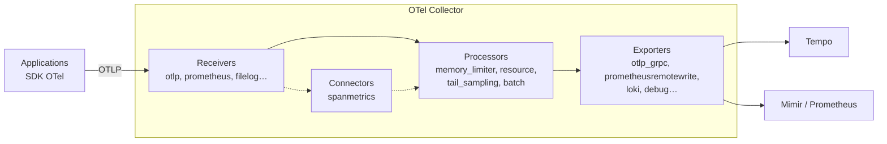
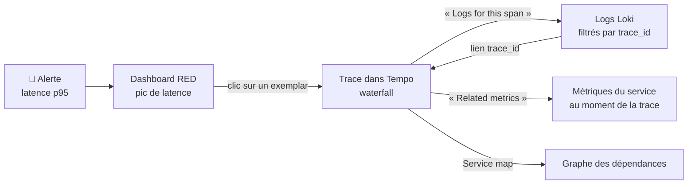
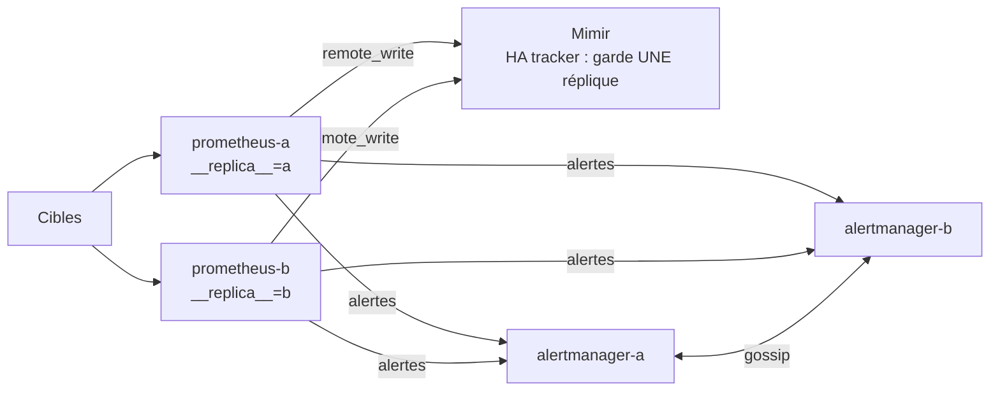
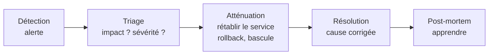

# 🧭 Observabilité — Palier 3 : Expert

### Traces & OpenTelemetry • Corrélation • Mimir & haute disponibilité • SLO • Sécurité • GitOps

---

## À propos de ce cours

**Prérequis :** [Palier 1](01.md) et [Palier 2](02.md) terminés ; projet fil rouge Palier 2 validé. Notions de base en développement (Python ou Node.js) pour la partie instrumentation.

**Ce qui change à ce palier :** vous savez voir et être prévenu. Il s'agit maintenant de **comprendre vite** (traces et corrélation des signaux), de **tenir la charge et les pannes** de la stack elle-même (long terme, haute disponibilité), de **piloter par la fiabilité** perçue par les clients (SLO) et d'**exploiter proprement** (sécurité, GitOps, gestion d'incident).

**Le lab de ce palier, c'est le projet fil rouge.** L'architecture est trop riche (≈ 22 conteneurs) pour un lab jetable : les configurations montrées ici sont celles de [`projet-fil-rouge/solution/palier-3`](projet-fil-rouge/solution/palier-3/), testées de bout en bout. Construisez les vôtres dans votre dépôt en suivant [`projet-fil-rouge/palier-3.md`](projet-fil-rouge/palier-3.md), et n'ouvrez la solution qu'en cas de blocage.

Versions testées ensemble (septembre 2026) :

| Composant | Version | Composant | Version |
| --- | --- | --- | --- |
| Grafana Tempo | 3.0.3 | Grafana Mimir | 3.2.1 |
| OpenTelemetry Collector (contrib) | 0.161.0 | SDK OpenTelemetry Python | 1.45.0 (instrumentations 0.66b0) |
| Prometheus | v3.15.0 | Alertmanager | v0.34.1 |
| Grafana | 13.2.2 | Loki / Alloy | 3.7.8 / v1.20.0 |
| Sloth | v0.16.0 | Caddy | 2.11.4 |
| docker-socket-proxy (Tecnativa) | v0.5.0 | | |

---

## Sommaire

**Partie 1 — Tracer**
1. Le tracing distribué
2. OpenTelemetry : instrumenter
3. L'OpenTelemetry Collector
4. Tempo et TraceQL

**Partie 2 — Corréler**
5. Relier métriques, logs et traces
6. Le 4ᵉ signal : le profiling (aperçu)

**Partie 3 — Passer à l'échelle et tenir**
7. Au-delà d'un Prometheus : stockage long terme avec Mimir
8. Haute disponibilité et méta-monitoring
9. Kubernetes (aperçu)

**Partie 4 — Piloter par la fiabilité**
10. SLI, SLO et budgets d'erreur
11. Gestion d'incident et post-mortems

**Partie 5 — Sécuriser et automatiser**
12. Sécurité de la stack d'observabilité
13. Observability as Code et GitOps
14. Coûts et dimensionnement

**Partie 6 — Synthèse**
15. Projet fil rouge et game day, auto-évaluation, cheat-sheet, glossaire, bilan du cursus

---

## Objectifs de ce palier

- Expliquer traces, spans, propagation de contexte et échantillonnage, et instrumenter une application avec OpenTelemetry
- Déployer un OTel Collector et Tempo, et interroger les traces en TraceQL
- Naviguer en un clic métrique → trace → logs → métriques
- Mettre en place un stockage long terme dédoublonné (Mimir) derrière une paire Prometheus HA et un cluster Alertmanager
- Définir des SLO, calculer un budget d'erreur, alerter sur le *burn rate* multi-fenêtres
- Conduire un incident et rédiger un post-mortem sans reproche
- Durcir la stack (réseau, TLS, authentification, secrets, données personnelles, socket Docker)
- Gérer toute la stack en GitOps, avec une CI qui valide configurations, règles et tests

---

# Partie 1 — Tracer

## Module 1 — Le tracing distribué

### 1.1 Pourquoi métriques et logs ne suffisent plus

Une commande dans Marché traverse le gateway, le service orders, PostgreSQL, puis le service payments. Les métriques disent « le p95 du gateway est passé à 1 s » ; les logs de chaque service racontent chacun leur morceau d'histoire. Aucun des deux ne répond directement à : **« pour cette requête lente précise, où le temps a-t-il été perdu ? »**. C'est la question des traces.

### 1.2 Vocabulaire

| Terme | Définition |
| --- | --- |
| **Trace** | Le parcours complet d'une requête, identifié par un **trace ID** (128 bits) |
| **Span** | Une opération dans la trace : un nom, un début, une durée, un **span ID**, un parent |
| **Span kind** | `SERVER` (requête reçue), `CLIENT` (requête émise), `INTERNAL`, `PRODUCER`/`CONSUMER` (messages) |
| **Attributs** | Paires clé/valeur sur un span (`http.route`, `db.system`, `payment.method`) |
| **Événements** | Faits horodatés dans un span (« paiement refusé », une exception) |
| **Status** | `UNSET`, `OK` ou `ERROR` |
| **Resource** | Attributs de l'émetteur : `service.name`, `service.version`, `deployment.environment.name` |
| **Propagation de contexte** | La transmission du trace ID d'un service à l'autre, via des en-têtes |
| **Baggage** | Paires clé/valeur propagées avec le contexte (ex. `tenant=kara`), lisibles par tous les services en aval |

### 1.3 À quoi ressemble une trace

Trace réelle du projet fil rouge pendant l'incident `base-lente` (durées mesurées) :

```
gateway   POST /api/orders ............................................ 967 ms  (SERVER)
gateway   └─ POST (httpx → orders) .................................... 965 ms  (CLIENT)
orders       └─ POST /orders .......................................... 964 ms  (SERVER)
orders          ├─ SELECT  db.statement="SELECT pg_sleep(%s)" .......... 802 ms  ← le coupable
orders          ├─ INSERT  INTO orders … ...............................   0,5 ms
orders          ├─ POST (httpx → payments) ............................. 155 ms
payments        │  └─ POST /payments/charge ............................ 154 ms
payments        │     └─ prestataire.debit  (span manuel) .............. 152 ms
orders          └─ UPDATE orders SET status … ..........................   0,5 ms
```

Grafana l'affiche en *waterfall* : on voit instantanément que 83 % du temps est passé dans une requête SQL, et laquelle.

### 1.4 La propagation : l'en-tête `traceparent`

Le standard W3C Trace Context définit l'en-tête transmis à chaque appel sortant :

```
traceparent: 00-4bf92f3577b34da6a3ce929d0e0e4736-00f067aa0ba902b7-01
             │  └───────── trace-id (32 hex) ───┘ └─ parent span-id ┘ └ flags (01 = échantillonné)
             version
```

Les bibliothèques d'instrumentation l'ajoutent (client HTTP) et le lisent (serveur HTTP) automatiquement. 🪤 Une trace « coupée en deux » signifie presque toujours qu'un maillon ne propage pas : un client HTTP non instrumenté, un proxy qui supprime l'en-tête, une file de messages sans propagation dans les métadonnées.

### 1.5 Échantillonner

Tracer 100 % des requêtes coûte cher à fort trafic. Deux familles :

| | **Head sampling** | **Tail sampling** |
| --- | --- | --- |
| Décision | Au début de la trace, dans le SDK | À la fin de la trace, dans le Collector |
| Exemple | `parentbased_traceidratio` à 10 % | « Toutes les erreurs + tout ce qui dépasse 500 ms + 10 % du reste » |
| Avantage | Simple, gratuit | Garde les traces **intéressantes** |
| Inconvénient | Garde 10 % d'erreurs au hasard, en perd 90 % | Le Collector doit garder toutes les traces en mémoire le temps de décider ; tous les spans d'une trace doivent arriver au même Collector |

`parentbased_*` : un service suit la décision de son appelant (sinon, traces trouées). 🪤 Si vous calculez des métriques (RED) **à partir des spans**, faites-le **avant** l'échantillonnage (voir 3.3), sinon vos taux seront faux.

---

## Module 2 — OpenTelemetry : instrumenter

### 2.1 Le projet

OpenTelemetry (OTel, CNCF) est **le** standard ouvert de production de télémétrie : une **API** (ce que votre code appelle), des **SDK** par langage (qui implémentent échantillonnage, traitement, export), des **bibliothèques d'instrumentation** (Flask, FastAPI, Django, Express, JDBC, httpx…), un protocole (**OTLP**, gRPC sur 4317 / HTTP sur 4318) et le **Collector**. Il couvre traces, métriques, logs (et profils, en cours). Votre code ne dépend plus du backend : changer Tempo pour un autre outil ne touche pas l'application.

### 2.2 Conventions sémantiques et ressource

Les **conventions sémantiques** fixent les noms d'attributs (`http.request.method`, `http.route`, `db.system.name`, `server.address`…) pour que tous les outils se comprennent. Les plus importants sont ceux de la **ressource** :

| Attribut | Rôle |
| --- | --- |
| `service.name` | **Obligatoire en pratique** : le nom du service (sinon `unknown_service`) |
| `service.version` | Version déployée : comparer avant/après un déploiement |
| `deployment.environment.name` | `production`, `staging`, `lab` |

🪤 Les conventions évoluent. Exemple constaté dans le projet fil rouge : l'instrumentation psycopg 0.66b0 émet encore `db.system` alors que la convention stable est désormais `db.system.name`. Une requête TraceQL sur `span.db.system.name` ne trouvait **rien**. Vérifiez toujours ce que votre instrumentation émet réellement (vue détaillée d'un span) avant d'écrire requêtes et alertes.

### 2.3 Configurer par variables d'environnement

Le SDK lit des variables standard, identiques dans tous les langages :

| Variable | Exemple | Rôle |
| --- | --- | --- |
| `OTEL_SERVICE_NAME` | `payments` | Nom du service |
| `OTEL_RESOURCE_ATTRIBUTES` | `deployment.environment.name=lab,service.version=1.2.0` | Attributs de ressource |
| `OTEL_EXPORTER_OTLP_ENDPOINT` | `http://otel-collector:4317` | Où envoyer |
| `OTEL_EXPORTER_OTLP_PROTOCOL` | `grpc` ou `http/protobuf` | Protocole |
| `OTEL_TRACES_SAMPLER` | `parentbased_traceidratio` | Échantillonneur |
| `OTEL_TRACES_SAMPLER_ARG` | `0.1` | Taux (10 %) |
| `OTEL_PROPAGATORS` | `tracecontext,baggage` | Formats de propagation |

### 2.4 Python (FastAPI) — le code du projet fil rouge

```python
# pip install opentelemetry-sdk opentelemetry-exporter-otlp-proto-grpc \
#   opentelemetry-instrumentation-fastapi opentelemetry-instrumentation-httpx opentelemetry-instrumentation-psycopg
from opentelemetry import trace
from opentelemetry.exporter.otlp.proto.grpc.trace_exporter import OTLPSpanExporter
from opentelemetry.instrumentation.fastapi import FastAPIInstrumentor
from opentelemetry.instrumentation.httpx import HTTPXClientInstrumentor
from opentelemetry.instrumentation.psycopg import PsycopgInstrumentor
from opentelemetry.sdk.resources import Resource
from opentelemetry.sdk.trace import TracerProvider
from opentelemetry.sdk.trace.export import BatchSpanProcessor

def setup_tracing(service: str, version: str) -> None:
    resource = Resource.create({"service.name": service, "service.version": version})  # + OTEL_RESOURCE_ATTRIBUTES
    provider = TracerProvider(resource=resource)
    provider.add_span_processor(BatchSpanProcessor(OTLPSpanExporter()))   # endpoint : OTEL_EXPORTER_OTLP_ENDPOINT
    trace.set_tracer_provider(provider)
    HTTPXClientInstrumentor().instrument()                  # appels sortants → spans CLIENT + traceparent
    PsycopgInstrumentor().instrument(enable_commenter=False) # requêtes SQL → spans

setup_tracing("payments", "1.2.0")          # AVANT de créer le pool de connexions et les clients HTTP
app = FastAPI()
FastAPIInstrumentor.instrument_app(app, excluded_urls="healthz,metrics")   # spans SERVER
tracer = trace.get_tracer("payments")
```

**Span manuel** pour une opération métier qui mérite son segment :

```python
@app.post("/payments/charge")
def charge(req: ChargeIn):
    with tracer.start_as_current_span("prestataire.debit") as span:
        span.set_attribute("payment.method", req.method)
        span.set_attribute("payment.amount_xof", req.amount)
        declined = appeler_le_prestataire(req)
        span.set_attribute("payment.outcome", "declined" if declined else "approved")
        if declined:
            # Un refus est un résultat MÉTIER : un événement, pas un status ERROR
            span.add_event("paiement refusé", {"reason": "solde insuffisant"})
```

**Le trace ID dans chaque log** (corrélation logs ↔ traces) — dans le formateur JSON :

```python
ctx = trace.get_current_span().get_span_context()
if ctx.is_valid:
    entry["trace_id"] = format(ctx.trace_id, "032x")
    entry["span_id"] = format(ctx.span_id, "016x")
```

**Un exemplar sur l'histogramme de latence** (métrique → trace) :

```python
trace_id = format(ctx.trace_id, "032x") if ctx.is_valid else None
HTTP_DURATION.labels(method, route).observe(duration, exemplar={"trace_id": trace_id} if trace_id else None)
```

Les exemplars ne sont transmis qu'au format **OpenMetrics** : l'endpoint `/metrics` doit négocier le format (`choose_encoder(accept)` en Python), ce que fait déjà le code du Palier 2.

Pièges vécus sur ce code :
- 🪤 Instrumenter psycopg **après** l'ouverture du pool = aucune requête SQL tracée. Appelez `setup_tracing()` au chargement du module.
- 🪤 Ne tracez pas `/healthz` et `/metrics` (`excluded_urls`) : des milliers de traces inutiles par jour.
- Un 402 « paiement refusé » n'est pas une erreur technique : ne mettez pas le span en `ERROR`, sinon vos alertes d'erreur sonnent pour de mauvaises raisons.

### 2.5 Node.js / Next.js

```javascript
// npm install @opentelemetry/sdk-node @opentelemetry/auto-instrumentations-node @opentelemetry/exporter-trace-otlp-grpc
// instrumentation.js — chargé AVANT l'application : node --require ./instrumentation.js server.js
const { NodeSDK } = require('@opentelemetry/sdk-node');
const { getNodeAutoInstrumentations } = require('@opentelemetry/auto-instrumentations-node');
const { OTLPTraceExporter } = require('@opentelemetry/exporter-trace-otlp-grpc');

const sdk = new NodeSDK({
  traceExporter: new OTLPTraceExporter(),          // OTEL_EXPORTER_OTLP_ENDPOINT
  instrumentations: [getNodeAutoInstrumentations({
    '@opentelemetry/instrumentation-fs': { enabled: false },   // très bavard
  })],
});
sdk.start();
process.on('SIGTERM', () => sdk.shutdown());       // vider les spans en attente à l'arrêt
```

Next.js propose un fichier `instrumentation.ts` à la racine, appelé au démarrage du serveur, prévu pour ce code.

### 2.6 Instrumentation « zéro code »

| Langage | Mécanisme |
| --- | --- |
| Python | `opentelemetry-bootstrap -a install` puis `opentelemetry-instrument python app.py` |
| Java | Agent JVM : `-javaagent:opentelemetry-javaagent.jar` |
| .NET | Instrumentation automatique (profiler CLR) |
| Node.js | `node --require @opentelemetry/auto-instrumentations-node/register app.js` |
| Kubernetes | OpenTelemetry Operator : injection automatique par annotation de pod |

Idéal pour démarrer ; ajoutez ensuite des spans et attributs **métier** à la main, c'est là que se trouve la valeur.

---

## Module 3 — L'OpenTelemetry Collector

### 3.1 Architecture



Le Collector **découple** les applications des backends : elles n'envoient qu'à lui ; lui enrichit, filtre, échantillonne, réessaie, et route. Deux modes de déploiement : **agent** (à côté de chaque application ou nœud) et **gateway** (un pool central). Les grandes installations combinent les deux.

La distribution **contrib** (`otel/opentelemetry-collector-contrib`) contient tous les composants ; pour la production, on peut construire une distribution minimale avec l'*OpenTelemetry Collector Builder*. **Grafana Alloy** embarque aussi les composants du Collector (`otelcol.*`) : un seul agent pour logs, métriques et traces est possible.

### 3.2 Configuration du projet fil rouge

```yaml
extensions:
  health_check:
    endpoint: 0.0.0.0:13133

receivers:
  otlp:
    protocols:
      grpc: { endpoint: 0.0.0.0:4317 }
      http: { endpoint: 0.0.0.0:4318 }

processors:
  memory_limiter:                # TOUJOURS en premier : refuser plutôt que se faire tuer par l'OOM killer
    check_interval: 1s
    limit_percentage: 80
    spike_limit_percentage: 25
  resource:
    attributes:
      - key: deployment.environment.name
        value: lab
        action: upsert
  batch:                         # TOUJOURS en dernier : regrouper les envois
    send_batch_size: 1024
    timeout: 2s

exporters:
  otlp_grpc/tempo:
    endpoint: tempo:4317
    tls:
      insecure: true             # réseau interne ; mTLS en production

service:
  extensions: [health_check]
  telemetry:
    metrics:
      readers:
        - pull:
            exporter:
              prometheus: { host: 0.0.0.0, port: 8888 }   # le Collector s'observe lui-même
  pipelines:
    traces:
      receivers: [otlp]
      processors: [memory_limiter, resource, batch]
      exporters: [otlp_grpc/tempo]
```

- Valider : `docker run --rm -v "$PWD:/c" otel/opentelemetry-collector-contrib:0.161.0 validate --config=/c/config.yaml`
- Les exporters s'appellent désormais `otlp_grpc` et `otlp_http` ; les anciens noms `otlp` et `otlphttp` restent acceptés.
- Métriques à surveiller : `otelcol_receiver_refused_spans_total`, `otelcol_exporter_send_failed_spans_total`, `otelcol_exporter_queue_size`.

### 3.3 Tail sampling et métriques issues des spans

Configuration validée : les **métriques RED sont calculées sur 100 % des spans** (connecteur `spanmetrics`), **puis** on n'envoie à Tempo que les traces intéressantes.

```yaml
processors:
  tail_sampling:
    decision_wait: 10s            # attendre la fin de la trace avant de décider
    num_traces: 50000
    policies:
      - name: toutes-les-erreurs
        type: status_code
        status_code: { status_codes: [ERROR] }
      - name: les-lentes
        type: latency
        latency: { threshold_ms: 500 }
      - name: echantillon-du-reste
        type: probabilistic
        probabilistic: { sampling_percentage: 10 }

connectors:
  spanmetrics:                    # exporter d'un pipeline traces → receiver d'un pipeline metrics
    histogram:
      explicit:
        buckets: [50ms, 100ms, 250ms, 500ms, 1s, 2.5s]
    dimensions:
      - name: http.route

exporters:
  prometheusremotewrite:
    endpoint: http://mimir:9009/api/v1/push

service:
  pipelines:
    traces/entree:                # 100 % des spans → métriques
      receivers: [otlp]
      processors: [memory_limiter]
      exporters: [spanmetrics]
    traces/entree-echantillonnee: # traces choisies → Tempo
      receivers: [otlp]
      processors: [memory_limiter, tail_sampling, batch]
      exporters: [otlp_grpc/tempo]
    metrics/spanmetrics:
      receivers: [spanmetrics]
      processors: [batch]
      exporters: [prometheusremotewrite]
```

🪤 Le tail sampling exige que **tous les spans d'une trace** arrivent au **même** Collector : avec plusieurs Collectors, ajoutez devant eux un niveau d'`loadbalancing` exporter, routé par trace ID.

---

## Module 4 — Tempo et TraceQL

### 4.1 Tempo 3

Tempo stocke les traces dans un stockage objet (ou le disque en lab), **sans index** des attributs : les recherches parcourent des blocs en format colonne (Parquet), ce qui rend le stockage très bon marché.

⚠️ **Tempo 3.0 (2026) change d'architecture** : les *ingesters* ont disparu. En mode distribué, l'écriture passe par Kafka (distributor → Kafka → *block-builder* et *live-store*) ; en **mode monolithique**, le distributor écrit directement dans le live-store et le metrics-generator, sans Kafka. Les configurations de tutoriels Tempo 2.x (bloc `ingester:`, processeur `local-blocks`, récepteur OpenCensus) sont refusées. Un outil aide à migrer : `tempo-cli migrate config`.

Configuration monolithique du projet fil rouge :

```yaml
stream_over_http_enabled: true

server:
  http_listen_port: 3200
  log_level: warn

distributor:
  receivers:
    otlp:
      protocols:
        grpc: { endpoint: 0.0.0.0:4317 }
        http: { endpoint: 0.0.0.0:4318 }

# Métriques DÉRIVÉES des traces, poussées vers Mimir
metrics_generator:
  registry:
    external_labels:
      source: tempo
  storage:
    path: /var/tempo/generator/wal
    remote_write:
      - url: http://mimir:9009/api/v1/push
        send_exemplars: true

storage:
  trace:
    backend: local               # production : s3, gcs, azure
    wal:
      path: /var/tempo/wal
    local:
      path: /var/tempo/blocks

overrides:
  defaults:
    metrics_generator:
      processors: [service-graphs, span-metrics]

usage_report:
  reporting_enabled: false
```

- **service-graphs** : pour chaque paire client → serveur, débit, erreurs et latence (`traces_service_graph_request_total`…) → la *Service map* de Grafana. Dans le projet, PostgreSQL y apparaît comme un nœud nommé d'après la base (`marche`).
- **span-metrics** : RED par service et par nom de span (`traces_spanmetrics_calls_total`, `traces_spanmetrics_latency_bucket`).
- Tempo 3 logue au niveau `warn` des « no jobs found » de son planificateur interne quand il n'a rien à compacter : c'est normal.

### 4.2 TraceQL

TraceQL sélectionne des **spans** (et renvoie les traces qui les contiennent) :

```traceql
{ resource.service.name = "payments" }                                   # spans du service payments
{ span.http.route = "/api/orders" && duration > 700ms }                  # spans lents d'une route
{ status = error }                                                       # spans en erreur
{ span.db.system = "postgresql" && duration > 500ms }                    # requêtes SQL lentes
{ name = "prestataire.debit" && span.payment.method = "mobile_money" }   # span manuel + attribut métier
{ resource.service.name = "gateway" } >> { duration > 700ms && kind = client }   # structurel
```

| Élément | Exemples |
| --- | --- |
| Portées d'attributs | `resource.x` (émetteur), `span.x` (span), `.x` (les deux) |
| Intrinsèques | `name`, `duration`, `status`, `kind`, `trace:duration`, `trace:rootService` |
| Comparaisons | `=`, `!=`, `>`, `>=`, `<`, `<=`, `=~` (regex), `!~` |
| Structure | `A >> B` (B descendant de A), `A > B` (enfant direct), `A ~ B` (frères), `A && B` sur deux spansets |
| Agrégats | `{ … } \| count() > 3`, `{ … } \| avg(duration) > 1s` |
| Sélection | `{ … } \| select(span.http.route, span.db.statement)` |

**TraceQL metrics** (GA dans Tempo 3) : des séries temporelles calculées directement sur les traces, sans instrumentation supplémentaire.

```traceql
{ resource.service.name = "orders" } | rate()                                  # spans/s
{ span.db.system = "postgresql" } | quantile_over_time(duration, .95)          # p95 des requêtes SQL
{ status = error } | rate() by (resource.service.name)                         # erreurs par service
```

### Exercice 4.1
Pendant l'incident `paiement-lent` du projet fil rouge, écrivez la requête TraceQL qui renvoie les traces du gateway contenant un span de **payments** de plus d'une seconde.

<details><summary>💡 Solution</summary>

```traceql
{ resource.service.name = "gateway" } >> { resource.service.name = "payments" && duration > 1s }
```
Plus spécifique : `… && kind = server` pour ne garder que le span serveur de payments, ou cibler le span manuel `name = "prestataire.debit"` — ce qui révèlerait ici que le prestataire lui-même n'est **pas** lent (la latence est injectée avant, dans le middleware) : un indice précieux pour le diagnostic.
</details>

---

# Partie 2 — Corréler

## Module 5 — Relier métriques, logs et traces

### 5.1 Le parcours d'investigation



Chaque flèche est une configuration de **datasource** Grafana, provisionnée (Palier 2).

### 5.2 Métriques → traces : les exemplars

1. L'application attache le `trace_id` aux observations d'histogramme (module 2.4).
2. Prometheus stocke les exemplars : flag **`--enable-feature=exemplar-storage`** (il négocie alors OpenMetrics avec les cibles). Mimir les accepte si `max_global_exemplars_per_user` > 0 (0 par défaut !) et que `remote_write` a `send_exemplars: true`.
3. La datasource Prometheus sait où ouvrir le trace ID :

```yaml
  - name: Prometheus
    type: prometheus
    uid: prometheus
    jsonData:
      exemplarTraceIdDestinations:
        - name: trace_id          # nom du label de l'exemplar
          datasourceUid: tempo
```

4. Dans le panel, activez **Exemplars** sur la requête (`"exemplar": true` dans le JSON) : des losanges apparaissent sur le graphe ; cliquer ouvre la trace.

API pour vérifier : `GET /api/v1/query_exemplars?query=http_request_duration_seconds_bucket&start=…&end=…`.

🪤 La première version de ce cours activait les exemplars avec `storage.tsdb.out_of_order_time_window` : c'est **faux**, ce réglage n'a rien à voir. Seul le flag `exemplar-storage` compte.

### 5.3 Traces → logs, logs → traces, traces → métriques

```yaml
  - name: Tempo
    type: tempo
    uid: tempo
    url: http://tempo:3200
    jsonData:
      tracesToLogsV2:
        datasourceUid: loki
        spanStartTimeShift: "-2m"
        spanEndTimeShift: "2m"
        filterByTraceID: true
        tags:
          - key: service.name        # attribut de ressource OTel…
            value: service           # …traduit en label Loki
      tracesToMetrics:
        datasourceUid: mimir
        tags:
          - key: service.name
            value: service
        queries:
          - name: Taux d'erreurs du service
            query: sum(rate(http_requests_total{$$__tags, status=~"5.."}[5m])) / sum(rate(http_requests_total{$$__tags}[5m]))
      serviceMap:
        datasourceUid: mimir        # où trouver traces_service_graph_*
      nodeGraph:
        enabled: true
      lokiSearch:
        datasourceUid: loki

  - name: Loki
    type: loki
    uid: loki
    jsonData:
      derivedFields:
        - name: trace_id
          matcherType: label         # trace_id est une structured metadata (pas dans le texte à parser)
          matcherRegex: trace_id
          datasourceUid: tempo
          url: "$${__value.raw}"     # $$ = $ littéral (le provisioning interpole les variables d'env)
          urlDisplayLabel: Voir la trace
```

Côté Alloy, le `trace_id` extrait du JSON va en **structured metadata**, jamais en label (une valeur par requête = un stream par requête) :

```alloy
    stage.json {
      expressions = { level = "", trace_id = "" }
    }
    stage.structured_metadata {
      values = { trace_id = "" }
    }
```

Requête Loki directe : `{service="payments"} | trace_id="8b3c84cf247772cdaa8304221684be93"`.

---

## Module 6 — Le 4ᵉ signal : le profiling (aperçu)

Le **profiling continu** échantillonne en permanence les piles d'appels de vos processus et répond à « quelle **fonction** consomme ce CPU / cette mémoire ? ». **Grafana Pyroscope** (auto-hébergeable) le stocke ; les données viennent d'un SDK dans l'application ou d'un profilage eBPF par Alloy (`pyroscope.ebpf`), sans modifier le code. Le lien avec les traces existe (*span profiles* : le profil d'un span précis). À explorer une fois les trois premiers signaux maîtrisés.

---

# Partie 3 — Passer à l'échelle et tenir

## Module 7 — Au-delà d'un Prometheus : stockage long terme avec Mimir

### 7.1 Les limites d'un Prometheus seul

Un Prometheus = une machine : mémoire bornée (séries actives), disque local, pas de réplication, rétention coûteuse au-delà de quelques semaines, pas de vue globale sur plusieurs Prometheus, pas de multi-tenant.

| Besoin | Solution |
| --- | --- |
| Vue globale de quelques Prometheus | Fédération (`/federate`) — simple mais limitée |
| Long terme, HA, multi-tenant, scalabilité horizontale | **Mimir**, **Thanos**, VictoriaMetrics, Cortex |
| Collecte sans stockage local (edge, Kubernetes) | Prometheus en **mode agent** (`--agent`) ou Alloy, qui ne font que `remote_write` |

### 7.2 Thanos ou Mimir ?

| | **Thanos** | **Mimir** |
| --- | --- | --- |
| Origine | CNCF (Improbable) | Grafana Labs |
| Principe | Un **sidecar** à côté de chaque Prometheus envoie ses blocs de 2 h vers le stockage objet ; *Query* fédère les Prometheus et le stockage | Les Prometheus (ou agents) **poussent** en `remote_write` vers Mimir, qui stocke tout |
| Point fort | S'ajoute à des Prometheus existants sans les changer ; **downsampling** (5 min, 1 h) pour le très long terme | Multi-tenant natif, performances d'ingestion et de requête (moteur MQE), HA tracker intégré |
| Déploiement minimal | Sidecar + Query + Store Gateway + Compactor | Un binaire en mode monolithique |

Mimir 3 (fin 2025) introduit l'**architecture *ingest storage*** (Kafka entre écriture et lecture, pour les très grands déploiements) et fait de **MQE** (*Mimir Query Engine*, jusqu'à -92 % de mémoire en pic) le moteur par défaut. L'architecture « classique », utilisée ici en monolithique, reste supportée.

Thanos, pour comparaison (sidecar à côté de Prometheus lancé avec `--storage.tsdb.min-block-duration=2h --storage.tsdb.max-block-duration=2h`) :

```yaml
  thanos-sidecar:
    image: quay.io/thanos/thanos:v0.42.4
    command:
      - sidecar
      - --tsdb.path=/prometheus
      - --prometheus.url=http://prometheus:9090
      - --objstore.config-file=/etc/thanos/bucket.yml
    volumes:
      - prometheus_data:/prometheus
```

### 7.3 Le stockage objet en auto-hébergé

Mimir, Thanos, Loki et Tempo sont conçus pour un stockage objet compatible S3.

⚠️ **MinIO n'est plus une option évidente** : l'édition communautaire a progressivement perdu fonctionnalités et images officielles en 2025, et son dépôt GitHub est **archivé** (constaté en septembre 2026). Alternatives auto-hébergées compatibles S3 : **SeaweedFS**, **Garage** (léger, pensé pour le multi-sites), **Ceph RGW** (grande échelle). Ou le S3 d'un hébergeur. Dans le lab, Mimir utilise le système de fichiers.

### 7.4 Mimir monolithique

`mimir/mimir.yaml` du projet fil rouge :

```yaml
multitenancy_enabled: false      # tenant unique « anonymous »

server:
  http_listen_port: 9009
  log_level: warn

common:
  storage:
    backend: filesystem          # production : s3, gcs, azure, swift
    filesystem:
      dir: /data/blocks

blocks_storage:
  storage_prefix: blocks
  tsdb:
    dir: /data/tsdb
  bucket_store:
    sync_dir: /data/tsdb-sync

compactor:
  data_dir: /data/compactor
  sharding_ring:
    kvstore: { store: memberlist }

distributor:
  ring:
    instance_addr: 127.0.0.1
    kvstore: { store: memberlist }
  ha_tracker:                    # module 8
    enable_ha_tracker: true
    kvstore: { store: memberlist }

ingester:
  ring:
    instance_addr: 127.0.0.1
    kvstore: { store: memberlist }
    replication_factor: 1

store_gateway:
  sharding_ring:
    replication_factor: 1

ruler_storage:
  backend: filesystem
  filesystem:
    dir: /data/rules

limits:
  accept_ha_samples: true
  ha_cluster_label: cluster
  ha_replica_label: __replica__
  max_global_exemplars_per_user: 100000   # 0 par défaut = exemplars refusés
  compactor_blocks_retention_period: 90d

usage_stats:
  enabled: false
```

```yaml
  mimir:
    image: grafana/mimir:3.2.1
    command: ["-config.file=/etc/mimir/mimir.yaml", "-target=all"]
```

Côté Prometheus :

```yaml
remote_write:
  - url: http://mimir:9009/api/v1/push
    send_exemplars: true
    queue_config:
      max_samples_per_send: 2000
      batch_send_deadline: 5s
```

Datasource Grafana : `type: prometheus`, `url: http://mimir:9009/prometheus`, `jsonData.prometheusType: Mimir`. En multi-tenant, chaque requête porte l'en-tête `X-Scope-OrgID: <tenant>` (Prometheus : `remote_write.headers`, Grafana : *custom HTTP headers*).

À surveiller côté Prometheus : `prometheus_remote_storage_samples_failed_total`, `prometheus_remote_storage_highest_timestamp_in_seconds` moins `prometheus_remote_storage_queue_highest_sent_timestamp_seconds` (retard d'envoi).

🪤 **Noms UTF-8.** Prometheus 3 accepte les noms de métriques et de labels UTF-8 ; l'OTel Collector 0.161 expose par exemple un label `server.address`. Mimir, lui, les **refuse** par défaut (`err-mimir-label-invalid`) : tout le lot est rejeté. Constaté dans le projet fil rouge (et détecté par l'alerte `RemoteWriteEnEchec`). Correctif propre, côté Prometheus :

```yaml
global:
  metric_name_validation_scheme: legacy      # n'accepter que [a-zA-Z_:][a-zA-Z0-9_:]*
  metric_name_escaping_scheme: underscores   # server.address → server_address
```

---

## Module 8 — Haute disponibilité et méta-monitoring

### 8.1 Une paire Prometheus

Prometheus ne se réplique pas. La HA consiste à faire tourner **deux instances identiques** qui scrapent les mêmes cibles, et à dédoublonner **en aval**.



Une seule configuration pour les deux (Prometheus 3 développe les variables d'environnement dans `external_labels`) :

```yaml
global:
  external_labels:
    cluster: marche                 # identifie la paire
    __replica__: ${PROM_REPLICA}    # a ou b (variable d'environnement du conteneur)

alerting:
  # Sans ceci, les alertes de a et b diffèrent par __replica__ :
  # Alertmanager ne les dédoublonne pas et chaque notification part en DOUBLE.
  alert_relabel_configs:
    - action: labeldrop
      regex: __replica__
  alertmanagers:
    - static_configs:
        - targets: ["alertmanager-a:9093", "alertmanager-b:9093"]
```

- Le **HA tracker** de Mimir élit une réplique par `cluster` et n'accepte que ses échantillons ; si elle se tait (au-delà d'un délai), il bascule sur l'autre. Résultat mesuré dans le projet : `up{job="node"}` → **1** série dans Mimir, pas 2.
- 🪤 On pourrait croire qu'un label préfixé `__` est retiré des alertes : **non**, testé avec Prometheus 3.15 — `__replica__` arrive dans Alertmanager, d'où le `labeldrop` obligatoire.
- Chaque Prometheus envoie ses alertes à **tous** les Alertmanager ; ce sont eux qui dédoublonnent.

### 8.2 Un cluster Alertmanager

```yaml
  alertmanager-a:
    command:
      - --config.file=/etc/alertmanager/alertmanager.yml
      - --cluster.listen-address=0.0.0.0:9094
      - --cluster.peer=alertmanager-b:9094
  alertmanager-b:
    command:
      - --config.file=/etc/alertmanager/alertmanager.yml
      - --cluster.listen-address=0.0.0.0:9094
      - --cluster.peer=alertmanager-a:9094
```

Les membres partagent (gossip) silences et état de notification : une alerte n'est notifiée qu'une fois. Vérification : `alertmanager_cluster_members` = 2. ⚠️ Ne mettez **pas** de load balancer entre Prometheus et les Alertmanager : Prometheus doit les connaître tous.

### 8.3 Loki, Tempo, Grafana en HA

- **Loki** : mode monolithique (lab, petites installations), mode *simple scalable* (read / write / backend) ou microservices, sur stockage objet, avec `replication_factor: 3` en production.
- **Tempo** : mode distribué (avec Kafka depuis Tempo 3), stockage objet.
- **Grafana** : plusieurs instances derrière un load balancer, avec une **base externe** (PostgreSQL/MySQL, pas SQLite) et l'alerting en HA :

```ini
[database]
type = postgres
host = postgres-grafana:5432
name = grafana
user = grafana
password = $__file{/run/secrets/grafana_db_password}

[unified_alerting]
ha_peers = grafana-1:9094,grafana-2:9094
```

(Ou les variables équivalentes `GF_DATABASE_TYPE`, `GF_UNIFIED_ALERTING_HA_PEERS`…)

### 8.4 Qui surveille les surveillants ?

| Risque | Parade |
| --- | --- |
| Prometheus ou Alertmanager meurt : **plus aucune alerte**, silence total | Alerte **Watchdog** (`expr: vector(1)`) toujours active, routée vers un *dead man's switch* externe (healthchecks.io auto-hébergé, Uptime Kuma en mode push…) qui alerte s'il **cesse** de la recevoir |
| Une réplique Prometheus tombe | L'autre la scrape : `CibleInjoignable` |
| Le remote write échoue | `RemoteWriteEnEchec` sur les métriques `prometheus_remote_storage_*` |
| Le cluster Alertmanager se scinde | `min(alertmanager_cluster_members) < 2` |
| Le Collector jette des spans | `otelcol_receiver_refused_spans_total` |
| Loki rejette des logs | `loki_discarded_samples_total` |

```yaml
      - alert: Watchdog
        expr: vector(1)
        labels: { severity: none }
        annotations:
          summary: "Alerte sentinelle : la chaîne d'alerting fonctionne"
```

```yaml
# alertmanager.yml
    - matchers: ['alertname = "Watchdog"']
      receiver: deadmansswitch
      group_wait: 0s
      group_interval: 1m
      repeat_interval: 1m
```

💡 Idéalement, le méta-monitoring tourne **ailleurs** que la stack surveillée (autre machine, autre hébergeur) : une panne de la machine ne doit pas emporter son propre détecteur.

---

## Module 9 — Kubernetes (aperçu)

Sur Kubernetes, on ne configure plus `scrape_configs` à la main : le **Prometheus Operator** (chart Helm `kube-prometheus-stack`, qui installe aussi Grafana, Alertmanager, node-exporter, kube-state-metrics et des dizaines de règles et dashboards) introduit des ressources :

```yaml
apiVersion: monitoring.coreos.com/v1
kind: ServiceMonitor               # « scrape les services portant ces labels »
metadata:
  name: payments
  labels: { release: kube-prometheus-stack }
spec:
  selector:
    matchLabels: { app: payments }
  endpoints:
    - port: http
      path: /metrics
      interval: 15s
---
apiVersion: monitoring.coreos.com/v1
kind: PrometheusRule               # règles d'alerte versionnées avec l'application
metadata:
  name: payments
  labels: { release: kube-prometheus-stack }
spec:
  groups:
    - name: payments
      rules:
        - alert: PaiementsEnErreur
          expr: sum(rate(http_requests_total{service="payments", status=~"5.."}[5m])) > 1
          for: 5m
          labels: { severity: critical }
```

Autres briques : **kube-state-metrics** (état des objets : déploiements, pods, redémarrages), le chart **k8s-monitoring** de Grafana (Alloy préconfiguré pour métriques, logs, traces, événements), l'**OpenTelemetry Operator** (Collectors gérés et auto-instrumentation par annotation). Les principes de ce cursus restent identiques ; seul le « câblage » change.

---

# Partie 4 — Piloter par la fiabilité

## Module 10 — SLI, SLO et budgets d'erreur

### 10.1 Définitions

| Terme | Définition | Exemple (Marché) |
| --- | --- | --- |
| **SLI** | Mesure de la qualité perçue, en **bons événements / événements valides** | Part des requêtes du gateway sans 5xx |
| **SLO** | Objectif interne sur un SLI, sur une **fenêtre** | 99,5 % sur 30 jours glissants |
| **SLA** | Engagement **contractuel**, avec pénalités ; toujours moins strict que le SLO | 99 % sinon remboursement partiel |
| **Budget d'erreur** | 1 − SLO : la quantité d'échec **autorisée** | 0,5 % des requêtes du mois |

### 10.2 Choisir ses SLI

| Type | Bons événements | Pour |
| --- | --- | --- |
| **Disponibilité** | Réponses non-5xx | APIs |
| **Latence** | Réponses en moins de X ms | APIs interactives |
| **Fraîcheur** | Données mises à jour depuis moins de X min | Pipelines, tableaux de bord |
| **Exactitude** | Traitements au bon résultat | Batchs, paiements |

Règles : mesurer **au plus près de l'utilisateur** (le gateway, voire une sonde externe), exclure les requêtes **invalides** (un 422 provoqué par le client n'est pas un échec du service) et les endpoints techniques (`/healthz`), et viser ce dont les utilisateurs ont **besoin**, pas 100 % (inatteignable et paralysant).

La latence se mesure exactement avec un histogramme dont un bucket **est** le seuil : bons = `http_request_duration_seconds_bucket{le="0.5"}`, total = `…_count`. D'où l'exigence d'un bucket `0.5` au Palier 2.

### 10.3 Le budget en chiffres

| SLO | Budget sur 30 jours | Soit |
| --- | --- | --- |
| 99 % | 1 % | 7 h 12 min |
| 99,5 % | 0,5 % | 3 h 36 min |
| 99,9 % | 0,1 % | 43 min |
| 99,95 % | 0,05 % | 21 min 36 s |
| 99,99 % | 0,01 % | 4 min 19 s |

```
budget = (1 − SLO) × période        ex. : (1 − 0,999) × 30 j × 24 h × 60 min = 43,2 min
```

La **politique de budget** transforme le chiffre en décisions : budget sain → on déploie librement et on prend des risques ; budget sous 25 % → gel des déploiements risqués, priorité à la fiabilité ; budget épuisé → seules les corrections passent. Elle se négocie entre produit et technique, **avant** l'incident.

### 10.4 Le burn rate et les alertes multi-fenêtres

Le **burn rate** est la vitesse de consommation du budget : `taux d'erreur observé / (1 − SLO)`. Un burn rate de 1 épuise le budget exactement en fin de période ; de 14,4, il consomme **2 % du budget mensuel en une heure**.

Alerter sur « taux d'erreur > 0,5 % pendant 5 min » est trop bruyant ; « budget épuisé » est trop tard. La méthode du *SRE Workbook* (Google) combine **plusieurs fenêtres** :

| Sévérité | Burn rate | Fenêtre longue | Fenêtre courte | Budget consommé à la détection |
| --- | --- | --- | --- | --- |
| Page (critical) | 14,4 | 1 h | 5 min | 2 % |
| Page (critical) | 6 | 6 h | 30 min | 5 % |
| Ticket (warning) | 3 | 1 j | 2 h | 10 % |
| Ticket (warning) | 1 | 3 j | 6 h | 10 % |

La fenêtre longue garantit que le problème est **réel** ; la courte, qu'il est **toujours en cours** (l'alerte s'éteint vite après la correction). Écrit à la main pour un SLO de 99,5 % :

```promql
(
  sum(rate(http_requests_total{service="gateway", route!="/healthz", status=~"5.."}[1h]))
  / sum(rate(http_requests_total{service="gateway", route!="/healthz"}[1h])) > 14.4 * 0.005
and
  sum(rate(http_requests_total{service="gateway", route!="/healthz", status=~"5.."}[5m]))
  / sum(rate(http_requests_total{service="gateway", route!="/healthz"}[5m])) > 14.4 * 0.005
)
```

### 10.5 Générer les règles avec Sloth

Écrire ces règles pour chaque SLO est fastidieux : **Sloth** les génère (recording rules sur toutes les fenêtres, alertes page/ticket, métadonnées) à partir d'une spécification :

```yaml
version: "prometheus/v1"
service: "gateway"
labels:
  owner: "equipe-plateforme"
slos:
  - name: "disponibilite"
    objective: 99.5
    description: "Les clients reçoivent une réponse sans erreur serveur."
    sli:
      events:
        # « or vector(0) » : sans aucune 5xx, sum(rate(...)) ne renvoie RIEN (pas 0) et le SLI disparaît
        error_query: sum(rate(http_requests_total{job="app", service="gateway", route!="/healthz", status=~"5.."}[{{.window}}])) or vector(0)
        total_query: sum(rate(http_requests_total{job="app", service="gateway", route!="/healthz"}[{{.window}}]))
    alerting:
      name: SLODisponibiliteGateway
      labels: { service: gateway }
      annotations:
        summary: "Le budget d'erreur de disponibilité du gateway brûle trop vite"
      page_alert:
        labels: { severity: critical }
      ticket_alert:
        labels: { severity: warning }

  - name: "latence"
    objective: 99
    description: "Les clients obtiennent une réponse en moins de 500 ms."
    sli:
      events:
        error_query: |
          sum(rate(http_request_duration_seconds_count{job="app", service="gateway", route!="/healthz"}[{{.window}}]))
          -
          sum(rate(http_request_duration_seconds_bucket{job="app", service="gateway", route!="/healthz", le="0.5"}[{{.window}}]))
        total_query: sum(rate(http_request_duration_seconds_count{job="app", service="gateway", route!="/healthz"}[{{.window}}]))
    alerting:
      name: SLOLatenceGateway
      labels: { service: gateway }
      page_alert:
        labels: { severity: critical }
      ticket_alert:
        labels: { severity: warning }
```

```bash
docker run --rm -v "$PWD:/w" -w /w ghcr.io/slok/sloth:v0.16.0 \
  generate -i slo/marche-gateway.yml -o prometheus/rules/slo-marche-gateway.yml
```

Métriques produites, pour le dashboard SLO : `slo:sli_error:ratio_rate5m` … `ratio_rate30d`, `slo:objective:ratio`, `slo:error_budget:ratio`, `slo:current_burn_rate:ratio`, `slo:period_error_budget_remaining:ratio`.

🪤 Le `or vector(0)` n'est pas décoratif : dans le projet fil rouge, juste après un redémarrage (aucune 5xx encore), le SLO de disponibilité n'avait **ni burn rate ni budget** — il était invisible. C'est le même piège qu'au Palier 1 (une série absente n'est pas zéro).

Résultat mesuré pendant l'incident `base-lente` : l'alerte **`SLOLatenceGateway` (critical, burn rate 14,4)** s'est déclenchée en ~4 minutes, alors que `LatenceP95Elevee` était encore *pending*.

---

## Module 11 — Gestion d'incident et post-mortems

### 11.1 Le déroulé d'un incident



- **Atténuer avant de comprendre** : un rollback qui rétablit le service en 5 min vaut mieux qu'un diagnostic parfait en 2 h.
- Rôles sur un incident sérieux : **responsable d'incident** (coordonne, décide), **opérations** (agit), **communication** (clients, direction). Une personne peut cumuler, mais les rôles doivent être explicites.
- Une **chronologie** tenue en direct (canal dédié), horodatée : elle nourrira le post-mortem.

### 11.2 Méthode de diagnostic avec la stack

1. **Symptôme** : quelle alerte ? quel SLO ? depuis quand ? (dashboard SLO, annotations)
2. **Périmètre** : quels services, routes, moyens de paiement ? (dashboard RED, variables)
3. **Changement** : un déploiement, une config ? (annotations `deploy`, `marche_build_info`)
4. **Localisation** : un exemplar ou une recherche TraceQL → la trace → le span fautif
5. **Explication** : les logs du span (trace → logs), les métriques de la ressource (USE)
6. **Confirmation** : l'hypothèse explique-t-elle **tous** les symptômes ?

### 11.3 Le post-mortem sans reproche

Un post-mortem cherche les **causes systémiques**, jamais un coupable : « pourquoi le système a-t-il permis cette erreur ? » plutôt que « qui ? ». Modèle (utilisé pour l'épreuve finale du projet) :

```markdown
# Post-mortem — <titre court>
- Date, durée, sévérité, rédacteur
## Résumé (3 lignes, lisibles par la direction)
## Impact : clients touchés, requêtes en erreur, budget d'erreur consommé (avec requête)
## Chronologie (horodatée) : début, détection (quelle alerte ?), actions, rétablissement
## Détection : délai, signal qui a alerté, signal qui AURAIT dû alerter plus tôt
## Diagnostic : le chemin suivi (dashboards, traces, logs), avec captures ou requêtes
## Cause racine et facteurs contributifs (5 pourquoi)
## Ce qui a bien marché / ce qui a mal marché / où nous avons eu de la chance
## Actions : action, responsable, échéance, type (prévenir, détecter, atténuer)
```

### 11.4 Les game days

Injecter volontairement des pannes, en conditions contrôlées, pour vérifier que l'observabilité et les équipes réagissent comme prévu : c'est l'objet de l'**épreuve finale** du projet fil rouge (`chaos.py gameday`). À plus grande échelle : *chaos engineering* (Chaos Mesh, LitmusChaos sur Kubernetes).

---

# Partie 5 — Sécuriser et automatiser

## Module 12 — Sécurité de la stack d'observabilité

### 12.1 Le modèle de menace

La télémétrie est une **cible** : elle contient topologie, versions, noms internes, parfois des secrets et des données personnelles glissés dans les logs. Les outils ont des accès puissants (socket Docker, cAdvisor privilégié). Et Prometheus, Loki, Alertmanager n'ont **aucune authentification** par défaut : quiconque les atteint peut tout lire, créer des silences, supprimer des données (API d'administration).

### 12.2 Segmenter le réseau

```yaml
networks:
  app: {}            # l'application et ce qui doit lui parler (scrapers, collector)
  obs:
    internal: true   # la stack d'observabilité : AUCUN accès sortant, AUCUN port publié
  front: {}          # l'exposition : Caddy (HTTPS) → Grafana
```

| Service | Réseaux |
| --- | --- |
| Applications, PostgreSQL | `app` |
| Prometheus A/B, Blackbox, postgres-exporter, OTel Collector | `app` + `obs` |
| Mimir, Loki, Tempo, Alertmanager, Alloy, cAdvisor, Node Exporter, proxy de socket | `obs` |
| Grafana | `obs` + `front` |
| Caddy | `front` (seul port publié de la stack d'observabilité : 8443 ; l'application garde les siens, Mailpit écoute sur 127.0.0.1 au lab) |

Le correcteur du projet vérifie que 9090, 3100, 9093, 3200, 9009 et 4317 ne répondent **plus** depuis l'hôte.

### 12.3 TLS devant Grafana

```caddyfile
{
	local_certs          # lab : CA locale de Caddy ; production : un vrai domaine → Let's Encrypt automatique
}

https://localhost:8443 {
	encode zstd gzip
	reverse_proxy grafana:3000
	header {
		Strict-Transport-Security "max-age=31536000; includeSubDomains"
		X-Content-Type-Options "nosniff"
		X-Frame-Options "DENY"
		Referrer-Policy "strict-origin-when-cross-origin"
		-Server
	}
}
```

Côté Grafana : `GF_SERVER_ROOT_URL=https://localhost:8443/`, `GF_SECURITY_COOKIE_SECURE=true`, `GF_SECURITY_COOKIE_SAMESITE=strict`.

### 12.4 Authentifier Prometheus (et les exporters)

`--web.config.file=/etc/prometheus/web-config.yml` :

```yaml
basic_auth_users:
  admin: $2a$14$atd1bdIF9wHm2NfnhPWiE.7a5UVtlkNaQDXGgPUgxPotIA40TOKF.   # bcrypt
# tls_server_config:                  # TLS natif, si pas de proxy devant
#   cert_file: /etc/prometheus/tls/cert.pem
#   key_file: /etc/prometheus/tls/key.pem
```

Hacher : `docker run --rm caddy:2.11.4-alpine caddy hash-password --plaintext '…'`. Tout ce qui interroge Prometheus doit alors s'authentifier : le job qui le scrape (`basic_auth.password_file`), la datasource Grafana (`basicAuth` + `secureJsonData.basicAuthPassword: $__file{/run/secrets/prometheus_password}`), le reload (`/-/reload` exige désormais le mot de passe). Le même `web-config.yml` fonctionne pour Node Exporter, Blackbox, Alertmanager (même bibliothèque *exporter-toolkit*).

### 12.5 Les secrets

```yaml
services:
  grafana:
    environment:
      GF_SECURITY_ADMIN_PASSWORD__FILE: /run/secrets/grafana_admin_password   # suffixe __FILE
    secrets: [grafana_admin_password, prometheus_password]
secrets:
  grafana_admin_password:
    file: ./secrets/grafana_admin_password.txt     # exclu de Git (.gitignore)
```

- `printf '%s' 'motdepasse' > secrets/x.txt` (et non `echo`, qui ajoute un retour à la ligne… qui fait partie du mot de passe).
- Sous Linux, les fichiers de secrets gardent leurs permissions : ils doivent être lisibles par l'utilisateur du conteneur (Grafana : uid 472).
- 🪤 **`GF_SECURITY_ADMIN_PASSWORD(__FILE)` n'est lu qu'à la création de la base.** Sur une instance existante (volume conservé), changer la variable ne change **rien** — piège rencontré en passant le projet au Palier 3. Réinitialisation : `docker exec grafana sh -c 'grafana cli admin reset-admin-password "$(cat /run/secrets/grafana_admin_password)"'`.
- Au-delà : un gestionnaire de secrets (HashiCorp Vault, Infisical, OpenBao) ou des secrets chiffrés dans Git (SOPS + age).

### 12.6 Durcir Grafana

```yaml
      GF_AUTH_ANONYMOUS_ENABLED: "false"
      GF_USERS_ALLOW_SIGN_UP: "false"
      GF_ANALYTICS_REPORTING_ENABLED: "false"
      GF_ANALYTICS_CHECK_FOR_UPDATES: "false"
      # SSO OIDC (ex. Keycloak auto-hébergé) plutôt que des comptes locaux :
      GF_AUTH_GENERIC_OAUTH_ENABLED: "true"
      GF_AUTH_GENERIC_OAUTH_NAME: Keycloak
      GF_AUTH_GENERIC_OAUTH_CLIENT_ID: grafana
      GF_AUTH_GENERIC_OAUTH_CLIENT_SECRET__FILE: /run/secrets/oidc_client_secret
      GF_AUTH_GENERIC_OAUTH_SCOPES: openid profile email roles
      GF_AUTH_GENERIC_OAUTH_AUTH_URL: https://sso.exemple.tg/realms/infra/protocol/openid-connect/auth
      GF_AUTH_GENERIC_OAUTH_TOKEN_URL: https://sso.exemple.tg/realms/infra/protocol/openid-connect/token
      GF_AUTH_GENERIC_OAUTH_API_URL: https://sso.exemple.tg/realms/infra/protocol/openid-connect/userinfo
      GF_AUTH_GENERIC_OAUTH_ROLE_ATTRIBUTE_PATH: contains(roles[*], 'grafana-admin') && 'Admin' || contains(roles[*], 'grafana-editor') && 'Editor' || 'Viewer'
```

### 12.7 Le socket Docker et les conteneurs privilégiés

Monter `/var/run/docker.sock` = donner **root sur l'hôte** (on peut lancer un conteneur privilégié qui monte `/`). Au lieu de le donner à Prometheus et Alloy, placez un **proxy filtrant** en lecture seule :

```yaml
  docker-socket-proxy:
    image: tecnativa/docker-socket-proxy:v0.5.0
    environment:
      CONTAINERS: 1      # lister les conteneurs et lire leurs logs
      NETWORKS: 1        # nécessaire au service discovery
      POST: 0            # aucune écriture : ni création, ni exec, ni arrêt
    volumes:
      - /var/run/docker.sock:/var/run/docker.sock:ro
    networks: [obs]
```

Puis `host: tcp://docker-socket-proxy:2375` dans `docker_sd_configs` et dans `discovery.docker` / `loki.source.docker` d'Alloy. Prometheus n'a plus besoin de `user: root`. cAdvisor reste `privileged` : isolez-le (réseau `obs`, aucun port publié).

### 12.8 Données personnelles dans les logs

Numéros de téléphone, e-mails, adresses IP, jetons : ils finissent toujours dans des logs. Masquez-les **avant stockage**, dans Alloy :

```alloy
    // +228 91 23 45 67 → +228 91 ** ** 67 (chaque groupe capturé est remplacé)
    stage.replace {
      expression = `\+228 \d{2} (\d{2} \d{2}) \d{2}`
      replace    = "** **"
    }
```

Vérifié dans le projet : Loki ne contient que des numéros masqués… mais `docker logs marche-payments` affiche toujours le numéro complet, conservé dans les fichiers JSON de Docker sur l'hôte. Le vrai correctif est **à la source** (ne pas loguer la donnée, ou la hacher) ; le masquage dans le pipeline est une ceinture de sécurité. Pensez aussi à la **rétention** (RGPD et lois locales de protection des données).

### 12.9 Chaîne d'approvisionnement

- Versions épinglées ; en production, épinglez aussi le **digest** (`grafana/tempo:3.0.3@sha256:…`).
- Scannez les images (`trivy image grafana/grafana:13.2.2`).
- Vérifiez les signatures quand elles existent (`cosign verify`) ; par exemple, Tempo annonce la signature de toutes ses images à partir de la version 3.1.
- Suivez les avis de sécurité : les notes de version de Tempo 3.0.3 corrigent par exemple une dizaine de CVE de dépendances Go.

### Checklist de durcissement

- [ ] Un seul point d'entrée, en HTTPS ; aucun autre port publié
- [ ] Réseau interne pour la stack ; cAdvisor et le proxy de socket isolés
- [ ] Authentification sur Prometheus (et exporters exposés) ; accès anonyme Grafana désactivé
- [ ] Aucun secret en clair dans Git ni dans le compose ; secrets lisibles uniquement par qui en a besoin
- [ ] Socket Docker jamais monté directement dans un outil exposé
- [ ] Données personnelles masquées avant stockage, rétention définie
- [ ] Images épinglées, scannées, mises à jour régulièrement

---

## Module 13 — Observability as Code et GitOps

### 13.1 Tout est dans Git

```
marche-observable/
├── docker-compose.yml
├── app/                              # instrumentation
├── prometheus/{prometheus.yml, web-config.yml, rules/, tests/}
├── alertmanager/{alertmanager.yml, templates/}
├── slo/*.yml                         # spécifications Sloth (sources des règles SLO)
├── otel-collector/  tempo/  mimir/  loki/  alloy/  blackbox/  caddy/
├── grafana/{provisioning/, dashboards/}
├── scripts/{validate.sh, grafana_rbac.py, annotate_deploy.py}
├── secrets/README.md                 # les *.txt sont ignorés
└── .github/workflows/observabilite-ci.yml
```

### 13.2 Valider avant de fusionner

Un seul script, utilisé en local **et** par la CI (`scripts/validate.sh` de la solution) :

| Contrôle | Outil |
| --- | --- |
| Syntaxe de `prometheus.yml` | `promtool check config --syntax-only` |
| Règles (recording, alertes, SLO) | `promtool check rules` |
| Tests unitaires des alertes | `promtool test rules` |
| Règles SLO à jour avec leur spécification | `sloth generate` + `diff` |
| Configuration et **arbre de routage** d'Alertmanager | `amtool check-config`, `amtool config routes test` (assertion sur le résultat) |
| Alloy | `alloy fmt` |
| Loki | `loki -verify-config` |
| Collector | `otelcol validate` |
| Dashboards : JSON valide, uid uniques, aucune datasource `${DS_…}` non résolue | petit script Python |
| Compose | `docker compose config -q` |

### 13.3 La CI

```yaml
name: Stack d'observabilité
on:
  pull_request:
  push:
    branches: [main]

jobs:
  valider:
    runs-on: ubuntu-latest
    steps:
      - uses: actions/checkout@v4
      - name: Secrets factices (compose config les exige)
        run: |
          printf '%s' ci > secrets/grafana_admin_password.txt
          printf '%s' ci > secrets/prometheus_password.txt
      - run: ./scripts/validate.sh

  deployer:
    needs: valider
    if: github.ref == 'refs/heads/main' && github.event_name == 'push'
    runs-on: ubuntu-latest
    environment: production          # approbation manuelle possible
    steps:
      - uses: actions/checkout@v4
      - name: Déployer (rsync + docker compose)
        run: |   # voir la solution complète : rsync hors secrets/, compose up, reload Prometheus
          …
      - name: Annoter le déploiement dans Grafana
        run: |
          curl -fsS -X POST "$GRAFANA_URL/api/annotations" \
            -H "Authorization: Bearer $GRAFANA_TOKEN" -H "Content-Type: application/json" \
            -d "{\"text\":\"Déploiement stack ${GITHUB_SHA::7}\",\"tags\":[\"deploy\",\"observabilite\"]}"
```

### 13.4 Déployer

| Contexte | Outil |
| --- | --- |
| Un ou quelques serveurs Docker | Job CI en SSH (`docker compose up -d --remove-orphans`), ou **Ansible** |
| Kubernetes | **Argo CD** ou **Flux** : l'état du cluster suit en permanence la branche principale |
| Objets Grafana hors fichiers (équipes, permissions) | **Terraform** (provider `grafana/grafana`) ou scripts idempotents |

Règles d'or : plus **aucune** modification manuelle en production (provisioning en lecture seule, `allowUiUpdates: false`) ; chaque changement passe par une PR relue ; un `git revert` est le rollback.

---

## Module 14 — Coûts et dimensionnement

| Signal | Le coût dépend de… | Leviers |
| --- | --- | --- |
| Métriques | Nombre de **séries actives** × rétention | Cardinalité (labels), `metric_relabel_configs` drop, recording rules pour le long terme, intervalle de scrape |
| Logs | **Volume** ingéré (Go/jour) × rétention | Niveaux de log, `stage.drop`, rétention par stream, échantillonnage des logs d'accès |
| Traces | Nombre de spans × rétention | Échantillonnage (tail), rétention courte (7–14 j), métriques dérivées pour le long terme |

Ordres de grandeur : Prometheus ≈ 1 à 2 octets par échantillon sur disque et quelques Ko de mémoire par série active ; Loki compresse typiquement 5 à 10 fois ; une trace de 20 spans pèse quelques Ko.

💡 Posez un **budget** : « 500 000 séries actives, 20 Go de logs/jour, 7 jours de traces » et surveillez-le avec les métriques de la stack (`prometheus_tsdb_head_series`, `loki_distributor_bytes_received_total`, `tempo_distributor_spans_received_total`). Une alerte sur la croissance de la cardinalité évite la facture surprise.

---

# Partie 6 — Synthèse

## Module 15 — Projet fil rouge, game day et bilan

### 15.1 Projet fil rouge — Palier 3 et épreuve finale

[`projet-fil-rouge/palier-3.md`](projet-fil-rouge/palier-3.md) : vous tracez Marché de bout en bout, corrélez les quatre flèches, passez à Mimir derrière une paire Prometheus HA et un cluster Alertmanager, définissez les SLO, sécurisez tout et automatisez la validation. Puis vient l'**épreuve finale** : un game day à l'aveugle, dont la réussite confirme la maîtrise du cursus.

### 15.2 Auto-évaluation

1. Différence entre un span `SERVER` et un span `CLIENT` ? Pourquoi en voit-on deux pour un même appel ?
2. Que contient l'en-tête `traceparent` ?
3. Head ou tail sampling pour garder toutes les traces en erreur ? Quelle contrainte en découle ?
4. Pourquoi calculer les métriques RED avant l'échantillonnage ?
5. Pourquoi `memory_limiter` en premier et `batch` en dernier ?
6. Qu'est-ce qu'un exemplar, et quelles sont les trois conditions pour en voir dans Grafana (côté Prometheus/Mimir) ?
7. Pourquoi le `trace_id` va-t-il en structured metadata et pas en label Loki ?
8. Écrivez la requête TraceQL « traces du gateway contenant une requête SQL de plus de 500 ms ».
9. Qu'a changé Tempo 3 par rapport à Tempo 2 ?
10. Thanos ou Mimir pour ajouter du long terme à 10 Prometheus existants qu'on ne veut pas modifier ?
11. Comment Mimir dédoublonne-t-il une paire Prometheus ?
12. Pourquoi faut-il `labeldrop` `__replica__` dans `alert_relabel_configs` ?
13. Pourquoi ne pas mettre de load balancer entre Prometheus et un cluster Alertmanager ?
14. À quoi sert l'alerte Watchdog, et où doit-elle être envoyée ?
15. Calculez le budget d'erreur mensuel (30 j) d'un SLO de 99,9 %.
16. Que signifie un burn rate de 14,4 ? Pourquoi deux fenêtres par alerte ?
17. Pourquoi `or vector(0)` dans l'`error_query` d'un SLO de disponibilité ?
18. Pourquoi monter le socket Docker dans un conteneur est-il dangereux, et quelle alternative ?
19. Masquer les données personnelles dans Alloy suffit-il ? Pourquoi ?
20. Citez cinq contrôles qu'une CI d'observabilité doit exécuter.

<details><summary>💡 Réponses</summary>

1. `SERVER` : la requête reçue par un service ; `CLIENT` : la requête émise. Un appel entre deux services produit un span CLIENT chez l'appelant et un span SERVER chez l'appelé ; l'écart entre les deux = le réseau (et les files d'attente).
2. Version, trace ID, span ID du parent, flags (échantillonnage).
3. Tail sampling ; tous les spans d'une trace doivent arriver au même Collector (load balancing par trace ID) et le Collector garde les traces en mémoire pendant `decision_wait`.
4. Sinon, les taux et latences ne représentent que l'échantillon (biaisé vers les erreurs et les lentes).
5. Le limiteur doit protéger tout le reste de la chaîne ; le batch regroupe ce qui est sur le point de partir.
6. Un trace ID attaché à une observation de métrique. Prometheus : `--enable-feature=exemplar-storage` (et une cible qui expose l'OpenMetrics) ; Mimir : `max_global_exemplars_per_user` > 0 et `send_exemplars: true` ; Grafana : `exemplarTraceIdDestinations` et l'option Exemplars sur la requête.
7. Une valeur par requête : en label, un stream par requête (explosion du nombre de streams).
8. `{ resource.service.name = "gateway" } >> { span.db.system = "postgresql" && duration > 500ms }` (ou `db.system.name` selon votre instrumentation).
9. Plus d'ingesters : écriture via Kafka en distribué, directe en monolithique ; `local-blocks` et OpenCensus supprimés ; TraceQL metrics GA ; vParquet5.
10. Thanos (sidecar), qui s'ajoute sans remplacer.
11. Par les labels `cluster` et `__replica__` : le HA tracker élit une réplique par cluster et rejette les échantillons de l'autre, avec bascule si l'élue se tait.
12. Sinon les alertes des deux répliques diffèrent par ce label : Alertmanager ne les dédoublonne pas.
13. Prometheus doit envoyer chaque alerte à tous les membres ; un load balancer n'en joindrait qu'un, et le dédoublonnage/HA serait compromis.
14. Prouver en continu que la chaîne d'alerting fonctionne ; vers un service externe qui alerte s'il cesse de la recevoir.
15. 0,1 % × 30 × 24 × 60 = 43,2 minutes.
16. Le budget s'épuiserait en 30 j / 14,4 ≈ 2 jours (2 % du budget par heure). Fenêtre longue = le problème est réel ; courte = il est encore en cours.
17. Sans aucune erreur, la somme est vide (pas 0) et le SLI, le burn rate et le budget disparaissent.
18. Le socket = contrôle total du démon Docker = root sur l'hôte ; un proxy filtrant en lecture seule.
19. Non : les données brutes restent à la source (fichiers de logs Docker de l'hôte, sortie standard) ; il faut corriger l'application et gérer la rétention.
20. `promtool check config`, `promtool check rules`, `promtool test rules`, `amtool check-config` + test de routage, `otelcol validate`, `loki -verify-config`, `alloy fmt`, cohérence Sloth, validation des dashboards JSON, `docker compose config`.
</details>

### 15.3 Cheat-sheet

```traceql
{ resource.service.name = "x" && span.http.route = "/r" && duration > 1s }
{ status = error }            { kind = server }            { name = "span" }
{ A } >> { B }   { A } > { B }   { A } ~ { B }
{ … } | count() > 3           { … } | select(span.attr)
{ … } | rate() by (resource.service.name)
{ … } | quantile_over_time(duration, .95)
```

```bash
OTEL_SERVICE_NAME  OTEL_RESOURCE_ATTRIBUTES  OTEL_EXPORTER_OTLP_ENDPOINT
OTEL_TRACES_SAMPLER=parentbased_traceidratio  OTEL_TRACES_SAMPLER_ARG=0.1
```

```
budget        = (1 − SLO) × période
burn rate     = taux d'erreur / (1 − SLO)
page          : 14,4 sur 1 h ET 5 min ; 6 sur 6 h ET 30 min
ticket        : 3 sur 1 j ET 2 h ; 1 sur 3 j ET 6 h
```

### 15.4 Glossaire

| Terme | Définition |
| --- | --- |
| **Trace / span** | Parcours d'une requête / une opération de ce parcours |
| **Propagation de contexte** | Transmission du trace ID entre services (`traceparent`) |
| **OTLP** | Protocole OpenTelemetry (gRPC 4317, HTTP 4318) |
| **Resource** | Attributs de l'émetteur (`service.name`…) |
| **Head / tail sampling** | Échantillonnage au début / à la fin de la trace |
| **Connector** | Composant du Collector reliant deux pipelines (ex. spanmetrics) |
| **TraceQL** | Langage de requête de Tempo |
| **Metrics-generator** | Composant de Tempo qui dérive des métriques des traces |
| **Exemplar** | Trace ID attaché à un point de métrique |
| **Structured metadata** | Métadonnées par ligne de log, non indexées comme labels |
| **Remote write** | Envoi des échantillons d'un Prometheus vers un stockage distant |
| **HA tracker** | Composant de Mimir qui dédoublonne les paires Prometheus |
| **Multi-tenant** | Isolation des données de plusieurs équipes/clients (`X-Scope-OrgID`) |
| **Dead man's switch** | Système qui alerte quand un signal de vie **cesse** |
| **SLI / SLO / SLA** | Indicateur / objectif interne / engagement contractuel |
| **Budget d'erreur / burn rate** | Échec autorisé / vitesse de consommation de ce budget |
| **Post-mortem sans reproche** | Analyse d'incident centrée sur le système, pas sur les personnes |
| **GitOps** | Piloter l'infrastructure exclusivement par Git |

### 15.5 Bilan du cursus

| Palier | Vous savez… |
| --- | --- |
| 🟢 Fondamentaux | …collecter métriques et logs, les interroger en PromQL/LogQL, construire un dashboard, raisonner en cardinalité et en méthodes USE/RED |
| 🟡 Intermédiaire | …instrumenter du code, surveiller conteneurs et endpoints, alerter de façon testée et routée, tout provisionner, gérer les accès |
| 🔴 Expert | …tracer et corréler, passer à l'échelle en HA, piloter par les SLO, conduire un incident, sécuriser et automatiser la stack |

Vous pouvez concevoir, déployer et exploiter une stack d'observabilité auto-hébergée complète, pour vos projets comme pour ceux de clients. La preuve : le projet fil rouge et son game day.

### 15.6 Pour aller plus loin

- Google, *The Site Reliability Workbook*, chapitres « Implementing SLOs » et « Alerting on SLOs » (gratuits en ligne)
- Alex Hidalgo, *Implementing Service Level Objectives* (O'Reilly)
- [opentelemetry.io/docs](https://opentelemetry.io/docs/) — en particulier les conventions sémantiques
- Documentation [Tempo](https://grafana.com/docs/tempo/latest/) (guide de migration vers Tempo 3) et [Mimir](https://grafana.com/docs/mimir/latest/)
- Certifications CNCF : **PCA** (*Prometheus Certified Associate*) et **OTCA** (*OpenTelemetry Certified Associate*)

---

*Fin du cursus. Pour le prouver : [l'épreuve finale du projet fil rouge](projet-fil-rouge/palier-3.md#épreuve-finale--game-day).*
