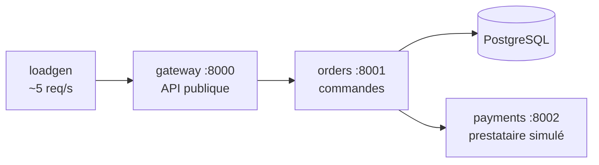

# 🛒 Projet fil rouge — « Marché observable »

> Un seul projet, trois paliers, une épreuve finale. Si vous le menez au bout **seul**, sans ouvrir les solutions, vous maîtrisez le cursus d'observabilité.

---

## Le contexte

Vous rejoignez **Marché**, une jeune plateforme de commande en ligne (pagnes, riz, téléphones, forfaits internet), payable en mobile money ou par carte, avec des prix en francs CFA. L'équipe de développement livre vite… et n'a **aucune** observabilité : quand un client se plaint, on lit `docker logs` en espérant trouver quelque chose.

Votre mission, en trois paliers :

| Palier | Votre mission | Cours associé |
| --- | --- | --- |
| 🟢 **1** | **Voir** : collecter métriques et logs, construire le premier dashboard, mener une enquête sur le comportement de Marché | [01.md](../01.md) |
| 🟡 **2** | **Être prévenu** : instrumenter le code (RED + métier), alerter de bout en bout, tout passer en *as code*, gérer les accès | [02.md](../02.md) |
| 🔴 **3** | **Comprendre et tenir** : tracer les requêtes, corréler les signaux, passer à l'échelle en HA, piloter par les SLO, sécuriser, automatiser | [03.md](../03.md) |
| 🏁 **Final** | **Game day** : des pannes sont injectées à l'aveugle ; vous les détectez, les diagnostiquez et rédigez les post-mortems | [palier-3.md](palier-3.md#épreuve-finale--game-day) |

---

## L'application Marché



| Service | Rôle | Endpoints |
| --- | --- | --- |
| `gateway` | API publique : catalogue, création et consultation de commandes | `GET /api/products`, `POST /api/orders`, `GET /api/orders/{id}`, `/healthz`, `/metrics` |
| `orders` | Enregistre la commande dans PostgreSQL, demande le paiement, met à jour le statut | `POST /orders`, `GET /orders/{id}`, `/healthz` (vérifie la base), `/metrics` |
| `payments` | Prestataire de paiement simulé : latence réaliste, ~3 % de refus « solde insuffisant » | `POST /payments/charge`, `/healthz`, `/metrics` |
| `loadgen` | Génère en continu du trafic réaliste, y compris quelques requêtes invalides (404, 422) | — |
| `postgres` | Base de données des commandes | — |

Ce que l'application fournit **au départ** (`starter/`) :
- des **logs JSON** sur la sortie standard (une ligne d'accès par requête, plus des événements métier : « commande créée », « paiement refusé »…) ;
- un endpoint **`/metrics`** avec un seul compteur applicatif, `http_requests_total{method, route, status}`, et les métriques du processus Python.

C'est volontairement pauvre : l'enrichir fait partie du travail (Palier 2 : latences, métriques métier ; Palier 3 : traces).

### Les statuts HTTP à connaître

| Code | Signification dans Marché |
| --- | --- |
| 201 | Commande créée et payée |
| 402 | Commande créée, paiement **refusé** (métier, normal ~3 %) |
| 404 | Produit ou commande inconnus |
| 422 | Requête invalide (le loadgen en envoie volontairement ~2 %) |
| 502 | Le paiement a échoué **techniquement** (payments en erreur ou injoignable) |
| 503 | Service indisponible (panne injectée, dépendance injoignable) |

---

## `chaos.py` — l'injecteur de pannes

Une observabilité ne vaut que si elle **voit les pannes**. `starter/chaos.py` (Python 3, bibliothèque standard uniquement) en injecte à la demande :

```bash
python chaos.py scenarios                  # liste des scénarios
python chaos.py scenario paiement-lent     # déclencher un scénario connu
python chaos.py status                     # état de chaque service
python chaos.py reset                      # tout remettre d'aplomb
python chaos.py set orders db_slow_ms=300  # réglage fin
python chaos.py gameday [--hard]           # incident(s) tiré(s) au sort, à l'aveugle (épreuve finale)
python chaos.py reveal                     # révèle le game day et remet d'aplomb
```

| Scénario | Ce qui se passe réellement |
| --- | --- |
| `paiement-lent` | payments répond en ~1,5 s |
| `paiement-instable` | 30 % des appels à payments échouent |
| `base-lente` | chaque insertion attend 800 ms dans PostgreSQL |
| `fuite-memoire` | le gateway ne libère jamais une partie de sa mémoire |
| `cpu-sature` | un thread d'orders consomme un cœur en continu |
| `tempete-de-logs` | orders émet 50 lignes WARNING par requête |
| `gateway-erreurs` | 15 % des requêtes du gateway échouent |
| `paiement-hors-ligne` | le conteneur payments est arrêté |
| `base-hors-ligne` | le conteneur PostgreSQL est arrêté |

---

## Règles du jeu

1. **Travaillez dans votre propre dépôt Git**, jamais dans ce dossier :
   ```bash
   cp -r starter ~/marche-observable && cd ~/marche-observable
   git init && git add . && git commit -m "Point de départ : application Marché"
   docker compose up -d --build
   curl -s localhost:8000/api/products
   ```
   Vous ajouterez **vos** services d'observabilité dans ce même `docker-compose.yml`, palier après palier. Un commit par étape : votre historique Git racontera votre progression.
2. **Ne modifiez pas le comportement métier** de l'application (au Palier 2 et 3, vous modifiez son **instrumentation**, pas sa logique).
3. **Les noms imposés sont imposés** (labels, métriques, uid de datasources) : le correcteur automatique en dépend, comme une vraie équipe dépendrait de vos conventions.
4. **Pas de solution avant d'avoir fini le palier.** Les solutions de référence (`solution/palier-N/`) sont là pour comparer *après*, pas pour copier. Chaque palier a des **indices** repliés, à ouvrir un par un en cas de blocage.
5. **Prouvez tout.** Une affirmation (« le paiement mobile money est plus lent ») n'est acceptée qu'accompagnée de la requête qui la démontre.

---

## Validation

### Correcteur automatique

`verify/verify.py` interroge **votre** stack (via l'API de Grafana) et vérifie les critères techniques du palier **et des paliers précédents**. Lancez-le depuis ce dossier `projet-fil-rouge/` (Python 3.10+, bibliothèque standard uniquement) :

```bash
python verify/verify.py --palier 1 --password <mot de passe admin Grafana>
python verify/verify.py --palier 2 --password <…>
python verify/verify.py --palier 3 --url https://localhost:8443 --password <…> --repo ~/marche-observable
```

Laissez tourner le trafic au moins **10 minutes** avant de lancer une vérification. Le correcteur ne regarde que ce qui se **mesure** ; les livrables écrits (enquête, runbooks, post-mortems) sont évalués avec les grilles de chaque palier.

### Grille de maîtrise

| Niveau | Critère |
| --- | --- |
| 🟢 Palier 1 validé | `verify.py --palier 1` vert + enquête du Palier 1 complète et prouvée |
| 🟡 Palier 2 validé | `verify.py --palier 2` vert + tests unitaires de règles verts + runbooks + incidents détectés par alerte |
| 🔴 Palier 3 validé | `verify.py --palier 3` vert + CI verte + SLO documentés + incidents diagnostiqués par les traces |
| 🏁 **Maîtrise du cursus** | Game day final réussi : ≥ 4 incidents sur 5 détectés **par une alerte** (pas par hasard), diagnostiqués jusqu'à la cause racine en moins de 15 min chacun, post-mortems conformes à la grille |

---

## Ressources nécessaires

| Palier | Conteneurs | RAM conseillée |
| --- | --- | --- |
| 1 | ~10 | 4 Go libres |
| 2 | ~15 | 6 Go libres |
| 3 | ~22 | 8 Go libres (machine de 16 Go recommandée) |

Testé avec Docker Desktop (Windows 11, WSL2) et Docker Engine sous Linux. Sous Windows, utilisez Git Bash ou WSL pour les commandes shell.

---

## Arborescence de ce dossier

```
projet-fil-rouge/
├── README.md              ← vous êtes ici
├── palier-1.md            ← cahier des charges du Palier 1
├── palier-2.md            ← … du Palier 2
├── palier-3.md            ← … du Palier 3 + épreuve finale (game day)
├── starter/               ← l'application Marché, point de départ (à copier)
│   ├── docker-compose.yml
│   ├── chaos.py
│   └── app/               ← gateway.py, orders.py, payments.py, loadgen.py, common.py
├── verify/
│   └── verify.py          ← correcteur automatique
└── solution/              ← solutions de référence, testées (à n'ouvrir qu'APRÈS)
    ├── README.md          ← les pièges rencontrés en construisant les solutions
    ├── palier-1/
    ├── palier-2/
    └── palier-3/
```

Bon courage — et commencez par [palier-1.md](palier-1.md).
