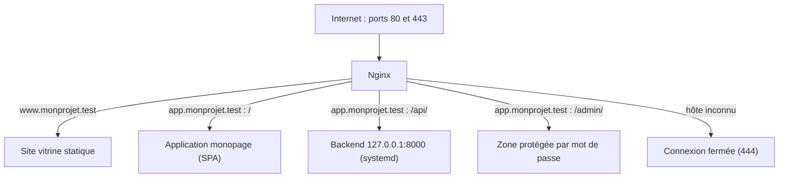
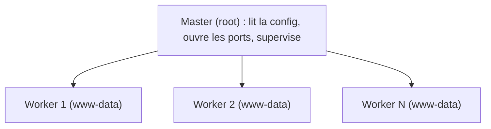
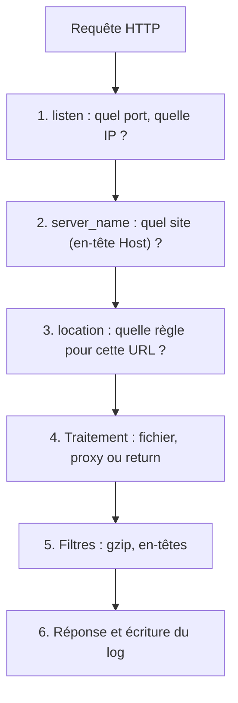

# Nginx sur Ubuntu — Palier 1 : Fondamentaux

*Cours · exercices · projet fil rouge — palier 1 sur 3*

**Durée estimée :** 12 à 16 h · **Prérequis :** terminal Linux, notions HTTP (méthodes, codes, en-têtes) · **Environnement :** Ubuntu Server 26.04 LTS (nginx 1.28) ou 24.04 LTS (nginx 1.24). Les écarts de version sont signalés. *(Versions upstream début octobre 2026 : stable 1.30, mainline 1.31.)*

## Sommaire

- Mode d'emploi et feuille de route des 3 paliers
- Le projet fil rouge « MonProjet »
- Module 0 · Préparer le labo
- Module 1 · Comprendre Nginx
- Module 2 · Installer et piloter Nginx
- Module 3 · Anatomie d'une configuration
- Module 4 · Servir du contenu statique
- Module 5 · Hôtes virtuels (server blocks)
- Module 6 · Routage avec `location`
- Module 7 · Reverse proxy
- Module 8 · Logs et observation
- Module 9 · HTTPS avec Let's Encrypt
- Module 10 · Sécurité de base
- Module 11 · Performance de base
- Module 12 · Exploitation et dépannage
- Recette finale, évaluation, passerelle vers le palier 2
- Annexes : A aide-mémoire · B configuration de référence · C corrigés

---

## Mode d'emploi

**À la fin de ce palier, vous saurez :**

- installer, configurer, recharger et dépanner Nginx sur Ubuntu en autonomie ;
- héberger plusieurs sites sur une même machine (hôtes virtuels) ;
- router des URL vers des fichiers, des redirections ou des applications (reverse proxy) ;
- activer HTTPS avec renouvellement automatique ;
- lire les logs et diagnostiquer 403, 404, 502 et 504 ;
- appliquer un socle de sécurité et de performance solide.

**Méthode.** Chaque module suit le même rythme : *Objectifs → Cours → Exercices → Jalon du projet → Auto-évaluation*. Avant chaque test, **prédisez le résultat** : c'est ce qui distingue copier de comprendre. Les corrigés sont en annexe C : cherchez d'abord.

**Légende.** ⚠️ piège classique · 💡 astuce · 🧩 jalon du projet · ⭐ guidé · ⭐⭐ autonome · ⭐⭐⭐ défi.

**Technologies croisées dans ce palier :** UFW (pare-feu), systemd et journald, logrotate, Certbot et Let's Encrypt, OpenSSL, curl, git, htpasswd, et les modules Nginx `core`, `rewrite`, `proxy`, `ssl`, `gzip`, `headers`, `log`, `access`, `auth_basic`, `stub_status`.

## Les 3 paliers (plan prévisionnel)

**Palier 1 — Fondamentaux (ce document).** Installer, configurer, publier un site statique et une API derrière un reverse proxy, HTTPS, logs, sécurité et performance de base, dépannage.

**Palier 2 — Intermédiaire.**

- Variables, `map`, réécritures et redirections avancées
- Upstreams et répartition de charge (algorithmes, sticky sessions, health checks passifs, keepalive)
- Applications réelles : PHP-FPM (Laravel), Gunicorn/uWSGI (Django), Node/Next.js, WebSocket, SSE, gRPC, sockets Unix
- Cache : `proxy_cache`, `fastcgi_cache`, micro-caching, purge
- TLS avancé : HTTP/2, HTTP/3, certificats wildcard (DNS-01), mTLS
- Protection : `limit_req`, `limit_conn`, `real_ip`, fail2ban, CSP, `auth_request`
- Nginx + Docker / Compose
- Observabilité : logs JSON, exporter Prometheus, Loki, Grafana

**Palier 3 — Expert.**

- Internals : phases de traitement, boucle d'événements, tuning noyau, tests de charge
- Modules dynamiques : Brotli, headers-more, GeoIP2, njs, OpenResty/Lua, compilation depuis les sources
- Module `stream` : proxy TCP/UDP, routage SNI
- Sécurité avancée : WAF (ModSecurity v3 / Coraza), durcissement système
- Haute disponibilité : Keepalived, blue/green, canary (`split_clients`)
- Edge et CDN maison : cache distribué, `slice`, médias HLS, proxy d'API d'IA en streaming
- CI/CD et Infrastructure as Code : tests de configuration, Ansible, images Docker durcies
- Carnet de recettes par cas d'usage : SaaS multi-tenant, API gateway, média, IA

*Ce plan s'ajustera à vos retours à la fin de chaque palier.*

---

## Le projet fil rouge : « MonProjet »

Vous allez construire, module après module, la **façade web complète d'un produit fictif** sur un serveur Ubuntu. À la fin du palier, une seule instance Nginx servira :



**Cahier des charges final :**

1. `monprojet.test` redirige vers `www.monprojet.test` ; HTTP redirige vers HTTPS.
2. `www` : site statique, page 404 personnalisée, cache navigateur, compression.
3. `app` : SPA avec repli sur `index.html`, API proxifiée sur `/api/`, zone `/admin/` protégée, route de santé `/healthz`.
4. Tout hôte inconnu (ou accès direct par IP) est rejeté.
5. Logs enrichis (temps de réponse, identifiant de requête), rotation vérifiée, supervision locale via `stub_status`.
6. Socle de sécurité : version masquée, en-têtes, fichiers cachés interdits, HSTS progressif.
7. Configuration versionnée avec git, runbook d'exploitation, recette automatisée (`recette.sh`) à 100 % de PASS.

**Deux pistes de travail :**

- **Piste A — labo (par défaut).** Domaine fictif `monprojet.test` (le TLD `.test` est réservé aux essais), noms résolus via `/etc/hosts`, certificat auto-signé. Aucune dépendance externe.
- **Piste B — public.** Un vrai domaine et un serveur joignable depuis Internet : Let's Encrypt au module 9. Pour passer de A à B, remplacez `monprojet.test` par votre domaine (commande au module 0).

Chaque module se termine par un **🧩 jalon** qui ajoute une brique. L'état final complet figure en annexe B.

---

## Module 0 · Préparer le labo

**Objectifs :** une machine prête, un pare-feu sûr, des noms de test résolus, les bons outils.

### Cours

**Machine.** Un VPS (1 vCPU et 1 Go de RAM suffisent) ou une VM locale sous Ubuntu Server 26.04 ou 24.04 LTS, avec un utilisateur `sudo`.

**Mises à jour et outils :**

```bash
sudo apt update && sudo apt upgrade -y
sudo apt install -y curl jq tree git dnsutils apache2-utils
```

`jq` lit le JSON, `apache2-utils` fournit `htpasswd` (module 10) et `ab` (module 11), `git` versionnera votre configuration.

**Pare-feu UFW.** ⚠️ Autorisez SSH *avant* d'activer, sinon vous vous coupez l'accès :

```bash
sudo ufw allow OpenSSH
sudo ufw enable
sudo ufw status
```

Sur un cloud public, ouvrez aussi les ports 80 et 443 dans le groupe de sécurité du fournisseur.

**Noms de test (piste A).** Sur la machine *depuis laquelle vous testez*, ajoutez dans `/etc/hosts` (Windows : `C:\Windows\System32\drivers\etc\hosts`) :

```text
203.0.113.10  monprojet.test www.monprojet.test app.monprojet.test
```

Remplacez l'IP par celle de votre serveur (`127.0.0.1` si vous testez depuis le serveur lui-même).

**Piste B.** Créez des enregistrements DNS `A` (et `AAAA` en IPv6) pour `votredomaine.com`, `www` et `app`. Le moment venu, remplacez le domaine partout :

```bash
sudo grep -rl --exclude-dir=.git 'monprojet\.test' /etc/nginx \
  | sudo xargs -r sed -i 's/monprojet\.test/votredomaine.com/g'
```

**Votre instrument principal : `curl`.**

```bash
curl -I URL                                     # en-têtes seuls (requête HEAD)
curl -sS -o /dev/null -w '%{http_code}\n' URL   # code HTTP seul
curl --resolve h:80:IP http://h/                # forcer l'IP sans DNS
curl -H 'Host: h' http://IP/                    # variante : fixer l'en-tête Host
```

### Check-list de sortie

- [ ] `lsb_release -ds` affiche votre version d'Ubuntu, `ip -br a` votre IP.
- [ ] `sudo ufw status` : SSH autorisé, pare-feu actif.
- [ ] Piste A : `getent hosts www.monprojet.test` renvoie l'IP du serveur.

---

## Module 1 · Comprendre Nginx

**Objectifs :** expliquer ce que fait Nginx, décrire son architecture, suivre le trajet d'une requête.

### Cours

#### 1.1 Ce que fait Nginx

Nginx (« engine x ») est à la fois un **serveur HTTP**, un **reverse proxy**, un **répartiteur de charge**, un **cache HTTP** et un **proxy TCP/UDP** (module `stream`). En pratique, c'est la porte d'entrée de vos applications (Django derrière Gunicorn, Laravel derrière PHP-FPM, Next.js, API…) : il termine TLS, route les URL, sert les fichiers statiques, compresse, journalise et protège.

⚠️ Nginx n'exécute pas votre code Python ou PHP : il **délègue** à un backend (`proxy_pass`, `fastcgi_pass`).

#### 1.2 Pourquoi il est rapide

Son architecture est **événementielle** :



- Le **master** lit la configuration, ouvre les ports 80/443 et pilote les workers.
- Chaque **worker** gère des milliers de connexions dans une boucle d'événements non bloquante (`epoll` sous Linux), sans créer un processus ou un thread par connexion.
- Conséquence : Nginx absorbe les clients lents et les pics de connexions sans mobiliser votre application. C'est la raison d'être d'un reverse proxy devant Gunicorn ou PHP-FPM.

#### 1.3 Le trajet d'une requête



**C'est la carte mentale du cours :** chaque module éclaire l'une de ces étapes. Quand un comportement vous surprend, demandez-vous à quelle étape la décision a été prise.

#### 1.4 Modules, variantes et versions

Les fonctions de Nginx sont des **modules**, compilés dans le binaire ou chargés dynamiquement. Ceux de ce palier :

- `core` : `listen`, `server_name`, `location`, `root`, `alias`, `try_files`, `error_page`
- `rewrite` : `return`, `rewrite`, `if`
- `proxy` : `proxy_pass`, `proxy_set_header`, délais
- `ssl` : certificats et protocoles TLS
- `headers` : `add_header`, `expires` · `gzip` : compression
- `log` : `log_format`, `access_log`
- `access` et `auth_basic` : `allow`, `deny`, mot de passe
- `stub_status` : compteurs de supervision

**Où trouver Nginx :**

- **Paquet Ubuntu** (ce palier) : intégré à systemd, correctifs de sécurité rétroportés par Ubuntu. 26.04 LTS embarque la 1.28, 24.04 LTS la 1.24.
- **Dépôt nginx.org** : branche *stable* (numéro mineur pair, aujourd'hui 1.30) ou *mainline* (impair, aujourd'hui 1.31). Versions plus récentes, arborescence différente (palier 2).
- **Variantes** : OpenResty (Nginx + Lua), NGINX Plus (commercial) — palier 3.

💡 Consultez toujours la documentation de **votre version** : `nginx -v`, puis nginx.org/en/docs/.

### Exercices

**1.1 ⭐** Citez trois raisons de placer Nginx devant Gunicorn plutôt que d'exposer Gunicorn directement.

**1.2 ⭐** Sur papier, décrivez le trajet de `GET https://app.monprojet.test/api/users` en nommant, à chaque étape, la directive qui décide.

### Auto-évaluation

1. Quel processus ouvre les ports 80 et 443, et sous quelle identité tournent les workers ?
2. Pourquoi Nginx supporte-t-il bien un grand nombre de connexions lentes ?
3. Nginx peut-il exécuter directement du code PHP ou Python ? Sinon, que fait-il ?

---

## Module 2 · Installer et piloter Nginx

**Objectifs :** installer, ouvrir le pare-feu, repérer les fichiers, maîtriser le cycle de vie du service et `nginx -t`.

### Cours

#### 2.1 Installation

```bash
sudo apt update
sudo apt install -y nginx
nginx -v
```

Le service démarre tout seul et s'active au démarrage. Pour lister les modules compilés (la sortie de `-V` va sur *stderr*, d'où `2>&1`) :

```bash
nginx -V 2>&1 | tr ' ' '\n' | grep module
```

#### 2.2 Pare-feu

```bash
sudo ufw app list            # profils installés par le paquet
sudo ufw allow 'Nginx Full'  # 80 + 443
sudo ufw status
```

Profils : `Nginx HTTP` (80), `Nginx HTTPS` (443), `Nginx Full` (les deux).

#### 2.3 Premier test

```bash
systemctl status nginx --no-pager
curl -I http://localhost
sudo ss -tlnp | grep nginx
```

Attendu : `HTTP/1.1 200 OK`, un en-tête `Server: nginx/…` et deux sockets en écoute (80 en IPv4 et en IPv6). Depuis un navigateur : la page « Welcome to nginx! ».

#### 2.4 Où est quoi (arborescence Debian/Ubuntu)

```text
/etc/nginx/
├── nginx.conf          fichier racine
├── conf.d/             fragments inclus dans http { }
├── sites-available/    un fichier par site (disponibles)
├── sites-enabled/      liens symboliques vers les sites actifs
├── snippets/           blocs réutilisables (include)
├── modules-enabled/    chargement des modules dynamiques
├── mime.types          extension → Content-Type
└── proxy_params        en-têtes de proxy usuels
/var/www/html/          racine web par défaut
/var/log/nginx/         access.log, error.log
/run/nginx.pid          PID du master
```

⚠️ Beaucoup de tutoriels (Docker, RHEL, paquets nginx.org) n'utilisent que `conf.d/`. Le modèle `sites-available` / `sites-enabled` est une particularité Debian/Ubuntu.

#### 2.5 Piloter le service

- `sudo systemctl start | stop | restart nginx`
- `sudo systemctl reload nginx` : recharge la config **sans couper** les connexions en cours
- `sudo systemctl enable | disable nginx` : démarrage au boot
- `sudo nginx -t` : teste la syntaxe et l'ouverture des fichiers référencés
- `sudo nginx -T` : teste puis affiche la configuration complète fusionnée
- `journalctl -u nginx --since "10 min ago"` : journal du service

**Reload vs restart.** Au *reload*, le master relit la config ; si elle est valide, il lance de nouveaux workers et laisse les anciens finir leurs requêtes avant de les arrêter. Si elle est invalide, les anciens workers continuent et l'erreur va dans `error.log`. Un *restart* coupe tout, et avec une config cassée le service ne redémarre pas.

**Le réflexe d'or :**

```bash
sudo nginx -t && sudo systemctl reload nginx
```

⚠️ Ne vous fiez pas au seul code de retour de `systemctl reload` : la vérité est dans `nginx -t` et `error.log`.

#### 2.6 Voir les processus

```bash
pgrep -a nginx    # master (root) + workers (www-data)
nproc             # nombre de cœurs ≈ nombre de workers (worker_processes auto)
```

### Exercices

**2.1 ⭐** Installez Nginx, ouvrez le pare-feu et vérifiez la page par défaut depuis un autre poste.

**2.2 ⭐** Listez cinq modules compilés avec `nginx -V`. Lequel fournit `stub_status` ?

**2.3 ⭐⭐** Casser puis réparer *(labo uniquement)*. Sauvegardez `nginx.conf`, retirez un `;`, puis : (a) lancez `sudo nginx -t` et lisez le fichier et la ligne de l'erreur ; (b) lancez `sudo systemctl reload nginx` : le site répond-il encore ? Que dit `error.log` ? (c) lancez `sudo systemctl restart nginx` : que se passe-t-il ? Restaurez la sauvegarde.

**2.4 ⭐⭐** Notez les PID avec `pgrep -a nginx`, faites un `reload`, comparez ; refaites avec un `restart`. Quels PID changent dans chaque cas ?

### 🧩 Jalon 1 : base installée et versionnée

Versionnez `/etc/nginx` et créez un alias pratique :

```bash
sudo git -C /etc/nginx init -q
echo "alias ngit='sudo git -C /etc/nginx -c user.name=ops -c user.email=ops@localhost'" >> ~/.bashrc
source ~/.bashrc
ngit add -A && ngit commit -qm "baseline : configuration d'origine"
```

Désormais : `ngit status`, `ngit diff`, `ngit log --oneline`.

### Auto-évaluation

1. Quelle différence entre `reload` et `restart` ?
2. Où placer la configuration d'un nouveau site sur Ubuntu ?
3. Quelle commande affiche la configuration effective, includes compris ?

---

## Module 3 · Anatomie d'une configuration

**Objectifs :** lire n'importe quelle configuration, maîtriser contextes et héritage, éviter le piège d'`add_header`.

### Cours

#### 3.1 Syntaxe

```nginx
# commentaire
directive_simple valeur1 valeur2;     # se termine par un point-virgule

bloc {                                # un bloc regroupe des directives
    sous_directive valeur;
}
```

- Chaque directive simple finit par `;` — l'oubli est l'erreur n°1.
- Unités : octets `k`, `m` ; durées `ms`, `s`, `m`, `h`, `d` (`client_max_body_size 10m;`, `proxy_read_timeout 30s;`).
- Variables : `$host`, `$uri`, `$request_uri`, `$scheme`, `$remote_addr`, `$status`…
- `include` accepte les jokers : `include /etc/nginx/sites-enabled/*;`

#### 3.2 Les contextes

```text
main                  user, worker_processes, error_log, pid
├── events { }        worker_connections
└── http { }          tout ce qui concerne HTTP
    ├── upstream { }  groupes de backends
    └── server { }    un site : listen, server_name
        └── location { }   une URL ou un motif d'URL
```

Chaque directive n'est valide que dans certains contextes (la doc indique *Context*). Erreur typique : `"server" directive is not allowed here`.

#### 3.3 L'héritage et son piège

Une directive posée dans un contexte parent s'applique aux enfants, sauf redéfinition. ⚠️ **Piège des directives répétables** (`add_header`, `proxy_set_header`, `fastcgi_param`…) : si l'enfant en déclare *une seule*, il perd *toutes* celles du parent.

```nginx
server {
    add_header X-Frame-Options "SAMEORIGIN" always;

    location /assets/ {
        add_header Cache-Control "public";
        # X-Frame-Options a DISPARU dans ce bloc !
    }
}
```

Remède : regrouper les en-têtes dans un *snippet* et l'inclure dans chaque bloc concerné (`include snippets/security-headers.conf;`).

#### 3.4 Lire la configuration d'Ubuntu

Le fichier `nginx.conf` ressemble à ceci (simplifié, les détails varient selon la version) :

```nginx
user www-data;                     # identité des workers
worker_processes auto;             # un worker par cœur
pid /run/nginx.pid;
error_log /var/log/nginx/error.log;
include /etc/nginx/modules-enabled/*.conf;

events {
    worker_connections 768;        # connexions simultanées par worker
}

http {
    sendfile on;                   # copie fichier → socket par le noyau
    tcp_nopush on;
    include /etc/nginx/mime.types;
    default_type application/octet-stream;
    access_log /var/log/nginx/access.log;
    gzip on;

    include /etc/nginx/conf.d/*.conf;
    include /etc/nginx/sites-enabled/*;    # vos sites arrivent ici
}
```

Les sites ne sont **pas** dans `nginx.conf` : ils y sont *inclus*. Ce modèle « un fichier par site » est la base d'une configuration maintenable.

#### 3.5 Organisation recommandée

- `nginx.conf` : quasiment jamais modifié.
- `conf.d/NN-nom.conf` : réglages globaux du contexte `http` (formats de log, compression…). Le préfixe numérique fixe l'ordre de chargement.
- `sites-available/<site>.conf` + lien dans `sites-enabled/` : un fichier par site.
- `snippets/` : blocs réutilisables via `include`.

```bash
sudo ln -s /etc/nginx/sites-available/monsite.conf /etc/nginx/sites-enabled/   # activer
sudo rm /etc/nginx/sites-enabled/monsite.conf                                  # désactiver
```

### Exercices

**3.1 ⭐** Dans la configuration ci-dessus, donnez le contexte de : `worker_connections`, `sendfile`, `listen`, `root`.

**3.2 ⭐** Provoquez l'erreur `"server" directive is not allowed here` (indice : un `server { listen 8099; }` placé hors du bloc `http`), lisez-la avec `nginx -t`, puis corrigez.

**3.3 ⭐⭐** Reproduisez le piège `add_header`. Créez `/etc/nginx/conf.d/lab-heritage.conf` :

```nginx
server {
    listen 8082;
    add_header X-Global "oui" always;

    location /a/ { return 200 "a\n"; }
    location /b/ { add_header X-Local "oui" always; return 200 "b\n"; }
}
```

Quels en-têtes renvoient `curl -I localhost:8082/a/` et `/b/` ? Corrigez `/b/` pour qu'il renvoie les deux, puis supprimez le fichier.

**3.4 ⭐⭐** Créez `/etc/nginx/conf.d/05-global.conf` avec `server_tokens off;`, rechargez, comparez l'en-tête `Server` avant et après.

### 🧩 Jalon 2 : arborescence du projet

```bash
sudo mkdir -p /var/www/monprojet/{www,app}
sudo chown -R "$USER":www-data /var/www/monprojet
```

Si vous n'avez pas fait l'exercice 3.4, créez maintenant `05-global.conf` avec `server_tokens off;`. Puis :

```bash
sudo nginx -t && sudo systemctl reload nginx
ngit add -A && ngit commit -qm "jalon 2 : server_tokens off"
```

### Auto-évaluation

1. Dans quel contexte vit un bloc `server` ?
2. Un `server` déclare un `add_header`, un `location` enfant en déclare un autre : quels en-têtes reçoit la réponse de ce `location` ?
3. Pourquoi placer un `log_format` dans `conf.d/` plutôt que dans le fichier d'un site ?

---

## Module 4 · Servir du contenu statique

**Objectifs :** publier un site statique proprement, maîtriser `root`, `alias` et `try_files`, personnaliser les erreurs, régler les permissions.

### Cours

#### 4.1 Le plus petit site

```nginx
server {
    listen 80;
    server_name www.monprojet.test;

    root /var/www/monprojet/www;
    index index.html;

    location / {
        try_files $uri $uri/ =404;
    }
}
```

- `root` : dossier racine. `/a/b.css` → `/var/www/monprojet/www/a/b.css`. Placez-le au niveau `server`, pas dans chaque `location`.
- `index` : fichier servi quand l'URL désigne un dossier.
- `try_files` : essaie dans l'ordre le fichier exact, le dossier (donc son `index`), sinon `404`.

#### 4.2 `root` ou `alias` ?

```nginx
location /img/ { root  /data;          }   # /img/a.png → /data/img/a.png
location /img/ { alias /data/images/;  }   # /img/a.png → /data/images/a.png
```

`root` **ajoute** l'URI complète au dossier ; `alias` **remplace** la partie qui a matché le `location`. ⚠️ Avec `alias`, terminez par `/` si le `location` se termine par `/`.

#### 4.3 Applications monopage (SPA)

```nginx
location / { try_files $uri $uri/ /index.html; }
```

Toute URL qui n'est pas un fichier renvoie `index.html` : le routeur JavaScript prend le relais. ⚠️ Effet de bord : un asset manquant renvoie aussi `index.html` avec un statut 200. Limitez le repli :

```nginx
location /assets/ { try_files $uri =404; }
```

#### 4.4 Pages d'erreur personnalisées

```nginx
error_page 404 /404.html;
location = /404.html { internal; }
```

`internal` rend la page atteignable uniquement par redirection interne : on ne peut pas la demander directement. De même : `error_page 500 502 503 504 /50x.html;`.

#### 4.5 Types MIME

`mime.types` associe extension et `Content-Type`. Un mauvais type produit un CSS ignoré ou un fichier téléchargé au lieu d'être affiché. Contrôle : `curl -I …/style.css | grep -i content-type`.

#### 4.6 Permissions et erreurs 403

Les workers (`www-data`) doivent pouvoir **traverser** chaque dossier du chemin (bit `x`) et **lire** les fichiers. Pour inspecter tout le chemin :

```bash
namei -l /var/www/monprojet/www/index.html
```

Causes classiques d'un 403 : dossier sans `index` (et `autoindex off`), permissions, règle `deny`. Principe : propriétaire = vous (déploiement), groupe = `www-data`, lecture seule pour Nginx.

```bash
sudo chown -R "$USER":www-data /var/www/monprojet
find /var/www/monprojet -type d -exec chmod 750 {} +
find /var/www/monprojet -type f -exec chmod 640 {} +
```

### Exercices

**4.1 ⭐** Créez le contenu du jalon 3, activez le site et vérifiez `/` et une URL inexistante.

**4.2 ⭐⭐** `root` vs `alias`. Créez `/srv/demo/images/logo.txt` et un serveur de test (`conf.d/lab-alias.conf`, `listen 8084;`) avec `location /img/ { root /srv/demo/images; }`. Constatez le 404, lisez dans `error.log` le chemin réellement cherché, puis corrigez avec `alias`.

**4.3 ⭐⭐** Cassez volontairement les permissions (`chmod 000` sur `index.html`, puis `chmod 700` sur le dossier `www`). Diagnostiquez avec `namei -l` et `error.log`, puis réparez.

**4.4 ⭐⭐⭐** Expliquez pourquoi `/dashboard/settings` renvoie `index.html` alors que `/assets/absent.js` renvoie 404 sur l'hôte `app` (une fois le jalon 5 appliqué).

### 🧩 Jalon 3 : site vitrine et contenu de l'application

```bash
cd /var/www/monprojet
mkdir -p www/assets app/assets app/admin

cat > www/index.html <<'HTML'
<!doctype html>
<html lang="fr">
<meta charset="utf-8">
<meta name="viewport" content="width=device-width, initial-scale=1">
<title>MonProjet</title>
<link rel="stylesheet" href="/assets/style.css">
<main>
  <h1>MonProjet</h1>
  <p>Servi par <code>Nginx</code> sur Ubuntu.</p>
  <p><a href="https://app.monprojet.test/">Ouvrir l'application</a></p>
</main>
HTML

cat > www/404.html <<'HTML'
<!doctype html>
<html lang="fr">
<meta charset="utf-8">
<title>Introuvable</title>
<link rel="stylesheet" href="/assets/style.css">
<main><h1>Page introuvable</h1><p><a href="/">Retour à l'accueil</a></p></main>
HTML

cat > www/assets/style.css <<'CSS'
:root { --bg:#0f172a; --fg:#e2e8f0; --accent:#38bdf8; }
* { box-sizing: border-box; }
body { margin:0; font:16px/1.6 system-ui, sans-serif;
       background:var(--bg); color:var(--fg); }
main { max-width:40rem; margin:10vh auto; padding:0 1rem; }
h1 { font-size:2rem; margin:0 0 .5rem; }
a { color:var(--accent); }
code { background:#1e293b; padding:.1em .35em; border-radius:4px; }
CSS

cp www/assets/style.css app/assets/style.css

cat > app/index.html <<'HTML'
<!doctype html>
<html lang="fr">
<meta charset="utf-8">
<meta name="viewport" content="width=device-width, initial-scale=1">
<title>MonProjet · App</title>
<link rel="stylesheet" href="/assets/style.css">
<main>
  <h1>MonProjet · App</h1>
  <p>Réponse de l'API :</p>
  <pre id="out">chargement…</pre>
</main>
<script>
fetch('/api/hello')
  .then(r => r.text())
  .then(t => { document.getElementById('out').textContent = t; })
  .catch(e => { document.getElementById('out').textContent = String(e); });
</script>
HTML

echo '<h1>Zone admin</h1>' > app/admin/index.html
```

Appliquez ensuite les permissions du § 4.6, puis créez le premier hôte virtuel (`sudo tee`, car `/etc/nginx` appartient à root) :

```bash
sudo tee /etc/nginx/sites-available/monprojet-www.conf >/dev/null <<'CONF'
server {
    listen 80;
    listen [::]:80;
    server_name www.monprojet.test;

    root /var/www/monprojet/www;
    index index.html;

    error_page 404 /404.html;
    location = /404.html { internal; }

    location / { try_files $uri $uri/ =404; }
}
CONF
sudo ln -s /etc/nginx/sites-available/monprojet-www.conf /etc/nginx/sites-enabled/
sudo nginx -t && sudo systemctl reload nginx
curl --resolve www.monprojet.test:80:127.0.0.1 http://www.monprojet.test/
ngit add -A && ngit commit -qm "jalon 3 : site vitrine"
```

### Auto-évaluation

1. Avec `location /img/ { alias /data/pics/; }`, quel fichier sert `/img/a.png` ?
2. Pourquoi placer `root` dans `server` plutôt que dans chaque `location` ?
3. Quelle directive empêche d'accéder directement à `/404.html` ?

---

## Module 5 · Hôtes virtuels (server blocks)

**Objectifs :** héberger plusieurs sites sur une machine, comprendre la sélection du `server`, sécuriser le cas « hôte inconnu », rediriger proprement.

### Cours

#### 5.1 Comment Nginx choisit le `server`

En deux temps : (1) par **adresse:port** (`listen`), (2) parmi les candidats, par l'en-tête **`Host`** (`server_name`). Ordre de priorité pour le nom :

1. nom exact (`www.monprojet.test`) ;
2. joker en début, le plus long (`*.monprojet.test`) ;
3. joker en fin (`www.*`) ;
4. première expression régulière qui correspond (`~^…$`, dans l'ordre du fichier) ;
5. sinon, le serveur **par défaut** du port : celui marqué `default_server`, à défaut le premier défini.

#### 5.2 Plusieurs sites, un fichier chacun

Un fichier par site dans `sites-available/`, activé par un lien dans `sites-enabled/` (module 3).

#### 5.3 Le serveur « attrape-tout »

⚠️ Sans `default_server` explicite, une requête avec un `Host` inconnu — ou un accès direct par IP, typique des scanners — tombe sur le **premier site chargé** : fuite possible. Prévoyez un serveur par défaut qui coupe court :

```nginx
server {
    listen 80 default_server;
    listen [::]:80 default_server;
    server_name _;
    return 444;        # 444 : Nginx ferme la connexion sans répondre
}
```

Il faut d'abord retirer le site par défaut d'Ubuntu, déjà `default_server` :

```bash
sudo rm /etc/nginx/sites-enabled/default
```

Sinon : `a duplicate default server for 0.0.0.0:80`.

#### 5.4 Redirections canoniques

```nginx
server {
    listen 80;
    server_name monprojet.test;
    return 301 http://www.monprojet.test$request_uri;
}
```

- `$request_uri` conserve chemin **et** paramètres ; `$uri` ne conserve que le chemin normalisé.
- ⚠️ Le `301` est mis en cache par les navigateurs : testez en `302`, passez en `301` quand c'est validé.

#### 5.5 Tester sans DNS

```bash
curl --resolve www.monprojet.test:80:127.0.0.1 http://www.monprojet.test/
curl -H 'Host: www.monprojet.test' http://127.0.0.1/
```

💡 Pour savoir quel bloc répond, ajoutez provisoirement `add_header X-Served-By "www" always;`.

### Exercices

**5.1 ⭐** Testez avec curl les trois noms du projet et affichez l'en-tête `Location` de l'apex (`curl -I`).

**5.2 ⭐** Appelez le serveur par son IP (`curl -v http://IP/`). Que voit curl ? (indice : erreur 52)

**5.3 ⭐⭐** Réactivez le site `default` en plus de l'attrape-tout. Lisez l'erreur de `nginx -t`, corrigez.

**5.4 ⭐⭐** Ajoutez un serveur `*.monprojet.test` qui répond `return 200 "joker\n";`. Quel bloc répond pour `app.monprojet.test` ? pour `x.monprojet.test` ? Pourquoi ? Supprimez-le ensuite.

**5.5 ⭐⭐⭐** Créez volontairement une boucle (apex → www **et** www → apex). Observez `curl -IL --max-redirs 5`, puis corrigez.

### 🧩 Jalon 4 : trois sites et un attrape-tout

```bash
sudo rm -f /etc/nginx/sites-enabled/default

sudo tee /etc/nginx/sites-available/00-catchall.conf >/dev/null <<'CONF'
server {
    listen 80 default_server;
    listen [::]:80 default_server;
    server_name _;
    return 444;
}
CONF

sudo tee /etc/nginx/sites-available/monprojet-www.conf >/dev/null <<'CONF'
server {
    listen 80;
    listen [::]:80;
    server_name monprojet.test;
    return 301 http://www.monprojet.test$request_uri;
}

server {
    listen 80;
    listen [::]:80;
    server_name www.monprojet.test;

    root /var/www/monprojet/www;
    index index.html;

    error_page 404 /404.html;
    location = /404.html { internal; }

    location / { try_files $uri $uri/ =404; }
}
CONF

sudo tee /etc/nginx/sites-available/monprojet-app.conf >/dev/null <<'CONF'
server {
    listen 80;
    listen [::]:80;
    server_name app.monprojet.test;

    root /var/www/monprojet/app;
    index index.html;

    location / { try_files $uri $uri/ /index.html; }
}
CONF

cd /etc/nginx/sites-enabled
sudo ln -sf ../sites-available/00-catchall.conf .
sudo ln -sf ../sites-available/monprojet-app.conf .
sudo nginx -t && sudo systemctl reload nginx
ngit add -A && ngit commit -qm "jalon 4 : vhosts et attrape-tout"
```

### Auto-évaluation

1. Dans quel ordre Nginx compare-t-il les `server_name` ?
2. Que fait `return 444;` ?
3. Quelle différence entre `$uri` et `$request_uri` ?

---

## Module 6 · Routage avec `location`

**Objectifs :** prédire quel `location` répond, utiliser les modificateurs, maîtriser `return` et `rewrite`, éviter `if`.

### Cours

#### 6.1 Syntaxe et modificateurs

```nginx
location = /chemin    { }   # correspondance exacte
location ^~ /prefixe  { }   # préfixe prioritaire : stoppe la recherche regex
location ~  regex     { }   # expression régulière, sensible à la casse
location ~* regex     { }   # expression régulière, insensible à la casse
location /prefixe     { }   # préfixe simple
location @nom         { }   # location nommée (error_page, try_files)
```

#### 6.2 L'algorithme de sélection

1. S'il existe un `location =` exact : gagné.
2. Parmi les préfixes (avec ou sans `^~`), retenir **le plus long** qui correspond. S'il porte `^~` : gagné.
3. Sinon, tester les **expressions régulières dans l'ordre du fichier** : la première qui correspond gagne.
4. Si aucune regex ne correspond, utiliser le préfixe retenu à l'étape 2.

#### 6.3 Motifs usuels

```nginx
# Route de santé (supervision)
location = /healthz {
    access_log off;
    default_type text/plain;     # sinon le navigateur télécharge le texte
    return 200 "ok\n";
}

# Fichiers cachés interdits, sauf /.well-known/ (validation Let's Encrypt)
location ~ /\.(?!well-known) { deny all; }

# Assets : cache navigateur
location ~* \.(?:css|js|woff2|svg|png|jpe?g|webp|avif|ico)$ {
    expires 30d;
    access_log off;
}

# Backend d'API
location /api/ { proxy_pass http://127.0.0.1:8000/; }
```

#### 6.4 `return`, `rewrite`, `if`

- `return 301 /nouvelle-url;` : le plus simple et le plus rapide pour les redirections et réponses fixes.
- `rewrite ^/ancien/(.*)$ /nouveau/$1 permanent;` : réécriture par regex ; drapeaux `last` (relance la sélection du `location`), `break`, `redirect` (302), `permanent` (301).
- `if` : à éviter. Dans un `location`, seuls `return` et `rewrite` y sont sûrs. Préférez `try_files`, `return` et, au palier 2, `map`.

#### 6.5 Déboguer le routage

Technique du **return de diagnostic** : faites répondre chaque `location` par son nom (`return 200 "A\n";`) puis testez avec curl. `sudo nginx -T | grep -n location` liste ce que Nginx a réellement chargé.

### Exercices

**6.1 ⭐⭐ Le puzzle.** Créez `/etc/nginx/conf.d/lab-location.conf` :

```nginx
server {
    listen 8081;
    default_type text/plain;

    location = /                { return 200 "A : exact racine\n"; }
    location /                  { return 200 "B : prefixe racine\n"; }
    location /docs/             { return 200 "C : prefixe /docs/\n"; }
    location ^~ /docs/img/      { return 200 "D : ^~ /docs/img/\n"; }
    location ~ \.(png|jpg)$     { return 200 "E : regex images\n"; }
    location ~* \.PDF$          { return 200 "F : regex pdf\n"; }
    location = /docs/index.html { return 200 "G : exact index\n"; }
}
```

**Avant de tester**, écrivez sur papier la lettre attendue pour chaque URL :

`/` · `/index.html` · `/docs/` · `/docs/guide.html` · `/docs/index.html` · `/docs/photo.png` · `/docs/img/photo.png` · `/photo.jpg` · `/rapport.pdf` · `/docs/IMG/photo.png` · `/docs` · `/docs/img/`

Puis vérifiez :

```bash
for u in / /index.html /docs/ /docs/guide.html /docs/index.html \
         /docs/photo.png /docs/img/photo.png /photo.jpg /rapport.pdf \
         /docs/IMG/photo.png /docs /docs/img/; do
  printf '%-22s -> ' "$u"; curl -s "http://127.0.0.1:8081$u"
done
```

**6.2 ⭐⭐** Redirigez `/ancien-blog/(.*)` vers `/blog/$1` en 301 et vérifiez avec `curl -I`.

**6.3 ⭐⭐⭐** Interdisez les fichiers cachés mais laissez passer `/.well-known/acme-challenge/test.txt` (à créer dans la racine de `www`). Vérifiez : `/.git/config` → 403, `/.well-known/acme-challenge/test.txt` → 200.

### 🧩 Jalon 5 : règles communes

Créez le snippet réutilisable :

```bash
sudo tee /etc/nginx/snippets/deny-dotfiles.conf >/dev/null <<'CONF'
# Interdit les fichiers cachés (.git, .env…) sauf /.well-known/ (ACME)
location ~ /\.(?!well-known) {
    deny all;
}
CONF
```

- Dans `monprojet-www.conf` (bloc `www`) : ajoutez `include snippets/deny-dotfiles.conf;` et le `location ~* \.(?:css|js|…)$` d'assets du § 6.3.
- Dans `monprojet-app.conf` : ajoutez `include snippets/deny-dotfiles.conf;`, le `location = /healthz`, et `location /assets/ { expires 30d; try_files $uri =404; }`.

```bash
sudo nginx -t && sudo systemctl reload nginx
curl -s --resolve app.monprojet.test:80:127.0.0.1 http://app.monprojet.test/healthz
ngit add -A && ngit commit -qm "jalon 5 : snippets et routes communes"
```

### Auto-évaluation

1. Avec `location ~ \.png$`, une requête `/images/logo.PNG` correspond-elle ? Pourquoi ?
2. Que change `^~` dans `location ^~ /docs/img/` ?
3. Pourquoi éviter `if` dans un `location` ?

---

## Module 7 · Reverse proxy

**Objectifs :** placer Nginx devant une application, maîtriser `proxy_pass` et le slash final, transmettre les bons en-têtes, diagnostiquer 502 et 504.

### Cours

#### 7.1 Pourquoi un reverse proxy ?

- **Terminaison TLS** : le backend parle HTTP simple en local.
- **Protection** : Nginx absorbe clients lents et requêtes malformées avant qu'elles n'atteignent l'application.
- **Statique** servi sans solliciter l'application.
- **Plusieurs applications** derrière les ports 80/443 d'une seule IP.
- **Point unique** pour logs, limites, cache et sécurité.

⚠️ Le backend doit écouter sur **`127.0.0.1` uniquement**, jamais sur `0.0.0.0` : sinon on peut contourner Nginx.

#### 7.2 Le backend de labo

Un petit serveur Python (bibliothèque standard seulement) qui **renvoie en JSON ce que Nginx lui transmet**. Il vous servira à observer en-têtes, chemins et délais.

```bash
sudo mkdir -p /opt/monprojet
sudo tee /opt/monprojet/echo.py >/dev/null <<'PY'
#!/usr/bin/env python3
"""Backend d'écho : renvoie en JSON ce que Nginx lui transmet."""
import json, time
from http.server import BaseHTTPRequestHandler, ThreadingHTTPServer
from urllib.parse import urlparse, parse_qs

class Echo(BaseHTTPRequestHandler):
    def _reply(self, code, payload):
        body = json.dumps(payload, indent=2, ensure_ascii=False).encode()
        self.send_response(code)
        self.send_header("Content-Type", "application/json; charset=utf-8")
        self.send_header("Content-Length", str(len(body)))
        self.end_headers()
        if self.command != "HEAD":
            self.wfile.write(body)

    def do_GET(self):
        url = urlparse(self.path)
        if url.path.endswith("/slow"):            # simule un backend lent
            time.sleep(int(parse_qs(url.query).get("s", ["10"])[0]))
        self._reply(200, {
            "path_recu": self.path,
            "client_direct": self.client_address[0],
            "headers": dict(self.headers.items()),
        })

    do_HEAD = do_GET

    def do_POST(self):
        n = int(self.headers.get("Content-Length", 0))
        data = self.rfile.read(n)
        self._reply(200, {"path_recu": self.path, "octets_recus": len(data)})

if __name__ == "__main__":
    ThreadingHTTPServer(("127.0.0.1", 8000), Echo).serve_forever()
PY
```

Service systemd (utilisateur éphémère, aucun droit superflu) :

```bash
sudo tee /etc/systemd/system/monprojet-echo.service >/dev/null <<'UNIT'
[Unit]
Description=Backend d'écho MonProjet
After=network.target

[Service]
DynamicUser=yes
ExecStart=/usr/bin/python3 /opt/monprojet/echo.py
Restart=on-failure

[Install]
WantedBy=multi-user.target
UNIT
sudo systemctl daemon-reload
sudo systemctl enable --now monprojet-echo
curl -s http://127.0.0.1:8000/test | jq
```

#### 7.3 Premier `proxy_pass`

```nginx
location /api/ {
    proxy_pass http://127.0.0.1:8000/;
}
```

Appelez `/api/hello` : le JSON montre que le backend a reçu `Host: 127.0.0.1:8000`. Nginx a **remplacé** l'en-tête d'origine.

#### 7.4 La règle du slash final

```text
location /api/ { proxy_pass http://app;  }   /api/users → /api/users
location /api/ { proxy_pass http://app/; }   /api/users → /users
location /api  { proxy_pass http://app/; }   /api/users → //users   ⚠️
```

Sans URI dans `proxy_pass` (pas de `/` final), le chemin est transmis tel quel ; avec une URI (même un simple `/`), la partie qui a matché le `location` est **remplacée**. Dans un `location` à expression régulière, `proxy_pass` ne peut pas contenir d'URI.

#### 7.5 Les en-têtes à transmettre

```nginx
proxy_set_header Host              $host;
proxy_set_header X-Real-IP         $remote_addr;
proxy_set_header X-Forwarded-For   $proxy_add_x_forwarded_for;
proxy_set_header X-Forwarded-Proto $scheme;
proxy_set_header X-Request-ID      $request_id;
```

Sans eux, l'application voit `Host` = `127.0.0.1:8000`, une IP cliente `127.0.0.1` et le schéma `http` : liens et redirections en `http://`, cookies `Secure` absents, boucles de redirection. Côté application, il faut aussi **faire confiance** à ces en-têtes : Django `SECURE_PROXY_SSL_HEADER`, Laravel `trustProxies`, Express `trust proxy`. (Ubuntu fournit aussi `/etc/nginx/proxy_params`, qui couvre les quatre premiers.)

#### 7.6 Délais et tailles

```nginx
proxy_connect_timeout 5s;     # établir la connexion au backend
proxy_read_timeout    60s;    # attendre la réponse (défaut 60 s)
proxy_send_timeout    60s;
client_max_body_size  10m;    # taille maximale d'un envoi (défaut 1m → 413)
```

#### 7.7 Diagnostiquer 502, 504 et 413

- **502 Bad Gateway** : backend injoignable ou réponse invalide. `error.log` : `connect() failed (111: Connection refused) while connecting to upstream`. Vérifiez `systemctl status`, `sudo ss -tlnp | grep 8000`, puis un `curl` direct sur le backend.
- **504 Gateway Timeout** : backend trop lent. `error.log` : `upstream timed out (110: …) while reading response header`. Corrigez le backend avant d'augmenter `proxy_read_timeout`.
- **413 Request Entity Too Large** : `client_max_body_size` trop bas.

#### 7.8 `upstream` : un nom pour le backend

```nginx
upstream echo_backend {
    server 127.0.0.1:8000;
}
# puis : proxy_pass http://echo_backend/;
```

Un groupe nommé est la base de la répartition de charge (palier 2).

💡 **Aperçu WebSocket** : ajoutez `proxy_http_version 1.1; proxy_set_header Upgrade $http_upgrade; proxy_set_header Connection "upgrade";` dans le `location` concerné (détails au palier 2).

⚠️ **Version** : avant nginx 1.29.7 (donc dans les paquets Ubuntu 24.04 et 26.04), Nginx parle HTTP/1.0 au backend par défaut ; les versions récentes passent à HTTP/1.1 avec keep-alive.

### Exercices

**7.1 ⭐** Déployez le backend et son service ; vérifiez-le en direct sur `127.0.0.1:8000`.

**7.2 ⭐** Ajoutez le `location /api/` sur l'hôte `app`. Appelez `/api/hello`, relevez `Host`, ajoutez les `proxy_set_header`, comparez.

**7.3 ⭐⭐** Matrice du slash : testez les trois variantes du § 7.4 et notez à chaque fois `path_recu`.

**7.4 ⭐⭐** Provoquez un **502** (`sudo systemctl stop monprojet-echo`) et lisez `error.log`. Provoquez un **504** : `proxy_read_timeout 3s;` puis `/api/slow?s=10`. Rétablissez.

**7.5 ⭐⭐** **413** : `head -c 2M /dev/zero | curl -s --data-binary @- -w '\n%{http_code}\n' http://app.monprojet.test/api/upload` avec la limite par défaut (1m), puis avec `client_max_body_size 5m;`.

**7.6 ⭐⭐⭐** Envoyez `-H 'X-Forwarded-For: 1.2.3.4'`. Que reçoit le backend ? Pourquoi une application ne doit-elle pas faire confiance aveuglément à la première adresse ? (La réponse technique arrive au palier 2 avec `real_ip`.)

### 🧩 Jalon 6 : l'API derrière Nginx

```bash
sudo tee /etc/nginx/snippets/proxy-monprojet.conf >/dev/null <<'CONF'
proxy_set_header Host              $host;
proxy_set_header X-Real-IP         $remote_addr;
proxy_set_header X-Forwarded-For   $proxy_add_x_forwarded_for;
proxy_set_header X-Forwarded-Proto $scheme;
proxy_set_header X-Request-ID      $request_id;

proxy_connect_timeout 5s;
proxy_read_timeout    60s;
proxy_send_timeout    60s;
CONF
```

Dans `monprojet-app.conf`, avant `location /` :

```nginx
    location /api/ {
        proxy_pass http://127.0.0.1:8000/;
        include snippets/proxy-monprojet.conf;
    }
```

```bash
sudo nginx -t && sudo systemctl reload nginx
curl -s --resolve app.monprojet.test:80:127.0.0.1 http://app.monprojet.test/api/hello | jq
ngit add -A && ngit commit -qm "jalon 6 : reverse proxy /api/"
```

### Auto-évaluation

1. Avec `location /api/ { proxy_pass http://app/; }`, quel chemin reçoit le backend pour `/api/x` ? Et sans le `/` final ?
2. Pourquoi `proxy_set_header Host $host;` ?
3. Quelle différence entre un 502 et un 504 ?

---

## Module 8 · Logs et observation

**Objectifs :** lire et enrichir les logs, mesurer, assurer la rotation, exposer des compteurs de supervision.

### Cours

#### 8.1 Deux journaux

- `access_log` : une ligne par requête (qui, quoi, résultat, durée).
- `error_log` : les problèmes rencontrés par Nginx. Niveaux : `debug`, `info`, `notice`, `warn`, `error` (défaut), `crit`, `alert`, `emerg`.

Le format par défaut, `combined`, ressemble à :

```text
203.0.113.7 - - [02/Oct/2026:10:15:32 +0000] "GET /api/hello HTTP/1.1" 200 412 "-" "curl/8.5.0"
```

#### 8.2 Un format enrichi

Un `log_format` se déclare dans le contexte `http`, donc dans `conf.d/` :

```nginx
# /etc/nginx/conf.d/00-log-formats.conf
log_format monprojet '$remote_addr - $remote_user [$time_local] '
                     '"$request" $status $body_bytes_sent '
                     '"$http_referer" "$http_user_agent" '
                     'rt=$request_time urt=$upstream_response_time '
                     'rid=$request_id';
```

- `rt` : durée totale de la requête ; `urt` : durée côté backend (`-` pour du statique) ; `rid` : identifiant unique, aussi transmis au backend (`X-Request-ID`) pour **relier** logs Nginx et logs applicatifs.
- Le début du format est identique à `combined` : le code HTTP reste le champ n°9.

Par site :

```nginx
access_log /var/log/nginx/monprojet-app.access.log monprojet;
error_log  /var/log/nginx/monprojet-app.error.log warn;
```

#### 8.3 Exploiter les logs

```bash
L=/var/log/nginx/monprojet-app.access.log
sudo tail -f $L                                              # en direct
sudo awk '{print $9}' $L | sort | uniq -c | sort -rn         # codes HTTP
sudo awk '{print $1}' $L | sort | uniq -c | sort -rn | head  # IP les plus actives
sudo awk '$9 ~ /^5/' $L | tail                               # erreurs 5xx
sudo awk '{for(i=1;i<=NF;i++) if($i ~ /^rt=/){sub("rt=","",$i); print $i, $7}}' $L \
  | sort -rn | head                                          # requêtes les plus lentes
```

💡 `goaccess` (paquet apt) produit un tableau de bord à partir du format `combined`.

#### 8.4 Réduire le bruit

`access_log off;` pour `/healthz` et les assets ; `log_not_found off;` pour `favicon.ico` et `robots.txt`. Sur Internet, des scans (`/.env`, `/wp-login.php`…) apparaîtront dans vos logs : c'est normal, et c'est ce que le module 10 neutralise.

#### 8.5 Rotation avec logrotate

Ubuntu fournit `/etc/logrotate.d/nginx` (rotation quotidienne, 14 archives compressées, tous les `/var/log/nginx/*.log`). Après rotation, Nginx doit **rouvrir** ses fichiers, ce que fait le script `postrotate`.

```bash
cat /etc/logrotate.d/nginx
sudo logrotate -d /etc/logrotate.d/nginx    # simulation
sudo logrotate -f /etc/logrotate.d/nginx    # forcer une rotation
```

⚠️ Un log écrit **hors** de `/var/log/nginx/*.log` n'est pas tourné.

#### 8.6 `stub_status` : compteurs de supervision

Exposez-le sur un serveur **local uniquement** :

```nginx
server {
    listen 127.0.0.1:8088;
    server_name localhost;
    access_log off;

    location = /nginx_status {
        stub_status;
        allow 127.0.0.1;
        deny all;
    }
}
```

```text
Active connections: 2
server accepts handled requests
 120 120 340
Reading: 0 Writing: 1 Waiting: 1
```

`accepts` et `handled` : connexions acceptées et traitées ; `requests` : requêtes ; `Waiting` : connexions keep-alive inactives. Au palier 2, ces compteurs alimenteront Prometheus et Grafana.

### Exercices

**8.1 ⭐** Créez le format `monprojet`, appliquez-le aux deux sites, générez du trafic et repérez `rt`, `urt` et `rid` dans une ligne.

**8.2 ⭐⭐** Avec `awk` : nombre de requêtes par code, trois URL les plus demandées (`$7`), cinq requêtes les plus lentes (générez-en avec `/api/slow?s=2`).

**8.3 ⭐⭐** Rotation : simulez (`-d`), forcez (`-f`), vérifiez qu'un nouveau fichier est écrit (`ls -l`) et que Nginx y écrit bien.

**8.4 ⭐⭐** Activez `stub_status`, puis lancez `for i in $(seq 100); do curl -s -o /dev/null http://app.monprojet.test/healthz; done`. Quels compteurs bougent ?

**8.5 ⭐⭐⭐** Corrélation : appelez `/api/hello`, relevez `X-Request-ID` dans le JSON du backend et retrouvez la **même** valeur (`rid=`) dans le log Nginx.

### 🧩 Jalon 7 : journalisation et supervision

1. Créez `conf.d/00-log-formats.conf` (§ 8.2).
2. Dans `monprojet-www.conf` et `monprojet-app.conf`, ajoutez des `access_log` / `error_log` dédiés ; `access_log off;` dans `/healthz` et les assets.
3. Créez et activez le serveur de supervision local :

```bash
sudo tee /etc/nginx/sites-available/monprojet-status.conf >/dev/null <<'CONF'
server {
    listen 127.0.0.1:8088;
    server_name localhost;
    access_log off;

    location = /nginx_status {
        stub_status;
        allow 127.0.0.1;
        deny all;
    }
}
CONF
sudo ln -sf ../sites-available/monprojet-status.conf /etc/nginx/sites-enabled/
sudo nginx -t && sudo systemctl reload nginx
curl -s http://127.0.0.1:8088/nginx_status
ngit add -A && ngit commit -qm "jalon 7 : logs et stub_status"
```

### Auto-évaluation

1. Dans quel contexte `log_format` est-il valide ?
2. Quelle différence entre `rt` et `urt` ?
3. Pourquoi Nginx doit-il rouvrir ses logs après une rotation ?

---

## Module 9 · HTTPS avec Let's Encrypt

**Objectifs :** comprendre TLS côté serveur, obtenir et renouveler un certificat, forcer HTTPS, activer HSTS, vérifier.

### Cours

#### 9.1 TLS en cinq minutes (point de vue opérateur)

- Le serveur présente un **certificat** (identité + clé publique) signé par une autorité ; le navigateur vérifie la chaîne et le nom.
- **`privkey.pem`** : clé privée, secrète (`600`, jamais dans git). **`fullchain.pem`** : votre certificat plus les intermédiaires. Dans Nginx, utilisez toujours *fullchain*.
- **SNI** : le client annonce le nom demandé dès la poignée de main, ce qui permet plusieurs certificats sur une même IP:443.
- **Let's Encrypt** : autorité gratuite, aux certificats de durée de vie courte et en baisse (90 jours aujourd'hui, 64 jours prévus à partir de février 2027, puis 45 jours en 2028). **L'automatisation du renouvellement n'est pas optionnelle.**
- **Validation HTTP-01** : Let's Encrypt appelle `http://votre-nom/.well-known/acme-challenge/…` : DNS correct et port 80 ouvert.

#### 9.2 Piste B : Certbot

```bash
sudo apt install -y certbot python3-certbot-nginx
sudo certbot --nginx --staging \
  -d votredomaine.com -d www.votredomaine.com -d app.votredomaine.com
```

`--staging` utilise l'environnement de test de Let's Encrypt (certificat non reconnu, mais aucune limite de débit stricte). Quand tout passe, relancez **sans** `--staging`. Certbot pose quelques questions (e-mail, conditions, redirection HTTP → HTTPS : acceptez), puis **modifie vos fichiers** : repérez les lignes `# managed by Certbot` avec `ngit diff`.

Renouvellement (déjà planifié par un timer systemd) :

```bash
systemctl list-timers 'certbot*' 'snap.certbot*'
sudo certbot certificates
sudo certbot renew --dry-run
```

Les certificats sont dans `/etc/letsencrypt/live/<nom>/` (`fullchain.pem`, `privkey.pem`). Certbot recommande officiellement l'installation par `snap` ; le paquet apt, plus ancien, convient très bien à ce palier.

#### 9.3 Piste A : certificat auto-signé

```bash
sudo openssl req -x509 -newkey rsa:2048 -nodes -days 365 \
  -keyout /etc/ssl/private/monprojet.key \
  -out    /etc/ssl/certs/monprojet.crt \
  -subj "/CN=monprojet.test" \
  -addext "subjectAltName=DNS:monprojet.test,DNS:www.monprojet.test,DNS:app.monprojet.test"
```

Pour tester **sans** `curl -k`, faites confiance explicitement à ce certificat :

```bash
curl --cacert /etc/ssl/certs/monprojet.crt \
     --resolve www.monprojet.test:443:127.0.0.1 https://www.monprojet.test/
```

#### 9.4 Le bloc HTTPS propre

```nginx
server {
    listen 80;
    listen [::]:80;
    server_name www.monprojet.test;
    return 301 https://$host$request_uri;
}

server {
    listen 443 ssl;
    listen [::]:443 ssl;
    server_name www.monprojet.test;

    ssl_certificate     /etc/ssl/certs/monprojet.crt;    # piste B : …/fullchain.pem
    ssl_certificate_key /etc/ssl/private/monprojet.key;  # piste B : …/privkey.pem
    include snippets/tls-monprojet.conf;
    # … root, locations, etc.
}
```

Le snippet `tls-monprojet.conf` factorise les réglages TLS. Piste A :

```bash
sudo tee /etc/nginx/snippets/tls-monprojet.conf >/dev/null <<'CONF'
ssl_protocols TLSv1.2 TLSv1.3;
ssl_session_cache shared:SSL:10m;
ssl_session_timeout 1d;
ssl_session_tickets off;
CONF
```

Piste B (réglages maintenus à jour par Certbot) : le snippet contient simplement

```nginx
include /etc/letsencrypt/options-ssl-nginx.conf;
ssl_dhparam /etc/letsencrypt/ssl-dhparams.pem;
```

⚠️ **HTTP/2 et version.** Avec nginx 1.24 (Ubuntu 24.04), on écrit `listen 443 ssl http2;`. Depuis nginx 1.25.1 (Ubuntu 26.04 : 1.28), on écrit `listen 443 ssl;` **et** `http2 on;` dans le `server`. Sur 1.24, `http2 on;` provoque `unknown directive "http2"`. Vérifiez avec `nginx -v`. (HTTP/2 et HTTP/3 sont approfondis au palier 2.)

#### 9.5 Attrape-tout HTTPS

```nginx
server {
    listen 443 ssl default_server;
    listen [::]:443 ssl default_server;
    ssl_reject_handshake on;   # refuse la poignée TLS pour un nom inconnu (nginx ≥ 1.19.4)
}
```

Aucun certificat n'est nécessaire pour ce bloc.

#### 9.6 HSTS : progressivité obligatoire

```nginx
add_header Strict-Transport-Security "max-age=300" always;
```

HSTS ordonne au navigateur de n'utiliser que HTTPS pour ce site. Montez par paliers (5 min → 1 semaine → 1 mois → 1 an) **après** validation. ⚠️ `includeSubDomains` n'est sûr que si *tous* vos sous-domaines sont en HTTPS ; `preload` est quasi irréversible : hors programme. Placez HSTS dans les blocs **443** uniquement.

#### 9.7 Vérifier

```bash
curl -I https://www.votredomaine.com
openssl s_client -connect www.votredomaine.com:443 -servername www.votredomaine.com \
  </dev/null 2>/dev/null | openssl x509 -noout -subject -issuer -dates
```

Pour un domaine public, le test en ligne **SSL Labs** (ssllabs.com/ssltest) vise une note A ou A+. `-servername` envoie le SNI : sans lui, vous obtenez le certificat du serveur par défaut.

### Exercices

**9.1 ⭐** *(piste A)* Générez le certificat, activez HTTPS sur `www`, testez avec `--cacert` et lisez sujet et dates avec `openssl s_client`.

**9.2 ⭐** *(piste B)* `certbot --nginx --staging`, observez `ngit diff`, relancez en réel, puis `certbot renew --dry-run`.

**9.3 ⭐⭐** Redirigez tout HTTP vers HTTPS ; vérifiez que `curl -IL http://monprojet.test/` (ajoutez `-k` en piste A) ne fait qu'**un** saut vers `https://www…`, puis 200. Il faut pour cela un bloc 443 pour l'apex.

**9.4 ⭐⭐** *(piste B)* Refactorisez la configuration écrite par Certbot : chemins explicites et `include snippets/tls-monprojet.conf`, sans doublons de directives ; `nginx -t` doit passer.

**9.5 ⭐⭐** Activez HSTS à 300 s, observez l'en-tête, puis expliquez le risque d'un `max-age` d'un an posé trop tôt.

**9.6 ⭐⭐⭐** Surveillance : `openssl x509 -in /etc/ssl/certs/monprojet.crt -noout -checkend 2592000 && echo OK || echo "expire sous 30 jours"`. Transformez-le en script d'alerte utilisable dans un cron.

### 🧩 Jalon 8 : HTTPS partout

Passez les trois hôtes en HTTPS selon le modèle du § 9.4 (apex et `www` redirigés vers `https://www…`, `app` redirigé vers `https://app…`), ajoutez l'attrape-tout 443 à `00-catchall.conf`, et HSTS à 300 s dans chaque bloc 443. La configuration complète est en **annexe B**.

```bash
sudo nginx -t && sudo systemctl reload nginx
curl -sI --cacert /etc/ssl/certs/monprojet.crt \
  --resolve www.monprojet.test:443:127.0.0.1 https://www.monprojet.test/ | head -5
ngit add -A && ngit commit -qm "jalon 8 : HTTPS"
```

### Auto-évaluation

1. Pourquoi `fullchain.pem` plutôt que `cert.pem` ?
2. À quoi sert `--staging` ?
3. Pourquoi monter HSTS progressivement ?

---

## Module 10 · Sécurité de base

**Objectifs :** réduire la surface d'attaque : version masquée, en-têtes, contrôle d'accès, fichiers sensibles, limites, moindre privilège.

### Cours

#### 10.1 Rester à jour

La première défense est le correctif : Nginx publie régulièrement des avis de sécurité (nginx.org/en/security_advisories.html) et Ubuntu les rétroporte dans ses paquets. Vérifiez que les mises à jour automatiques sont actives (`systemctl status unattended-upgrades`).

#### 10.2 Masquer la version

```nginx
server_tokens off;      # contexte http → conf.d/05-global.conf
```

L'en-tête devient `Server: nginx` : on ne publie plus la version exacte à ceux qui cherchent une faille précise. C'est de l'hygiène, pas une protection en soi.

#### 10.3 En-têtes de sécurité

```nginx
# /etc/nginx/snippets/security-headers.conf
add_header X-Content-Type-Options "nosniff" always;
add_header X-Frame-Options "SAMEORIGIN" always;
add_header Referrer-Policy "strict-origin-when-cross-origin" always;
add_header Permissions-Policy "geolocation=(), camera=(), microphone=()" always;
```

- `nosniff` : le navigateur respecte le `Content-Type` annoncé.
- `X-Frame-Options` : limite l'inclusion de vos pages dans des `<iframe>` tiers (clickjacking).
- `Referrer-Policy` : limite les informations d'origine envoyées aux sites tiers.
- `Permissions-Policy` : désactive des API sensibles du navigateur.
- `always` : l'en-tête est ajouté **même sur les réponses d'erreur** (sinon, seulement sur 2xx/3xx).
- HSTS : voir module 9. La `Content-Security-Policy`, plus puissante et plus exigeante, vient au palier 2.

⚠️ Rappel du module 3 : un `location` qui déclare son propre `add_header` perd ces en-têtes. Incluez le snippet dans ce `location`, ou préférez `expires` pour le cache (cette directive n'a pas ce défaut).

#### 10.4 Contrôle d'accès

Par IP : `allow` / `deny` (la première règle qui correspond gagne ; terminez par `deny all;`). Par mot de passe :

```bash
sudo htpasswd -c /etc/nginx/.htpasswd admin
sudo chown root:www-data /etc/nginx/.htpasswd
sudo chmod 640 /etc/nginx/.htpasswd
echo ".htpasswd" | sudo tee /etc/nginx/.gitignore
```

```nginx
location /admin/ {
    auth_basic "Zone privée";
    auth_basic_user_file /etc/nginx/.htpasswd;
    try_files $uri $uri/ =404;
}
```

⚠️ L'authentification Basic transmet les identifiants simplement encodés : **uniquement sur HTTPS**. Elle ne remplace pas une vraie authentification applicative (`auth_request`, palier 2). `satisfy any | all` combine règles IP et mot de passe.

#### 10.5 Fermer ce qui ne doit pas être public

- Fichiers cachés (`.git`, `.env`) : déjà couverts par `deny-dotfiles.conf`.
- Sauvegardes et résidus : `location ~* \.(?:bak|old|orig|sql|swp)$ { deny all; }`.
- **Principe de fond :** la racine web ne contient que ce qui est public. Publiez un dossier `public/`, pas le dépôt entier.

#### 10.6 Limites de requêtes

```nginx
client_max_body_size  10m;
client_body_timeout   15s;
client_header_timeout 15s;
```

Des délais courts limitent les connexions qui traînent volontairement. Le *rate limiting* (`limit_req`, `limit_conn`) arrive au palier 2.

#### 10.7 Moindre privilège

- Workers non-root (`user www-data`).
- Fichiers lisibles mais **non modifiables** par `www-data`.
- Clés TLS en `600`, propriété de root (le master les lit au démarrage).
- Backends sur `127.0.0.1`, pare-feu UFW actif.
- Un rôle par service : ici, `monprojet-echo` tourne sous un utilisateur éphémère.

### Exercices

**10.1 ⭐** Activez `server_tokens off;` et vérifiez avec `curl -sI … | grep -i '^server'`.

**10.2 ⭐** Créez le snippet d'en-têtes, incluez-le dans les blocs 443 et vérifiez avec `curl -sI … | grep -iE 'x-content|x-frame|referrer|permissions|strict'`.

**10.3 ⭐⭐** Protégez `/admin/` : attendu 401 sans identifiants, 200 avec `curl -u admin:…`. Expliquez pourquoi HTTPS est indispensable.

**10.4 ⭐⭐** Reproduisez le piège : ajoutez `add_header Cache-Control "public, immutable" always;` au `location` des assets et constatez la disparition des en-têtes de sécurité. Corrigez de deux façons : `include` du snippet, ou remplacement par `expires`.

**10.5 ⭐⭐⭐** Écrivez une boucle bash qui teste dix chemins sensibles (`/.env`, `/.git/config`, `/backup.sql`, `/admin/`…) et affiche le code HTTP de chacun. Aucun ne doit renvoyer 200 (sauf `/admin/` avec identifiants).

### 🧩 Jalon 9 : socle de sécurité

Complétez `conf.d/05-global.conf` :

```nginx
server_tokens off;
client_max_body_size  10m;
client_body_timeout   15s;
client_header_timeout 15s;
```

Créez le snippet d'en-têtes, incluez-le dans les blocs 443 de `www` et `app`, et ajoutez la zone `/admin/` protégée dans `app` :

```bash
sudo tee /etc/nginx/snippets/security-headers.conf >/dev/null <<'CONF'
add_header X-Content-Type-Options "nosniff" always;
add_header X-Frame-Options "SAMEORIGIN" always;
add_header Referrer-Policy "strict-origin-when-cross-origin" always;
add_header Permissions-Policy "geolocation=(), camera=(), microphone=()" always;
CONF
sudo nginx -t && sudo systemctl reload nginx
ngit add -A && ngit commit -qm "jalon 9 : sécurité de base"
```

### Auto-évaluation

1. Que garantit le paramètre `always` d'`add_header` ?
2. Pourquoi l'authentification Basic ne doit-elle servir que sur HTTPS ?
3. Pourquoi ne jamais laisser `.git` dans la racine web ?

---

## Module 11 · Performance de base

**Objectifs :** compresser, mettre en cache côté navigateur, régler les bases, mesurer avant d'optimiser.

### Cours

#### 11.1 Compression gzip

Ubuntu active déjà `gzip on;` dans `nginx.conf` : ⚠️ ne le redéclarez pas (erreur `"gzip" directive is duplicate`). Complétez avec :

```nginx
# /etc/nginx/conf.d/10-compression.conf
gzip_vary on;
gzip_comp_level 5;
gzip_min_length 256;
gzip_proxied any;
gzip_types text/plain text/css text/xml application/json
           application/javascript text/javascript
           application/xml image/svg+xml;
```

- `text/html` est toujours compressé.
- `gzip_vary on` ajoute `Vary: Accept-Encoding` pour les caches intermédiaires.
- Niveau 5-6 : bon compromis CPU / taille. **Ne compressez pas** ce qui l'est déjà (JPEG, PNG, WebP, WOFF2, zip, vidéo).
- La compression Brotli passe par un module dynamique (palier 3).

Mesure. ⚠️ Une requête `HEAD` (`curl -I`) n'est pas compressée : utilisez un `GET` et affichez les en-têtes avec `-D -` :

```bash
U=https://www.monprojet.test/assets/style.css
curl -sk -o /dev/null -w 'sans gzip : %{size_download} octets\n' $U
curl -sk -o /dev/null -w 'avec gzip : %{size_download} octets\n' -H 'Accept-Encoding: gzip' $U
curl -sk -o /dev/null -D - -H 'Accept-Encoding: gzip' $U | grep -i content-encoding
```

#### 11.2 Cache navigateur

```nginx
location ~* \.(?:css|js|woff2|svg|png|jpe?g|webp|avif|ico)$ { expires 30d; }
location = /index.html { expires -1; }     # toujours revalider
```

- `expires 30d;` produit `Cache-Control: max-age=2592000` (plus `Expires`).
- `expires -1;` produit `Cache-Control: no-cache` : le navigateur **revalide** à chaque fois.
- Règle d'or : assets au nom **empreinté** (`app.3f9a1c.js`) → cache très long ; HTML → revalidation.
- Nginx envoie `ETag` et `Last-Modified` : sur revalidation, il répond **304 Not Modified**, sans corps.

#### 11.3 Réglages de base

- `worker_processes auto;` : un worker par cœur.
- `worker_connections` : plafond de connexions **par worker** ; en reverse proxy, chaque requête en consomme deux (client et backend).
- `sendfile on; tcp_nopush on;` : déjà actifs sur Ubuntu.
- `keepalive_timeout` : durée de maintien d'une connexion inactive.

**Mesurez avant de régler.** Un test de charge simple :

```bash
ab -n 2000 -c 50 https://app.monprojet.test/healthz
```

(`ab` ne vérifie pas le certificat. `wrk` et `k6` au palier 3.) Comparez `/healthz` (réponse directe de Nginx) et `/api/hello` (via le backend Python) : l'écart donne le coût d'un backend.

### Exercices

**11.1 ⭐** Activez la compression et comparez les tailles du CSS. Que se passe-t-il pour un PNG ?

**11.2 ⭐** Constatez `Cache-Control` sur un asset ; rejouez la requête avec `If-None-Match: <etag>` et obtenez un `304`.

**11.3 ⭐⭐** `ab` sur `/healthz` puis `/api/hello` : comparez les « Requests per second » et expliquez l'écart.

**11.4 ⭐⭐** Faites varier `-c` (10, 50, 200) : que devient le débit ? Voyez-vous des erreurs, et où les lisez-vous ?

### 🧩 Jalon 10 : compression et cache

Ajoutez `conf.d/10-compression.conf` (§ 11.1) ; dans `app`, ajoutez `location = /index.html { expires -1; }` ; vérifiez les en-têtes.

```bash
sudo nginx -t && sudo systemctl reload nginx
ngit add -A && ngit commit -qm "jalon 10 : compression et cache"
```

### Auto-évaluation

1. À quoi sert `gzip_vary on;` ?
2. Pourquoi ne pas compresser un fichier JPEG ?
3. Que produit `expires -1;` ?

---

## Module 12 · Exploitation et dépannage

**Objectifs :** modifier sans risque, diagnostiquer avec méthode, reconnaître les pannes classiques, savoir revenir en arrière.

### Cours

#### 12.1 Le cycle de changement sûr

```text
modifier → ngit diff → nginx -t → reload → tester (curl) → lire les logs → ngit commit
```

Un changement à la fois. En cas de doute : `ngit checkout -- .` annule les modifications non commitées ; `ngit log --oneline` retrouve le dernier état sain.

#### 12.2 L'arbre de diagnostic

1. **Le service tourne-t-il ?** `systemctl status nginx` · `sudo ss -tlnp | grep -E ':80|:443'`
2. **La config est-elle valide ?** `sudo nginx -t`
3. **Le bon `server` répond-il ?** `curl -v --resolve …` et marqueur `X-Served-By`
4. **La bonne `location` ?** `return` de diagnostic · `sudo nginx -T | grep -n location`
5. **Que dit `error.log` ?** `sudo tail -n 50 /var/log/nginx/*error.log` : il explique la grande majorité des pannes.
6. **Le backend répond-il en direct ?** `curl -s http://127.0.0.1:8000/`
7. **Pare-feu, DNS, groupe de sécurité du cloud ?**

#### 12.3 Catalogue des pannes classiques

- `bind() to 0.0.0.0:80 failed (98: Address already in use)` : un autre processus (Apache, autre Nginx) occupe le port → `sudo ss -tlnp | grep :80`.
- `unknown directive "http2"` : directive trop récente pour votre version, ou module absent → `nginx -v`, `nginx -V`.
- `a duplicate default server for 0.0.0.0:80` : deux `default_server` sur le même port.
- `conflicting server name "x" on 0.0.0.0:80, ignored` : même `server_name` défini deux fois.
- `"gzip" directive is duplicate` : directive déjà posée à ce niveau.
- **403** : pas d'`index` (et `autoindex off`), permissions (`namei -l`), règle `deny`.
- **404** : mauvais `root`, `alias` ou `try_files` ; `error.log` indique le chemin cherché (`open() "…" failed`).
- **413** : `client_max_body_size`.
- **502** : backend arrêté ou mauvais port (`connect() failed (111…)`).
- **504** : backend trop lent (`upstream timed out`).
- **ERR_TOO_MANY_REDIRECTS** : règles www/apex ou HTTP/HTTPS croisées ; ou l'application croit être en HTTP (`X-Forwarded-Proto` manquant).
- **Ancienne version affichée** : cache navigateur (`expires`), mauvais hôte virtuel, rechargement oublié.
- **Certificat expiré** : `sudo certbot renew --dry-run`, timers (`systemctl list-timers`).
- **Aucun effet après reload** : le site n'est pas dans `sites-enabled/`.

#### 12.4 Boîte à outils

```bash
sudo nginx -T | less                          # configuration complète effective
sudo journalctl -u nginx --since "30 min ago" # journal du service
sudo lsof -i :80                              # qui écoute sur le port
namei -l /var/www/monprojet/www/index.html    # permissions le long du chemin
curl -v -o /dev/null --resolve h:443:IP https://h/   # dialogue complet
```

#### 12.5 Sauvegarde et reproductibilité

- `/etc/nginx` est versionné (jalon 1) : ne **poussez jamais** ce dépôt vers un serveur distant avec des secrets (`.htpasswd` est ignoré ; les clés TLS sont ailleurs).
- Sauvegardez `/etc/letsencrypt` (il contient des clés privées) dans un stockage chiffré.
- Un **runbook** d'une page vaut mieux que la mémoire : déploiement, rechargement, retour arrière, renouvellement des certificats, premiers réflexes en cas de panne.

### Exercices

**12.1 ⭐⭐ Le TP des pannes.** Appliquez **une** mutation à la fois, diagnostiquez avec l'arbre du § 12.2 **sans regarder le corrigé**, puis restaurez (`ngit checkout -- .`, ou la commande indiquée) :

1. Supprimez le lien `sites-enabled/monprojet-app.conf`.
2. Dans `monprojet-app.conf`, changez le port du backend (`127.0.0.1:8001`).
3. Dans `monprojet-www.conf`, écrivez `root /var/www/monprojet/ww;`.
4. `sudo chmod 700 /var/www/monprojet/www` (restauration : `chmod 750`).
5. Retirez `X-Forwarded-Proto` du snippet de proxy : que voit l'application ?
6. Copiez `monprojet-www.conf` en `copie.conf` et activez-le.

**12.2 ⭐⭐** Annulez une modification non commitée, puis retrouvez et inspectez un ancien commit (`ngit log --oneline`, `ngit show <id>`).

**12.3 ⭐⭐⭐** Écrivez `/usr/local/bin/ngx-check` : `nginx -t`, ports 80/443 en écoute, expiration du certificat, code HTTP de trois URL clés. Sortie `OK` / `KO` et code de retour exploitable par cron.

### 🧩 Jalon 11 : le runbook

Rédigez `~/monprojet-runbook.md` (une page) : arborescence, commandes de déploiement et de rechargement, procédure de retour arrière, renouvellement et vérification des certificats, arbre de diagnostic abrégé.

### Auto-évaluation

1. Quelle séquence de commandes appliquer pour un changement sûr ?
2. Un utilisateur signale un 502 : quelles sont vos quatre premières vérifications ?
3. Pourquoi sauvegarder `/etc/letsencrypt`, et comment le protéger ?

---

## Recette finale, évaluation, passerelle

### Recette automatisée

Enregistrez ce script sous `~/recette.sh` et lancez-le : `bash recette.sh monprojet.test 127.0.0.1`. En piste B, `STRICT=1 bash recette.sh votredomaine.com IP_PUBLIQUE` **vérifie** réellement le certificat.

```bash
#!/usr/bin/env bash
# recette.sh <domaine> <ip-du-serveur>
D="${1:-monprojet.test}"; IP="${2:-127.0.0.1}"
K="-k"; [ -n "$STRICT" ] && K=""        # STRICT=1 : certificat vérifié
ok=0; ko=0

t() {  # t "libellé" 'expression shell'
  if eval "$2" >/dev/null 2>&1; then echo "PASS  $1"; ((ok++))
  else echo "FAIL  $1"; ((ko++)); fi
}
get()  { curl -s $K --resolve "$1:443:$IP" --resolve "$1:80:$IP" "${@:2}"; }
code() { get "$1" -o /dev/null -w '%{http_code}' "${@:2}"; }

t "HTTP redirige vers HTTPS (301)"  '[ "$(code www.$D http://www.$D/)" = 301 ]'
t "www répond en HTTPS (200)"       '[ "$(code www.$D https://www.$D/)" = 200 ]'
t "apex redirige vers www"          'get $D -I http://$D/ | grep -qi "^location: https://www.$D/"'
t "404 personnalisée"               'get www.$D https://www.$D/nope | grep -qi introuvable'
t "hôte inconnu : connexion fermée" '[ "$(code inconnu.$D http://inconnu.$D/)" = 000 ]'
t "API proxifiée (/api/ -> /)"      'get app.$D https://app.$D/api/hello | grep -q "\"path_recu\": \"/hello\""'
t "X-Forwarded-Proto = https"       'get app.$D https://app.$D/api/hello | grep -q "\"X-Forwarded-Proto\": \"https\""'
t "/healthz répond 200"             '[ "$(code app.$D https://app.$D/healthz)" = 200 ]'
t "/admin/ protégé (401)"           '[ "$(code app.$D https://app.$D/admin/)" = 401 ]'
t "repli SPA (/dashboard/x = 200)"  '[ "$(code app.$D https://app.$D/dashboard/x)" = 200 ]'
t "asset absent = 404"              '[ "$(code app.$D https://app.$D/assets/absent.js)" = 404 ]'
t "dotfiles refusés (403)"          '[ "$(code www.$D https://www.$D/.git/config)" = 403 ]'
t "version Nginx masquée"           '! get www.$D -I https://www.$D/ | grep -qi "^server: nginx/"'
t "en-tête nosniff"                 'get www.$D -I https://www.$D/ | grep -qi "^x-content-type-options: nosniff"'
t "HSTS présent"                    'get www.$D -I https://www.$D/ | grep -qi "^strict-transport-security:"'
t "gzip sur le CSS"                 'get www.$D -o /dev/null -D - -H "Accept-Encoding: gzip" https://www.$D/assets/style.css | grep -qi "^content-encoding: gzip"'
t "cache navigateur sur le CSS"     'get www.$D -I https://www.$D/assets/style.css | grep -qi "^cache-control: max-age"'

echo; echo "Résultat : $ok PASS, $ko FAIL"
[ "$ko" -eq 0 ]
```

**Critères de réussite :** 100 % de PASS, un historique `ngit log` d'au moins 10 commits lisibles, un runbook rédigé et, en piste B, une note SSL Labs A ou A+.

### Évaluation finale (10 questions)

1. Décrivez en quatre étapes l'algorithme de sélection d'un `location`.
2. `proxy_pass http://app/;` et `proxy_pass http://app;` dans `location /api/` : quelle différence pour `/api/x` ?
3. Pourquoi `nginx -t` avant un reload ? Pourquoi un reload plutôt qu'un restart ?
4. Un 502 apparaît en production : votre démarche de diagnostic en quatre étapes.
5. Votre application Django génère des liens `http://` derrière Nginx en HTTPS : cause et correctifs (côté Nginx **et** côté Django).
6. Pourquoi prévoir un `default_server` explicite ?
7. Citez trois en-têtes de sécurité et leur rôle.
8. Qu'arrive-t-il aux `add_header` du parent quand un `location` en déclare un ?
9. Comment tester un hôte virtuel sans toucher au DNS ?
10. Quelles commandes prouvent que le renouvellement automatique des certificats fonctionne ?

### Passerelle vers le palier 2

Vous êtes prêt si vous savez, sans notes : expliquer le trajet d'une requête, prédire le `location` retenu, diagnostiquer 403 / 404 / 502 / 504, mettre un site en HTTPS avec renouvellement automatique, et revenir à un état sain grâce à git.

**Prochaine étape :** le palier 2 (Intermédiaire) : `map`, répartition de charge, applications réelles (PHP-FPM, Gunicorn, Next.js, WebSocket), cache, TLS avancé, protection et observabilité. Dites « palier 2 » quand vous êtes prêt et signalez ce que vous voulez ajuster dans le plan.

---

## Annexe A · Aide-mémoire

**Service et configuration**

```text
nginx -v | -V                  version | options de compilation
sudo nginx -t                  tester la configuration
sudo nginx -T                  tester + afficher la configuration complète
sudo systemctl reload nginx    recharger sans coupure
sudo systemctl restart nginx   redémarrer (coupe les connexions)
sudo nginx -s reopen           rouvrir les logs
```

**Directives du palier 1**

```text
listen / server_name / default_server     choix du site
root / alias / index / try_files          fichiers
location = ^~ ~ ~*                        routage
return / rewrite                          redirections
proxy_pass / proxy_set_header             reverse proxy
proxy_*_timeout / client_max_body_size    délais et tailles
log_format / access_log / error_log       journaux
ssl_certificate / ssl_certificate_key     TLS
add_header / expires                      en-têtes et cache
gzip_*                                    compression
allow / deny / auth_basic                 contrôle d'accès
server_tokens off                         masquer la version
stub_status                               compteurs
```

**Codes HTTP à connaître**

```text
301/302 redirection · 304 inchangé · 401 authentification · 403 interdit
404 introuvable · 413 corps trop gros · 444 (Nginx) connexion coupée
499 (Nginx) client parti · 502 backend KO · 504 backend trop lent
```

**curl**

```text
curl -I URL · -sS -o /dev/null -w '%{http_code}\n' URL · -v URL
curl --resolve h:443:IP https://h/ · -H 'Host: h' · -D - · -L · -u user:mdp
```

---

## Annexe B · Configuration de référence (état final)

> Piste A : certificat auto-signé (`/etc/ssl/…`). Piste B : remplacez les lignes `ssl_certificate*` par les chemins `fullchain.pem` / `privkey.pem` de Certbot, le contenu du snippet TLS par celui du § 9.4, et le domaine par le vôtre.

**Fichiers déjà donnés dans le cours :** `conf.d/00-log-formats.conf` (§ 8.2), `conf.d/10-compression.conf` (§ 11.1), `snippets/deny-dotfiles.conf` (jalon 5), `snippets/proxy-monprojet.conf` (jalon 6), `snippets/tls-monprojet.conf` (§ 9.4), `snippets/security-headers.conf` (jalon 9), `/etc/nginx/.htpasswd` (§ 10.4).

**`conf.d/05-global.conf`**

```nginx
server_tokens off;
client_max_body_size  10m;
client_body_timeout   15s;
client_header_timeout 15s;
```

**`sites-available/00-catchall.conf`**

```nginx
server {
    listen 80 default_server;
    listen [::]:80 default_server;
    server_name _;
    return 444;
}

server {
    listen 443 ssl default_server;
    listen [::]:443 ssl default_server;
    ssl_reject_handshake on;
}
```

**`sites-available/monprojet-www.conf`**

```nginx
# HTTP : apex et www → version canonique en HTTPS
server {
    listen 80;
    listen [::]:80;
    server_name monprojet.test www.monprojet.test;
    return 301 https://www.monprojet.test$request_uri;
}

# HTTPS : apex → www
server {
    listen 443 ssl;
    listen [::]:443 ssl;
    server_name monprojet.test;

    ssl_certificate     /etc/ssl/certs/monprojet.crt;
    ssl_certificate_key /etc/ssl/private/monprojet.key;
    include snippets/tls-monprojet.conf;

    return 301 https://www.monprojet.test$request_uri;
}

# HTTPS : site vitrine
server {
    listen 443 ssl;
    listen [::]:443 ssl;
    server_name www.monprojet.test;

    ssl_certificate     /etc/ssl/certs/monprojet.crt;
    ssl_certificate_key /etc/ssl/private/monprojet.key;
    include snippets/tls-monprojet.conf;
    include snippets/security-headers.conf;
    add_header Strict-Transport-Security "max-age=300" always;

    root /var/www/monprojet/www;
    index index.html;

    access_log /var/log/nginx/monprojet-www.access.log monprojet;
    error_log  /var/log/nginx/monprojet-www.error.log warn;

    include snippets/deny-dotfiles.conf;

    error_page 404 /404.html;
    location = /404.html { internal; }

    location ~* \.(?:css|js|woff2|svg|png|jpe?g|webp|avif|ico)$ {
        expires 30d;
        access_log off;
    }

    location / { try_files $uri $uri/ =404; }
}
```

**`sites-available/monprojet-app.conf`**

```nginx
server {
    listen 80;
    listen [::]:80;
    server_name app.monprojet.test;
    return 301 https://app.monprojet.test$request_uri;
}

server {
    listen 443 ssl;
    listen [::]:443 ssl;
    server_name app.monprojet.test;

    ssl_certificate     /etc/ssl/certs/monprojet.crt;
    ssl_certificate_key /etc/ssl/private/monprojet.key;
    include snippets/tls-monprojet.conf;
    include snippets/security-headers.conf;
    add_header Strict-Transport-Security "max-age=300" always;

    root /var/www/monprojet/app;
    index index.html;

    access_log /var/log/nginx/monprojet-app.access.log monprojet;
    error_log  /var/log/nginx/monprojet-app.error.log warn;

    include snippets/deny-dotfiles.conf;

    location = /healthz {
        access_log off;
        default_type text/plain;
        return 200 "ok\n";
    }

    location /api/ {
        proxy_pass http://127.0.0.1:8000/;
        include snippets/proxy-monprojet.conf;
    }

    location /admin/ {
        auth_basic "Zone privée";
        auth_basic_user_file /etc/nginx/.htpasswd;
        try_files $uri $uri/ =404;
    }

    location /assets/ {
        expires 30d;
        try_files $uri =404;
    }

    location = /index.html { expires -1; }

    location / { try_files $uri $uri/ /index.html; }
}
```

**`sites-available/monprojet-status.conf`** : voir jalon 7.

**Liens actifs dans `sites-enabled/` :** `00-catchall.conf`, `monprojet-www.conf`, `monprojet-app.conf`, `monprojet-status.conf`.

---

## Annexe C · Corrigés

### Auto-évaluations

**Module 1.** (1) Le master (root) ouvre les ports ; les workers tournent sous `www-data`. (2) Boucle d'événements non bloquante : un worker gère des milliers de connexions sans processus ni thread par connexion. (3) Non : il délègue à un backend (`proxy_pass`, `fastcgi_pass`).

**Module 2.** (1) `reload` relit la config sans coupure (les anciens workers finissent leurs requêtes ; config invalide = l'ancienne continue) ; `restart` coupe tout. (2) `/etc/nginx/sites-available/<site>.conf` et un lien dans `sites-enabled/`. (3) `sudo nginx -T`.

**Module 3.** (1) `http`. (2) Uniquement ceux du `location` : ceux du `server` sont perdus. (3) C'est un réglage global du contexte `http`, partagé par plusieurs sites : dans le fichier d'un site, désactiver ce site casserait les autres qui l'utilisent.

**Module 4.** (1) `/data/pics/a.png`. (2) Un seul endroit, hérité par tous les `location` : moins de répétitions et d'oublis. (3) `internal;`.

**Module 5.** (1) Nom exact → joker en début (le plus long) → joker en fin → première regex → serveur par défaut. (2) Nginx ferme la connexion sans répondre. (3) `$request_uri` est l'URI brute avec paramètres ; `$uri` est le chemin normalisé, sans paramètres.

**Module 6.** (1) Non : `~` est sensible à la casse, `.PNG` ≠ `.png` (il faudrait `~*`). (2) Si c'est le préfixe le plus long, Nginx s'arrête là et ne teste pas les regex. (3) Comportements surprenants ; seuls `return` et `rewrite` sont sûrs dedans ; préférer `try_files`, `return`, `map`.

**Module 7.** (1) `/x` ; sans le `/` final : `/api/x`. (2) Sinon le backend reçoit `Host: 127.0.0.1:8000` (noms d'hôte, cookies, liens faux). (3) 502 : backend injoignable ou réponse invalide ; 504 : backend trop lent (délai dépassé).

**Module 8.** (1) `http`. (2) `rt` : durée totale côté Nginx ; `urt` : durée de réponse du backend. (3) Après rotation, Nginx écrirait encore dans l'ancien fichier renommé ; il faut le signaler (`USR1` / `nginx -s reopen`).

**Module 9.** (1) `fullchain.pem` contient les certificats intermédiaires, sans lesquels certains clients ne valident pas la chaîne. (2) Environnement de test de Let's Encrypt : limites très souples, certificat non reconnu. (3) Une erreur propagée par HSTS reste mémorisée par les navigateurs pendant toute la durée `max-age`.

**Module 10.** (1) L'en-tête est ajouté aussi sur les réponses 4xx/5xx. (2) Les identifiants sont simplement encodés (base64) : lisibles sur le réseau sans TLS. (3) On exposerait historique, secrets et code source (`/.git/config`).

**Module 11.** (1) Ajoute `Vary: Accept-Encoding` pour que caches et CDN servent la bonne variante. (2) Déjà compressé : CPU gaspillé pour un gain quasi nul. (3) `Cache-Control: no-cache` : revalidation à chaque usage.

**Module 12.** (1) modifier → `ngit diff` → `nginx -t` → reload → tester → logs → commit. (2) État du service backend, port en écoute (`ss`), `curl` direct sur le backend, `error.log`. (3) Il contient des clés privées et le compte ACME : stockage chiffré, droits restreints, jamais dans git.

### Exercices clés

**2.3.** `nginx -t` indique fichier et ligne. Après `reload` avec config cassée, le site **répond encore** (anciens workers) et `error.log` détaille l'erreur. Après `restart`, le service **ne démarre pas** (`nginx -t` échoue en pré-démarrage) : le site est down.

**2.4.** `reload` : le PID du master est inchangé, les workers changent. `restart` : tous les PID changent.

**3.3.** `/a/` renvoie `X-Global`. `/b/` renvoie **seulement** `X-Local`. Correction : répéter `add_header X-Global …` dans `/b/` (ou inclure un snippet commun).

**5.2.** Le `Host` est inconnu : l'attrape-tout répond `444`, curl signale `Empty reply from server` (erreur 52).

**5.4.** `app.monprojet.test` : le bloc exact gagne ; `x.monprojet.test` : le joker.

**7.3.** `location /api/ { proxy_pass http://127.0.0.1:8000; }` → `/api/hello` ; avec `…:8000/;` → `/hello` ; `location /api { …/; }` → `//hello`.

**7.4.** 502 : `connect() failed (111: Connection refused)`. 504 : `upstream timed out (110: …)`.

**7.5.** Avec 1m : `413`. Avec 5m : `200` et `"octets_recus": 2097152`.

**7.6.** Le backend reçoit `X-Forwarded-For: 1.2.3.4, <IP réelle>` : le client peut forger la première valeur. Seule l'adresse ajoutée par **votre** Nginx est fiable.

### Puzzle du module 6 (ex. 6.1)

```text
/                    A      /photo.jpg           E
/index.html          B      /rapport.pdf         F
/docs/               C      /docs/IMG/photo.png  E
/docs/guide.html     C      /docs                B
/docs/index.html     G      /docs/img/           D
/docs/photo.png      E      /docs/img/photo.png  D
```

Points clés : `/docs/img/photo.png` → `^~` stoppe la recherche regex (D) ; `/docs/IMG/photo.png` → les préfixes sont sensibles à la casse, donc la regex `E` l'emporte sur `C` ; `/docs` sans slash ne correspond pas à `/docs/` (et `return` ne déclenche aucune redirection automatique).

### TP des pannes (ex. 12.1)

```text
1  lien supprimé      app.* tombe sur l'attrape-tout : réponse vide (000)
2  mauvais port       502 ; error.log : connect() failed (111)
3  root erroné        404 ; error.log : "…/ww/index.html" is not found
4  chmod 700          403 ; error.log : open() … failed (13: Permission denied)
5  sans X-Fwd-Proto   absent du JSON : l'application croit être en HTTP
6  copie.conf         nginx -t : conflicting server name … ignored ; la copie est ignorée
```

### Évaluation finale

1. Exact `=` → préfixe le plus long (si `^~`, stop) → regex dans l'ordre du fichier → sinon le préfixe retenu.
2. Avec `/` final : `/x` ; sans : `/api/x`.
3. `nginx -t` détecte l'erreur avant qu'elle n'atteigne la production ; un reload ne coupe aucune connexion en cours, un restart si, et échoue avec une config cassée.
4. Service backend actif ? Port en écoute ? `curl` direct sur le backend ; `error.log` de Nginx.
5. Le backend ne sait pas que le client est en HTTPS : transmettre `X-Forwarded-Proto $scheme` (Nginx) et configurer `SECURE_PROXY_SSL_HEADER` (Django).
6. Sans lui, un `Host` inconnu ou un accès par IP tombe sur le premier site chargé.
7. Par exemple : `X-Content-Type-Options: nosniff` (respect du type MIME), `X-Frame-Options` (anti-clickjacking), `Referrer-Policy` (fuite d'origine), HSTS (HTTPS forcé).
8. Le `location` perd **tous** les `add_header` hérités : il ne garde que les siens.
9. `curl --resolve h:443:IP https://h/` ou `curl -H 'Host: h' http://IP/` (ou `/etc/hosts`).
10. `systemctl list-timers 'certbot*' 'snap.certbot*'`, `sudo certbot certificates`, `sudo certbot renew --dry-run`.

---

*Fin du palier 1. Prochaine étape : palier 2 — Intermédiaire.*