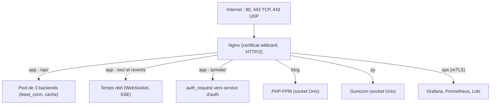

# Nginx sur Ubuntu — Palier 2 : Intermédiaire

*Cours · exercices · projet fil rouge — palier 2 sur 3*

**Durée estimée :** 18 à 24 h · **Prérequis :** palier 1 terminé (`recette.sh` à 100 % de PASS, configuration versionnée avec `ngit`) · **Environnement :** le serveur du palier 1, plus Docker au module 20.

## Sommaire

- Avant de commencer : état de départ, versions, conventions
- Le projet fil rouge « MonProjet v2 »
- Module 13 · Variables, `map` et réécritures
- Module 14 · Upstreams et répartition de charge
- Module 15 · Applications : sockets Unix, Gunicorn, PHP-FPM, Node/Next.js
- Module 16 · Temps réel : WebSocket, SSE, gRPC
- Module 17 · Cache : `proxy_cache` et micro-caching
- Module 18 · TLS avancé : HTTP/2, HTTP/3, wildcard, mTLS
- Module 19 · Protection : limites, IP réelle, fail2ban, CSP, `auth_request`
- Module 20 · Nginx et Docker Compose
- Module 21 · Observabilité : logs JSON, Prometheus, Loki, Grafana
- Module 22 · Exploitation avancée et dépannage
- Recette finale, évaluation, passerelle vers le palier 3
- Annexes : A aide-mémoire · B configuration de référence · C corrigés

---

## Avant de commencer

**État de départ.** Vérifiez : `bash ~/recette.sh monprojet.test 127.0.0.1` → 100 % de PASS ; `ngit status` propre. Les modules de ce palier **numérotent à la suite** du palier 1 (13 à 22) et leurs jalons continuent (12 à 21).

**Conventions identiques** (⚠️ piège · 💡 astuce · 🧩 jalon · ⭐ / ⭐⭐ / ⭐⭐⭐ difficulté). Les commandes `curl -k` ignorent le certificat auto-signé de la piste A ; en piste B, retirez `-k`. Les noms de test sont résolus via `/etc/hosts` : ajoutez maintenant les nouveaux hôtes à la ligne existante.

```text
203.0.113.10  monprojet.test www.monprojet.test app.monprojet.test
203.0.113.10  blog.monprojet.test py.monprojet.test ops.monprojet.test
```

**Versions : ce qui dépend de votre Nginx** (état début octobre 2026). Ubuntu 24.04 embarque la 1.24, Ubuntu 26.04 la 1.28 ; en amont, la branche stable est la 1.30. Vérifiez avec `nginx -v`.

- `http2 on;` (1.25.1) : absent en 1.24 ; présent en 1.28 et 1.30.
- Module HTTP/3 (1.25.0) : à vérifier avec `nginx -V 2>&1 | grep -o with-http_v3_module` ; les paquets de l'archive Ubuntu en sont généralement dépourvus (module 18, labo Docker au module 20).
- `resolve` dans `upstream` (1.27.3) : présent en 1.28 et 1.30, absent en 1.24.
- `sticky` (cookie/route/learn) dans `upstream` (1.29.6) : **uniquement 1.30 et plus**.
- `keepalive` vers les backends activé par défaut, HTTP/1.1 par défaut (1.29.7) : **1.30 et plus**.
- `add_header_inherit merge;` (1.29.3) : **1.30 et plus** (corrige le piège d'héritage du module 3).
- Mises à jour de sécurité : plusieurs correctifs de 2026 touchent `proxy`, `rewrite`, HTTP/2 et HTTP/3 (nginx.org/en/security_advisories.html). Gardez Nginx à jour.

💡 Les fonctions « 1.30 et plus » se testent dans l'image Docker officielle `nginx:stable` (module 20), sans toucher à votre Nginx Ubuntu.

---

## Le projet fil rouge : « MonProjet v2 »

Vous faites évoluer la façade du palier 1 en **plateforme multi-applications** :



**Cahier des charges final :**

1. `/api/` répartie sur 3 backends (`least_conn`, tolérance aux pannes), `/api/catalog` mis en cache.
2. WebSocket sur `/ws/`, flux SSE sur `/events`, sans coupure intempestive.
3. Hôtes `blog` (PHP-FPM) et `py` (Gunicorn) derrière sockets Unix.
4. Certificat wildcard, HTTP/2 partout, mTLS sur `ops`.
5. Limitation de débit sur `/api/login`, IP réelle, fail2ban, CSP, zone `/private/` protégée par `auth_request`.
6. Backends en conteneurs (Docker Compose), Nginx « conteneurisé » en labo pour sticky et HTTP/3.
7. Logs JSON, métriques Prometheus, logs dans Loki, tableau de bord Grafana derrière `ops`.
8. `recette2.sh` à 100 % de PASS et runbook mis à jour.

---

## Module 13 · Variables, `map` et réécritures

**Objectifs :** exploiter les variables, remplacer les `if` par des `map`, maîtriser `rewrite` et les redirections internes.

### Cours

#### 13.1 Les variables

- Requête : `$host`, `$uri` (normalisé, modifié par les réécritures), `$request_uri` (brut, avec paramètres), `$args`, `$arg_NOM`, `$request_method`, `$scheme`.
- En-têtes et cookies : `$http_NOM` (minuscules, `-` devient `_` : `$http_user_agent`), `$cookie_NOM`.
- Réponse et proxy : `$status`, `$upstream_addr`, `$upstream_status`, `$upstream_response_time`, `$upstream_cache_status`.
- Utilitaires : `$request_id`, `$remote_addr`, `$server_name`.

`set $var valeur;` crée une variable (module `rewrite`). Les variables sont évaluées **à la demande**, au moment où elles sont lues.

#### 13.2 `map` : la table de décision

`map` (contexte `http`) calcule une variable à partir d'une autre. C'est le remplaçant propre de la plupart des `if`.

```nginx
map $http_origin $cors_origin {
    default "";
    "https://app.monprojet.test"  $http_origin;
    "https://www.monprojet.test"  $http_origin;
}
```

Ordre d'évaluation : chaînes exactes, puis jokers (`*.exemple.com` avec le paramètre `hostnames`), puis expressions régulières **dans l'ordre**, sinon `default` (vide si absent). Une table longue se place dans un fichier :

```nginx
# conf.d/20-redirects.conf
map $uri $new_uri {
    include /etc/nginx/redirects.map;
}
```

```text
# /etc/nginx/redirects.map
/ancien-blog          /blog;
~^/produits/(\d+)$    /catalogue/$1;
```

Dans un `server` : `if ($new_uri) { return 301 $new_uri$is_args$args; }`. Clé sur `$uri` (sans paramètres) pour que `/ancien-blog?x=1` corresponde aussi ; `$is_args$args` rétablit les paramètres.

#### 13.3 `if` : les seuls usages sûrs

Dans un `location`, `if` n'est fiable qu'avec `return` ou `rewrite … last`. Autres directives : comportement imprévisible. Les directives du module `rewrite` (`if`, `set`, `return`, `rewrite`) se combinent bien entre elles, ce qui permet le motif de maintenance du § 13.6.

#### 13.4 `rewrite` : drapeaux et pièges

```nginx
rewrite ^/a/(.*)$ /b/$1 last;       # relance la recherche de location avec la nouvelle URI
rewrite ^/c/(.*)$ /b/$1 break;      # reste dans le location courant, saute les directives rewrite suivantes
rewrite ^/old$    /new  permanent;  # 301 vers le client
rewrite ^/tmp$    /new  redirect;   # 302 vers le client
```

- `last` et `break` sont des réécritures **internes** : le client ne voit rien.
- ⚠️ Au bout de 10 redirections internes : `500` et `rewrite or internal redirection cycle` dans `error.log`.
- `rewrite_log on;` (avec `error_log … notice;`) trace les réécritures.

#### 13.5 Locations nommées et redirections internes

```nginx
location / { try_files $uri @app; }
location @app { proxy_pass http://api_pool; }
error_page 502 503 504 /maintenance.html;
error_page 404 = @fallback;          # "=" remplace le code d'erreur par celui du fallback
```

`$request_uri` ne change pas lors d'une redirection interne ; `$uri`, si.

#### 13.6 Motif : mode maintenance par fichier drapeau

```nginx
# dans le bloc server de l'application
set $maintenance 0;
if (-f /var/www/monprojet/MAINTENANCE) { set $maintenance 1; }
if ($maintenance) { return 503; }

error_page 503 @maintenance;
location @maintenance {
    root /var/www/monprojet/pages;
    rewrite ^ /maintenance.html break;
    add_header Retry-After 300 always;
}
```

`touch /var/www/monprojet/MAINTENANCE` active le mode, `rm` le désactive, **sans reload**. Le code reste `503` (important pour le SEO et les sondes).

### Exercices

**13.1 ⭐** Créez `redirects.map` (une règle exacte, une règle avec capture, aucune règle par défaut) et testez avec `curl -skI`, y compris avec `?x=1`.

**13.2 ⭐⭐** CORS : appliquez le `map` ci-dessus à `/api/` (`add_header Access-Control-Allow-Origin $cors_origin always;` et `Vary: Origin`). Testez avec `-H 'Origin: https://app.monprojet.test'` puis `-H 'Origin: https://evil.test'`. ⚠️ Ce `location` déclare des `add_header` : que devient `X-Frame-Options` ? Corrigez avec `include snippets/security-headers.conf;`.

**13.3 ⭐⭐** `last` contre `break`. Créez `/srv/demo/b/x` (`sudo mkdir -p /srv/demo/b && echo "fichier statique" | sudo tee /srv/demo/b/x`) puis `conf.d/lab-rewrite.conf` :

```nginx
server {
    listen 8085;
    default_type text/plain;
    location /a/ { rewrite ^/a/(.*)$ /b/$1 last; }
    location /c/ { rewrite ^/c/(.*)$ /b/$1 break; root /srv/demo; }
    location /b/ { return 200 "location b\n"; }
}
```

Que renvoient `/a/x` et `/c/x` ? Prédisez, vérifiez, expliquez.

**13.4 ⭐⭐** Mode maintenance : créez la page, activez le motif, testez avec et sans fichier drapeau ; vérifiez `Retry-After`.

**13.5 ⭐⭐⭐** Provoquez `rewrite or internal redirection cycle` (`location /loop/ { rewrite ^/loop/(.*)$ /loop/$1 last; }`), lisez `error.log`, corrigez.

### 🧩 Jalon 12 : redirections, CORS et maintenance

```bash
sudo mkdir -p /var/www/monprojet/pages
sudo tee /var/www/monprojet/pages/maintenance.html >/dev/null <<'HTML'
<!doctype html>
<html lang="fr"><meta charset="utf-8"><title>Maintenance</title>
<h1>Maintenance en cours</h1><p>Retour dans quelques minutes.</p>
HTML
```

- Créez `conf.d/20-redirects.conf` et `/etc/nginx/redirects.map` (§ 13.2) ; ajoutez la ligne `if ($new_uri) { return 301 … }` aux blocs `www` et `app`.
- Créez `conf.d/25-cors.conf` avec le `map $http_origin $cors_origin` et appliquez-le à `/api/` (avec le snippet de sécurité).
- Ajoutez le motif de maintenance (§ 13.6) au bloc HTTPS de `app`.

```bash
sudo nginx -t && sudo systemctl reload nginx
ngit add -A && ngit commit -qm "jalon 12 : map, CORS, maintenance"
```

### Auto-évaluation

1. Pourquoi une table de redirections s'appuie-t-elle plutôt sur `$uri` que sur `$request_uri` ?
2. Différence entre `rewrite … last` et `rewrite … break` ?
3. Pourquoi le mode maintenance renvoie-t-il `503` plutôt que `200` ?

---

## Module 14 · Upstreams et répartition de charge

**Objectifs :** répartir le trafic sur plusieurs backends, tolérer les pannes, choisir un algorithme, maîtriser l'affinité de session.

### Cours

#### 14.1 Le bloc `upstream`

```nginx
upstream api_pool {
    zone api_pool 64k;                      # état partagé entre workers
    least_conn;                             # algorithme
    server 127.0.0.1:8001 weight=1 max_fails=3 fail_timeout=10s;
    server 127.0.0.1:8002 max_fails=3 fail_timeout=10s;
    server 127.0.0.1:8003 backup;           # n'est utilisé que si les autres sont HS
    keepalive 16;                           # connexions persistantes vers les backends
}
```

Paramètres de `server` : `weight` (poids), `max_fails` / `fail_timeout` (détection passive), `backup`, `down` (retire le serveur). `zone` place l'état (échecs, connexions actives) en mémoire partagée : indispensable pour que tous les workers aient la même vue.

**Keepalive vers les backends.** Jusqu'à la 1.29.6, il faut `proxy_http_version 1.1;` **et** `proxy_set_header Connection "";` pour que `keepalive` soit effectif. À partir de la 1.30, c'est le comportement par défaut.

#### 14.2 Algorithmes

- **Round robin** (défaut) : tour à tour, pondéré par `weight`.
- **`least_conn`** : vers le serveur ayant le moins de connexions actives. Meilleur choix quand les durées de requête varient.
- **`ip_hash`** : même adresse cliente (IPv4 : les 3 premiers octets) vers le même serveur. Affinité grossière, faussée par le NAT.
- **`hash $clef [consistent]`** : affinité sur une clé quelconque (`$cookie_sid`, `$request_uri`). `consistent` limite les déplacements quand le pool change.
- **`random [two [least_conn]]`** : tirage aléatoire (« power of two choices »), utile avec plusieurs Nginx en frontal.

#### 14.3 Détection passive des pannes

`max_fails=3 fail_timeout=10s` : après 3 échecs en 10 s, le serveur est écarté pendant 10 s, puis retenté. Par défaut, seuls les **erreurs de connexion et les délais dépassés** comptent comme échecs. Pour y inclure des codes HTTP :

```nginx
proxy_next_upstream error timeout http_502 http_503;
proxy_next_upstream_tries 2;       # nombre maximal d'essais au total
proxy_next_upstream_timeout 5s;    # durée maximale de l'ensemble des essais
```

⚠️ Nginx **ne rejoue pas** un `POST` déjà envoyé (sauf `non_idempotent`) : un échec sur une écriture est visible côté client. Les *health checks actifs* (`health_check`) restent, à ma connaissance, une fonction de NGINX Plus : vérifiez la documentation de votre version.

#### 14.4 Affinité de session

- Portable : `ip_hash`, ou `hash $cookie_sid consistent;` (le cookie est posé par l'application).
- Nginx 1.30+ : `sticky cookie srv_id expires=1h path=/ httponly;` dans l'`upstream` — Nginx pose lui-même le cookie. Paramètres `route=` et `drain` sur `server` pour vider un serveur sans couper les sessions existantes. À tester au module 20.

L'affinité est un **pis-aller** : préférez des applications sans état (sessions en base ou Redis).

#### 14.5 Déploiement progressif

Mettre un serveur `down`, recharger, le mettre à jour, le remettre en service, recharger : un par un. Les connexions en cours se terminent sur les anciens workers (module 22 pour les connexions longues).

#### 14.6 Le backend de labo, version 2

Remplace `echo.py` : instances identifiables, pannes et lenteurs simulées, flux SSE, route d'authentification, journal avec identifiant de requête.

```bash
sudo tee /opt/monprojet/echo2.py >/dev/null <<'PY'
#!/usr/bin/env python3
"""Backend d'écho v2 : instance identifiable, pannes et lenteurs simulées."""
import json, os, sys, time
from http.server import BaseHTTPRequestHandler, ThreadingHTTPServer
from urllib.parse import urlparse, parse_qs

PORT = int(sys.argv[1]) if len(sys.argv) > 1 else 8000
INSTANCE = os.environ.get("INSTANCE", str(PORT))

class Echo(BaseHTTPRequestHandler):
    def log_message(self, fmt, *args):
        rid = self.headers.get("X-Request-ID", "-")
        sys.stderr.write("[%s] %s rid=%s\n" % (INSTANCE, fmt % args, rid))

    def _reply(self, code, payload, headers=None):
        body = json.dumps(payload, indent=2, ensure_ascii=False).encode()
        self.send_response(code)
        self.send_header("Content-Type", "application/json; charset=utf-8")
        self.send_header("Content-Length", str(len(body)))
        self.send_header("X-Instance", INSTANCE)
        for k, v in (headers or {}).items():
            self.send_header(k, v)
        self.end_headers()
        if self.command != "HEAD":
            self.wfile.write(body)

    def _sse(self):
        self.send_response(200)
        self.send_header("Content-Type", "text/event-stream")
        self.send_header("Cache-Control", "no-cache")
        self.end_headers()
        for i in range(1, 6):
            self.wfile.write(f"data: tick {i} (instance {INSTANCE})\n\n".encode())
            self.wfile.flush()
            time.sleep(1)

    def do_GET(self):
        url = urlparse(self.path)
        p, q = url.path, parse_qs(url.query)
        if p.endswith("/slow"):
            time.sleep(int(q.get("s", ["10"])[0]))
        if p.endswith("/fail"):
            return self._reply(500, {"instance": INSTANCE, "erreur": "panne simulée"})
        if p.endswith("/events"):
            return self._sse()
        if p.endswith("/auth"):          # sous-requête de auth_request
            if self.headers.get("X-Api-Key") == "monprojet-secret":
                return self._reply(200, {"user": "demo"}, {"X-Auth-User": "demo"})
            return self._reply(401, {"erreur": "clé absente ou invalide"})
        extra = {}
        if p.endswith("/nostore"):
            extra["Cache-Control"] = "no-store"
        if p.endswith("/cookie"):
            extra["Set-Cookie"] = "sid=abc123; Path=/; HttpOnly"
        self._reply(200, {
            "instance": INSTANCE,
            "path_recu": self.path,
            "heure": time.strftime("%H:%M:%S"),
            "headers": dict(self.headers.items()),
        }, extra)

    do_HEAD = do_GET

    def do_POST(self):
        n = int(self.headers.get("Content-Length", 0))
        data = self.rfile.read(n)
        if self.path.endswith("/login"):
            return self._reply(401, {"instance": INSTANCE, "erreur": "identifiants invalides"})
        self._reply(200, {"instance": INSTANCE, "path_recu": self.path,
                          "octets_recus": len(data)})

if __name__ == "__main__":
    host = "0.0.0.0" if os.environ.get("BIND_ALL") else "127.0.0.1"
    ThreadingHTTPServer((host, PORT), Echo).serve_forever()
PY
```

Un service **modèle** (`@`) : une instance par port.

```bash
sudo tee /etc/systemd/system/monprojet-echo@.service >/dev/null <<'UNIT'
[Unit]
Description=Backend d'écho MonProjet (port %i)
After=network.target

[Service]
DynamicUser=yes
ExecStart=/usr/bin/python3 /opt/monprojet/echo2.py %i
Restart=on-failure

[Install]
WantedBy=multi-user.target
UNIT
sudo systemctl daemon-reload
sudo systemctl disable --now monprojet-echo        # l'ancienne instance (port 8000)
sudo systemctl enable --now monprojet-echo@8001 monprojet-echo@8002 monprojet-echo@8003
for p in 8001 8002 8003; do curl -s localhost:$p/x | jq -r .instance; done
```

### Exercices

**14.1 ⭐** Ajoutez `up=$upstream_addr us=$upstream_status` au `log_format` (avant `rid=`). Après le jalon, observez la colonne `up=` dans les logs.

**14.2 ⭐** Round robin : `for i in $(seq 9); do curl -sk https://app.monprojet.test/api/hello | jq -r .instance; done | sort | uniq -c`. Quelle répartition ?

**14.3 ⭐⭐** `weight=3` sur 8001, rechargez, refaites 10 requêtes. Répartition attendue ?

**14.4 ⭐⭐** Panne : `sudo systemctl stop monprojet-echo@8002`, refaites 9 requêtes (aucune erreur côté client ?). Lisez `error.log` et le champ `up=` (deux adresses séparées par une virgule ?). Relancez l'instance : quand revient-elle dans la rotation ?

**14.5 ⭐⭐** `least_conn` contre round robin : lancez 3 requêtes `/api/slow?s=8` en arrière-plan (`&`), puis 12 requêtes rapides. Comparez la répartition dans les deux modes.

**14.6 ⭐⭐⭐** Affinité : `hash $cookie_sid consistent;`. Comparez 10 requêtes avec `-b sid=abc` (même instance ?) et sans cookie.

### 🧩 Jalon 13 : le pool d'API

```bash
sudo tee /etc/nginx/conf.d/30-upstreams.conf >/dev/null <<'CONF'
upstream api_pool {
    zone api_pool 64k;
    least_conn;
    server 127.0.0.1:8001 max_fails=3 fail_timeout=10s;
    server 127.0.0.1:8002 max_fails=3 fail_timeout=10s;
    server 127.0.0.1:8003 max_fails=3 fail_timeout=10s;
    keepalive 16;
}
CONF
```

Dans le bloc HTTPS de `app`, remplacez le `location /api/` :

```nginx
    location /api/ {
        proxy_pass http://api_pool/;
        proxy_http_version 1.1;
        proxy_set_header Connection "";
        proxy_next_upstream error timeout http_502 http_503;
        proxy_next_upstream_tries 2;
        include snippets/proxy-monprojet.conf;
        # + les add_header CORS du jalon 12 et include snippets/security-headers.conf;
    }
```

```bash
sudo nginx -t && sudo systemctl reload nginx
curl -sk https://app.monprojet.test/api/hello | jq -r .instance
ngit add -A && ngit commit -qm "jalon 13 : pool d'API"
```

### Auto-évaluation

1. Que fait `zone` dans un `upstream` et pourquoi est-ce utile ?
2. Quels événements comptent comme « échec » par défaut pour `max_fails` ?
3. Pourquoi l'affinité de session est-elle un pis-aller ?

---

## Module 15 · Applications : sockets Unix, Gunicorn, PHP-FPM, Node/Next.js

**Objectifs :** brancher Nginx sur de vraies piles applicatives, choisir entre TCP et socket Unix, éviter les erreurs de permissions.

### Cours

#### 15.1 TCP ou socket Unix ?

```nginx
proxy_pass http://127.0.0.1:8000;                 # TCP local
proxy_pass http://unix:/run/monprojet/app.sock;   # socket Unix (URI éventuelle après un second « : »)
```

- Socket Unix : aucun port exposé, léger gain de performance, droits gérés par le système de fichiers.
- ⚠️ Revers : permissions. Le worker (`www-data`) doit pouvoir **écrire** sur le fichier socket et **traverser** son dossier.
- TCP : indispensable pour les conteneurs et les machines distantes.

#### 15.2 Python : Gunicorn derrière Nginx (Django)

Gunicorn crée la socket ; systemd fournit le dossier `/run/monprojet` (`RuntimeDirectory`). Le groupe `www-data` et un `umask 007` donnent la permission `660` à la socket.

```bash
sudo apt install -y gunicorn
sudo useradd --system --home /opt/monprojet --shell /usr/sbin/nologin monprojet
sudo mkdir -p /opt/monprojet/wsgi
sudo tee /opt/monprojet/wsgi/wsgi_lab.py >/dev/null <<'PY'
def application(environ, start_response):
    texte = "Gunicorn OK · Host={} · proto={} · ip={}\n".format(
        environ.get("HTTP_HOST"),
        environ.get("HTTP_X_FORWARDED_PROTO"),
        environ.get("HTTP_X_REAL_IP"))
    body = texte.encode()
    start_response("200 OK", [("Content-Type", "text/plain; charset=utf-8"),
                              ("Content-Length", str(len(body)))])
    return [body]
PY

sudo tee /etc/systemd/system/monprojet-gunicorn.service >/dev/null <<'UNIT'
[Unit]
Description=Gunicorn MonProjet (labo)
After=network.target

[Service]
User=monprojet
Group=www-data
RuntimeDirectory=monprojet
WorkingDirectory=/opt/monprojet/wsgi
ExecStart=/usr/bin/gunicorn --workers 2 --umask 007 \
  --bind unix:/run/monprojet/gunicorn.sock wsgi_lab:application
Restart=on-failure

[Install]
WantedBy=multi-user.target
UNIT
sudo systemctl daemon-reload
sudo systemctl enable --now monprojet-gunicorn
ls -l /run/monprojet/
```

Pour un vrai projet Django : un `venv`, `ExecStart=/opt/monprojet/venv/bin/gunicorn … config.wsgi:application`, `collectstatic`, et côté Django `ALLOWED_HOSTS`, `SECURE_PROXY_SSL_HEADER = ("HTTP_X_FORWARDED_PROTO", "https")`, `CSRF_TRUSTED_ORIGINS = ["https://py.monprojet.test"]`.

```nginx
server {
    listen 80;
    listen [::]:80;
    server_name py.monprojet.test;

    location /static/ {                     # statique servi par Nginx, pas par Gunicorn
        alias /opt/monprojet/wsgi/static/;
        expires 30d;
    }

    location / {
        proxy_pass http://unix:/run/monprojet/gunicorn.sock;
        include snippets/proxy-monprojet.conf;
    }
}
```

#### 15.3 PHP : PHP-FPM (Laravel)

```bash
sudo apt install -y php-fpm
ls /run/php/          # repérez la socket : phpX.Y-fpm.sock
```

Le motif recommandé pour Laravel : racine sur `public/`, **un seul** script PHP exécutable (`index.php`), tout le reste en 404.

```nginx
server {
    listen 80;
    listen [::]:80;
    server_name blog.monprojet.test;

    root /var/www/monprojet/blog/public;
    index index.php;

    location / { try_files $uri $uri/ /index.php?$query_string; }

    location ~ ^/index\.php(/|$) {
        fastcgi_pass unix:/run/php/php-fpm.sock;     # ou /run/php/phpX.Y-fpm.sock
        fastcgi_param SCRIPT_FILENAME $realpath_root$fastcgi_script_name;
        include fastcgi_params;
        fastcgi_hide_header X-Powered-By;
    }

    location ~ \.php$ { return 404; }     # aucun autre script PHP n'est exécutable
    include snippets/deny-dotfiles.conf;
}
```

- ⚠️ Sans la règle `\.php$ → 404`, un fichier `.php` déposé dans un dossier d'envois serait **exécuté**.
- `client_max_body_size` doit être au moins égal à `upload_max_filesize` et `post_max_size` de PHP.
- Réglages du pool dans `/etc/php/X.Y/fpm/pool.d/www.conf` : `pm`, `pm.max_children`, `request_terminate_timeout`.
- Côté Laravel : `trustProxies` pour faire confiance à `X-Forwarded-*` (module 7).

#### 15.4 Node / Next.js

Next.js en mode `output: 'standalone'` se lance avec `node server.js` ; Nginx le traite comme n'importe quel backend HTTP.

```text
# /etc/systemd/system/monprojet-next.service (extrait)
[Service]
User=monprojet
WorkingDirectory=/opt/monprojet/next
Environment=NODE_ENV=production PORT=3000 HOSTNAME=127.0.0.1
ExecStart=/usr/bin/node server.js
Restart=on-failure
```

```nginx
location /_next/static/ {            # fichiers empreintés : cache d'un an
    proxy_pass http://127.0.0.1:3000;
    expires 1y;
    include snippets/proxy-monprojet.conf;
}

location / {
    proxy_pass http://127.0.0.1:3000;
    include snippets/proxy-monprojet.conf;
}
```

💡 Variantes de `server_name` et de `proxy_pass` selon l'application ; la logique (en-têtes transmis, statique servi en direct, backend sur loopback) ne change pas.

### Exercices

**15.1 ⭐⭐** Déployez le labo Gunicorn et le vhost `py`. `curl -s http://py.monprojet.test/` doit afficher `proto=http` et une IP.

**15.2 ⭐⭐** Déployez le labo PHP-FPM et le vhost `blog`. Créez `uploads/evil.php` dans `public/` et prouvez qu'il renvoie 404, alors que `/` répond.

**15.3 ⭐⭐** Permissions : `sudo chmod 600 /run/monprojet/gunicorn.sock`. Quel code ? Quelle ligne dans `error.log` ? Rétablissez (`sudo systemctl restart monprojet-gunicorn`).

**15.4 ⭐⭐** Simulez Next.js avec `sudo systemctl enable --now monprojet-echo@3000`, configurez les deux `location` du § 15.4 sur un hôte de test et vérifiez l'en-tête `Cache-Control` sur `/_next/static/x.js`.

**15.5 ⭐⭐⭐** Créez un fichier de 100 Ko dans `/opt/monprojet/wsgi/static/`. Comparez avec `ab -n 500 -c 20` le temps de service via `/static/…` (Nginx) et via une route Gunicorn. Que concluez-vous ?

### 🧩 Jalon 14 : deux nouvelles piles

```bash
sudo mkdir -p /var/www/monprojet/blog/public
sudo tee /var/www/monprojet/blog/public/index.php >/dev/null <<'PHP'
<?php
header('Content-Type: text/plain; charset=utf-8');
echo "PHP-FPM OK · PHP " . PHP_VERSION . "\n";
echo "HTTPS=" . ($_SERVER['HTTPS'] ?? 'off') . " · host=" . $_SERVER['HTTP_HOST'] . "\n";
PHP
sudo chown -R "$USER":www-data /var/www/monprojet/blog
```

Créez `sites-available/monprojet-blog.conf` et `monprojet-py.conf` avec les blocs des § 15.2 et 15.3, activez-les (liens dans `sites-enabled/`). Ils restent en HTTP jusqu'au module 18.

```bash
sudo nginx -t && sudo systemctl reload nginx
curl -s http://blog.monprojet.test/ ; curl -s http://py.monprojet.test/
ngit add -A && ngit commit -qm "jalon 14 : blog (PHP-FPM) et py (Gunicorn)"
```

### Auto-évaluation

1. Quelles permissions la socket Gunicorn doit-elle avoir pour que Nginx puisse s'y connecter ?
2. Pourquoi ajouter `location ~ \.php$ { return 404; }` ?
3. Pourquoi servir `/static/` directement avec Nginx plutôt que par l'application ?

---

## Module 16 · Temps réel : WebSocket, SSE, gRPC

**Objectifs :** proxifier des connexions longues sans les casser, comprendre buffering et timeouts, gérer les rechargements avec des connexions ouvertes.

### Cours

#### 16.1 Pourquoi le temps réel casse un proxy naïf

- **Buffering** : par défaut Nginx accumule la réponse avant de l'envoyer ; un flux d'événements arrive alors d'un bloc, à la fin.
- **Délais** : `proxy_read_timeout` (60 s) coupe une connexion silencieuse.
- **En-têtes de saut** : `Upgrade` et `Connection` ne sont pas transmis par défaut ; HTTP/1.0 vers le backend interdit l'upgrade.

#### 16.2 WebSocket

```nginx
# conf.d/15-websocket.conf   (contexte http)
map $http_upgrade $connection_upgrade {
    default upgrade;
    ''      close;
}
```

```nginx
location /ws/ {
    proxy_pass http://127.0.0.1:8010;
    proxy_http_version 1.1;
    proxy_set_header Upgrade    $http_upgrade;
    proxy_set_header Connection $connection_upgrade;
    include snippets/proxy-headers.conf;
    proxy_read_timeout 1h;
    proxy_send_timeout 1h;
}
```

⚠️ Ce `location` ne peut pas inclure `proxy-monprojet.conf` : ce snippet fixe déjà `proxy_read_timeout` et provoquerait `directive is duplicate`. D'où le **refactoring** du jalon 15 : un snippet d'en-têtes seul, réutilisable partout.

Test de la poignée de main (attendu : `101 Switching Protocols`) :

```bash
curl -sk -i -N --http1.1 -m 3 \
  -H 'Connection: Upgrade' -H 'Upgrade: websocket' \
  -H 'Sec-WebSocket-Version: 13' \
  -H 'Sec-WebSocket-Key: dGhlIHNhbXBsZSBub25jZQ==' \
  https://app.monprojet.test/ws/ | head -3
```

#### 16.3 Server-Sent Events (SSE)

```nginx
location = /events {
    proxy_pass http://api_pool/events;
    proxy_http_version 1.1;
    proxy_set_header Connection "";
    proxy_buffering off;               # indispensable : on veut chaque événement tout de suite
    proxy_cache off;
    proxy_read_timeout 1h;
    include snippets/proxy-headers.conf;
}
```

💡 Le backend peut aussi demander le non-buffering **par réponse** avec l'en-tête `X-Accel-Buffering: no`. Observez la différence avec des horodatages :

```bash
curl -skN https://app.monprojet.test/events | while read -r l; do echo "$(date +%T) $l"; done
```

#### 16.4 gRPC (aperçu)

```nginx
location /grpc.Service/ {
    grpc_pass grpc://127.0.0.1:50051;     # grpcs:// si le backend est en TLS
    grpc_read_timeout 1h;
}
```

Le client gRPC parle HTTP/2 : il faut donc HTTP/2 activé sur le port d'écoute (module 18).

#### 16.5 Connexions longues et rechargements

À chaque `reload`, les anciens workers restent en vie tant qu'une connexion longue est ouverte (`nginx: worker process is shutting down` dans `ps`). Pour borner cela :

```nginx
worker_shutdown_timeout 30s;     # contexte main (nginx.conf)
```

Au-delà de 30 s, Nginx ferme de force les connexions restantes : les clients doivent savoir se reconnecter.

#### 16.6 Garder une connexion en vie

Un `proxy_read_timeout` doit dépasser l'intervalle entre deux messages. Le plus robuste est un **ping applicatif** (WebSocket ping/pong, ligne de commentaire `: ping` en SSE) plus fréquent que le délai. Côté client : reconnexion automatique avec attente progressive.

### Exercices

**16.1 ⭐⭐** Déployez le serveur WebSocket de labo (ci-dessous), le `location /ws/` et validez avec la poignée de main `101`, puis avec un vrai client.

```bash
sudo apt install -y python3-venv
sudo python3 -m venv /opt/monprojet/venv-ws
sudo /opt/monprojet/venv-ws/bin/pip install websockets
sudo tee /opt/monprojet/ws_echo.py >/dev/null <<'PY'
import asyncio
import websockets

async def echo(ws):
    async for message in ws:
        await ws.send(f"écho : {message}")

async def main():
    async with websockets.serve(echo, "127.0.0.1", 8010):
        await asyncio.Future()

asyncio.run(main())
PY
sudo tee /etc/systemd/system/monprojet-ws.service >/dev/null <<'UNIT'
[Unit]
Description=Echo WebSocket MonProjet (labo)
After=network.target

[Service]
DynamicUser=yes
ExecStart=/opt/monprojet/venv-ws/bin/python /opt/monprojet/ws_echo.py
Restart=on-failure

[Install]
WantedBy=multi-user.target
UNIT
sudo systemctl daemon-reload && sudo systemctl enable --now monprojet-ws
```

Client interactif (piste A : on fait confiance au certificat de labo) :

```bash
SSL_CERT_FILE=/etc/ssl/certs/monprojet.crt \
  /opt/monprojet/venv-ws/bin/python -m websockets wss://app.monprojet.test/ws/
```

**16.2 ⭐⭐** Retirez les deux lignes `Upgrade` / `Connection` du `location /ws/` : que renvoie la poignée de main ? Rétablissez.

**16.3 ⭐⭐** SSE : comparez `proxy_buffering off` et `on` avec la commande d'horodatage. Quand arrivent les cinq événements dans chaque cas ?

**16.4 ⭐⭐⭐** Mettez `proxy_read_timeout 5s;` sur `/ws/`, ouvrez une session inactive : au bout de combien de temps est-elle coupée ? Que faudrait-il côté application pour l'éviter ?

**16.5 ⭐⭐⭐** Gardez une session WebSocket ouverte, lancez `sudo systemctl reload nginx`, observez `ps aux | grep 'nginx: worker'`. Ajoutez `worker_shutdown_timeout 20s;` et recommencez.

### 🧩 Jalon 15 : snippets refactorés, WebSocket et SSE

```bash
sudo tee /etc/nginx/snippets/proxy-headers.conf >/dev/null <<'CONF'
proxy_set_header Host              $host;
proxy_set_header X-Real-IP         $remote_addr;
proxy_set_header X-Forwarded-For   $proxy_add_x_forwarded_for;
proxy_set_header X-Forwarded-Proto $scheme;
proxy_set_header X-Request-ID      $request_id;
CONF

sudo tee /etc/nginx/snippets/proxy-monprojet.conf >/dev/null <<'CONF'
include snippets/proxy-headers.conf;
proxy_connect_timeout 5s;
proxy_read_timeout    60s;
proxy_send_timeout    60s;
CONF
```

Créez `conf.d/15-websocket.conf` (§ 16.2), ajoutez `location /ws/` et `location = /events` au bloc HTTPS de `app` (§ 16.2 et 16.3) et `worker_shutdown_timeout 30s;` dans `nginx.conf`.

```bash
sudo nginx -t && sudo systemctl reload nginx
curl -skN -m 7 https://app.monprojet.test/events
ngit add -A && ngit commit -qm "jalon 15 : WebSocket et SSE"
```

### Auto-évaluation

1. Pourquoi un flux SSE arrive-t-il « d'un bloc » avec le buffering activé ?
2. Quel est le rôle de la variable `$connection_upgrade` ?
3. Que fait `worker_shutdown_timeout` et quel risque implique-t-il ?

---

## Module 17 · Cache : `proxy_cache` et micro-caching

**Objectifs :** soulager les backends avec un cache HTTP, éviter les fuites de données, maîtriser durée de vie, verrouillage et invalidation.

### Cours

#### 17.1 Mettre en place un cache

```bash
sudo mkdir -p /var/cache/nginx
```

```nginx
# conf.d/40-cache.conf   (contexte http)
proxy_cache_path /var/cache/nginx/api levels=1:2 keys_zone=api_cache:10m
                 max_size=200m inactive=10m use_temp_path=off;
```

- `keys_zone` : index en mémoire (environ 8 000 clés par Mo). `max_size` : taille disque maximale. `inactive` : une entrée non demandée pendant ce délai est supprimée. `levels` : sous-dossiers du cache.

```nginx
location /api/catalog {
    proxy_pass http://api_pool/catalog;
    proxy_http_version 1.1;
    proxy_set_header Connection "";

    proxy_cache api_cache;
    proxy_cache_key "$scheme$request_method$host$request_uri";
    proxy_cache_valid 200 10s;
    proxy_cache_valid 404 1s;
    proxy_cache_lock on;                         # une seule requête remplit une entrée
    proxy_cache_use_stale error timeout updating
                          http_500 http_502 http_503 http_504;
    proxy_cache_background_update on;            # rafraîchit en arrière-plan

    add_header X-Cache-Status $upstream_cache_status always;
    include snippets/security-headers.conf;      # sinon : en-têtes de sécurité perdus
    include snippets/proxy-monprojet.conf;
}
```

`$upstream_cache_status` : `MISS` (absent), `HIT`, `EXPIRED` (périmé, renouvelé), `STALE` (périmé servi faute de mieux), `UPDATING`, `REVALIDATED`, `BYPASS`.

#### 17.2 Ce qui est mis en cache, et ce qui ne doit jamais l'être

- Par défaut : `GET` et `HEAD` uniquement.
- Les en-têtes du backend **priment** sur `proxy_cache_valid` : `Cache-Control` (`max-age`, `s-maxage`, `stale-while-revalidate`, `stale-if-error`), `Expires`, `X-Accel-Expires`.
- Jamais stockées par défaut : réponses avec `Set-Cookie`, `Cache-Control: private`, `no-store`, `no-cache`, ou `Vary: *`.
- ⚠️ **Danger n°1 : cacher une réponse personnalisée** et la servir à un autre utilisateur. Ne cachez que des routes anonymes, et ajoutez des garde-fous :

```nginx
proxy_cache_bypass $http_authorization $cookie_sid;   # ne pas servir depuis le cache
proxy_no_cache     $http_authorization $cookie_sid;   # ne pas stocker
```

(Une condition est vraie si une de ses variables est non vide et différente de `0`.) N'utilisez `proxy_ignore_headers Set-Cookie` qu'en connaissance de cause.

#### 17.3 Micro-caching

Mettre en cache 1 à 5 secondes seulement des pages dynamiques identiques pour tous : un pic de 1 000 requêtes par seconde sur une même URL devient **une seule** requête vers le backend toutes les quelques secondes. Avec `proxy_cache_lock on` et `use_stale updating`, le backend n'est jamais « piétiné » (*cache stampede*).

Pour PHP-FPM, mêmes réglages avec `fastcgi_*` :

```nginx
fastcgi_cache_path /var/cache/nginx/blog levels=1:2 keys_zone=blog_cache:10m
                   max_size=100m inactive=10m;

# dans le location ~ ^/index\.php :
fastcgi_cache blog_cache;
fastcgi_cache_key "$scheme$request_method$host$request_uri";
fastcgi_cache_valid 200 5s;
fastcgi_cache_lock on;
fastcgi_cache_use_stale error timeout updating;
set $skip 0;
if ($http_cookie ~* "laravel_session|wordpress_logged_in") { set $skip 1; }
fastcgi_cache_bypass $skip;
fastcgi_no_cache $skip;
```

⚠️ Laravel pose un cookie de session sur presque toutes ses réponses, ce qui les rend non cachables : le micro-cache n'est possible que sur les routes sans session.

#### 17.4 Invalider : pas de purge native

Nginx open source n'a pas de commande de purge. Stratégies :

- **TTL courts** (le micro-cache s'invalide tout seul).
- **URL versionnées** (`/api/catalog?v=42`) : changer la clé change l'entrée.
- **Rafraîchissement forcé** : `proxy_cache_bypass` avec un en-tête réservé à un client de confiance (ci-dessous) : la réponse fraîche **remplace** l'entrée.
- **Suppression du fichier** : le nom est le MD5 de la clé, rangé selon `levels`.
- Modules tiers (`ngx_cache_purge`) ou NGINX Plus : palier 3.

```nginx
map "$remote_addr:$http_x_refresh" $force_refresh {
    default 0;
    "127.0.0.1:1" 1;           # seul localhost peut forcer le rafraîchissement
}
# dans le location : proxy_cache_bypass $force_refresh;
```

```bash
key="httpsGETapp.monprojet.test/api/catalog"
h=$(echo -n "$key" | md5sum | cut -d' ' -f1)
sudo rm -f /var/cache/nginx/api/${h: -1}/${h: -3:2}/$h       # levels=1:2
```

#### 17.5 Observer

Ajoutez `cache=$upstream_cache_status` au `log_format` ; `ls -R /var/cache/nginx/api` montre les entrées. Un **taux de HIT** bas révèle un TTL trop court, une clé trop variable (paramètres aléatoires, cookies) ou des réponses non cachables.

### Exercices

**17.1 ⭐** Activez le cache de `/api/catalog`. Trois requêtes de suite : `MISS` puis `HIT` ? L'heure (`heure`) et l'instance changent-elles entre deux `HIT` ?

```bash
for i in 1 2 3; do curl -skD - -o /dev/null https://app.monprojet.test/api/catalog | grep -i x-cache-status; done
```

**17.2 ⭐⭐** Piétinement : videz le cache (`sudo rm -rf /var/cache/nginx/api/*`), lancez 50 requêtes simultanées, puis comptez les accès réels aux backends. Recommencez avec `proxy_cache_lock off;`.

```bash
seq 50 | xargs -P 50 -I{} curl -sk -o /dev/null https://app.monprojet.test/api/catalog
journalctl -u 'monprojet-echo@*' --since "1 min ago" | grep -c catalog
```

**17.3 ⭐⭐** Sécurité : demandez `/api/catalog/nostore` et `/api/catalog/cookie`. Sont-elles mises en cache ? Pourquoi ? Observez `X-Cache-Status`.

**17.4 ⭐⭐** `use_stale` : remplissez le cache, arrêtez les trois backends (`sudo systemctl stop 'monprojet-echo@*'`). Que reçoit le client avant, puis après expiration du TTL ? Relancez les instances.

**17.5 ⭐⭐⭐** Mettez en place le rafraîchissement forcé (`X-Refresh: 1` depuis localhost) et la suppression par clé (MD5). Vérifiez que l'entrée disparaît.

**17.6 ⭐⭐⭐** Micro-cachez `blog` (5 s) en excluant les clients avec cookie de session. Mesurez l'effet avec `ab -n 1000 -c 50`.

### 🧩 Jalon 16 : le catalogue en cache

- Créez `conf.d/40-cache.conf` (§ 17.1) et `conf.d/45-cache-refresh.conf` avec le `map` du § 17.4.
- Ajoutez le `location /api/catalog` du § 17.1 (avec `proxy_cache_bypass $force_refresh;`) au bloc HTTPS de `app`, **avant** `location /api/`.
- Dans `00-log-formats.conf`, ajoutez `cache=$upstream_cache_status` à la fin du format.

```bash
sudo nginx -t && sudo systemctl reload nginx
curl -skI https://app.monprojet.test/api/catalog | grep -i x-cache
ngit add -A && ngit commit -qm "jalon 16 : cache du catalogue"
```

### Auto-évaluation

1. Pourquoi ne faut-il jamais cacher une réponse accompagnée d'un cookie de session ?
2. À quoi sert `proxy_cache_lock` ?
3. Comment forcer la mise à jour d'une entrée sans purge native ?

---

## Module 18 · TLS avancé : HTTP/2, HTTP/3, wildcard, mTLS

**Objectifs :** activer HTTP/2 (et HTTP/3 si possible), automatiser un certificat wildcard, authentifier des clients par certificat.

### Cours

#### 18.1 HTTP/2

```nginx
# nginx ≥ 1.25.1 (Ubuntu 26.04, stable 1.30)
listen 443 ssl;
listen [::]:443 ssl;
http2 on;

# nginx 1.24 (Ubuntu 24.04) à la place :
# listen 443 ssl http2;
```

Gain : multiplexage de nombreuses requêtes sur une connexion, compression des en-têtes. Vérification :

```bash
curl -sk -o /dev/null -w '%{http_version}\n' https://www.monprojet.test/    # 2
```

#### 18.2 HTTP/3 (QUIC)

HTTP/3 s'appuie sur QUIC, au-dessus d'**UDP**. Il faut un Nginx compilé avec `http_v3_module` et une bibliothèque TLS compatible QUIC.

```bash
nginx -V 2>&1 | grep -o with-http_v3_module      # rien = non pris en charge
```

Les paquets de l'archive Ubuntu en sont généralement dépourvus. Voies possibles : paquets nginx.org (stable 1.30) ou image Docker officielle (module 20). Configuration :

```nginx
server {
    listen 443 ssl;
    listen [::]:443 ssl;
    listen 443 quic reuseport;            # reuseport : UNE seule fois par adresse:port
    listen [::]:443 quic reuseport;       # (les autres server utilisent « listen 443 quic; »)
    http2 on;
    http3 on;
    quic_retry on;                        # validation d'adresse (anti-amplification)
    add_header Alt-Svc 'h3=":443"; ma=86400' always;   # annonce HTTP/3 aux clients
    # ...
}
```

- Pare-feu : `sudo ufw allow 443/udp`.
- Le navigateur découvre HTTP/3 via l'en-tête `Alt-Svc` ; si UDP est bloqué, il retombe sur TCP.
- ⚠️ `Alt-Svc` est un `add_header` : même piège d'héritage (placez-le dans un snippet inclus partout).
- Une faille d'usurpation d'adresse en HTTP/3 a été corrigée en 2026 : restez à jour.

#### 18.3 Certificat wildcard

Un certificat `*.exemple.com` couvre **un** niveau de sous-domaine (pas l'apex : listez-le aussi). Let's Encrypt n'accorde les jokers que par le défi **DNS-01** : Certbot crée un enregistrement TXT chez votre fournisseur DNS, via un plugin.

```bash
# exemple avec Cloudflare (autres : route53, ovh, digitalocean, google…)
sudo apt install -y python3-certbot-dns-cloudflare
sudo install -m 600 /dev/null /etc/letsencrypt/cloudflare.ini
echo 'dns_cloudflare_api_token = VOTRE_JETON' | sudo tee /etc/letsencrypt/cloudflare.ini >/dev/null

sudo certbot certonly --test-cert --dns-cloudflare \
  --dns-cloudflare-credentials /etc/letsencrypt/cloudflare.ini \
  -d votredomaine.com -d '*.votredomaine.com'
```

Retirez `--test-cert` pour le certificat réel. Rechargement automatique après renouvellement :

```bash
sudo tee /etc/letsencrypt/renewal-hooks/deploy/reload-nginx.sh >/dev/null <<'SH'
#!/bin/sh
systemctl reload nginx
SH
sudo chmod +x /etc/letsencrypt/renewal-hooks/deploy/reload-nginx.sh
sudo certbot renew --dry-run
```

*Piste A* : un certificat auto-signé **wildcard** :

```bash
sudo openssl req -x509 -newkey rsa:2048 -nodes -days 365 \
  -keyout /etc/ssl/private/monprojet.key -out /etc/ssl/certs/monprojet.crt \
  -subj "/CN=monprojet.test" \
  -addext "subjectAltName=DNS:monprojet.test,DNS:*.monprojet.test"
```

Factorisez ensuite le certificat dans **un** snippet réutilisé par tous les `server` :

```nginx
# /etc/nginx/snippets/tls-cert.conf     (piste B : chemins Let's Encrypt)
ssl_certificate     /etc/ssl/certs/monprojet.crt;
ssl_certificate_key /etc/ssl/private/monprojet.key;
include snippets/tls-monprojet.conf;
```

Changer ou renouveler le certificat = modifier un seul fichier. 💡 Nginx dispose aussi d'un module ACME natif (`ngx_http_acme_module`, module dynamique en Rust, encore en préversion) : à surveiller ; Certbot reste la référence pour ce palier.

#### 18.4 OCSP : un réflexe devenu inutile avec Let's Encrypt

`ssl_stapling on;` agrafait une preuve de non-révocation OCSP. Let's Encrypt a abandonné OCSP en 2025 (au profit des CRL) : avec ses certificats, `ssl_stapling` n'a plus d'effet (message `no OCSP responder URL`). Gardez-le seulement pour une autorité qui publie encore OCSP.

#### 18.5 mTLS : authentifier le client par certificat

Le serveur exige que le client présente un certificat signé par **votre** autorité. Idéal pour les outils d'administration.

```bash
mkdir -p ~/pki && cd ~/pki
# 1. L'autorité (la clé ca.key ne quitte JAMAIS cette machine d'administration)
openssl req -x509 -newkey rsa:4096 -nodes -days 3650 \
  -keyout ca.key -out ca.crt -subj "/CN=MonProjet Ops CA"
# 2. Un certificat client
openssl req -newkey rsa:2048 -nodes -keyout client.key -out client.csr -subj "/CN=ops-admin"
openssl x509 -req -in client.csr -CA ca.crt -CAkey ca.key -CAcreateserial -days 365 \
  -extfile <(printf "extendedKeyUsage=clientAuth\n") -out client.crt
# 3. Seul le certificat de l'autorité va sur le serveur
sudo mkdir -p /etc/nginx/mtls && sudo cp ca.crt /etc/nginx/mtls/
# 4. Pour un navigateur : bundle PKCS#12
openssl pkcs12 -export -in client.crt -inkey client.key -out client.p12
```

```nginx
server {
    listen 443 ssl;
    listen [::]:443 ssl;
    http2 on;
    server_name ops.monprojet.test;

    include snippets/tls-cert.conf;
    include snippets/security-headers.conf;
    add_header Strict-Transport-Security "max-age=604800" always;

    ssl_client_certificate /etc/nginx/mtls/ca.crt;
    ssl_verify_client on;                  # « optional » + test de $ssl_client_verify pour un mode mixte

    location / {
        default_type text/plain;
        return 200 "ops OK · client : $ssl_client_s_dn\n";
    }
}
```

Sans certificat : `400 No required SSL certificate was sent`. Avec : `ops OK · client : CN=ops-admin`. Vers un backend, transmettez l'identité : `proxy_set_header X-SSL-Client-DN $ssl_client_s_dn;`.

#### 18.6 Hygiène TLS : vérifier

`ssl_protocols TLSv1.2 TLSv1.3;`, tickets désactivés (sauf rotation de clés), `ssl_early_data` laissé à `off` (0-RTT : rejeu possible). Auditez avec `testssl.sh` (paquet `testssl.sh`) ou SSL Labs pour un domaine public.

### Exercices

**18.1 ⭐** Activez HTTP/2 (bonne syntaxe pour votre version) sur les blocs HTTPS de `www` et `app` et vérifiez `%{http_version}`.

**18.2 ⭐⭐** Remplacez le certificat par un wildcard (piste A : `openssl` ; piste B : DNS-01 en `--test-cert` puis réel), créez `snippets/tls-cert.conf`, puis utilisez-le dans **tous** les `server`. Vérifiez : `openssl s_client -connect IP:443 -servername blog.monprojet.test </dev/null | openssl x509 -noout -ext subjectAltName`.

**18.3 ⭐⭐** Passez `blog` et `py` en HTTPS (blocs 80 → 301 et blocs 443) avec le snippet du § 18.3.

**18.4 ⭐⭐** HTTP/3 : testez `with-http_v3_module`. Présent : activez-le sur `www`. Absent : reportez cet exercice au module 20 (image Docker) et décrivez ce qui manque.

**18.5 ⭐⭐⭐** mTLS : créez l'autorité et le certificat client, mettez en place `ops`, testez sans puis avec certificat (`curl --cert client.crt --key client.key`). Que se passe-t-il avec un certificat signé par une **autre** autorité ?

**18.6 ⭐⭐⭐** Auditez avec `testssl.sh` ou SSL Labs, traitez un point relevé, puis passez HSTS à une semaine (`max-age=604800`) partout.

### 🧩 Jalon 17 : TLS avancé

1. Certificat wildcard + `snippets/tls-cert.conf` utilisé par tous les `server` (`www`, `app`, `blog`, `py`, `ops`, apex).
2. HTTP/2 activé partout ; `blog` et `py` en HTTPS avec redirection depuis le port 80.
3. Hôte `ops` en mTLS (`sites-available/monprojet-ops.conf`, réponse provisoire `return 200`).
4. HSTS à 604800 s sur tous les blocs 443.

```bash
sudo nginx -t && sudo systemctl reload nginx
curl -sk -o /dev/null -w '%{http_version}\n' https://app.monprojet.test/
curl -sk --cert ~/pki/client.crt --key ~/pki/client.key https://ops.monprojet.test/
ngit add -A && ngit commit -qm "jalon 17 : wildcard, HTTP/2, mTLS"
```

### Auto-évaluation

1. Pourquoi un certificat wildcard exige-t-il le défi DNS-01 ?
2. Pourquoi `reuseport` ne peut-il apparaître qu'une fois par adresse:port ?
3. Où doit se trouver la clé privée de l'autorité de votre mTLS ?

---

## Module 19 · Protection : limites, IP réelle, fail2ban, CSP, `auth_request`

**Objectifs :** ralentir les abus, connaître la vraie IP du client, bannir les récidivistes, durcir le navigateur, déléguer l'authentification.

### Cours

#### 19.1 Limiter le débit de requêtes : `limit_req`

```nginx
# conf.d/50-limits.conf   (contexte http)
limit_req_zone  $binary_remote_addr zone=login:10m rate=5r/m;
limit_req_zone  $binary_remote_addr zone=api:10m   rate=20r/s;
limit_conn_zone $binary_remote_addr zone=perip:10m;
limit_req_status  429;
limit_conn_status 429;
limit_req_log_level warn;
```

```nginx
location = /api/login {
    limit_req zone=login burst=3 nodelay;
    proxy_pass http://api_pool/login;
    include snippets/proxy-monprojet.conf;
}
```

C'est un **seau percé** : `rate` est le débit soutenu (5 par minute), `burst` la file d'excédent tolérée. Avec `nodelay`, les requêtes du burst passent immédiatement : ici 1 + 3 requêtes passent, les suivantes reçoivent `429` jusqu'au prochain jeton (un toutes les 12 s). Sans `nodelay`, l'excédent est *retardé* au lieu d'être rejeté. `limit_req_dry_run on;` journalise sans rejeter : idéal pour calibrer avant d'appliquer.

La clé compte : `$binary_remote_addr` (par IP), ou un jeton d'API (`$http_x_api_key`) pour limiter par client plutôt que par adresse (derrière un NAT, des centaines d'utilisateurs partagent une IP).

#### 19.2 Limiter les connexions et la bande passante

```nginx
location /downloads/ {
    alias /var/www/monprojet/downloads/;
    limit_conn perip 2;          # 2 téléchargements simultanés par IP
    limit_rate_after 5m;         # les 5 premiers Mo à pleine vitesse
    limit_rate 500k;             # puis 500 Ko/s
}
```

#### 19.3 L'IP réelle du client : le module `real_ip`

Derrière un répartiteur ou un CDN, `$remote_addr` est l'adresse **du proxy**. Les limites, les logs et fail2ban deviennent aveugles. Le module `real_ip` remplace `$remote_addr` par une IP lue dans un en-tête, **mais seulement** si la requête vient d'un proxy de confiance :

```nginx
# conf.d/55-realip.conf   (contexte http)
set_real_ip_from 127.0.0.1;        # liste blanche des proxys de confiance
real_ip_header   X-Forwarded-For;
real_ip_recursive on;              # ignore les adresses de confiance en fin de chaîne
```

⚠️ **Ne faites jamais confiance à tout le monde** (`0.0.0.0/0`) : n'importe quel client pourrait alors usurper son IP, contournant limites et bannissements (c'est la réponse à l'exercice 7.6 du palier 1). L'adresse d'origine reste disponible dans `$realip_remote_addr`. Pour Cloudflare ou un autre CDN, listez ses plages publiées et utilisez son en-tête dédié (`CF-Connecting-IP`).

💡 **Astuce de labo** : tout votre trafic de test vient de `127.0.0.1`, donc de confiance : `curl -H 'X-Forwarded-For: 203.0.113.50' …` simule un client précis, très pratique pour tester limites et bannissements sans machine externe.

#### 19.4 Filtres simples

```nginx
map $http_user_agent $bad_ua {
    default 0;
    ~*(sqlmap|nikto|masscan) 1;
}
# dans server : if ($bad_ua) { return 444; }
```

Filtrer le `User-Agent` est une barrière **faible** (trivialement contournable) ; utile surtout contre le bruit.

#### 19.5 fail2ban : bannir les récidivistes

fail2ban lit vos journaux et ajoute des règles de pare-feu. Les « jails » Nginx livrées avec le paquet : `nginx-limit-req` (déclenchée par vos `429`), `nginx-http-auth` (échecs d'authentification Basic), `nginx-botsearch` (scans de chemins inexistants).

```bash
sudo apt install -y fail2ban
sudo tee /etc/fail2ban/jail.d/nginx.local >/dev/null <<'CONF'
[DEFAULT]
# ajoutez ici votre IP d'administration pour ne pas vous bannir vous-même
ignoreip = 127.0.0.1/8 ::1
banaction = ufw
bantime  = 1h
findtime = 10m
maxretry = 5

[nginx-limit-req]
enabled = true
port    = http,https
logpath = /var/log/nginx/*error.log

[nginx-http-auth]
enabled = true
port    = http,https
logpath = /var/log/nginx/*error.log

[nginx-botsearch]
enabled = true
port    = http,https
logpath = /var/log/nginx/*access.log
CONF
sudo systemctl restart fail2ban
sudo fail2ban-client status nginx-limit-req
```

Débannir : `sudo fail2ban-client set nginx-limit-req unbanip 203.0.113.50`. fail2ban ne fonctionne que si les journaux contiennent la **vraie** IP : d'où `real_ip` (§ 19.3).

#### 19.6 Content-Security-Policy (CSP)

La CSP indique au navigateur d'où une page peut charger scripts, styles, images, connexions : elle neutralise l'essentiel des XSS. Méthode : **observer avant d'imposer**.

```nginx
# /etc/nginx/snippets/csp-app.conf  (mode observation)
add_header Content-Security-Policy-Report-Only
  "default-src 'self'; script-src 'self'; style-src 'self'; img-src 'self' data:; connect-src 'self'; frame-ancestors 'none'; base-uri 'self'; form-action 'self'" always;
```

Chargez l'application avec la console du navigateur ouverte : chaque violation est signalée. Notre page `app` contient un `<script>` **en ligne** : bloqué par `script-src 'self'`. Remède : déplacer le script dans un fichier (`/assets/app.js`) ; les CSP sérieuses n'autorisent pas `'unsafe-inline'`. Quand la console est silencieuse, renommez l'en-tête en `Content-Security-Policy` pour imposer.

⚠️ `add_header` : même piège d'héritage (placez la CSP dans un snippet inclus au niveau `server`). Depuis nginx 1.29.3, `add_header_inherit merge;` fusionne les en-têtes du parent au lieu de les écraser.

#### 19.7 `auth_request` : déléguer l'authentification

Pour chaque requête vers une zone protégée, Nginx envoie une **sous-requête** à un service d'authentification : `2xx` → accès accordé ; `401`/`403` → refusé ; autre → `500`. Le service peut valider un jeton, une session, un SSO. Le module est présent dans le paquet Ubuntu.

```nginx
location /private/ {
    auth_request /_auth;
    auth_request_set $auth_user $upstream_http_x_auth_user;   # récupère un en-tête de la réponse d'auth
    proxy_pass http://api_pool/;
    proxy_http_version 1.1;
    proxy_set_header Connection "";
    proxy_set_header X-Auth-User $auth_user;
    include snippets/proxy-monprojet.conf;
}

location = /_auth {
    internal;
    proxy_pass http://127.0.0.1:8001/auth;
    proxy_pass_request_body off;               # l'auth n'a pas besoin du corps
    proxy_set_header Content-Length "";
    proxy_set_header X-Original-URI $request_uri;
    proxy_set_header Host $host;
}
```

Les en-têtes de la requête d'origine (dont `X-Api-Key` ou `Authorization`) sont transmis au service d'auth. Notre backend de labo accepte la clé `monprojet-secret`. En production : le service d'authentification doit être rapide et redondant (sinon, `500` partout) ; mettez ses réponses en cache quelques secondes (clé = jeton) si le débit l'exige.

### Exercices

**19.1 ⭐⭐** `limit_req_dry_run on;` d'abord : envoyez 10 `POST` rapides sur `/api/login` et lisez `error.log`. Puis imposez la limite : combien de `401` et de `429` ?

```bash
for i in $(seq 10); do curl -sk -o /dev/null -w '%{http_code} ' -X POST https://app.monprojet.test/api/login; done; echo
```

**19.2 ⭐⭐** `real_ip` : activez-le, envoyez `curl -sk -H 'X-Forwarded-For: 203.0.113.50' …`, et retrouvez `203.0.113.50` dans le log. Que se passerait-il avec `set_real_ip_from 0.0.0.0/0;` ?

**19.3 ⭐⭐** fail2ban : configurez la jail `nginx-limit-req`, déclenchez-la en simulant l'IP `203.0.113.50` (en-tête `X-Forwarded-For`) avec plus de 5 rafales de `429`, vérifiez la ligne bannie dans `sudo fail2ban-client status nginx-limit-req`, puis débannissez.

**19.4 ⭐⭐** CSP : mettez le script en fichier (`app.js`, voir ci-dessous), activez le mode observation, constatez les violations avant et après correction, puis passez en mode imposé.

```bash
cd /var/www/monprojet/app
cat > assets/app.js <<'JS'
fetch('/api/hello')
  .then(r => r.text())
  .then(t => { document.getElementById('out').textContent = t; })
  .catch(e => { document.getElementById('out').textContent = String(e); });
JS
sed -i '/<script>/,/<\/script>/c\<script src="/assets/app.js" defer></script>' index.html
```

**19.5 ⭐⭐⭐** `auth_request` : sans clé → `401` ; avec `-H 'X-Api-Key: monprojet-secret'` → `200` et l'en-tête `X-Auth-User` visible dans le JSON du backend.

**19.6 ⭐⭐⭐** `/downloads/` : créez un fichier de 50 Mo (`fallocate -l 50M`), appliquez `limit_rate`, mesurez la vitesse (`curl -o /dev/null -w '%{speed_download}\n'`), puis testez `limit_conn perip 2` avec 3 téléchargements simultanés.

### 🧩 Jalon 18 : le bouclier

- Créez `conf.d/50-limits.conf` (§ 19.1), `55-realip.conf` (§ 19.3) et le `map $bad_ua` (§ 19.4).
- Ajoutez `location = /api/login` (avant `location /api/`) et `location /private/` + `location = /_auth` au bloc HTTPS de `app`.
- Créez `snippets/csp-app.conf` et incluez-le dans `app` ; la page utilise `app.js`.
- Installez et configurez fail2ban (§ 19.5).

```bash
sudo nginx -t && sudo systemctl reload nginx
curl -sk -o /dev/null -w '%{http_code}\n' https://app.monprojet.test/private/x
ngit add -A && ngit commit -qm "jalon 18 : limites, real_ip, CSP, auth_request"
```

### Auto-évaluation

1. Que signifient `rate`, `burst` et `nodelay` dans `limit_req` ?
2. Pourquoi ne faut-il jamais déclarer `set_real_ip_from 0.0.0.0/0;` ?
3. Que se passe-t-il si le service appelé par `auth_request` est indisponible ?

---

## Module 20 · Nginx et Docker Compose

**Objectifs :** faire cohabiter Nginx et des conteneurs, éviter les pièges réseau et pare-feu, tester les fonctions récentes avec l'image officielle.

### Cours

#### 20.1 Deux architectures

- **A. Nginx sur l'hôte, applications en conteneurs.** Les conteneurs publient leurs ports sur `127.0.0.1`. Nginx ne voit aucune différence avec un service systemd : c'est notre cas pour la production du fil rouge.
- **B. Nginx dans un conteneur, au sein du réseau Compose.** Les services se joignent par leur nom (`api1:8000`). Pratique pour des environnements complets reproductibles, et pour tester les versions récentes de Nginx.

#### 20.2 Installer Docker

```bash
sudo apt install -y docker.io docker-compose-v2
sudo usermod -aG docker "$USER"          # puis reconnectez-vous
docker compose version
```

⚠️ Le groupe `docker` équivaut à un accès root. ⚠️ **Docker contourne UFW** : un port publié (`-p 8080:80`) est joignable de l'extérieur même si UFW l'interdit. Publiez **toujours** sur la boucle locale : `127.0.0.1:8080:80`.

#### 20.3 Architecture A : les backends en conteneurs

```yaml
# /opt/monprojet/stack/compose.yaml
x-api: &api
  image: python:3.12-slim
  command: ["python", "/app/echo2.py", "8000"]
  volumes: ["/opt/monprojet/echo2.py:/app/echo2.py:ro"]
  restart: unless-stopped
  healthcheck:
    test: ["CMD", "python", "-c", "import urllib.request as u; u.urlopen('http://127.0.0.1:8000/health')"]
    interval: 10s
    timeout: 3s
    retries: 3

services:
  api1:
    <<: *api
    environment: { INSTANCE: api1, BIND_ALL: "1" }
    ports: ["127.0.0.1:8001:8000"]
  api2:
    <<: *api
    environment: { INSTANCE: api2, BIND_ALL: "1" }
    ports: ["127.0.0.1:8002:8000"]
  api3:
    <<: *api
    environment: { INSTANCE: api3, BIND_ALL: "1" }
    ports: ["127.0.0.1:8003:8000"]
```

Dans le conteneur, le processus écoute sur `0.0.0.0` (`BIND_ALL=1`) ; c'est la **publication** `127.0.0.1:800X` qui le limite à l'hôte. Libérez d'abord les ports :

```bash
sudo systemctl disable --now monprojet-echo@8001 monprojet-echo@8002 monprojet-echo@8003
cd /opt/monprojet/stack && docker compose up -d
docker compose ps
curl -sk https://app.monprojet.test/api/hello | jq -r .instance     # api1, api2 ou api3
```

Le pool `api_pool` du module 14 est **inchangé** : Nginx parle toujours à `127.0.0.1:8001-8003`.

#### 20.4 Architecture B : Nginx officiel dans Compose

L'image `nginx:stable` suit la branche stable (1.30) : sticky sessions, DNS dynamique, HTTP/3. Elle charge `/etc/nginx/conf.d/*.conf`, écrit ses logs sur `stdout`/`stderr`, et peut générer sa configuration depuis des modèles (`/etc/nginx/templates/*.template`, variables d'environnement substituées au démarrage).

```bash
sudo mkdir -p /opt/monprojet/lab && cd /opt/monprojet/lab
sudo tee compose.yaml >/dev/null <<'YML'
x-api: &api
  image: python:3.12-slim
  command: ["python", "/app/echo2.py", "8000"]
  volumes: ["/opt/monprojet/echo2.py:/app/echo2.py:ro"]
  restart: unless-stopped

services:
  lb:
    image: nginx:stable
    ports:
      - "127.0.0.1:8443:443/tcp"
      - "127.0.0.1:8443:443/udp"
    volumes:
      - ./default.conf:/etc/nginx/conf.d/default.conf:ro
      - /etc/ssl/certs/monprojet.crt:/etc/nginx/tls/tls.crt:ro
      - /etc/ssl/private/monprojet.key:/etc/nginx/tls/tls.key:ro
    depends_on: [api1, api2, api3]
  api1:
    <<: *api
    environment: { INSTANCE: api1, BIND_ALL: "1" }
  api2:
    <<: *api
    environment: { INSTANCE: api2, BIND_ALL: "1" }
  api3:
    <<: *api
    environment: { INSTANCE: api3, BIND_ALL: "1" }
YML

sudo tee default.conf >/dev/null <<'CONF'
resolver 127.0.0.11 valid=10s;          # DNS interne de Docker

upstream pool {
    zone pool 64k;
    server api1:8000 resolve;           # nginx ≥ 1.27.3 : re-résolution dynamique
    server api2:8000 resolve;
    server api3:8000 resolve;
    sticky cookie srv_id expires=1h path=/ httponly;     # nginx ≥ 1.29.6
}

server {
    listen 443 ssl;
    listen 443 quic reuseport;
    http2 on;
    http3 on;
    server_name _;

    ssl_certificate     /etc/nginx/tls/tls.crt;
    ssl_certificate_key /etc/nginx/tls/tls.key;
    add_header Alt-Svc 'h3=":8443"; ma=60' always;      # port VU du client : 8443

    location / {
        proxy_pass http://pool;
        proxy_set_header Host $host;
        proxy_set_header X-Request-ID $request_id;
    }
}
CONF
docker compose up -d
```

Tests :

```bash
# affinité : même instance avec le cookie, variable sans
for i in 1 2 3 4 5; do curl -sk -c jar -b jar https://127.0.0.1:8443/x | jq -r .instance; done
for i in 1 2 3 4 5; do curl -sk https://127.0.0.1:8443/x | jq -r .instance; done
curl -skI https://127.0.0.1:8443/ | grep -iE 'alt-svc|set-cookie'
docker compose exec lb nginx -V 2>&1 | grep -o with-http_v3_module
sudo ss -lunp | grep 8443                  # le port UDP de QUIC est ouvert
```

#### 20.5 Pièges classiques

- `host not found in upstream "api1"` au démarrage : le conteneur ciblé n'existe pas encore (`depends_on`) ou le nom est mal orthographié. Avec `resolver` + paramètre `resolve` (ou une variable dans `proxy_pass`), Nginx re-résout dynamiquement.
- **Recharger** dans le conteneur : `docker compose exec lb nginx -t && docker compose exec lb nginx -s reload`.
- **IP du client perdue** : à travers la publication de ports, le conteneur voit l'adresse de la passerelle Docker. Solutions : `network_mode: host`, ou garder Nginx sur l'hôte (architecture A) avec `X-Forwarded-For` et `real_ip`.
- Joindre un service de l'hôte depuis un conteneur : `extra_hosts: ["host.docker.internal:host-gateway"]`.
- Fichiers montés en lecture seule (`:ro`) et droits du fichier lu par le processus du conteneur.
- Épingler les versions d'images en production (`nginx:1.30`, pas `latest`).

### Exercices

**20.1 ⭐** Installez Docker, lancez l'architecture A, vérifiez que `https://app.monprojet.test/api/hello` répond toujours et que les trois instances apparaissent.

**20.2 ⭐⭐** Lancez l'architecture B. Interrogez `https://127.0.0.1:8443/x` une douzaine de fois sans cookie : quelle répartition ?

**20.3 ⭐⭐** Sticky : avec un fichier de cookies (`-c jar -b jar`), l'instance reste-t-elle la même ? Arrêtez cette instance (`docker compose stop apiN`) : que se passe-t-il pour le client collant ?

**20.4 ⭐⭐⭐** HTTP/3 : confirmez le module, le port UDP et l'en-tête `Alt-Svc`. Testez avec `curl --http3-only -sk -I https://127.0.0.1:8443/` si votre `curl` le permet (`curl -V | grep -i http3`), ou avec les outils développeur d'un navigateur (colonne « Protocole » : `h3`).

**20.5 ⭐⭐⭐** Re-résolution : `docker compose up -d --force-recreate api2`. Le pool continue-t-il de fonctionner ? Retirez le paramètre `resolve`, recommencez, comparez (`error.log` du conteneur : `docker compose logs lb`).

### 🧩 Jalon 19 : les backends en conteneurs

- Créez `/opt/monprojet/stack/compose.yaml` (§ 20.3), arrêtez les services systemd, lancez la pile.
- Versionnez-la : `cd /opt/monprojet/stack && sudo git init -q && sudo git add -A && sudo git -c user.name=ops -c user.email=ops@localhost commit -qm "stack compose"`.
- Vérifiez : `recette.sh` (palier 1) reste à 100 % de PASS.

```bash
bash ~/recette.sh monprojet.test 127.0.0.1
ngit add -A && ngit commit -qm "jalon 19 : backends en conteneurs" || true
```

### Auto-évaluation

1. Pourquoi publier les ports Docker sur `127.0.0.1` ?
2. À quoi sert le paramètre `resolve` d'un `server` d'`upstream` ?
3. Pourquoi l'IP cliente est-elle perdue derrière un port publié par Docker, et comment y remédier ?

---

## Module 21 · Observabilité : logs JSON, Prometheus, Loki, Grafana

**Objectifs :** mesurer ce que fait Nginx (débit, erreurs, latence, cache), centraliser logs et métriques, bâtir un tableau de bord et une alerte.

### Cours

#### 21.1 Que mesurer ?

Les **trois signaux** d'un service web : le **débit** (requêtes par seconde), les **erreurs** (part de 5xx), la **durée** (latence p95) ; plus la **saturation** (connexions actives, attente). Nginx open source offre peu de métriques natives (`stub_status`, module 8) mais des **logs très riches**. Le montage classique :

- les **logs** (JSON) → Loki : codes, latences, cache, par hôte ;
- `stub_status` → *exporter* → Prometheus : connexions, débit global, disponibilité ;
- Grafana : tableaux de bord et alertes sur les deux.

#### 21.2 Des logs en JSON

```nginx
# conf.d/00-log-formats.conf   (ajout)
log_format monprojet_json escape=json
  '{"t":"$time_iso8601","rid":"$request_id","ip":"$remote_addr",'
  '"host":"$host","m":"$request_method","uri":"$request_uri",'
  '"status":$status,"bytes":$body_bytes_sent,"rt":$request_time,'
  '"urt":"$upstream_response_time","up":"$upstream_addr",'
  '"cache":"$upstream_cache_status","ua":"$http_user_agent"}';
```

`escape=json` échappe correctement guillemets et caractères spéciaux dans les valeurs. Plusieurs `access_log` peuvent coexister : on garde le format lisible **et** on ajoute le JSON pour les machines.

```nginx
access_log /var/log/nginx/monprojet-app.access.json.log monprojet_json;
```

Le nom se termine par `.log` : logrotate le prend en charge. Contrôle : `sudo tail -n1 /var/log/nginx/monprojet-app.access.json.log | jq`.

#### 21.3 La pile d'observation en conteneurs

Tous les services partagent le réseau de l'hôte (`network_mode: host`) pour joindre `127.0.0.1:8088` (statut Nginx) et lire `/var/log/nginx`, et sont liés à la **boucle locale** (UFW filtre aussi le mode hôte, contrairement aux ports publiés).

```bash
sudo mkdir -p /opt/monprojet/obs && cd /opt/monprojet/obs
sudo tee compose.yaml >/dev/null <<'YML'
services:
  prometheus:
    image: prom/prometheus:latest
    network_mode: host
    restart: unless-stopped
    command: ["--config.file=/etc/prometheus/prometheus.yml",
              "--web.listen-address=127.0.0.1:9090"]
    volumes: ["./prometheus.yml:/etc/prometheus/prometheus.yml:ro", "prom-data:/prometheus"]

  loki:
    image: grafana/loki:latest
    network_mode: host
    restart: unless-stopped
    command: ["-config.file=/etc/loki/local-config.yaml",
              "-server.http-listen-address=127.0.0.1",
              "-server.grpc-listen-address=127.0.0.1"]

  alloy:
    image: grafana/alloy:latest
    network_mode: host
    user: root                      # lit /var/log/nginx (droits 0640 www-data:adm)
    restart: unless-stopped
    command: ["run", "--server.http.listen-addr=127.0.0.1:12345", "/etc/alloy/config.alloy"]
    volumes: ["./config.alloy:/etc/alloy/config.alloy:ro",
              "/var/log/nginx:/var/log/nginx:ro", "alloy-data:/var/lib/alloy/data"]

  nginx-exporter:
    image: nginx/nginx-prometheus-exporter:latest
    network_mode: host
    restart: unless-stopped
    command: ["--nginx.scrape-uri=http://127.0.0.1:8088/nginx_status",
              "--web.listen-address=127.0.0.1:9113"]

  grafana:
    image: grafana/grafana:latest
    network_mode: host
    restart: unless-stopped
    environment:
      GF_SERVER_HTTP_ADDR: 127.0.0.1
      GF_SERVER_DOMAIN: ops.monprojet.test
      GF_SERVER_ROOT_URL: https://ops.monprojet.test/
    volumes: ["./datasources.yml:/etc/grafana/provisioning/datasources/ds.yml:ro",
              "grafana-data:/var/lib/grafana"]

volumes: { prom-data: {}, alloy-data: {}, grafana-data: {} }
YML

sudo tee prometheus.yml >/dev/null <<'YML'
global:
  scrape_interval: 15s
scrape_configs:
  - job_name: nginx
    static_configs:
      - targets: ["127.0.0.1:9113"]
YML

sudo tee datasources.yml >/dev/null <<'YML'
apiVersion: 1
datasources:
  - name: Prometheus
    type: prometheus
    url: http://127.0.0.1:9090
    isDefault: true
  - name: Loki
    type: loki
    url: http://127.0.0.1:3100
YML
```

Alloy lit les fichiers JSON, en extrait quelques champs **à faible cardinalité** comme étiquettes, et pousse vers Loki :

```bash
sudo tee config.alloy >/dev/null <<'ALLOY'
local.file_match "nginx" {
  path_targets = [{ "__path__" = "/var/log/nginx/*.json.log", "job" = "nginx" }]
}

loki.source.file "nginx" {
  targets    = local.file_match.nginx.targets
  forward_to = [loki.process.nginx.receiver]
}

loki.process "nginx" {
  stage.json {
    expressions = { status = "status", host = "host", cache = "cache" }
  }
  stage.labels {
    values = { status = "", host = "", cache = "" }
  }
  forward_to = [loki.write.local.receiver]
}

loki.write "local" {
  endpoint {
    url = "http://127.0.0.1:3100/loki/api/v1/push"
  }
}
ALLOY
docker compose up -d
```

⚠️ **Cardinalité** : n'utilisez jamais une IP, une URI ou un identifiant de requête comme *étiquette* Loki (des millions de flux). Ces champs restent dans la ligne de log et s'interrogent avec `| json`. Promtail, l'ancien agent, est arrivé en fin de vie en 2026 : Alloy le remplace. Les données de Loki sont éphémères dans ce labo (stockage par défaut du conteneur).

#### 21.4 Requêtes utiles

PromQL (Prometheus) :

```text
rate(nginx_http_requests_total[1m])                               # requêtes/s
nginx_connections_active                                          # connexions actives
rate(nginx_connections_accepted[5m]) - rate(nginx_connections_handled[5m])   # > 0 : saturation
nginx_up == 0                                                     # Nginx injoignable
```

LogQL (Loki) :

```text
sum by (status) (rate({job="nginx"}[1m]))                          # débit par code HTTP
sum(rate({job="nginx", status=~"5.."}[5m])) / sum(rate({job="nginx"}[5m]))   # part de 5xx
quantile_over_time(0.95, {job="nginx"} | json | unwrap rt [5m]) by (host)    # latence p95
sum(rate({job="nginx", cache="HIT"}[5m]))
  / sum(rate({job="nginx", cache=~"HIT|MISS|EXPIRED|STALE|UPDATING"}[5m]))   # taux de HIT
```

**Alertes de départ** : part de 5xx supérieure à 2 % pendant 5 min ; `nginx_up == 0` pendant 1 min ; p95 supérieur à 1 s pendant 10 min.

#### 21.5 Grafana derrière `ops` (mTLS)

Grafana n'écoute que sur la boucle locale ; seul l'hôte `ops` (protégé par certificat client, module 18) l'expose. Grafana Live utilise un WebSocket : réutilisez `$connection_upgrade` (module 16).

```nginx
location / {
    proxy_pass http://127.0.0.1:3000;
    proxy_http_version 1.1;
    proxy_set_header Upgrade    $http_upgrade;
    proxy_set_header Connection $connection_upgrade;
    include snippets/proxy-headers.conf;
}
```

À la première connexion, Grafana demande de changer le mot de passe administrateur initial : faites-le immédiatement.

### Exercices

**21.1 ⭐** Ajoutez `monprojet_json` et le second `access_log` aux blocs `www` et `app`. Contrôlez que la dernière ligne est du JSON valide.

**21.2 ⭐** Lancez la pile. Vérifiez : `curl -s 127.0.0.1:9113/metrics | grep -E '^nginx_(up|http_requests_total)'`, `curl -s 127.0.0.1:3100/ready`, et la cible Prometheus (`curl -s 127.0.0.1:9090/api/v1/targets | jq '.data.activeTargets[].health'`).

**21.3 ⭐⭐** Générez du trafic varié avec ce script, puis explorez les requêtes du § 21.4 dans Grafana (« Explore ») :

```bash
cat > ~/traffic.sh <<'SH'
#!/usr/bin/env bash
B=https://app.monprojet.test
for i in $(seq 1 200); do
  curl -sk -o /dev/null $B/healthz
  curl -sk -o /dev/null $B/api/hello
  curl -sk -o /dev/null $B/api/catalog
  [ $((i % 10)) -eq 0 ] && curl -sk -o /dev/null $B/nope
  [ $((i % 25)) -eq 0 ] && curl -sk -o /dev/null $B/api/fail
  [ $((i % 20)) -eq 0 ] && for j in 1 2 3 4 5 6; do curl -sk -o /dev/null -X POST $B/api/login; done
  sleep 0.2
done
SH
bash ~/traffic.sh
```

**21.4 ⭐⭐** Construisez un tableau de bord à quatre panneaux : débit par code, part de 5xx, latence p95 par hôte, taux de HIT du cache. Exportez-le en JSON dans `/opt/monprojet/obs/dashboard-nginx.json`.

**21.5 ⭐⭐⭐** Créez une alerte « 5xx > 2 % pendant 5 min » et déclenchez-la en boucle sur `/api/fail`.

**21.6 ⭐⭐⭐** Corrélation : repérez dans Grafana une requête lente (`/api/slow?s=2`), copiez son `rid`, retrouvez la même requête dans les journaux du backend : `cd /opt/monprojet/stack && docker compose logs | grep <rid>`.

### 🧩 Jalon 20 : l'observatoire

- JSON logs sur `www` et `app` ; pile `/opt/monprojet/obs` en marche.
- Hôte `ops` : remplacez le `return 200` provisoire par le `location /` du § 21.5.
- Tableau de bord exporté et versionné avec la pile.

```bash
sudo nginx -t && sudo systemctl reload nginx
curl -sk --cert ~/pki/client.crt --key ~/pki/client.key -o /dev/null -w '%{http_code}\n' https://ops.monprojet.test/login
cd /opt/monprojet/obs && sudo git init -q && sudo git add -A && sudo git -c user.name=ops -c user.email=ops@localhost commit -qm "pile d'observation"
ngit add -A && ngit commit -qm "jalon 20 : logs JSON, ops/Grafana"
```

### Auto-évaluation

1. Pourquoi n'utilise-t-on pas l'IP cliente comme étiquette Loki ?
2. Quelle source donne la latence p95 : `stub_status` ou les logs ? Pourquoi ?
3. Pourquoi lier Grafana à `127.0.0.1` et le publier par l'hôte `ops` ?

---

## Module 22 · Exploitation avancée et dépannage

**Objectifs :** modifier sans coupure ni mauvaise surprise, déboguer une connexion précise, dimensionner les limites système, diagnostiquer les pannes propres à un pool, un cache ou un TLS avancé.

### Cours

#### 22.1 Changer sans casser

- **Garde-fou git** : refuser tout commit dont la configuration est invalide.

```bash
sudo tee /etc/nginx/.git/hooks/pre-commit >/dev/null <<'SH'
#!/bin/sh
nginx -t -q || { echo "nginx -t a échoué : commit refusé"; exit 1; }
SH
sudo chmod +x /etc/nginx/.git/hooks/pre-commit
```

- **Comparer avant/après** : `sudo nginx -T > /tmp/avant.txt` avant le changement, puis `diff /tmp/avant.txt <(sudo nginx -T)` : la configuration *effective* (includes développés), pas seulement vos fichiers.
- **Connexions longues** : un reload laisse les anciens workers en vie (module 16). Prévoyez `worker_shutdown_timeout` et des clients qui se reconnectent.
- **Un changement à la fois**, vérifié par la recette.

#### 22.2 Déboguer une seule connexion

Le niveau `debug` sur tout le trafic est inutilisable en production. `debug_connection` l'active **pour un client précis** (Nginx doit être compilé avec `--with-debug`) :

```bash
nginx -V 2>&1 | grep -o -- --with-debug
```

```nginx
# nginx.conf
error_log /var/log/nginx/error.log notice;
events {
    debug_connection 127.0.0.1;      # l'adresse TCP vue par Nginx (pas l'IP « réelle » de real_ip)
}
```

Rechargez, faites **une** requête depuis ce client, lisez `error.log` : chaque étape y figure (choix du `server`, du `location`, réécritures, connexion à l'amont, cache). Retirez la directive ensuite.

#### 22.3 Catalogue des erreurs d'un palier 2

- `no live upstreams while connecting to upstream` : tous les serveurs de l'`upstream` sont écartés (`max_fails`). Rétablissez-en un, attendez `fail_timeout`, ou prévoyez un serveur `backup`.
- `upstream sent too big header while reading response header from upstream` : en-têtes ou cookies volumineux → `proxy_buffer_size 16k;` (et `proxy_buffers 8 16k;`).
- `upstream prematurely closed connection` : le backend a fermé ou planté en cours de réponse (Gunicorn tue un worker trop lent : `--timeout`).
- `recv() failed (104: Connection reset by peer)` : le backend a réinitialisé la connexion.
- `limiting requests, excess: … by zone "login"` : `limit_req` en action ; vérifiez qu'il ne frappe pas des utilisateurs légitimes (clé, `burst`, IP partagée, `real_ip`).
- `worker_connections are not enough` : augmentez `worker_connections`.
- `socket() failed (24: Too many open files)` ou `accept4() … (24: Too many open files)` : limite de fichiers ouverts (§ 22.4).
- `client SSL certificate verify error` / 400 `The SSL certificate error` : certificat client invalide ou signé par une autre autorité (mTLS).
- **421 Misdirected Request** : un navigateur réutilise une connexion HTTP/2 vers un autre hôte couvert par le **même certificat wildcard**, alors que cet hôte exige un mTLS différent. Remède : certificat dédié à l'hôte `ops`.
- **429** : limite atteinte ; **499** : le client a fermé avant la réponse.
- **Contenu périmé** : TTL trop long ou entrée jamais rafraîchie (§ 17.4).
- **Bannissement involontaire** : `sudo fail2ban-client status <jail>`, `unbanip`, et `ignoreip`.

#### 22.4 Dimensionner les limites

```nginx
# nginx.conf  (contexte main)
worker_rlimit_nofile 65535;

events {
    worker_connections 4096;
}
```

Capacité théorique en reverse proxy : `worker_processes × worker_connections ÷ 2` clients simultanés (une connexion cliente et une connexion vers l'amont par requête). Le noyau et systemd imposent leur propre plafond de fichiers ouverts :

```bash
sudo mkdir -p /etc/systemd/system/nginx.service.d
printf '[Service]\nLimitNOFILE=65535\n' | sudo tee /etc/systemd/system/nginx.service.d/limits.conf
sudo systemctl daemon-reload && sudo systemctl restart nginx
grep 'open files' /proc/$(cat /run/nginx.pid)/limits
```

#### 22.5 Le runbook v2

Ajoutez à `~/monprojet-runbook.md` : le pool (comment sortir/rentrer un backend), le cache (vider une entrée, forcer un rafraîchissement), les certificats wildcard et mTLS (échéances, renouvellement, qui détient `ca.key`), fail2ban (débannir), la pile d'observation (où regarder en premier), et les procédures de reprise.

### Exercices

**22.1 ⭐** Installez le garde-fou git. Cassez volontairement un fichier, tentez `ngit add -A && ngit commit -m test` : le commit doit être refusé. Réparez.

**22.2 ⭐⭐⭐** `debug_connection` : capturez une requête `/api/hello` en `debug` et repérez les lignes du choix de `location` et de l'envoi vers l'amont. Retirez la directive.

**22.3 ⭐⭐** Dimensionnement : mettez `worker_connections 256;`, lancez `ab -n 20000 -c 1000 https://app.monprojet.test/healthz`, lisez `error.log`, puis corrigez avec le § 22.4 et vérifiez la limite de fichiers effective.

**22.4 ⭐⭐ Le TP des pannes (palier 2).** Appliquez **une** mutation à la fois, diagnostiquez **sans** regarder le corrigé, puis restaurez :

1. Arrêtez les trois backends (`docker compose stop` dans `/opt/monprojet/stack`).
2. Supprimez `conf.d/55-realip.conf` puis refaites le test `X-Forwarded-For` de l'exercice 19.2.
3. Retirez les lignes `Upgrade` et `Connection` du `location /ws/`.
4. Pointez `ssl_client_certificate` sur un autre `ca.crt` et testez `ops` avec votre certificat client.
5. Mettez `proxy_cache_valid 200 1d;` sur le catalogue, modifiez la réponse du backend : pourquoi l'ancienne valeur persiste-t-elle ?
6. Mettez `limit_req zone=api burst=0` avec `rate=1r/s` sur `/api/` : que voient des utilisateurs légitimes ?
7. Supprimez `include snippets/security-headers.conf;` du `location /api/catalog`.
8. `sudo chmod 600 /run/monprojet/gunicorn.sock` puis appelez `py`.

### 🧩 Jalon 21 : exploitation

- Garde-fou git, `debug_connection` retiré, limites dimensionnées (`worker_connections 4096`, `worker_rlimit_nofile 65535`, `LimitNOFILE`).
- `~/monprojet-runbook.md` complété (§ 22.5).

```bash
sudo nginx -t && sudo systemctl reload nginx
ngit add -A && ngit commit -qm "jalon 21 : exploitation avancée"
```

### Auto-évaluation

1. Pourquoi `debug_connection` plutôt que `error_log … debug` global ?
2. Que signifie `no live upstreams` et comment l'éviter ?
3. Comment calculer, grossièrement, le nombre de clients simultanés servis en reverse proxy ?

---

## Recette finale, évaluation, passerelle

### Recette automatisée v2

Enregistrez ce script sous `~/recette2.sh`. Il demande une fois votre mot de passe `sudo` (lecture des logs). Lancement : `bash ~/recette2.sh monprojet.test 127.0.0.1` ; en piste B, `STRICT=1 bash ~/recette2.sh votredomaine.com IP_PUBLIQUE`.

```bash
#!/usr/bin/env bash
# recette2.sh <domaine> <ip-du-serveur>
D="${1:-monprojet.test}"; IP="${2:-127.0.0.1}"
K="-k"; [ -n "$STRICT" ] && K=""
ok=0; ko=0
sudo -v

t() {  # t "libellé" 'expression shell'
  if eval "$2" >/dev/null 2>&1; then echo "PASS  $1"; ((ok++))
  else echo "FAIL  $1"; ((ko++)); fi
}
get()  { curl -s $K --resolve "$1:443:$IP" --resolve "$1:80:$IP" "${@:2}"; }
code() { get "$1" -o /dev/null -w '%{http_code}' "${@:2}"; }
burst()   { for i in $(seq 10); do code app.$D https://app.$D/api/login -X POST; echo; done; }
spread()  { for i in 1 2 3 4 5 6 7 8 9; do get app.$D https://app.$D/api/hello | jq -r .instance; done | sort -u | wc -l; }
promup()  { curl -sG 127.0.0.1:9090/api/v1/query --data-urlencode 'query=up{job="nginx"}' | jq -e '.data.result[0].value[1] == "1"'; }
cert_san(){ echo | openssl s_client -connect "$IP:443" -servername "blog.$D" 2>/dev/null | openssl x509 -noout -ext subjectAltName; }
ws101()   { get app.$D -i -N --http1.1 -m 3 -H 'Connection: Upgrade' -H 'Upgrade: websocket' \
              -H 'Sec-WebSocket-Version: 13' -H 'Sec-WebSocket-Key: dGhlIHNhbXBsZSBub25jZQ==' \
              https://app.$D/ws/ | head -1; }

t "palier 1 : recette toujours verte"     'bash ~/recette.sh $D $IP'
t "HTTP/2 actif"                          '[ "$(get www.$D -o /dev/null -w "%{http_version}" https://www.$D/)" = 2 ]'
t "certificat wildcard (blog.*)"          'cert_san | grep -qF "DNS:*.$D"'
t "blog : PHP-FPM répond en HTTPS"        'get blog.$D https://blog.$D/ | grep -q "PHP-FPM OK"'
t "py : Gunicorn voit proto=https"        'get py.$D https://py.$D/ | grep -q "proto=https"'
t "pool : au moins 2 instances servent"   '[ "$(spread)" -ge 2 ]'
t "cache : 2e requête = HIT"              'get app.$D -o /dev/null https://app.$D/api/catalog; get app.$D -o /dev/null -D - https://app.$D/api/catalog | grep -qi "^x-cache-status: hit"'
t "WebSocket : 101 Switching Protocols"   'ws101 | grep -q 101'
t "SSE : premier événement < 2 s"         'get app.$D -N -m 2 https://app.$D/events | grep -q "tick 1"'
t "limit_req : 429 après rafale"          'burst | grep -q 429'
t "auth_request : sans clé = 401"         '[ "$(code app.$D https://app.$D/private/x)" = 401 ]'
t "auth_request : avec clé = 200"         '[ "$(code app.$D https://app.$D/private/x -H "X-Api-Key: monprojet-secret")" = 200 ]'
t "mTLS : sans certificat = 400"          '[ "$(code ops.$D https://ops.$D/)" = 400 ]'
t "mTLS : avec certificat = 200"          '[ "$(code ops.$D https://ops.$D/login --cert $HOME/pki/client.crt --key $HOME/pki/client.key)" = 200 ]'
t "HSTS d'au moins une semaine"           'get www.$D -I https://www.$D/ | grep -qi "max-age=604800"'
t "CSP présente sur app"                  'get app.$D -I https://app.$D/ | grep -qi "^content-security-policy"'
t "logs JSON valides"                     'sudo tail -n1 /var/log/nginx/monprojet-app.access.json.log | jq -e .'
t "exporter Nginx actif"                  'curl -s 127.0.0.1:9113/metrics | grep -q "^nginx_up 1"'
t "Prometheus collecte Nginx"             'promup'
t "Loki prêt"                             'curl -s 127.0.0.1:3100/ready | grep -q ready'

echo; echo "Résultat : $ok PASS, $ko FAIL"
[ "$ko" -eq 0 ]
```

**Critères de réussite :** 100 % de PASS, `ngit log` d'au moins 10 nouveaux commits lisibles, runbook v2 complété, tableau de bord exporté.

### Évaluation finale (12 questions)

1. Quand préférer `map` à `if` ? Donnez un exemple.
2. Différence entre `rewrite … last` et `rewrite … break`.
3. Citez trois algorithmes d'équilibrage et un cas d'usage de chacun.
4. Avec `max_fails=3 fail_timeout=10s`, que se passe-t-il quand un backend tombe ? Et pour un `POST` en cours ?
5. Pourquoi associer `proxy_cache_lock` et `proxy_cache_use_stale updating` pour un micro-cache ?
6. Citez deux risques du cache HTTP et la parade de chacun.
7. Pourquoi `set_real_ip_from` doit-il rester restrictif ?
8. Expliquez `limit_req zone=login burst=3 nodelay` avec `rate=5r/m`.
9. WebSocket derrière Nginx : quels sont les éléments de configuration indispensables ?
10. Socket Unix ou TCP ? Quel piège de permissions ?
11. Certificat wildcard Let's Encrypt : quel défi, quel outil, comment recharger Nginx après renouvellement ?
12. Pourquoi publier un port Docker sur `127.0.0.1` ?

### Passerelle vers le palier 3

Vous êtes prêt si vous savez, sans notes : concevoir un pool résilient et son plan de déploiement, protéger une route sensible (limites, IP réelle, authentification déléguée), mettre un cache sans fuite de données, activer HTTP/2 et expliquer HTTP/3, lire un tableau de bord Nginx et diagnostiquer une panne à partir des logs et des métriques.

**Prochaine étape : palier 3 (Expert).** Internals (phases de traitement, boucle d'événements), tuning noyau et tests de charge, modules dynamiques (Brotli, headers-more, GeoIP2, njs, OpenResty/Lua), module `stream` (TCP/UDP, SNI), WAF, haute disponibilité (Keepalived, blue/green, canary), CDN maison, CI/CD et Infrastructure as Code, puis un carnet de recettes par cas d'usage. Dites « palier 3 » quand vous voulez la suite.

---

## Annexe A · Aide-mémoire

**Directives du palier 2**

```text
map / $http_* $cookie_* $arg_*            tables de décision, variables
rewrite … last | break | redirect | permanent
upstream / zone / least_conn / hash / keepalive / backup / down / sticky
proxy_next_upstream / _tries / _timeout   reprises
proxy_cache_path / proxy_cache / _valid / _lock / _use_stale / _bypass / proxy_no_cache
fastcgi_pass / fastcgi_cache*             PHP-FPM
proxy_buffering / proxy_read_timeout      temps réel (SSE, WebSocket)
map $http_upgrade $connection_upgrade     WebSocket
limit_req_zone / limit_req / limit_conn_zone / limit_conn / limit_rate
set_real_ip_from / real_ip_header / real_ip_recursive
auth_request / auth_request_set
http2 on / listen … quic / http3 on / ssl_client_certificate / ssl_verify_client
worker_connections / worker_rlimit_nofile / worker_shutdown_timeout / debug_connection
```

**Commandes**

```text
docker compose up -d | ps | logs -f | stop | exec lb nginx -s reload
sudo fail2ban-client status <jail> | set <jail> unbanip <ip>
sudo certbot certonly --dns-… -d exemple.com -d '*.exemple.com' | renew --dry-run
openssl s_client -connect IP:443 -servername H </dev/null | openssl x509 -noout -ext subjectAltName
curl --http2 | --http3-only | --cert c.crt --key c.key | -N (flux) | -c jar -b jar
```

---

## Annexe B · Configuration de référence (état final)

> Piste A (labo). Piste B : domaine réel et chemins Let's Encrypt dans `snippets/tls-cert.conf`. Sur nginx 1.24, remplacez chaque `http2 on;` par `http2` sur la ligne `listen 443 ssl`.

**Fichiers de `conf.d/`**

```text
00-log-formats.conf    log_format monprojet et monprojet_json
05-global.conf         server_tokens, tailles et délais clients
10-compression.conf    gzip_*
15-websocket.conf      map $http_upgrade $connection_upgrade
20-redirects.conf      map $uri $new_uri (+ /etc/nginx/redirects.map)
25-cors.conf           map $http_origin $cors_origin
30-upstreams.conf      upstream api_pool
40-cache.conf          proxy_cache_path api_cache
45-cache-refresh.conf  map … $force_refresh
50-limits.conf         limit_req_zone, limit_conn_zone, statuts 429
55-realip.conf         set_real_ip_from, real_ip_header
60-badbots.conf         map $http_user_agent $bad_ua
```

**Snippets** : `deny-dotfiles`, `proxy-headers`, `proxy-monprojet`, `security-headers`, `csp-app`, `tls-monprojet`, `tls-cert`.

**`sites-available/monprojet-app.conf`**

```nginx
server {
    listen 80;
    listen [::]:80;
    server_name app.monprojet.test;
    return 301 https://app.monprojet.test$request_uri;
}

server {
    listen 443 ssl;
    listen [::]:443 ssl;
    http2 on;
    server_name app.monprojet.test;

    include snippets/tls-cert.conf;
    include snippets/security-headers.conf;
    include snippets/csp-app.conf;
    add_header Strict-Transport-Security "max-age=604800" always;

    root /var/www/monprojet/app;
    index index.html;

    access_log /var/log/nginx/monprojet-app.access.log monprojet;
    access_log /var/log/nginx/monprojet-app.access.json.log monprojet_json;
    error_log  /var/log/nginx/monprojet-app.error.log warn;

    # --- règles du site ---
    if ($new_uri) { return 301 $new_uri$is_args$args; }
    if ($bad_ua)  { return 444; }

    set $maintenance 0;
    if (-f /var/www/monprojet/MAINTENANCE) { set $maintenance 1; }
    if ($maintenance) { return 503; }
    error_page 503 @maintenance;
    location @maintenance {
        root /var/www/monprojet/pages;
        rewrite ^ /maintenance.html break;
        add_header Retry-After 300 always;
    }

    include snippets/deny-dotfiles.conf;

    # --- routes ---
    location = /healthz {
        access_log off;
        default_type text/plain;
        return 200 "ok\n";
    }

    location = /api/login {
        limit_req zone=login burst=3 nodelay;
        proxy_pass http://api_pool/login;
        proxy_http_version 1.1;
        proxy_set_header Connection "";
        include snippets/proxy-monprojet.conf;
    }

    location /api/catalog {
        proxy_pass http://api_pool/catalog;
        proxy_http_version 1.1;
        proxy_set_header Connection "";
        proxy_cache api_cache;
        proxy_cache_key "$scheme$request_method$host$request_uri";
        proxy_cache_valid 200 10s;
        proxy_cache_valid 404 1s;
        proxy_cache_lock on;
        proxy_cache_use_stale error timeout updating http_500 http_502 http_503 http_504;
        proxy_cache_background_update on;
        proxy_cache_bypass $force_refresh;
        add_header X-Cache-Status $upstream_cache_status always;
        include snippets/security-headers.conf;
        include snippets/proxy-monprojet.conf;
    }

    location /api/ {
        proxy_pass http://api_pool/;
        proxy_http_version 1.1;
        proxy_set_header Connection "";
        proxy_next_upstream error timeout http_502 http_503;
        proxy_next_upstream_tries 2;
        add_header Access-Control-Allow-Origin $cors_origin always;
        add_header Vary Origin always;
        include snippets/security-headers.conf;
        include snippets/proxy-monprojet.conf;
    }

    location /ws/ {
        proxy_pass http://127.0.0.1:8010;
        proxy_http_version 1.1;
        proxy_set_header Upgrade    $http_upgrade;
        proxy_set_header Connection $connection_upgrade;
        include snippets/proxy-headers.conf;
        proxy_read_timeout 1h;
        proxy_send_timeout 1h;
    }

    location = /events {
        proxy_pass http://api_pool/events;
        proxy_http_version 1.1;
        proxy_set_header Connection "";
        proxy_buffering off;
        proxy_cache off;
        proxy_read_timeout 1h;
        include snippets/proxy-headers.conf;
    }

    location /private/ {
        auth_request /_auth;
        auth_request_set $auth_user $upstream_http_x_auth_user;
        proxy_pass http://api_pool/;
        proxy_http_version 1.1;
        proxy_set_header Connection "";
        proxy_set_header X-Auth-User $auth_user;
        include snippets/proxy-monprojet.conf;
    }

    location = /_auth {
        internal;
        proxy_pass http://127.0.0.1:8001/auth;
        proxy_pass_request_body off;
        proxy_set_header Content-Length "";
        proxy_set_header X-Original-URI $request_uri;
        proxy_set_header Host $host;
    }

    location /admin/ {
        auth_basic "Zone privée";
        auth_basic_user_file /etc/nginx/.htpasswd;
        try_files $uri $uri/ =404;
    }

    location /assets/ { expires 30d; try_files $uri =404; }
    location = /index.html { expires -1; }
    location / { try_files $uri $uri/ /index.html; }
}
```

⚠️ Les `location` qui déclarent leurs propres `add_header` (CORS, cache, maintenance) y répètent `include snippets/security-headers.conf;`. HSTS n'a pas besoin d'y figurer : le navigateur le retient dès la première réponse.

**`sites-available/monprojet-ops.conf`**

```nginx
server {
    listen 80;
    listen [::]:80;
    server_name ops.monprojet.test;
    return 301 https://ops.monprojet.test$request_uri;
}

server {
    listen 443 ssl;
    listen [::]:443 ssl;
    http2 on;
    server_name ops.monprojet.test;

    include snippets/tls-cert.conf;          # idéalement un certificat dédié (voir « 421 », module 22)
    include snippets/security-headers.conf;
    add_header Strict-Transport-Security "max-age=604800" always;

    ssl_client_certificate /etc/nginx/mtls/ca.crt;
    ssl_verify_client on;

    location / {
        proxy_pass http://127.0.0.1:3000;
        proxy_http_version 1.1;
        proxy_set_header Upgrade    $http_upgrade;
        proxy_set_header Connection $connection_upgrade;
        include snippets/proxy-headers.conf;
    }
}
```

Les hôtes `blog` et `py` suivent les blocs des § 15.2 et 15.3, en HTTPS (`include snippets/tls-cert.conf;`, `http2 on;`, redirection depuis le port 80).

---

## Annexe C · Corrigés

### Auto-évaluations

**Module 13.** (1) `$uri` est le chemin normalisé, sans paramètres : `/ancien-blog?x=1` correspond aussi. `$request_uri` contient les paramètres et ne correspondrait que sans eux. (2) `last` relance la recherche de `location` avec la nouvelle URI ; `break` reste dans le `location` courant, saute les `rewrite` suivants et sert l'URI réécrite. (3) Pour que sondes, moteurs de recherche et caches sachent que c'est temporaire (`Retry-After`) ; un `200` serait indexé comme contenu valide.

**Module 14.** (1) `zone` place l'état (échecs, connexions actives) en mémoire partagée : tous les workers ont la même vue. (2) Les erreurs de connexion et les délais dépassés (`error`, `timeout`) ; pas les codes HTTP 5xx, sauf s'ils sont listés dans `proxy_next_upstream`. (3) Elle lie un client à un serveur précis : panne = perte de session, charge inégale, déploiements plus délicats ; préférez un état partagé.

**Module 15.** (1) Mode `660`, propriétaire l'utilisateur de l'application, groupe `www-data` (`umask 007`) : le worker doit pouvoir écrire sur la socket et traverser son dossier. (2) Empêcher l'exécution de tout script PHP autre que `index.php` (par exemple un fichier déposé dans un dossier d'envois). (3) Plus rapide, décharge l'application, `expires` simple.

**Module 16.** (1) Nginx accumule la réponse dans ses tampons ; un flux court n'atteint la taille du tampon ou la fin de réponse qu'à la fin : tout arrive d'un bloc. `proxy_buffering off` règle cela. (2) Elle vaut `upgrade` si le client a demandé un `Upgrade`, `close` sinon : on ne transmet `Connection: upgrade` que lorsque c'est pertinent. (3) Elle force la fermeture des anciens workers après N secondes ; elle coupe des connexions longues légitimes.

**Module 17.** (1) Elle serait servie à un autre utilisateur : fuite de données de session ou personnelles. (2) Une seule requête remplit l'entrée, les autres attendent : pas de piétinement. (3) `proxy_cache_bypass` avec un en-tête réservé, suppression du fichier par son MD5, URL versionnée, TTL court.

**Module 18.** (1) Le défi HTTP-01 prouve le contrôle d'un nom précis ; un joker couvre des noms que l'autorité ne peut tester un par un : on prouve le contrôle de la zone DNS (enregistrement TXT). (2) `reuseport` crée des sockets UDP dédiées par worker pour cette adresse:port ; il ne se déclare qu'une fois, dans un seul `server` (les autres écrivent `listen 443 quic;`). (3) Sur une machine d'administration, hors du serveur web ; seul `ca.crt` est déployé.

**Module 19.** (1) `rate` : débit soutenu (5 requêtes/min) ; `burst` : excédent toléré ; `nodelay` : le burst est servi tout de suite (sinon retardé). (2) Tout client pourrait usurper son IP avec `X-Forwarded-For` et échapper aux limites et aux bannissements. (3) `500` (hors 401/403) : la zone protégée devient inaccessible ; le service d'authentification doit être rapide et redondant.

**Module 20.** (1) Docker contourne UFW pour les ports publiés : sans `127.0.0.1`, le service serait joignable depuis Internet. (2) Re-résoudre le nom (via `resolver`) pour suivre les changements d'adresse des conteneurs (nginx ≥ 1.27.3). (3) La publication remplace l'IP source par celle de la passerelle ; remèdes : `network_mode: host`, ou Nginx sur l'hôte avec `X-Forwarded-For` et `real_ip`.

**Module 21.** (1) Une étiquette par valeur crée un flux par valeur : explosion de l'index et de la mémoire. (2) Les logs (`$request_time`) ; `stub_status` n'a que des compteurs globaux, sans durée. (3) Pour qu'il ne soit atteignable qu'à travers le TLS et le mTLS de Nginx.

**Module 22.** (1) Le niveau `debug` global est gigantesque et sensible ; `debug_connection` le limite à un client. (2) Tous les serveurs de l'`upstream` sont écartés ; prévoir un `backup`, de la redondance, des `max_fails` raisonnables. (3) `worker_processes × worker_connections ÷ 2`.

### Exercices clés

**13.3.** `/a/x` → `location b` (`last` relance la recherche, `/b/x` correspond à `location /b/`). `/c/x` → `fichier statique` (`break` : on reste dans `/c/` et on sert `/srv/demo/b/x`).

**14.2–14.3.** Neuf requêtes séquentielles : 3/3/3 (round robin, ou `least_conn` à égalité). Avec `weight=3` sur 8001, environ 6/2/2 sur dix requêtes.

**14.4.** Aucune erreur côté client (reprise sur le serveur suivant) ; `error.log` : `connect() failed (111: Connection refused)` ; `up=` affiche deux adresses (`127.0.0.1:8002, 127.0.0.1:8001`). Après 3 échecs en 10 s le serveur est écarté 10 s, puis retesté ; il revient dès qu'il répond de nouveau.

**14.6.** Avec `hash $cookie_sid`, un cookie fixe donne toujours la même instance. **Sans cookie, la clé est vide** : toutes les requêtes tombent sur le même serveur. Remède : `map $cookie_sid $affinity { "" $remote_addr; default $cookie_sid; }` puis `hash $affinity consistent;`.

**15.3.** `502` ; `error.log` : `connect() to unix:/run/monprojet/gunicorn.sock failed (13: Permission denied) while connecting to upstream`.

**16.2.** Sans `Upgrade`/`Connection`, le backend reçoit une requête HTTP ordinaire et répond par une erreur 4xx : pas de `101`. **16.3.** `buffering off` : un événement par seconde ; `on` : les cinq d'un coup, à la fin. **16.4.** Coupure au bout d'environ 5 s (`upstream timed out … while proxying upgraded connection`) ; il faut un ping applicatif plus fréquent que le délai. **16.5.** L'ancien worker reste « shutting down » tant que la session vit ; avec `worker_shutdown_timeout 20s`, il disparaît après 20 s et la session est fermée.

**17.1.** `MISS` puis `HIT` ; l'heure et l'instance restent identiques entre deux `HIT` (réponse servie du cache). **17.2.** Avec `proxy_cache_lock on` : 1 accès au backend (parfois 2) ; sans : une cinquantaine, répartis sur les instances. **17.3.** Aucune des deux n'est mise en cache : `no-store` d'un côté, `Set-Cookie` de l'autre ; `X-Cache-Status` reste `MISS`. **17.4.** Avant expiration : `HIT` ; après expiration, backends arrêtés : `STALE` (contenu périmé servi) grâce à `use_stale error timeout`.

**18.2.** La sortie contient `DNS:monprojet.test, DNS:*.monprojet.test`. **18.5.** Certificat d'une autre autorité : `400 The SSL certificate error` (et `client SSL certificate verify error` dans `error.log`).

**19.1.** Sur 10 `POST` rapides avec `rate=5r/m burst=3 nodelay` : 4 réponses `401` (1 + burst) puis 6 `429`. En mode `dry_run`, 10 `401` et des lignes `dry run` dans `error.log`. **19.2.** Le log affiche `203.0.113.50`. Avec `0.0.0.0/0`, n'importe qui peut se faire passer pour n'importe quelle IP. **19.3.** Après plus de 5 `429` dans la fenêtre, l'IP apparaît dans `Banned IP list` et `sudo ufw status` affiche une règle `DENY`.

**20.2–20.3.** Sans cookie : répartition sur les trois instances ; avec fichier de cookies : toujours la même. Si l'instance collante s'arrête, Nginx en choisit une autre et pose un nouveau cookie : la session liée à l'ancien serveur est perdue. **20.5.** Avec `resolve`, la nouvelle adresse du conteneur recréé est prise en compte sous `valid=10s` ; sans, Nginx garde l'ancienne IP : erreurs jusqu'au prochain reload.

### TP des pannes (palier 2, ex. 22.4)

```text
1  backends arrêtés   502 ; error.log : connect() failed puis « no live upstreams » ;
                      /api/catalog sert STALE tant que l'entrée existe
2  real_ip retiré     l'IP journalisée reste 127.0.0.1 : l'usurpation ne marche plus,
                      mais limites et bannissements ne voient plus les clients simulés
3  sans Upgrade       pas de 101 : erreur 4xx du backend
4  mauvais ca.crt     400 « The SSL certificate error » ; error.log : client SSL
                      certificate verify error
5  TTL 1d             l'ancienne valeur reste en HIT : forcer (X-Refresh: 1 depuis
                      localhost) ou supprimer le fichier du cache
6  limit_req 1r/s     429 dès deux requêtes rapprochées pour des utilisateurs légitimes ;
                      error.log : limiting requests, excess
7  snippet retiré     les en-têtes de sécurité disparaissent de /api/catalog : seul
                      X-Cache-Status reste (piège d'héritage d'add_header)
8  chmod 600 socket   502 ; connect() to unix:… failed (13: Permission denied)
```

### Évaluation finale

1. `map` remplace les `if` : table de décision sans effets de bord (CORS, redirections, UA). 2. `last` relance la recherche de `location` ; `break` reste et sert. 3. `round robin` (backends homogènes), `least_conn` (durées de requête variables), `hash … consistent` (affinité ou cache par clé). 4. Après 3 échecs en 10 s, le serveur est écarté 10 s ; les requêtes sont reprises sur un autre serveur, sauf un `POST` déjà envoyé, qui n'est pas rejoué. 5. Le verrou évite que N requêtes simultanées frappent le backend ; `updating` sert l'ancienne version pendant le rafraîchissement. 6. Fuite de données personnalisées (ne cacher que l'anonyme, `bypass`/`no_cache`) ; contenu périmé (TTL court, rafraîchissement forcé, URL versionnées). 7. Sinon n'importe quel client usurpe son IP. 8. Débit soutenu 5/min, 3 requêtes d'excédent servies tout de suite (4 passent au départ), les suivantes en `429`. 9. HTTP/1.1, `Upgrade`, `Connection` via la variable de `map`, délais longs (et ping applicatif). 10. Socket pour un service local sans port exposé ; piège : droits du fichier socket et du dossier pour `www-data`. 11. Défi DNS-01, plugin DNS de Certbot, hook de déploiement `systemctl reload nginx`. 12. Docker contourne UFW sur les ports publiés.

---

*Fin du palier 2. Prochaine étape : palier 3 — Expert.*