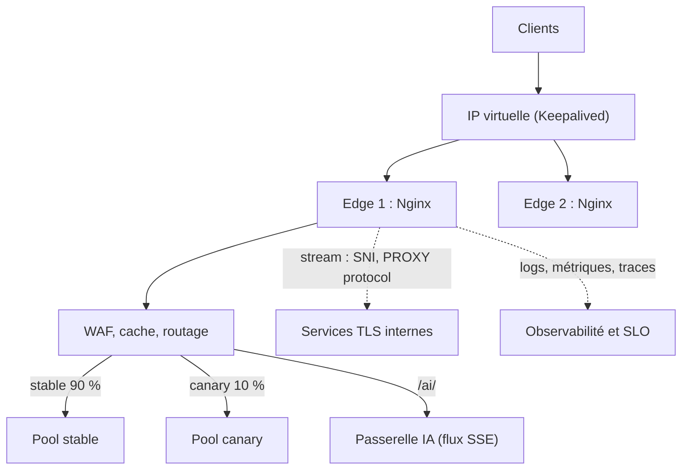

# Nginx sur Ubuntu — Palier 3 : Expert

*Cours · exercices · projet fil rouge — palier 3 sur 3*

**Durée estimée :** 28 à 36 h · **Prérequis :** palier 2 terminé (`recette2.sh` à 100 % de PASS, `ngit` propre) · **Environnement :** le serveur des paliers précédents, Docker, et pour la haute disponibilité deux nœuds (ou la simulation Docker du module 28).

## Sommaire

- Avant de commencer : état de départ, versions, règle d'or
- Le projet fil rouge « MonProjet v3 »
- Module 23 · Internals et performance
- Module 24 · Modules dynamiques : Brotli, headers-more, GeoIP2, compilation
- Module 25 · Scripter Nginx : njs et Lua
- Module 26 · `stream` : TCP, UDP, SNI, PROXY protocol
- Module 27 · Sécurité avancée : WAF et durcissement
- Module 28 · Haute disponibilité et déploiements
- Module 29 · Edge et CDN maison
- Module 30 · Observabilité experte : traces et SLO
- Module 31 · CI/CD et Infrastructure as Code
- Module 32 · Recettes par cas d'usage : SaaS, API gateway, passerelle IA
- Recette finale, évaluation, conclusion du cours
- Annexes : A aide-mémoire · B configurations de référence · C corrigés

---

## Avant de commencer

**État de départ.** `bash ~/recette2.sh monprojet.test 127.0.0.1` à 100 % ; `ngit status` propre ; sauvegarde : `sudo tar czf ~/nginx-fin-palier2.tgz /etc/nginx /opt/monprojet`. Les modules numérotent à la suite (23 à 32), les jalons aussi (22 à 31).

**La règle d'or de l'expert : on ne règle que ce qu'on a mesuré.** Chaque réglage de ce palier répond à un symptôme observable (une métrique, une ligne de log, un compteur du noyau). Sans mesure avant et après, c'est de la superstition.

**Versions** (début octobre 2026). Ubuntu 26.04 embarque Nginx 1.28, Ubuntu 24.04 la 1.24 ; en amont, stable 1.30 et mainline 1.31.5.

- **Mainline 1.31.5 (2 septembre 2026)** : *Control API* (reprise de NGINX Plus), *predicate locations* (une variable devient un critère de `location`), module `ngx_http_json_module`, directive `client_body_early_read`. À éprouver dans l'image `nginx:mainline`, pas en production sans période d'essai.
- PROXY protocol **v2 émis** par `stream` : 1.31.4 et plus. `max_headers` : 1.29.8 et plus.
- Module ACME natif (`ngx_http_acme_module`, module dynamique en Rust, dépôt `github.com/nginx/nginx-acme`) : absent de l'archive Ubuntu ; hors programme pratique.
- **Sécurité** : 2026 a vu des correctifs sur `map` avec regex, `rewrite` (captures), `slice`, `ssi`, HTTP/2, HTTP/3 et njs. Avant d'activer un module, lisez les avis (nginx.org/en/security_advisories.html, avis Ubuntu). Le paquet njs d'Ubuntu 24.04 est en 0.8.2 alors que njs 1.0.1 corrige plusieurs failles : vérifiez la version installée.

---

## Le projet fil rouge : « MonProjet v3 »

Vous transformez la plateforme en **edge de production** : performante, mesurée, protégée, redondante, déployable par code.



**Cahier des charges final :**

1. Une **campagne de mesures** (avant/après) justifie chaque réglage ; profil noyau appliqué.
2. Brotli, `headers-more` ; liens de téléchargement signés par njs.
3. `stream` : routage SNI, PROXY protocol, proxy UDP.
4. WAF (ModSecurity + OWASP CRS) en détection puis en blocage ; service durci par systemd.
5. Paire haute disponibilité (Keepalived), déploiement bleu/vert et canary.
6. Téléchargements protégés (`X-Accel-Redirect`), négociation d'images, purge du cache.
7. Traces OpenTelemetry et alertes SLO à taux de consommation du budget d'erreurs.
8. Configuration en dépôt avec tests en CI, déploiement Ansible.
9. Trois recettes : SaaS multi-tenant, API gateway, passerelle d'inférence IA.
10. `recette3.sh` à 100 % de PASS.

---

## Module 23 · Internals et performance

**Objectifs :** comprendre comment Nginx traite réellement une requête, lire ses symptômes (tampons, fichiers temporaires, descripteurs, files d'attente), mesurer proprement et régler en conséquence.

### Cours

#### 23.1 Les 11 phases de traitement

Chaque requête traverse des **phases** dans un ordre fixe. Une directive agit dans une phase précise :

```text
 1 POST_READ        set_real_ip_from, real_ip_header
 2 SERVER_REWRITE   rewrite, return, if, set  (niveau server)
 3 FIND_CONFIG      choix du location
 4 REWRITE          rewrite, return, if, set  (niveau location)
 5 POST_REWRITE     (interne : relance si l'URI a changé)
 6 PREACCESS        limit_req, limit_conn
 7 ACCESS           allow, deny, auth_basic, auth_request
 8 POST_ACCESS      (interne : satisfy)
 9 PRECONTENT       try_files, mirror
10 CONTENT          proxy_pass, fastcgi_pass, static, index, return…
11 LOG              access_log
```

Conséquences utiles : un `return` au niveau `server` s'exécute **avant** `limit_req` et `auth_request` ; `set_real_ip_from` agit avant tout, d'où une IP déjà corrigée pour la suite ; `try_files` s'exécute tard, après les contrôles d'accès ; les filtres de réponse (gzip, Brotli, `add_header`) agissent après le contenu.

#### 23.2 Processus et boucle d'événements

- Le **master** (root) lit la configuration et supervise ; les **workers** exécutent une boucle d'événements (`epoll`) : ils ne bloquent jamais sur une connexion, sauf sur des E/S disque lentes.
- `worker_processes auto;` : un worker par cœur. `worker_cpu_affinity auto;` les épingle.
- `listen … reuseport;` crée un socket d'écoute **par worker** : le noyau répartit les connexions, au lieu d'un seul socket partagé. Une seule déclaration par `adresse:port`.
- `accept_mutex` (désactivé par défaut) et `multi_accept` : à ne toucher qu'avec une mesure.
- La capacité s'exprime en **connexions** : `worker_connections` par worker, deux par requête en reverse proxy.

#### 23.3 Tampons et fichiers temporaires

Nginx lit la réponse du backend dans des tampons mémoire, puis la sert au client à son rythme. Quand la réponse (ou le corps de requête) dépasse les tampons, il l'écrit sur disque :

```text
[warn] an upstream response is buffered to a temporary file …
[warn] a client request body is buffered to a temporary file …
```

C'est le **mécanisme qui protège le backend des clients lents** : il se vide vite, Nginx garde la réponse. Réglages : `proxy_buffer_size`, `proxy_buffers 8 16k`, `proxy_busy_buffers_size`, `proxy_max_temp_file_size` (0 désactive les fichiers : le backend suit alors le débit du client), `client_body_buffer_size`. Autres limites : `large_client_header_buffers 4 8k;` (en-têtes et cookies volumineux → 400/414), `client_header_buffer_size`.

#### 23.4 Fichiers statiques

```nginx
sendfile on;                 # le noyau copie fichier → socket
sendfile_max_chunk 1m;       # évite qu'un gros transfert monopolise un worker
tcp_nopush on;               # en-têtes et début de fichier dans un même paquet
tcp_nodelay on;              # pas d'attente (connexions keepalive)
aio threads;                 # lectures disque dans un pool de threads (build avec threads)
directio 4m;                 # gros fichiers : contourne le cache de pages

open_file_cache max=2000 inactive=30s;    # mémorise descripteurs, tailles, existence
open_file_cache_valid 60s;
open_file_cache_min_uses 2;
open_file_cache_errors on;
```

Gain réel de `open_file_cache` : moins d'appels système (`openat`, `fstat`) par requête. Il se **vérifie** avec `strace -c` (exercice 23.2).

#### 23.5 TLS et connexions

`ssl_session_cache shared:SSL:50m;` (la reprise de session évite une poignée de main complète), `ssl_buffer_size 4k;` (réduit le délai du premier octet pour de petites réponses), `keepalive_requests`, `keepalive_timeout`, `reset_timedout_connection on;` (libère vite les connexions mortes), `http2_max_concurrent_streams`.

#### 23.6 Le noyau : chaque réglage répond à un symptôme

```text
# /etc/sysctl.d/90-nginx.conf   (à appliquer avec : sudo sysctl --system)
net.core.somaxconn = 4096                 # file d'acceptation
net.ipv4.tcp_max_syn_backlog = 8192
net.core.netdev_max_backlog = 16384
net.ipv4.ip_local_port_range = 10240 65535   # ports éphémères vers les backends
net.ipv4.tcp_fin_timeout = 15
net.ipv4.tcp_syncookies = 1
fs.file-max = 2097152
```

- Connexions refusées sous charge → `nstat -az TcpExtListenOverflows TcpExtListenDrops` croissants : file d'acceptation pleine → `somaxconn` **et** `listen … backlog=4096;`.
- `Cannot assign requested address` vers un backend → ports éphémères épuisés : `keepalive` vers l'amont, `ip_local_port_range`.
- `Too many open files` → `worker_rlimit_nofile` et `LimitNOFILE` (module 22).
- `nf_conntrack: table full, dropping packet` (`dmesg`) → UFW active le suivi de connexions : `net.netfilter.nf_conntrack_max`.

#### 23.7 Mesurer sérieusement

Outils : `wrk` (paquet `wrk`), `h2load` (paquet `nghttp2-client`), k6 (`docker run --rm --network host -i grafana/k6 run - <script.js`).

```bash
wrk -t4 -c200 -d40s --latency https://app.monprojet.test/healthz
```

Méthode :

- générateur de charge sur **une autre machine** (sinon vous mesurez la concurrence entre deux programmes) ;
- **chauffer** 10 s, puis mesurer 30 à 60 s en régime stable ;
- retenir les **percentiles** (p50, p95, p99), pas la moyenne ;
- un modèle de charge **ouvert** (débit imposé, `constant-arrival-rate` dans k6) évite de masquer la latence (« coordinated omission ») ;
- **une variable à la fois**, trois répétitions, résultats consignés ;
- surveiller en parallèle CPU, `ss -s`, `error.log`, `nginx_connections_*`.

### Exercices

**23.1 ⭐⭐ Les phases en pratique.** Envoyez dix `POST` sur `/api/login` avec `curl -sk -A sqlmap -X POST …` (le `$bad_ua` du palier 2 renvoie `444`), puis dix sans ce `User-Agent`. Où voyez-vous des `429` ? Expliquez par l'ordre des phases.

**23.2 ⭐⭐ Les appels système.** Trouvez un PID de worker (`pgrep -a nginx`). Pendant `wrk -t2 -c50 -d10s https://www.monprojet.test/assets/style.css`, lancez :

```bash
sudo strace -c -f -p <PID_WORKER> -e trace=epoll_wait,accept4,sendfile,openat,newfstatat
```

Comparez le nombre d'`openat` et `newfstatat` avec et sans `open_file_cache`.

**23.3 ⭐⭐ Le client lent.** Créez un fichier de 30 Mo servi par un petit serveur local et proxifié, puis téléchargez-le lentement :

```bash
mkdir -p /tmp/big && fallocate -l 30M /tmp/big/gros.bin
python3 -m http.server 8095 --bind 127.0.0.1 --directory /tmp/big &
# location /gros/ { proxy_pass http://127.0.0.1:8095/; }  (bloc HTTPS de app)
curl -sk --limit-rate 500k -o /dev/null https://app.monprojet.test/gros/gros.bin
```

Que dit `error.log` (fichier temporaire) ? Que se passe-t-il côté serveur Python (il a fini bien avant le client) ? Essayez `proxy_max_temp_file_size 0;` : quel est l'effet sur le backend ?

**23.4 ⭐⭐⭐ Campagne de mesures.** Mesurez `/healthz` et `/api/hello` (3 passes de 40 s chacune), puis refaites avec : (a) `access_log off` sur `/healthz`, (b) `worker_cpu_affinity auto`, (c) `keepalive` retiré de l'`upstream`. Consignez dans `~/perf/campagne.md` : configuration, req/s, p50/p95/p99, conclusion. Quel réglage pèse vraiment ?

**23.5 ⭐⭐⭐ Le noyau.** Notez `nstat -az TcpExtListenOverflows TcpExtListenDrops`, lancez `wrk -t4 -c1000 -d20s`, relisez les compteurs. Avec une file trop petite (`sudo sysctl net.core.somaxconn=128` et `listen … backlog=128`), qu'observez-vous ? Rétablissez.

### 🧩 Jalon 22 : profil de performance

- Créez `/etc/sysctl.d/90-nginx.conf` (§ 23.6) ; adoptez seulement ce que vos mesures justifient.
- Dans `conf.d/70-perf.conf` : `open_file_cache`, `sendfile_max_chunk`, `reset_timedout_connection on;`, `ssl_session_cache shared:SSL:50m;`, `ssl_buffer_size 4k;`.
- Conservez `~/perf/campagne.md` et la référence du **point de départ** pour comparer plus tard.

```bash
sudo sysctl --system >/dev/null
sudo nginx -t && sudo systemctl reload nginx
ngit add -A && ngit commit -qm "jalon 22 : profil de performance"
```

### Auto-évaluation

1. Pourquoi un `return` au niveau `server` n'est-il jamais compté par `limit_req` ?
2. Que signifie `an upstream response is buffered to a temporary file` et qu'est-ce que cela protège ?
3. Pourquoi lancer le générateur de charge sur une autre machine, et pourquoi lire les percentiles ?

---

## Module 24 · Modules dynamiques : Brotli, headers-more, GeoIP2, compilation

**Objectifs :** maîtriser le chargement et la compatibilité des modules, utiliser les modules Ubuntu utiles, compiler un module hors arbre sans casser le système.

### Cours

#### 24.1 Statique ou dynamique

Un module peut être compilé **dans** le binaire ou chargé par `load_module` (fichier `.so`). Sur Ubuntu, les modules dynamiques sont des paquets `libnginx-mod-*` :

```bash
apt-cache search libnginx-mod | sort
ls /etc/nginx/modules-enabled/        # liens vers /usr/share/nginx/modules-available/mod-*.conf
```

Chaque paquet dépose un fichier `.so` dans `/usr/lib/nginx/modules/` et un `load_module` activé automatiquement.

#### 24.2 Compatibilité binaire (ABI)

Un module est compilé pour une **version précise** de Nginx et ses options de compilation. Les paquets Ubuntu dépendent de `nginx-abi-X.Y.Z-N` : ils se mettent à jour **ensemble** avec Nginx. Un module compilé à la main ne bénéficie pas de cette garantie. Symptôme d'incompatibilité :

```text
nginx: [emerg] module "…so" is not binary compatible in /etc/nginx/…
```

Règle : après toute mise à jour de Nginx, **recompiler** ses modules maison et tester (`nginx -t`) avant le reload.

#### 24.3 Le catalogue Ubuntu utile

- `brotli-filter` / `brotli-static` : compression Brotli.
- `headers-more-filter` : maîtrise fine des en-têtes.
- `geoip2` (HTTP et stream) : pays/ville d'après l'IP.
- `image-filter` : redimensionnement d'images à la volée.
- `js` / `stream-js` (njs), `lua` : scripts (module 25).
- `modsecurity` : WAF (module 27). `cache-purge` : purge du cache (module 29).
- `stream` (+ `stream-geoip2`) : TCP/UDP (module 26).
- Autres : `subs-filter`, `echo`, `fancyindex`, `auth-pam`, `nchan` et `push-stream` (publication/abonnement), `rtmp`.

⚠️ Chaque module élargit la **surface d'attaque** : installez le strict nécessaire.

#### 24.4 Brotli

```bash
sudo apt install -y libnginx-mod-http-brotli-filter libnginx-mod-http-brotli-static brotli
```

```nginx
# conf.d/75-brotli.conf   (gzip reste actif en repli)
brotli on;
brotli_comp_level 5;
brotli_min_length 256;
brotli_types text/plain text/css application/json application/javascript
             text/javascript application/xml image/svg+xml;
brotli_static on;          # sert style.css.br s'il existe, sans recompresser
```

Les navigateurs n'utilisent Brotli qu'en HTTPS. Précompresser les assets au niveau maximal : `brotli -q 11 -k fichier` (le coût CPU est payé une seule fois). Vérifier :

```bash
curl -sk -H 'Accept-Encoding: br' -o /dev/null -D - https://www.monprojet.test/assets/style.css | grep -i content-encoding
```

#### 24.5 headers-more

```bash
sudo apt install -y libnginx-mod-http-headers-more-filter
```

```nginx
more_clear_headers Server;                       # ou : more_set_headers "Server: monprojet";
more_clear_headers X-Powered-By;
more_set_headers 'X-Request-ID: $request_id';
```

Contrairement à `add_header`, ces directives modifient **tous** les statuts, remplacent ou suppriment des en-têtes existants (même ceux du backend ou de `Server`) et ne souffrent pas du piège d'héritage de la même manière : à vérifier avec un `curl -I` après chaque changement.

#### 24.6 GeoIP2

```bash
sudo apt install -y libnginx-mod-http-geoip2 geoipupdate
```

La base GeoLite2 demande un compte gratuit MaxMind (clé de licence pour `geoipupdate`) ; des bases libres existent (DB-IP Lite, avec attribution). Le module lit un fichier `.mmdb` :

```nginx
geoip2 /usr/share/GeoIP/GeoLite2-Country.mmdb {
    auto_reload 60m;
    $geoip2_country_code country iso_code;
}
map $geoip2_country_code $zone_autorisee {
    default 0;
    ~^(FR|DE|BE)$ 1;
}
```

⚠️ La géolocalisation IP est **approximative** : ne l'utilisez jamais comme seule barrière. Derrière un CDN, utilisez l'IP réelle (`real_ip`). Journaliser le pays plutôt que l'IP complète limite les données personnelles.

#### 24.7 Compiler un module hors arbre

Pour un module sans paquet, on le compile contre **la même version** de Nginx, avec `--with-compat`. Exemple pédagogique avec `headers-more` (déjà packagé : on le compile ici pour comprendre, sans l'installer) :

```bash
sudo apt install -y build-essential libpcre2-dev zlib1g-dev libssl-dev git curl
V=$(nginx -v 2>&1 | grep -o '[0-9]\+\.[0-9]\+\.[0-9]\+')      # version amont du paquet
mkdir -p ~/build && cd ~/build
curl -fsSLO https://nginx.org/download/nginx-$V.tar.gz && tar xzf nginx-$V.tar.gz
git clone --depth 1 https://github.com/openresty/headers-more-nginx-module.git
cd nginx-$V
./configure --with-compat --add-dynamic-module=../headers-more-nginx-module
make modules
ls objs/*.so
```

Tester **dans un bac à sable**, sans toucher à la production :

```bash
cat > /tmp/ngx-test.conf <<CONF
load_module $PWD/objs/ngx_http_headers_more_filter_module.so;
pid /tmp/ngx-test.pid;
error_log /tmp/ngx-test.err;
events {}
http {
  access_log off;
  server {
    listen 127.0.0.1:8099;
    more_set_headers "Server: construit-maison";
    location / { return 200 "ok\n"; }
  }
}
CONF
sudo nginx -t -c /tmp/ngx-test.conf && sudo nginx -c /tmp/ngx-test.conf
curl -sI 127.0.0.1:8099 | grep -i '^server'
sudo kill "$(cat /tmp/ngx-test.pid)"
```

Si votre Nginx est dérivé d'un paquet distribution, un décalage de version ou d'options peut produire `is not binary compatible` : c'est le comportement attendu, et un bon exercice de diagnostic. Quand on dépend d'un module maison, on fige la version : `sudo apt-mark hold nginx` (et on organise des mises à jour de sécurité manuelles, **suivies**).

### Exercices

**24.1 ⭐** Comparez `nginx -V 2>&1 | tr ' ' '\n' | grep -E 'dynamic|module' | head -30` et `ls /etc/nginx/modules-enabled/`. Quels modules sont statiques, lesquels dynamiques ?

**24.2 ⭐⭐** Installez Brotli. Créez un JSON de 300 Ko (`python3 -c "import json;print(json.dumps([{'id':i,'nom':'article %d'%i} for i in range(8000)]))" > /var/www/monprojet/app/assets/data.json`). Comparez les tailles transférées en `identity`, `gzip` et `br` (`curl -sk -o /dev/null -w '%{size_download}\n' -H 'Accept-Encoding: …'`). Ajoutez `brotli_static`, précompressez et vérifiez que le CPU n'est plus sollicité (`wrk` avant/après).

**24.3 ⭐⭐** headers-more : supprimez `Server` et `X-Powered-By` (côté `blog`) puis remplacez `Server`. Vérifiez sur une page **d'erreur** (404, 502) : l'en-tête est-il aussi modifié ?

**24.4 ⭐⭐⭐** Compilez le module comme au § 24.7 et testez-le en bac à sable. Puis recommencez avec un autre numéro de version de Nginx : relevez et expliquez le message d'erreur.

**24.5 ⭐⭐⭐** *(optionnel)* GeoIP2 : installez le module, obtenez une base `.mmdb`, journalisez le pays dans `monprojet_json`. Simulez des pays différents avec `-H 'X-Forwarded-For: <IP publique connue>'` (`real_ip` du palier 2).

### 🧩 Jalon 23 : modules en production

- Installez Brotli (§ 24.4) et headers-more (§ 24.5), appliquez-les au niveau `http`, vérifiez avec `recette.sh` et `recette2.sh`.
- Dans `~/monprojet-runbook.md`, ajoutez la section « Modules » : liste, version, procédure de mise à jour, risque associé.

```bash
sudo nginx -t && sudo systemctl reload nginx
ngit add -A && ngit commit -qm "jalon 23 : Brotli et headers-more"
```

### Auto-évaluation

1. Pourquoi un module compilé à la main doit-il être recompilé après une mise à jour de Nginx ?
2. Quelle différence entre `add_header` et `more_set_headers` ?
3. Pourquoi la géolocalisation IP ne doit-elle jamais être la seule barrière ?

---

## Module 25 · Scripter Nginx : njs et Lua

**Objectifs :** savoir quand un script se justifie, écrire de petites extensions sûres avec njs (et goûter à Lua), éviter de bloquer la boucle d'événements.

### Cours

#### 25.1 Quand scripter, et quand s'abstenir

La configuration déclarative (`map`, `limit_req`, `auth_request`…) est plus **rapide, plus lisible et plus sûre**. On script quand elle ne suffit pas : vérifier une signature (HMAC), composer une réponse, router selon une logique métier, adapter des en-têtes. Coûts : complexité, surface d'attaque, risque de bloquer un worker. Règle : script **court, synchrone, sans E/S bloquante**, relu comme du code de production.

#### 25.2 njs (NGINX JavaScript)

Interpréteur JavaScript (sous-ensemble ES) officiel, embarqué et isolé. Sur Ubuntu : `libnginx-mod-http-js` (et `libnginx-mod-stream-js` pour `stream`).

```bash
sudo apt install -y libnginx-mod-http-js
sudo mkdir -p /etc/nginx/njs /etc/nginx/secrets /var/www/monprojet/private-files
echo "contenu confidentiel" | sudo tee /var/www/monprojet/private-files/rapport.txt
openssl rand -base64 32 | sudo tee /etc/nginx/secrets/link.key >/dev/null
sudo chown root:www-data /etc/nginx/secrets/link.key && sudo chmod 640 /etc/nginx/secrets/link.key
```

Le code njs s'exécute **dans le worker** (utilisateur `www-data`) : la clé doit lui être lisible, et lui seul.

```javascript
// /etc/nginx/njs/main.js
import fs from 'fs';
import cr from 'crypto';

let KEY = null;                                   // lue une fois par worker

function whoami(r) {
    r.headersOut['Content-Type'] = 'application/json';
    r.return(200, JSON.stringify({
        ip: r.remoteAddress, host: r.headersIn.host,
        uri: r.uri, method: r.method,
        ua: r.headersIn['User-Agent'] || null,
    }));
}

function verify(r) {                              // js_set : "1" si le lien est valide
    if (KEY === null) KEY = fs.readFileSync('/etc/nginx/secrets/link.key', 'utf8').trim();
    const exp = r.args.exp, sig = r.args.sig;
    if (!exp || !sig || Number(exp) < Date.now() / 1000) return '0';
    const mac = cr.createHmac('sha256', KEY).update(r.uri + ':' + exp).digest('base64url');
    return mac === sig ? '1' : '0';
}

export default { whoami, verify };
```

```nginx
# conf.d/80-njs.conf   (contexte http)
js_import main from /etc/nginx/njs/main.js;
js_set $link_ok main.verify;
```

```nginx
# dans le bloc HTTPS de app
location = /whoami { js_content main.whoami; }

location /dl/ {                                   # téléchargements par lien signé et expirant
    if ($link_ok != 1) { return 403; }
    alias /var/www/monprojet/private-files/;
}
```

Générer un lien valable 5 minutes (la signature porte sur `chemin:expiration`) :

```bash
EXP=$(( $(date +%s) + 300 ))
SIG=$(printf '%s' "/dl/rapport.txt:$EXP" \
  | openssl dgst -sha256 -hmac "$(sudo cat /etc/nginx/secrets/link.key)" -binary \
  | openssl base64 -A | tr '+/' '-_' | tr -d '=')
curl -sk "https://app.monprojet.test/dl/rapport.txt?exp=$EXP&sig=$SIG"
```

⚠️ Le code njs est **chargé au rechargement** : modifiez, `nginx -t`, `reload`. Diagnostic : `console.log(...)` et `r.log(...)` écrivent dans `error.log` (niveau `info`). Gardez njs à jour : des correctifs de sécurité y sont publiés régulièrement.

#### 25.3 Lua

Le module `ngx_http_lua` (écosystème OpenResty) expose des blocs Lua dans toutes les phases, avec des bibliothèques riches (`lua-resty-*` : Redis, JWT, etc.).

```bash
sudo apt install -y libnginx-mod-http-lua
```

```nginx
# conf.d/85-lua.conf
lua_shared_dict hits 1m;             # mémoire partagée entre workers
# si l'erreur « failed to load the 'resty.core' module » apparaît :
# lua_package_path "/usr/share/lua/5.1/?.lua;;";   (chemin à confirmer : dpkg -L lua-resty-core)
```

```nginx
location = /lua {
    default_type text/plain;
    content_by_lua_block {
        local n = ngx.shared.hits:incr(ngx.var.host, 1, 0)
        ngx.say("Lua OK · ", ngx.var.host, " · requêtes : ", n)
    }
}

location /lua-protege/ {
    access_by_lua_block {
        if ngx.var.http_x_token ~= "demo" then return ngx.exit(403) end
    }
    default_type text/plain;
    return 200 "accès accordé\n";
}
```

Phases disponibles : `init_by_lua_block`, `access_by_lua_block`, `content_by_lua_block`, `log_by_lua_block`… Pour des usages Lua intensifs, la distribution OpenResty (LuaJIT et bibliothèques intégrés) est plus adaptée que le module de l'archive Ubuntu.

#### 25.4 Choisir

- **Natif d'abord** : `map`, `auth_request`, `limit_req`, `secure_link`.
- **njs** : support officiel, bac à sable, logique modeste (HMAC, en-têtes, décisions).
- **Lua** : écosystème riche, accès fin aux phases ; plus de responsabilités (versions, chemins, JIT).
- **Dans l'application** : si la logique est métier, elle y a sa place ; Nginx délègue via `auth_request`.

#### 25.5 Le piège central : bloquer le worker

Un worker traite des milliers de connexions **dans un seul fil**. Une boucle active, un calcul long ou une lecture disque lente dans un script **gèle toutes les connexions de ce worker**. Les E/S réseau doivent passer par les API non bloquantes (`ngx.socket` en Lua, `ngx.fetch` en njs). Tout travail lourd va dans un backend.

### Exercices

**25.1 ⭐⭐** Mettez en place `/whoami` (njs) et appelez-le. Changez le script (ajoutez un champ), rechargez, vérifiez.

**25.2 ⭐⭐** Liens signés : générez un lien valide ; testez ensuite un lien **expiré** (`EXP` dans le passé), une signature falsifiée, et un chemin différent avec la même signature. Tous doivent être refusés (403).

**25.3 ⭐⭐** Lua : ajoutez `/lua` et `/lua-protege/`. Vérifiez que le compteur survit à un `reload` mais pas à un `restart`.

**25.4 ⭐⭐⭐ Geler un worker.** Temporairement, `worker_processes 1;` et dans njs une fonction `slow` qui boucle 3 s (`const t = Date.now(); while (Date.now() - t < 3000);`) exposée sur `/slow-njs`. Lancez `curl -sk https://app.monprojet.test/slow-njs &` puis aussitôt `time curl -sk https://app.monprojet.test/healthz`. Que constatez-vous, et pourquoi ? Rétablissez.

**25.5 ⭐⭐⭐** Contrôle d'une clé d'API de trois façons : `map`, `auth_request`, njs. Comparez lisibilité et débit (`wrk` sur `/healthz`-équivalent). Laquelle retenez-vous pour 10 clés ? pour 10 000 ?

### 🧩 Jalon 24 : liens signés

- Installez njs, créez `main.js`, la clé, `conf.d/80-njs.conf`, les `location = /whoami` et `/dl/` dans `app`.
- Notez dans le runbook : où est la clé, comment la renouveler (nouvelle clé → les anciens liens expirent), qui peut la lire.

```bash
sudo nginx -t && sudo systemctl reload nginx
ngit add -A && ngit commit -qm "jalon 24 : njs, liens signés"
```

### Auto-évaluation

1. Pourquoi un script long dans Nginx peut-il dégrader **toutes** les requêtes d'un worker ?
2. Pourquoi la clé HMAC doit-elle être lisible par `www-data` pour njs, et quelles précautions en découlent ?
3. Quand préférer `auth_request` à un script njs ou Lua ?

---

## Module 26 · `stream` : TCP, UDP, SNI, PROXY protocol

**Objectifs :** utiliser Nginx comme proxy de niveau 4, router par SNI sans déchiffrer, transmettre l'IP d'origine, proxifier de l'UDP, connaître les limites du module.

### Cours

#### 26.1 Le contexte `stream`

Le module `stream` proxifie des flux **TCP et UDP** sans comprendre HTTP : TLS en transit (*passthrough*), bases de données, MQTT, DNS… Sur Ubuntu : `libnginx-mod-stream`. Le contexte `stream { }` se place au **même niveau** que `http { }`, dans `nginx.conf`.

```bash
sudo apt install -y libnginx-mod-stream socat
nginx -V 2>&1 | grep -o with-stream_ssl_preread_module     # requis pour le routage SNI
sudo mkdir -p /etc/nginx/stream.d
```

À ajouter à la fin de `/etc/nginx/nginx.conf` :

```nginx
stream {
    log_format basic '$remote_addr [$time_local] $protocol $status '
                     '$bytes_sent $bytes_received $session_time '
                     '"$upstream_addr" "$ssl_preread_server_name"';
    access_log /var/log/nginx/stream.access.log basic;
    include /etc/nginx/stream.d/*.conf;
}
```

Si `$ssl_preread_server_name` est inconnue (module absent), retirez-la du format.

#### 26.2 Répartition TCP

```bash
socat TCP-LISTEN:7001,reuseaddr,fork SYSTEM:'echo backend-1; cat' &
socat TCP-LISTEN:7002,reuseaddr,fork SYSTEM:'echo backend-2; cat' &
```

```nginx
# /etc/nginx/stream.d/10-tcp-lab.conf
upstream tcp_pool {
    least_conn;
    server 127.0.0.1:7001 max_fails=2 fail_timeout=10s;
    server 127.0.0.1:7002 max_fails=2 fail_timeout=10s;
}
server {
    listen 127.0.0.1:7000;
    proxy_pass tcp_pool;
    proxy_connect_timeout 3s;
    proxy_timeout 1m;
}
```

```bash
for i in 1 2 3 4; do echo salut | socat -t1 - TCP:127.0.0.1:7000 | head -1; done
```

#### 26.3 Routage par SNI sans déchiffrer

`ssl_preread` lit le début de la poignée de main TLS (le *ClientHello*), en extrait le nom demandé (SNI), puis route le flux **sans le déchiffrer** : le certificat et le chiffrement restent l'affaire du backend.

```nginx
# /etc/nginx/stream.d/20-sni.conf
map $ssl_preread_server_name $sni_upstream {
    app.monprojet.test  https_local;
    ops.monprojet.test  https_local;
    default             blackhole;
}
upstream https_local { server 127.0.0.1:8444; }
upstream blackhole   { server 127.0.0.1:9; }          # port fermé : la connexion échoue

server {
    listen 127.0.0.1:9443;
    ssl_preread on;
    preread_timeout 5s;
    proxy_pass $sni_upstream;
    proxy_protocol on;           # transmet l'IP du client au backend (PROXY protocol)
}
```

Côté HTTP, un serveur qui **attend** le PROXY protocol et en tire l'IP du client :

```nginx
# conf.d/90-proxyproto-lab.conf
server {
    listen 127.0.0.1:8444 ssl proxy_protocol;
    server_name app.monprojet.test ops.monprojet.test;
    include snippets/tls-cert.conf;

    set_real_ip_from 127.0.0.1;
    real_ip_header proxy_protocol;

    location / {
        default_type text/plain;
        return 200 "via PROXY protocol · client=$remote_addr · proxy_protocol_addr=$proxy_protocol_addr · sni=$ssl_server_name\n";
    }
}
```

Test (le certificat est présenté par le **backend**, pas par le stream) :

```bash
curl -sk --resolve app.monprojet.test:9443:127.0.0.1 https://app.monprojet.test:9443/
curl -sk --resolve inconnu.test:9443:127.0.0.1 https://inconnu.test:9443/ ; echo "code=$?"
```

PROXY protocol : v1 (texte) toujours possible ; l'**émission** de la v2 par `stream` date de la 1.31.4. Un serveur qui déclare `proxy_protocol` sur `listen` **exige** l'en-tête : un client direct est rejeté (c'est pourquoi on isole ce `listen` sur la boucle locale).

#### 26.4 UDP : l'exemple du DNS

```nginx
# /etc/nginx/stream.d/30-dns.conf
server {
    listen 127.0.0.1:5353 udp;
    proxy_pass 127.0.0.53:53;      # le résolveur local d'Ubuntu (systemd-resolved)
    proxy_responses 1;             # une réponse par requête
    proxy_timeout 3s;
}
```

```bash
dig @127.0.0.1 -p 5353 ubuntu.com +short
```

#### 26.5 Protections et bonnes pratiques

- `preread_timeout 5s;` : le défaut (30 s) laisse des connexions silencieuses ouvertes très longtemps.
- `limit_conn_zone $binary_remote_addr zone=tcpperip:10m;` puis `limit_conn tcpperip 20;` dans `stream`.
- `allow` / `deny` existent aussi en `stream`.
- TLS en frontal d'un service sans TLS : `listen 6380 ssl;` avec `ssl_certificate…` puis `proxy_pass` vers le service.
- IP réelle en `stream` : `listen … proxy_protocol;` + `set_real_ip_from`.

#### 26.6 Les limites du module

- Aucune connaissance de HTTP : pas de métriques par requête ; seul le journal `stream` renseigne durées et volumes.
- Détection d'échec **passive** uniquement.
- ⚠️ `ssl_preread` attend les premiers octets **du client** : les protocoles où le **serveur parle d'abord** (SSH, SMTP) restent bloqués jusqu'à `preread_timeout`. Le partage de port SSH/HTTPS relève d'outils dédiés (sslh).
- Pour du TCP exigeant (bases de données : pool de connexions, vérifications actives), HAProxy ou PgBouncer sont plus adaptés. Nginx `stream` brille pour du passthrough simple et du routage SNI.

### Exercices

**26.1 ⭐⭐** Installez `stream`, ajoutez le bloc et la répartition TCP. Faites dix appels : répartition ? Tuez un `socat` (`pkill -f 'TCP-LISTEN:7001'`) : que voit le client ? et le journal `stream.access.log` ?

**26.2 ⭐⭐** Montez le laboratoire SNI + PROXY protocol. Interrogez `app.monprojet.test` puis un nom inconnu. Quelles valeurs apparaissent dans la réponse et dans `stream.access.log` ?

**26.3 ⭐⭐** Proxy DNS UDP : résolvez trois noms à travers `127.0.0.1:5353`. Lisez le log `stream` : quelle ligne pour un échange UDP ?

**26.4 ⭐⭐⭐** `preread_timeout` : `nc 127.0.0.1 9443` sans rien envoyer ; chronométrez la fermeture avec 5 s puis avec la valeur par défaut (retirez la directive).

**26.5 ⭐⭐⭐** `limit_conn` en `stream` : limitez à 3 connexions par IP, ouvrez 5 connexions simultanées (`socat - TCP:127.0.0.1:7000` en arrière-plan avec `sleep`) et observez les refus. Quel statut dans le journal ?

### 🧩 Jalon 25 : le plan L4

- Ajoutez le contexte `stream` et `stream.d/{10-tcp-lab,20-sni,30-dns}.conf`, le serveur `8444` (PROXY protocol), les tests ci-dessus.
- Ajoutez au runbook : ports `stream` utilisés, comment tester un routage SNI, ce qu'il ne faut pas faire passer par `stream`.

```bash
sudo nginx -t && sudo systemctl reload nginx
ngit add -A && ngit commit -qm "jalon 25 : stream (TCP, SNI, UDP, PROXY protocol)"
```

### Auto-évaluation

1. Qui présente le certificat TLS quand on route par SNI avec `ssl_preread` ?
2. Pourquoi un serveur HTTP déclaré avec `proxy_protocol` rejette-t-il un client direct ?
3. Pourquoi `ssl_preread` ne convient-il pas à SSH ?

---

## Module 27 · Sécurité avancée : WAF et durcissement

**Objectifs :** ajouter une couche de filtrage applicatif (WAF) sans casser le trafic légitime, réduire les privilèges du service, corriger les configurations dangereuses classiques.

### Cours

#### 27.1 La défense en profondeur

Aucune couche ne suffit : réseau (UFW, groupes de sécurité), Nginx (limites, TLS, en-têtes), **WAF** (motifs d'attaque), application (validation, authentification), système (moindres privilèges, mises à jour). Un WAF n'excuse pas une application vulnérable : il ajoute du temps (« correctif virtuel ») et de la visibilité.

#### 27.2 WAF : ModSecurity v3 et OWASP CRS

ModSecurity est un moteur de règles ; l'**OWASP Core Rule Set (CRS)** fournit les règles (injections SQL, XSS, traversée de chemins…). Chaque règle qui correspond ajoute un **score d'anomalie** ; la requête est bloquée au-delà d'un seuil (5 par défaut côté entrée). Sur Ubuntu :

```bash
sudo apt install -y libnginx-mod-http-modsecurity modsecurity-crs
ls /etc/modsecurity/            # fichiers du moteur
dpkg -L modsecurity-crs | head  # où sont les règles et crs-setup.conf
```

Le connecteur et le moteur sont des paquets liés à votre version de Nginx (ABI, module 24). Partez du fichier recommandé fourni (repérez-le : `find / -name 'modsecurity.conf-recommended' 2>/dev/null`) :

```bash
sudo mkdir -p /etc/nginx/modsec
sudo cp /etc/modsecurity/modsecurity.conf-recommended /etc/nginx/modsec/modsecurity.conf   # chemin à adapter
sudo tee /etc/nginx/modsec/main.conf >/dev/null <<'CONF'
Include /etc/nginx/modsec/modsecurity.conf
Include /etc/modsecurity/crs/crs-setup.conf
Include /usr/share/modsecurity-crs/rules/*.conf
CONF
```

Le fichier recommandé démarre en `SecRuleEngine DetectionOnly` : le moteur **détecte et journalise sans bloquer**. Dans `app`, activez-le par `location` :

```nginx
modsecurity on;
modsecurity_rules_file /etc/nginx/modsec/main.conf;

location /ws/     { modsecurity off; ... }   # flux longs : pas d'inspection
location = /events { modsecurity off; ... }
location = /healthz { modsecurity off; ... }
```

Test (en détection : réponse 200, mais une alerte dans le journal d'audit) :

```bash
curl -sk -o /dev/null -w '%{http_code}\n' "https://app.monprojet.test/?q=%3Cscript%3Ealert(1)%3C/script%3E"
sudo tail -n 30 /var/log/modsec_audit.log
```

Passage au blocage : `SecRuleEngine On` dans `modsecurity.conf`, rechargement, même test → `403`.

**Méthode de déploiement d'un WAF** : détection seule **au moins une à deux semaines** sur du vrai trafic ; lecture des alertes (identifiant de règle, ex. `942100`) ; **exclusions ciblées** des faux positifs ; puis blocage. Une exclusion limitée à une URL :

```text
SecRule REQUEST_URI "@beginsWith /api/notes" \
  "id:10001,phase:1,pass,nolog,ctl:ruleRemoveById=942100"
```

Autres points : le niveau de paranoïa du CRS (1 par défaut) ; l'inspection du corps de requête doit rester cohérente avec `client_max_body_size` (`SecRequestBodyLimit`) ; laissez `SecResponseBodyAccess Off` sauf besoin (coût et flux) ; mesurez le surcoût CPU avec `wrk` (exercice 27.3). OWASP **Coraza** (moteur en Go compatible avec le CRS) est une alternative moderne à évaluer ; vérifiez la maturité de son connecteur Nginx avant tout usage en production.

#### 27.3 Durcir le service avec systemd

systemd peut **sandboxer** Nginx. Mesure de départ :

```bash
systemd-analyze security nginx.service --no-pager | tail -3     # « exposure level »
```

```ini
# /etc/systemd/system/nginx.service.d/hardening.conf
[Service]
NoNewPrivileges=yes
PrivateTmp=yes
ProtectHome=yes
ProtectSystem=full
ProtectKernelTunables=yes
ProtectKernelModules=yes
ProtectKernelLogs=yes
ProtectControlGroups=yes
ProtectClock=yes
ProtectHostname=yes
RestrictSUIDSGID=yes
RestrictRealtime=yes
RestrictNamespaces=yes
LockPersonality=yes
SystemCallArchitectures=native
CapabilityBoundingSet=CAP_NET_BIND_SERVICE CAP_SETUID CAP_SETGID CAP_CHOWN CAP_DAC_OVERRIDE CAP_SYS_RESOURCE
# MemoryDenyWriteExecute=yes : NE PAS l'activer avec Lua (LuaJIT a besoin de mémoire exécutable)
```

Capacités conservées : écouter sur les ports \< 1024, abandonner les privilèges vers `www-data`, changer les propriétaires des répertoires de cache, relever les limites de fichiers. **À valider sur votre système** (modules, chemins) : appliquez, puis `sudo systemctl daemon-reload && sudo systemctl restart nginx`, relancez les recettes, lisez `journalctl -u nginx -p warning`. Si un service échoue, retirez les directives **une par une**. `ProtectSystem=strict` avec `ReadWritePaths=/var/log/nginx /var/cache/nginx /var/lib/nginx /run` améliore encore le score.

#### 27.4 Déni de service : ce qu'on peut et ne peut pas faire

Une attaque **volumétrique** ne se traite pas sur l'origine : elle se traite en amont (CDN, anti-DDoS du fournisseur). À l'origine, on réduit l'effet des attaques **applicatives** et des connexions abusives :

- `limit_req`, `limit_conn` (modules 19 et 26) ; délais courts ; `reset_timedout_connection on;`.
- `client_header_buffer_size`, `large_client_header_buffers`, `max_headers` (1.29.8+), `client_max_body_size`.
- HTTP/2 : `http2_max_concurrent_streams` ; maintenez Nginx à jour (des attaques sur HTTP/2 et HTTP/3 ont été corrigées en 2026).
- Noyau : `tcp_syncookies` ; surveillez `ss -s` et `nstat`.

#### 27.5 Les erreurs de configuration classiques : checklist d'audit

1. **`alias` décalé** : `location /files { alias /srv/files/; }` (le `location` sans `/` final, l'`alias` avec) permet `/files../secret` → traversée de répertoire. Les deux doivent se terminer de la même façon.
2. **`proxy_pass` piloté par le client** : `proxy_pass http://$http_x_cible;` fait de votre serveur un proxy ouvert (SSRF). Les variables de `proxy_pass` ne doivent venir que de listes fermées (`map`).
3. **`Host` non fiable** : préférez `$host` (nettoyé) à `$http_host` dans `proxy_set_header Host`, et prévoyez un `default_server` qui rejette les noms inconnus.
4. **`$uri` dans une redirection** : `return 301 https://$host$uri;` peut laisser passer des retours à la ligne encodés (injection d'en-têtes) ; préférez `$request_uri`.
5. **`add_header` perdu** : un `location` avec son propre `add_header` perd les en-têtes du parent (module 3).
6. **`if` dans un `location`** pour autre chose que `return`/`rewrite`.
7. **Fichiers sensibles accessibles** : `.git`, `.env`, sauvegardes, `/server-status`.
8. **Confiance excessive à `X-Forwarded-For`** : `real_ip` limité aux proxys de confiance.
9. **Versions** : Nginx, modules, njs, WAF à jour ; `server_tokens off`.
10. **Autorisations** : clés TLS et secrets en `600`/`640`, `www-data` n'écrit pas dans le code.

### Exercices

**27.1 ⭐⭐** Installez ModSecurity et le CRS en **détection**. Envoyez trois attaques classiques (XSS ci-dessus, `?id=1%20OR%201=1`, `?f=../../etc/passwd`). Pour chacune, relevez dans `modsec_audit.log` l'identifiant de règle et le score.

**27.2 ⭐⭐** Passez en blocage : les trois requêtes renvoient-elles `403` ? Envoyez ensuite un `POST` JSON légitime contenant le texte `1 OR 1=1` (`-d '{"note":"1 OR 1=1"}'` sur `/api/notes`) : bloqué ? Écrivez une exclusion **limitée à cette URL**, vérifiez qu'elle ne désarme pas le reste.

**27.3 ⭐⭐** Surcoût : `wrk -t4 -c100 -d30s https://app.monprojet.test/api/hello` avec WAF désactivé, en détection, puis en blocage. Consignez req/s et p99 dans `~/perf/campagne.md`.

**27.4 ⭐⭐⭐** Notez le score `systemd-analyze security nginx.service`, appliquez le fichier de durcissement, relancez `recette.sh` et `recette2.sh`, notez le nouveau score. Si un élément casse, identifiez la directive responsable. *(Labo uniquement :)* essayez `MemoryDenyWriteExecute=yes` avec le module Lua chargé et décrivez l'échec.

**27.5 ⭐⭐⭐** Reproduisez l'`alias` décalé sur un port de labo :

```bash
echo "secret du dossier parent" | sudo tee /srv/secret.txt
sudo mkdir -p /srv/files && echo "public" | sudo tee /srv/files/ok.txt
```

```nginx
server { listen 127.0.0.1:8086; location /files { alias /srv/files/; } }
```

`curl -s 127.0.0.1:8086/files../secret.txt` : que récupérez-vous ? Corrigez, puis relisez toute la configuration du projet avec la checklist du § 27.5 et corrigez au moins trois points.

### 🧩 Jalon 26 : bouclier avancé

- WAF en **détection** sur `app` (avec `modsecurity off` sur `/ws/`, `/events`, `/healthz`) ; journal d'audit dans la rotation (`/etc/logrotate.d/`).
- Durcissement systemd appliqué, score noté dans le runbook.
- Checklist d'audit passée sur toute la configuration ; écarts corrigés ou documentés.

```bash
sudo nginx -t && sudo systemctl reload nginx
ngit add -A && ngit commit -qm "jalon 26 : WAF en détection, durcissement, audit"
```

### Auto-évaluation

1. Pourquoi déployer un WAF en détection seule avant de bloquer ?
2. Pourquoi `MemoryDenyWriteExecute=yes` est-il déconseillé avec Lua ?
3. Quel défaut rend `location /files { alias /srv/files/; }` dangereux ?

---

## Module 28 · Haute disponibilité et déploiements

**Objectifs :** supprimer le point de défaillance unique de l'edge, déployer sans coupure (bleu/vert, canary), mettre à jour le binaire à chaud.

### Cours

#### 28.1 Principes et limites

Un seul Nginx est un point de défaillance. Le schéma classique : **deux nœuds** et une **IP virtuelle** (VIP) portée par l'un d'eux, déplacée automatiquement vers l'autre en cas de panne (protocole **VRRP**, logiciel **Keepalived**). La HA de l'edge ne règle pas : la base de données, les sessions, la synchronisation de la configuration et des certificats entre nœuds, ni les caches (chaque nœud a le sien).

#### 28.2 Keepalived

```bash
sudo apt install -y keepalived
sudo useradd -r -s /usr/sbin/nologin keepalived_script
```

```text
# /etc/keepalived/keepalived.conf   (nœud A ; sur B : priority 90, adresses inversées)
global_defs {
    enable_script_security
    script_user keepalived_script
}

vrrp_script chk_nginx {
    script "/usr/bin/curl -fsS http://127.0.0.1:8088/nginx_status"
    interval 2
    fall 2
    rise 2
}

vrrp_instance VI_1 {
    state BACKUP
    interface eth0
    virtual_router_id 51
    priority 100
    advert_int 1
    unicast_src_ip 10.0.0.11
    unicast_peer { 10.0.0.12 }
    virtual_ipaddress { 10.0.0.100/24 }
    track_script { chk_nginx }
}
```

- La sonde teste **Nginx lui-même** (le serveur local de `stub_status` du palier 1) : si elle échoue deux fois, le nœud abandonne la VIP.
- **Pare-feu** : VRRP est le protocole IP 112, que UFW ne filtre pas par nom. Ajoutez dans `/etc/ufw/before.rules`, avant `COMMIT` de la section `filter` : `-A ufw-before-input -p 112 -j ACCEPT` (puis `sudo ufw reload`).
- Si Nginx écoute explicitement sur la VIP, `net.ipv4.ip_nonlocal_bind=1` lui permet de démarrer sur le nœud qui ne la porte pas.
- Les **deux nœuds** `state BACKUP` avec des priorités différentes ; `nopreempt` évite que la VIP revienne au nœud principal dès son retour (pour ne pas provoquer deux basculements).
- Test de configuration : `sudo keepalived --config-test -f /etc/keepalived/keepalived.conf`.
- Synchronisation : la configuration vient du dépôt Git déployé sur les **deux** nœuds (module 31) ; les certificats par DNS-01 sur chaque nœud, ou copiés par un hook.

#### 28.3 Simulation sans deuxième serveur : Docker

```bash
sudo mkdir -p /opt/monprojet/ha-lab && cd /opt/monprojet/ha-lab
echo "noeud ha1" | sudo tee index1.html >/dev/null
echo "noeud ha2" | sudo tee index2.html >/dev/null

sudo tee Dockerfile >/dev/null <<'DF'
FROM ubuntu:24.04
RUN apt-get update && apt-get install -y --no-install-recommends \
      nginx keepalived curl iproute2 procps && rm -rf /var/lib/apt/lists/*
CMD ["sh", "-c", "nginx && exec keepalived --dont-fork --log-console -f /etc/keepalived/keepalived.conf"]
DF

for n in 1 2; do
  p=$([ $n = 1 ] && echo 100 || echo 90)
  me=172.30.0.1$n; peer=172.30.0.1$([ $n = 1 ] && echo 2 || echo 1)
  sudo tee ka$n.conf >/dev/null <<CONF
vrrp_script chk_nginx {
    script "/usr/bin/curl -fsS http://127.0.0.1/"
    interval 2
    fall 2
    rise 2
}
vrrp_instance VI_1 {
    state BACKUP
    interface eth0
    virtual_router_id 51
    priority $p
    advert_int 1
    unicast_src_ip $me
    unicast_peer { $peer }
    virtual_ipaddress { 172.30.0.100/24 }
    track_script { chk_nginx }
}
CONF
done

sudo tee compose.yaml >/dev/null <<'YML'
services:
  ha1:
    build: .
    cap_add: [NET_ADMIN, NET_BROADCAST, NET_RAW]
    volumes:
      - ./ka1.conf:/etc/keepalived/keepalived.conf:ro
      - ./index1.html:/var/www/html/index.nginx-debian.html:ro
    networks: { ha: { ipv4_address: 172.30.0.11 } }
  ha2:
    build: .
    cap_add: [NET_ADMIN, NET_BROADCAST, NET_RAW]
    volumes:
      - ./ka2.conf:/etc/keepalived/keepalived.conf:ro
      - ./index2.html:/var/www/html/index.nginx-debian.html:ro
    networks: { ha: { ipv4_address: 172.30.0.12 } }
  client:
    image: curlimages/curl:latest
    entrypoint: ["sh", "-c", "while true; do date +%T; curl -s -m 1 http://172.30.0.100/ || echo 'VIP injoignable'; sleep 1; done"]
    networks: { ha: { ipv4_address: 172.30.0.50 } }
networks:
  ha:
    ipam:
      config: [{ subnet: 172.30.0.0/24 }]
YML
docker compose up -d --build
docker compose logs -f client          # Ctrl-C pour quitter l'affichage
```

Dans un autre terminal : `docker compose stop ha1` ; le client doit basculer sur `noeud ha2` en quelques secondes ; `docker compose start ha1` ; observez le retour (avec ou sans `nopreempt`).

#### 28.4 Déploiement bleu/vert

Deux jeux de backends (bleu = version actuelle, vert = nouvelle). On **bascule** d'un coup en changeant la cible, et on revient en arrière aussi vite.

```nginx
# conf.d/32-bluegreen.conf
upstream app_blue  { zone app_blue 64k;  server 127.0.0.1:8101; }
upstream app_green { zone app_green 64k; server 127.0.0.1:8102; }
```

```nginx
# /etc/nginx/deploy/blue.conf  →  set $pool app_blue;
# /etc/nginx/deploy/green.conf →  set $pool app_green;
# /etc/nginx/deploy/active.conf : LIEN SYMBOLIQUE vers l'un des deux
```

```nginx
# dans le bloc HTTPS de app
include /etc/nginx/deploy/active.conf;

location /bg/ {
    rewrite ^/bg/(.*)$ /$1 break;          # indispensable : proxy_pass avec variable ne retire pas le préfixe
    proxy_pass http://$pool;
    include snippets/proxy-monprojet.conf;
}
```

```bash
sudo mkdir -p /etc/nginx/deploy
echo 'set $pool app_blue;'  | sudo tee /etc/nginx/deploy/blue.conf  >/dev/null
echo 'set $pool app_green;' | sudo tee /etc/nginx/deploy/green.conf >/dev/null
sudo ln -sfn /etc/nginx/deploy/blue.conf /etc/nginx/deploy/active.conf
sudo systemctl enable --now monprojet-echo@8101 monprojet-echo@8102

# bascule (après avoir vérifié que « vert » répond) :
sudo ln -sfn /etc/nginx/deploy/green.conf /etc/nginx/deploy/active.conf
sudo nginx -t && sudo systemctl reload nginx
```

Le rechargement ne coupe aucune connexion : les anciens workers terminent leurs requêtes vers « bleu ». **Compatibilité** : pendant la bascule, deux versions coexistent ; les migrations de base de données doivent être compatibles avec les deux (« expand puis contract »).

#### 28.5 Canary : exposer une nouvelle version à une fraction du trafic

```nginx
# conf.d/34-canary.conf
split_clients "${remote_addr}${http_user_agent}" $release_bucket {
    10%  canary;
    *    stable;
}
map $cookie_release $release_sticky {      # le cookie, s'il existe, garde le client sur sa version
    canary   canary;
    stable   stable;
    default  $release_bucket;
}
map $http_x_release $release {             # l'en-tête X-Release force le choix (tests QA)
    canary   canary;
    stable   stable;
    default  $release_sticky;
}
map $release $rel_pool { canary rel_canary; default rel_stable; }

upstream rel_stable { server 127.0.0.1:8101; }
upstream rel_canary { server 127.0.0.1:8103; }
```

```nginx
location /canary/ {
    rewrite ^/canary/(.*)$ /$1 break;
    add_header Set-Cookie "release=$release; Path=/; Max-Age=3600; HttpOnly; Secure; SameSite=Lax" always;
    add_header X-Release $release always;
    include snippets/security-headers.conf;
    proxy_pass http://$rel_pool;
    include snippets/proxy-headers.conf;
}
```

`split_clients` répartit **de façon stable** selon une clé (ici adresse + navigateur) ; le cookie garantit qu'un client ne « saute » pas d'une version à l'autre. On **augmente** progressivement (10 → 25 → 50 → 100 %) en surveillant le taux d'erreur par version (journal JSON : champ `release`, module 30) ; en cas de dérive, on remet 0 % : retour immédiat.

#### 28.6 Mise à jour du binaire sans coupure

Nginx peut remplacer son exécutable **à chaud** par signaux :

```bash
sudo kill -USR2 "$(cat /run/nginx.pid)"             # lance un nouveau master (l'ancien PID passe dans nginx.pid.oldbin)
sudo kill -WINCH "$(cat /run/nginx.pid.oldbin)"     # l'ancien master arrête ses workers
# vérification… puis :
sudo kill -QUIT "$(cat /run/nginx.pid.oldbin)"      # l'ancien master se termine
# Retour arrière : kill -HUP <ancien master> ; kill -QUIT <nouveau master>
```

Sur Ubuntu, `sudo service nginx upgrade` (si disponible) enchaîne ces étapes. Répétez toujours la manœuvre sur un bac à sable avant.

#### 28.7 Aperçu : la Control API (mainline 1.31.5)

La 1.31.5 reprend la *Control API* de NGINX Plus : inspection des processus et de la configuration, et **rechargement structuré avec retour JSON immédiat**, pensé pour l'automatisation (`/1/control/processes`, `/1/control/config`). Pour des raisons de sécurité, le projet recommande de l'exposer par **socket Unix**, jamais sur un port réseau. Syntaxes à confirmer dans la documentation de la version : à éprouver dans `nginx:mainline`.

### Exercices

**28.1 ⭐⭐** Lancez la simulation HA. Arrêtez `ha1` : mesurez la durée de bascule en comptant les lignes `VIP injoignable`. Redémarrez `ha1` : la VIP revient-elle ?

**28.2 ⭐⭐** Ajoutez `nopreempt` dans `ka1.conf`, redémarrez les conteneurs et refaites l'expérience. Qu'est-ce qui change, et pourquoi est-ce souhaitable ?

**28.3 ⭐⭐** Bleu/vert : montez les deux pools, lancez en continu `while sleep 0.2; do curl -sk -o /dev/null -w '%{http_code} ' https://app.monprojet.test/bg/x; done` et basculez. Y a-t-il une seule erreur ? Quelle instance répond avant/après ? Revenez en arrière.

**28.4 ⭐⭐⭐** Canary à 10 % : 200 requêtes **sans** cookie (`curl` isolés) puis 200 **avec** fichier de cookies (`-c jar -b jar`). Répartition ? Forcez avec `-H 'X-Release: canary'`. Montez à 50 % et revérifiez.

**28.5 ⭐⭐⭐** Rejouez la mise à jour binaire dans le bac à sable du module 24 (`/tmp/ngx-test.conf`) pendant `wrk -t2 -c50 -d30s http://127.0.0.1:8099/` : lancez `USR2`, `WINCH`, `QUIT` avec leurs PID. Aucune requête ne doit échouer. Notez les deux fichiers PID.

### 🧩 Jalon 27 : redondance et déploiements

- Simulation HA conservée dans `/opt/monprojet/ha-lab` ; procédure de bascule et de reprise dans le runbook.
- `32-bluegreen.conf`, `34-canary.conf`, `/etc/nginx/deploy/*`, `location /bg/` et `/canary/` dans `app`.
- Ajoutez `"release":"$release"` au format JSON (`00-log-formats.conf`).

```bash
sudo systemctl enable --now monprojet-echo@8101 monprojet-echo@8102 monprojet-echo@8103
sudo nginx -t && sudo systemctl reload nginx
ngit add -A && ngit commit -qm "jalon 27 : HA, bleu/vert, canary"
```

### Auto-évaluation

1. Que teste la sonde Keepalived et pourquoi cela suffit-il à déclencher la bascule ?
2. Pourquoi `rewrite … break` est-il nécessaire avec `proxy_pass http://$pool;` ?
3. Pourquoi le cookie `release` est-il utile avec `split_clients` ?

---

## Module 29 · Edge et CDN maison

**Objectifs :** concevoir une couche de diffusion (cache hiérarchique, gros fichiers, images, téléchargements protégés), en maîtrisant clés de cache, revalidation et invalidation.

### Cours

#### 29.1 Anatomie d'un CDN, version Nginx

- **Origine** : l'application, source de vérité.
- **Cache intermédiaire** (*mid-tier*) : concentre les demandes des bords vers l'origine.
- **Bord** (*edge*) : proche des clients, sert l'essentiel du trafic depuis son cache.

Chaque niveau est un Nginx avec `proxy_cache`. L'origine pilote les durées par `Cache-Control: s-maxage=…` (durée pour les caches partagés), et les niveaux se **cumulent** : un contenu servi 60 s par le bord puis 60 s par l'intermédiaire peut avoir 120 s de retard. Retenez cet empilement dans vos calculs de fraîcheur.

#### 29.2 La clé de cache : ce qui fait le taux de HIT

Une clé trop fine (paramètres de suivi, cookies, méthode) multiplie les entrées et fait chuter le taux de HIT. Pour des fichiers statiques, ignorez la requête (`?v=…`, `utm_*`) :

```nginx
proxy_cache_key "$scheme$host$uri";       # sans paramètres : /a.js?v=1 et /a.js?v=2 partagent l'entrée
```

À l'inverse, **toute** variable qui change la réponse doit figurer dans la clé (langue, appareil) ou dans `Vary`, sinon un utilisateur reçoit la réponse d'un autre.

#### 29.3 Gros fichiers : `slice`

Sans `slice`, un fichier de 2 Go n'est stocké qu'en entier, après un téléchargement complet depuis l'origine. Avec `slice`, Nginx le découpe en **tranches** requêtées et mises en cache séparément (requêtes `Range`) : une lecture partielle ne charge que les tranches nécessaires.

Origine de labo (un second Nginx statique, qui gère les `Range`) :

```bash
mkdir -p /tmp/big && [ -f /tmp/big/gros.bin ] || fallocate -l 30M /tmp/big/gros.bin
sudo mkdir -p /var/cache/nginx/media
```

```nginx
# conf.d/95-edge-lab.conf
proxy_cache_path /var/cache/nginx/media levels=1:2 keys_zone=media_cache:20m
                 max_size=2g inactive=1h use_temp_path=off;

server {                                   # origine de labo
    listen 127.0.0.1:8096;
    root /tmp/big;
}
```

```nginx
# dans le bloc HTTPS de app
location /videos/ {
    slice 1m;
    proxy_cache media_cache;
    proxy_cache_key $uri$slice_range;
    proxy_set_header Range $slice_range;
    proxy_http_version 1.1;
    proxy_cache_valid 200 206 1h;
    proxy_cache_lock on;
    add_header X-Cache-Status $upstream_cache_status always;
    include snippets/security-headers.conf;
    proxy_pass http://127.0.0.1:8096/;
}
```

Test : `curl -sk -r 0-99 -o /dev/null -w '%{http_code}\n' https://app.monprojet.test/videos/gros.bin` (attendu : `206`), puis `ls -R /var/cache/nginx/media | head` (une entrée par tranche demandée).

⚠️ **Sécurité** : une faille de divulgation mémoire du module `slice` a été corrigée en 2026 (branches 1.30.4 / 1.31.3). Vérifiez que votre paquet intègre le correctif avant d'exposer `slice`.

#### 29.4 Revalidation et admission

```nginx
proxy_cache_revalidate on;      # à l'expiration : requête conditionnelle (If-None-Match / If-Modified-Since) → 304 sans corps
proxy_cache_min_uses 2;         # n'admet un objet qu'à sa 2e demande : les contenus « vus une fois » n'encombrent pas le cache
proxy_cache_valid any 1m;       # durée de repli pour les autres statuts
```

`stale-while-revalidate` et `stale-if-error` (envoyés par l'origine) sont respectés par `proxy_cache`, avec `proxy_cache_background_update on;`.

#### 29.5 Purger

Le paquet `libnginx-mod-http-cache-purge` (archive Ubuntu, univers) ajoute une purge ciblée. Il demande une clé de cache **reconstructible** : adoptez une clé sans méthode, par exemple `"$scheme$host$request_uri"`. La syntaxe exacte dépend de la version du module : lisez sa documentation installée (`dpkg -L libnginx-mod-http-cache-purge`) puis **restreignez** la route de purge aux adresses internes (`allow 127.0.0.1; deny all;`). Une route de purge ouverte est une porte d'attaque.

#### 29.6 Négociation d'images : AVIF et WebP

Pré-générez des variantes à côté des originaux (`photo.jpg.webp`, `photo.jpg.avif`) et laissez Nginx choisir selon l'en-tête `Accept` :

```bash
sudo apt install -y webp libavif-bin
cwebp -q 80 photo.jpg -o photo.jpg.webp
avifenc --min 20 --max 40 photo.jpg photo.jpg.avif
```

```nginx
map $http_accept $img_suffix {
    default         "";
    "~*image/avif"  ".avif";
    "~*image/webp"  ".webp";
}

location /img/ {
    root /var/www/monprojet/app;
    add_header Vary Accept always;
    include snippets/security-headers.conf;
    expires 30d;
    try_files $uri$img_suffix $uri =404;
}
```

`Vary: Accept` est **obligatoire** : sans lui, un cache intermédiaire servirait de l'AVIF à un navigateur qui ne le lit pas. Le redimensionnement à la volée (`libnginx-mod-http-image-filter`, `image_filter resize`) est possible, mais il consomme CPU et mémoire : réservez-le à une **liste blanche de tailles** et placez-le derrière un cache.

#### 29.7 Téléchargements protégés : `X-Accel-Redirect`

L'application décide **qui a le droit** ; Nginx envoie le fichier (bien plus efficacement que l'application). L'application répond avec un en-tête, Nginx le traite et sert le fichier depuis un emplacement **interne** :

```nginx
location /download {
    proxy_pass http://127.0.0.1:8090;       # l'application : contrôle d'accès
}

location /protected/ {
    internal;                                # inaccessible directement depuis l'extérieur
    alias /var/www/monprojet/private-files/;
}
```

Côté application : Django `response['X-Accel-Redirect'] = '/protected/rapport.txt'` ; Laravel `->header('X-Accel-Redirect', '/protected/rapport.txt')`. Autres en-têtes pris en compte par Nginx : `X-Accel-Limit-Rate` (limiter le débit de ce téléchargement), `X-Accel-Buffering`, `X-Accel-Expires`.

#### 29.8 Vidéo à la demande

Des segments HLS (`.m3u8`, `.ts`/`.m4s`) sont des fichiers statiques : `sendfile`, `Cache-Control` long pour les segments et court pour les playlists, `Access-Control-Allow-Origin` si le lecteur est sur un autre domaine, `slice` pour les gros MP4. Le module `ngx_http_mp4_module` gère le démarrage progressif (`?start=`).

### Exercices

**29.1 ⭐⭐** Montez `slice` avec l'origine de labo. Faites trois lectures partielles (`-r 0-99`, `-r 5000000-5000099`, la même à nouveau). Combien d'entrées dans le cache ? Quel `X-Cache-Status` à la troisième ?

**29.2 ⭐⭐** Téléchargements protégés. Créez ce service minimal (`sudo tee /opt/monprojet/accel.py`) et lancez-le :

```python
from http.server import BaseHTTPRequestHandler, HTTPServer
class H(BaseHTTPRequestHandler):
    def do_GET(self):
        self.send_response(200)
        self.send_header("X-Accel-Redirect", "/protected/rapport.txt")
        self.send_header("X-Accel-Limit-Rate", "100k")
        self.send_header("Content-Type", "text/plain; charset=utf-8")
        self.end_headers()
HTTPServer(("127.0.0.1", 8090), H).serve_forever()
```

`curl -sk https://app.monprojet.test/download` doit renvoyer le contenu du fichier ; `curl -sk -o /dev/null -w '%{http_code}\n' https://app.monprojet.test/protected/rapport.txt` doit renvoyer `404`.

**29.3 ⭐⭐** Négociation d'images : créez une image de test, ses variantes `.webp` et `.avif`, puis vérifiez le `Content-Type` et le `Vary` avec `-H 'Accept: image/avif'`, `-H 'Accept: image/webp'` et sans `Accept`.

**29.4 ⭐⭐⭐** `proxy_cache_min_uses 2` : demandez 100 URL **distinctes** une seule fois, puis 100 URL deux fois (`?i=1…100`, avec la clé `$request_uri`). Comparez la taille du cache (`du -sh`). Que conclure pour un catalogue à longue traîne ?

**29.5 ⭐⭐⭐** Installez le module de purge, lisez sa documentation, implémentez une purge de `/api/catalog` **limitée à localhost**, prouvez qu'elle fonctionne puis qu'elle est refusée depuis une autre adresse.

**29.6 ⭐⭐⭐** Deux niveaux : ajoutez un `server` intermédiaire sur `127.0.0.1:8097` (son propre cache) entre un « bord » (`/videos2/`) et l'origine `8096`. Comparez les `X-Cache-Status` des deux niveaux sur trois requêtes et calculez la fraîcheur maximale cumulée pour des TTL de 60 s à chaque niveau.

### 🧩 Jalon 28 : le bord de diffusion

- `95-edge-lab.conf` et `location /videos/` (si votre paquet est corrigé), `location /download` et `/protected/`, `location /img/` avec négociation.
- Module de purge si disponible. Nettoyez ce qui n'est que labo (`8096`, `8097`) avant la fin du palier, ou isolez-le.

```bash
sudo nginx -t && sudo systemctl reload nginx
ngit add -A && ngit commit -qm "jalon 28 : slice, négociation d'images, X-Accel"
```

### Auto-évaluation

1. Pourquoi `Vary: Accept` est-il indispensable avec la négociation d'images ?
2. Quel avantage apporte `slice` pour un fichier de 2 Go lu partiellement ?
3. Pourquoi l'emplacement `/protected/` est-il déclaré `internal` ?

---

## Module 30 · Observabilité experte : traces et SLO

**Objectifs :** décomposer la latence, suivre une requête de bout en bout (traces), piloter la fiabilité par des objectifs de niveau de service (SLO) et des alertes sur le taux de consommation du budget d'erreurs.

### Cours

#### 30.1 Décomposer la durée d'une requête

Dans le journal JSON, ajoutez les temps amont :

```nginx
log_format monprojet_json escape=json
  '{"t":"$time_iso8601","rid":"$request_id","ip":"$remote_addr",'
  '"host":"$host","m":"$request_method","uri":"$request_uri",'
  '"status":$status,"bytes":$body_bytes_sent,"rt":$request_time,'
  '"uct":"$upstream_connect_time","uht":"$upstream_header_time",'
  '"urt":"$upstream_response_time","up":"$upstream_addr",'
  '"cache":"$upstream_cache_status","release":"$release",'
  '"ua":"$http_user_agent"}';
```

- `rt` : durée totale côté Nginx (de la première lecture au dernier octet envoyé).
- `uct` : établissement de la connexion vers l'amont ; `uht` : jusqu'aux **en-têtes** de réponse (≈ temps jusqu'au premier octet utile, *TTFB*) ; `urt` : réponse complète de l'amont.

Lecture : `uct` élevé → réseau ou file d'acceptation du backend ; `uht` élevé → le backend **calcule** ; `rt` ≫ `urt` → **client lent** ou réponse retenue en tampon.

Pour exposer `release` à Loki, complétez Alloy (`config.alloy`) : `expressions = { status = "status", host = "host", cache = "cache", release = "release" }` et `values = { status = "", host = "", cache = "", release = "" }`, puis `docker compose restart alloy`.

#### 30.2 Traces distribuées avec OpenTelemetry

Une **trace** est l'histoire d'une requête à travers plusieurs services ; chaque étape est un **span**. Le module officiel `ngx_otel_module` (paquet `nginx-module-otel` depuis la 1.25.3 dans le dépôt nginx.org) exporte en OTLP/gRPC et propage le contexte W3C (`traceparent`). Il n'est pas dans l'archive Ubuntu : on l'éprouve avec la variante `nginx:stable-otel` de l'image officielle (vérifiez le nom du tag sur Docker Hub).

```bash
sudo mkdir -p /opt/monprojet/otel-lab && cd /opt/monprojet/otel-lab

sudo tee nginx.conf >/dev/null <<'CONF'
load_module modules/ngx_otel_module.so;
events {}
http {
    otel_exporter { endpoint otelcol:4317; }
    otel_service_name "edge-nginx";

    split_clients "$otel_trace_id" $ratio_sampler {      # échantillonnage : 100 % ici, 10 % en production
        100%  on;
        *     off;
    }

    log_format trace '$remote_addr "$request" $status trace=$otel_trace_id';
    access_log /dev/stdout trace;

    server {
        listen 8080;
        location / {
            otel_trace $ratio_sampler;
            otel_trace_context propagate;               # reprend traceparent entrant et le transmet à l'amont
            otel_span_attr "app.release" "stable";
            proxy_pass http://api:8000;
        }
    }
}
CONF

sudo tee otelcol.yaml >/dev/null <<'YML'
receivers:
  otlp:
    protocols:
      grpc:
        endpoint: 0.0.0.0:4317
exporters:
  debug:
    verbosity: detailed
service:
  pipelines:
    traces:
      receivers: [otlp]
      exporters: [debug]
YML

sudo tee compose.yaml >/dev/null <<'YML'
services:
  nginx:
    image: nginx:stable-otel
    ports: ["127.0.0.1:8080:8080"]
    volumes: ["./nginx.conf:/etc/nginx/nginx.conf:ro"]
    depends_on: [otelcol, api]
  otelcol:
    image: otel/opentelemetry-collector:latest
    command: ["--config=/etc/otelcol/config.yaml"]
    volumes: ["./otelcol.yaml:/etc/otelcol/config.yaml:ro"]
  api:
    image: python:3.12-slim
    command: ["python", "/app/echo2.py", "8000"]
    environment: { INSTANCE: api, BIND_ALL: "1" }
    volumes: ["/opt/monprojet/echo2.py:/app/echo2.py:ro"]
YML
docker compose up -d
curl -s localhost:8080/x | jq '.headers'          # cherchez « traceparent »
docker compose logs otelcol | grep -i 'trace id' | head
```

L'en-tête `traceparent` reçu par le backend prouve la **propagation** ; l'application instrumentée y accroche ses propres spans, et on voit toute la chaîne. Dans la pratique : exporter vers un collecteur central puis un stockage de traces (Tempo, Jaeger), journaliser `$otel_trace_id` pour passer d'un log à la trace correspondante, et **échantillonner** (1 à 10 %) car tracer 100 % coûte cher.

#### 30.3 SLI, SLO et budget d'erreurs

- **SLI** (indicateur) : par exemple « part des requêtes qui ne sont pas des 5xx » ou « part des requêtes plus rapides que 500 ms ».
- **SLO** (objectif) : « 99,9 % sur 30 jours ».
- **Budget d'erreurs** : 100 % − SLO = 0,1 % ≈ **43 minutes** d'indisponibilité par mois. Tant qu'il en reste, on peut prendre des risques (déployer, tester) ; une fois épuisé, on gèle les nouveautés.
- **Taux de consommation** (*burn rate*) : vitesse à laquelle le budget se consume, rapportée à la vitesse « normale ». Un taux de 1 épuise le budget exactement en 30 jours ; 14,4 l'épuise en 2 jours.

**Alerter sur le taux de consommation, à deux fenêtres** (méthode des manuels SRE) : on alerte quand la consommation est forte à la fois sur une fenêtre longue (confirme que ce n'est pas un pic) **et** une courte (confirme que ça dure encore).

```text
page (urgent)  : taux ≥ 14,4 sur 1 h  ET  taux ≥ 14,4 sur 5 min
ticket (jour)  : taux ≥ 6    sur 6 h  ET  taux ≥ 6    sur 30 min
```

Avec Loki (SLO 99,9 % → budget 0,001) :

```text
# part de 5xx sur 1 h et sur 5 min ; alerte si les DEUX dépassent 14,4 × 0,001
(sum(rate({job="nginx", status=~"5.."}[1h])) / sum(rate({job="nginx"}[1h])))  > (14.4 * 0.001)
(sum(rate({job="nginx", status=~"5.."}[5m])) / sum(rate({job="nginx"}[5m]))) > (14.4 * 0.001)

# SLI de latence : part des requêtes < 500 ms
sum(rate({job="nginx"} | json | rt < 0.5 [1h])) / sum(rate({job="nginx"}[1h]))
```

Dans Grafana : une règle d'alerte avec les deux requêtes et une expression « les deux sont vraies ».

#### 30.4 Tableaux de bord et alertes qui servent

- Un tableau par **question** : « le service est-il sain ? » (débit, erreurs, latence, saturation, budget restant), « d'où vient la lenteur ? » (décomposition `uct`/`uht`/`urt`), « la nouvelle version est-elle sûre ? » (taux d'erreur **canary contre stable**, étiquette `release`).
- **Annotez les déploiements** : l'API de Grafana (`POST /api/annotations`, avec un jeton de compte de service) permet à vos scripts de déploiement de marquer l'instant, pour relier un incident à un changement.
- Chaque alerte renvoie à une **procédure** du runbook, est **actionnable**, et se teste par **injection de pannes** (`/api/fail`, `/api/slow`, arrêt d'un backend).

### Exercices

**30.1 ⭐** Mettez à jour `monprojet_json` (temps amont, `release`), rechargez et validez une ligne avec `jq`.

**30.2 ⭐⭐** Trois scénarios, trois diagnostics. Pour chacun, relevez `rt`, `uct`, `uht`, `urt` dans la dernière ligne du journal et complétez le tableau : (a) `/api/slow?s=2` ; (b) un téléchargement lent (`--limit-rate 200k` sur un gros fichier) ; (c) un backend arrêté (`up` à deux adresses). Quel champ désigne chaque cause ?

**30.3 ⭐⭐** Laboratoire OTel : lancez la pile. Vérifiez que le backend reçoit `traceparent`, retrouvez l'identifiant de trace dans les logs Nginx **et** dans ceux du collecteur. Passez l'échantillonnage à 10 % : combien de traces pour 100 requêtes ?

**30.4 ⭐⭐⭐** Définissez deux SLO (disponibilité 99,9 %, latence 95 % \< 500 ms), calculez les budgets en minutes, créez l'alerte de taux de consommation à deux fenêtres (Grafana), déclenchez-la par une boucle sur `/api/fail`, observez-la s'activer puis se résoudre.

**30.5 ⭐⭐⭐** Tableau « version » : taux de 5xx **par `release`** (canary contre stable). Injectez des erreurs **seulement** sur le canary (`curl -H 'X-Release: canary' …/canary/fail`) et lisez l'écart. Exportez les règles d'alerte en JSON dans `/opt/monprojet/obs/slo-alerts.json`.

### 🧩 Jalon 29 : mesurer pour décider

- Journal JSON enrichi, `config.alloy` mis à jour, laboratoire OTel conservé dans `/opt/monprojet/otel-lab`.
- Deux SLO documentés dans le runbook (définition, budget, alertes, procédures) ; règles exportées.

```bash
sudo nginx -t && sudo systemctl reload nginx
cd /opt/monprojet/obs && docker compose restart alloy
ngit add -A && ngit commit -qm "jalon 29 : timings amont, release, SLO"
```

### Auto-évaluation

1. Que révèle un écart important entre `rt` et `urt` ?
2. Pourquoi alerter à la fois sur une fenêtre longue et une fenêtre courte ?
3. Que contient un budget d'erreurs de 0,1 % sur 30 jours, en minutes ?

---

## Module 31 · CI/CD et Infrastructure as Code

**Objectifs :** traiter la configuration comme du code (dépôt, tests, déploiement reproductible, retour arrière), éviter les pièges de modélisation, durcir les images de conteneurs.

### Cours

#### 31.1 Principes

- **La configuration est du code** : versionnée, relue, testée, déployée par un outil, jamais modifiée « à la main » sur le serveur (sinon : *dérive*).
- **Idempotence** : appliquer deux fois le même état donne le même résultat.
- **Promotion** : staging puis production, avec la même recette.
- **Secrets hors du dépôt** : clés privées, `.htpasswd`, clés d'API, jetons.
- **Retour arrière rapide** : `git revert` puis redéploiement.

#### 31.2 Structure du dépôt

```text
edge/
├── etc-nginx/            copie de /etc/nginx (conf.d, sites-available, snippets, stream.d, njs, modsec…)
├── ansible/              inventaire, playbook, modèles Jinja2
├── tests/                Dockerfile.ci, in-container.sh, recette*.sh
├── .gitignore            secrets/, .htpasswd, *.key, *.pem
└── .github/workflows/    pipeline (ou .gitlab-ci.yml)
```

Import initial de la configuration versionnée (l'historique `ngit` reste intact) :

```bash
mkdir -p ~/edge/etc-nginx ~/edge/ansible/templates ~/edge/tests && cd ~/edge
sudo git -C /etc/nginx archive HEAD | tar -x -C etc-nginx
printf 'secrets/\n.htpasswd\n*.key\n*.pem\n' > .gitignore
git init -q && git add -A && git commit -qm "import de la configuration"
```

#### 31.3 Modéliser sans casser les variables Nginx

- **`envsubst`** remplace **tout** `$mot` : donnez toujours la **liste explicite** des variables à substituer, sinon `$host`, `$uri`… sont détruits.

```bash
DOMAIN=staging.monprojet.test envsubst '${DOMAIN}' < app.conf.tpl > app.conf
```

- **Jinja2** (Ansible) : les délimiteurs `{{ }}` et `` n'entrent presque jamais en conflit avec Nginx, mais protégez les accolades de regex (`{2,5}`) et utilisez `…` au besoin.
- Limitez la modélisation aux **valeurs qui changent vraiment** par environnement (noms de domaine, adresses des backends, tailles de zones).

#### 31.4 Tester avant de déployer

Un `nginx -t` n'a de sens que dans un environnement qui **reproduit la production** (mêmes paquets, donc mêmes modules). L'image de test :

```dockerfile
# tests/Dockerfile.ci
FROM ubuntu:24.04
RUN apt-get update && DEBIAN_FRONTEND=noninteractive apt-get install -y --no-install-recommends \
      nginx libnginx-mod-stream libnginx-mod-http-brotli-filter libnginx-mod-http-brotli-static \
      libnginx-mod-http-headers-more-filter libnginx-mod-http-js \
      libnginx-mod-http-modsecurity modsecurity-crs openssl apache2-utils ca-certificates \
    && rm -rf /var/lib/apt/lists/*
COPY tests/in-container.sh /usr/local/bin/in-container.sh
ENTRYPOINT ["/usr/local/bin/in-container.sh"]
```

```bash
#!/usr/bin/env bash
# tests/in-container.sh : applique la config du dépôt, fabrique les « fixtures », teste
set -euo pipefail
cp -a /work/etc-nginx/. /etc/nginx/
openssl req -x509 -newkey rsa:2048 -nodes -days 1 -subj "/CN=ci.test" \
  -keyout /etc/ssl/private/monprojet.key -out /etc/ssl/certs/monprojet.crt 2>/dev/null
mkdir -p /etc/nginx/mtls /etc/nginx/secrets /var/www/monprojet/pages \
         /var/www/monprojet/private-files /var/cache/nginx
cp /etc/ssl/certs/monprojet.crt /etc/nginx/mtls/ca.crt
echo "ci-secret"              > /etc/nginx/secrets/link.key
echo "ci-key ci-client;"      > /etc/nginx/secrets/api-keys.map
htpasswd -bc /etc/nginx/.htpasswd ci ci >/dev/null 2>&1
nginx -t
```

Le piège : tout ce qui **n'est pas** dans git (clés, secrets, contenus) doit être fabriqué par des *fixtures*. Les adresses d'`upstream` en IP évitent de dépendre du DNS du pipeline. Exécution :

```bash
cd ~/edge && docker build -f tests/Dockerfile.ci -t edge-ci . \
  && docker run --rm -v "$PWD/etc-nginx:/work/etc-nginx:ro" edge-ci
```

D'autres contrôles : un **analyseur statique** de configuration (par exemple Gixy et ses forks : vérifiez la maintenance de celui que vous retenez) pour repérer les erreurs de la checklist du § 27.5 ; l'outil `crossplane` (configuration → JSON) pour écrire vos propres règles ; enfin les **recettes** (`recette*.sh`) sur un serveur de staging.

#### 31.5 Déployer avec Ansible

```yaml
# ansible/deploy.yml   (squelette à adapter ; collection requise : ansible.posix)
- hosts: edge
  become: true
  serial: 1                       # un nœud à la fois : la paire HA reste servie
  vars:
    domain: monprojet.test
  tasks:
    - name: Paquets
      ansible.builtin.apt:
        name: [nginx, rsync, libnginx-mod-stream, libnginx-mod-http-brotli-filter,
               libnginx-mod-http-headers-more-filter, libnginx-mod-http-js]
        state: present
        update_cache: true

    - name: Configuration versionnée (liens symboliques conservés)
      ansible.posix.synchronize:
        src: ../etc-nginx/
        dest: /etc/nginx/
        archive: true
        rsync_opts: ["--chown=root:root", "--exclude=.git", "--exclude=.htpasswd", "--exclude=secrets"]
      notify: Tester puis recharger

    - name: Valeurs propres à l'environnement
      ansible.builtin.template:
        src: templates/env.conf.j2
        dest: /etc/nginx/conf.d/99-env.conf
        owner: root
        mode: "0644"
      notify: Tester puis recharger

    - name: Nginx démarré et activé
      ansible.builtin.service: { name: nginx, enabled: true, state: started }

  handlers:
    - name: Tester puis recharger
      ansible.builtin.shell: nginx -t && systemctl reload nginx
```

`ansible-playbook --check --diff` montre ce qui **changerait** sans toucher au serveur ; une **seconde exécution** doit afficher `changed=0` (idempotence). Les secrets (`.htpasswd`, clés) sont déployés par des tâches dédiées chiffrées avec **Ansible Vault** (ou `sops`/`age`), jamais par le dépôt en clair ; le module `community.general.htpasswd` génère les fichiers de mots de passe.

#### 31.6 Le pipeline

```yaml
# .github/workflows/edge.yml   (premières étapes ; le déploiement suit le même modèle)
name: edge-config
on: [pull_request, push]
jobs:
  verifier:
    runs-on: ubuntu-latest
    steps:
      - uses: actions/checkout@v4
      - name: Image de test (mêmes paquets que la production)
        run: docker build -f tests/Dockerfile.ci -t edge-ci .
      - name: nginx -t sur la configuration du dépôt
        run: docker run --rm -v "$PWD/etc-nginx:/work/etc-nginx:ro" edge-ci
```

Étapes types : **analyse statique → `nginx -t` en conteneur → déploiement staging (`--check --diff` puis réel) → recette staging → validation humaine → déploiement production, nœud par nœud → recette production → annotation Grafana**. Retour arrière : `git revert` du commit fautif, redéploiement, recette ; mesurez le temps total, c'est votre MTTR de configuration.

#### 31.7 Images de conteneurs durcies

```yaml
services:
  web:
    image: nginxinc/nginx-unprivileged:stable     # utilisateur 101, écoute sur 8080
    read_only: true
    tmpfs: ["/tmp", "/var/cache/nginx", "/var/run"]
    cap_drop: [ALL]
    security_opt: ["no-new-privileges:true"]
    ports: ["127.0.0.1:8080:8080"]
    volumes: ["./site.conf:/etc/nginx/conf.d/default.conf:ro"]
```

Système de fichiers en lecture seule, aucune capacité, pas d'escalade de privilèges, pas de port privilégié (donc placé derrière un Nginx ou un répartiteur frontal). Épinglez la version, voire le **condensat** (`image@sha256:…`), et reconstruisez régulièrement pour les correctifs.

### Exercices

**31.1 ⭐⭐** Créez le dépôt `~/edge`, importez la configuration, ajoutez le `.gitignore`. Simulez un dépôt distant : `git init --bare ~/edge.git`, `git remote add origin ~/edge.git`, `git push -u origin HEAD`.

**31.2 ⭐⭐** Construisez l'image de test et exécutez-la : `nginx -t` doit réussir. Introduisez une erreur dans `etc-nginx` (un `;` en moins), relancez : la « CI » doit échouer. Corrigez.

**31.3 ⭐⭐** Installez Ansible (`sudo apt install -y ansible`, puis `ansible-galaxy collection install ansible.posix`). Lancez le playbook sur la machine locale (`ansible-playbook -i localhost, -c local ansible/deploy.yml --check --diff`), appliquez, relancez : `changed=0` ?

**31.4 ⭐⭐⭐** Modèles : générez deux fichiers d'environnement (staging et production) avec `envsubst` (liste explicite) puis avec Jinja2. Prouvez avec `grep '\$host'` que les variables Nginx n'ont pas été détruites. Que se passe-t-il avec `envsubst` **sans** liste ?

**31.5 ⭐⭐⭐ Exercice de retour arrière.** Introduisez une régression (par exemple un mauvais port dans `api_pool`), « déployez » par votre playbook, constatez que `recette2.sh` échoue, revenez en arrière avec `git revert` et redéployez. Chronométrez de la régression à la recette verte.

**31.6 ⭐⭐⭐** Lancez `nginxinc/nginx-unprivileged` avec le durcissement ci-dessus. Prouvez : écriture hors `tmpfs` impossible (`docker compose exec web sh -c 'touch /etc/x'`), `whoami` non root.

### 🧩 Jalon 30 : l'edge comme code

- Dépôt `~/edge` (configuration, `tests/`, `ansible/`, `.gitignore`), image de test fonctionnelle, playbook idempotent.
- Pipeline décrit (fichier de workflow) et procédure de retour arrière dans le runbook, avec le temps mesuré.

```bash
cd ~/edge && git add -A && git commit -qm "jalon 30 : edge as code (CI, Ansible)"
ngit add -A && ngit commit -qm "jalon 30 : alignement du dépôt" || true
```

### Auto-évaluation

1. Pourquoi `envsubst` doit-il recevoir une liste explicite de variables ?
2. Pourquoi tester `nginx -t` dans une image qui reproduit les paquets de production ?
3. Que prouve un second passage du playbook affichant `changed=0` ?

---

## Module 32 · Recettes par cas d'usage : SaaS, API gateway, passerelle IA

**Objectifs :** assembler les briques des trois paliers pour trois architectures fréquentes, avec leurs pièges propres.

### Cours

#### 32.1 SaaS multi-tenant

**Besoin :** un sous-domaine par client (`acme.saas.monprojet.test`), isolation, limites par client, et des **domaines personnalisés** (`app.client.com`) avec leur propre certificat.

**Certificat.** Un joker `*.monprojet.test` couvre **un seul** niveau ; `acme.saas.monprojet.test` en a deux. Ajoutez `*.saas.monprojet.test` au certificat de labo :

```bash
sudo openssl req -x509 -newkey rsa:2048 -nodes -days 365 \
  -keyout /etc/ssl/private/monprojet.key -out /etc/ssl/certs/monprojet.crt \
  -subj "/CN=monprojet.test" \
  -addext "subjectAltName=DNS:monprojet.test,DNS:*.monprojet.test,DNS:*.saas.monprojet.test"
```

**Extraire le client du nom** avec une capture nommée dans `server_name` :

```nginx
# conf.d/40-saas.conf   (http)
limit_req_zone $tenant zone=tenant_rate:10m rate=50r/s;
map $tenant $tenant_pool {
    default  rel_stable;          # pools du module 28
    globex   rel_canary;          # un gros client sur son propre pool
}
```

```nginx
server {
    listen 443 ssl;
    http2 on;
    server_name ~^(?<tenant>[a-z0-9][a-z0-9-]{1,30})\.saas\.monprojet\.test$;

    include snippets/tls-cert.conf;
    include snippets/security-headers.conf;
    limit_req zone=tenant_rate burst=100 nodelay;

    location / {
        proxy_pass http://$tenant_pool;
        proxy_set_header X-Tenant $tenant;
        include snippets/proxy-headers.conf;
    }
}
```

Isolation à vérifier : la clé de cache contient `$host` (pas de mélange entre clients) ; les limites sont **par client** ; l'en-tête `X-Tenant` vient **de Nginx**, jamais du client (supprimez tout `X-Tenant` entrant avant de le poser, ce que fait `proxy_set_header`).

**Domaines personnalisés : certificat choisi par SNI.** Depuis la 1.15.9, `ssl_certificate` accepte des variables ; depuis la 1.27.4, `ssl_certificate_cache` évite de relire les fichiers à chaque poignée de main.

```nginx
# conf.d/42-custom-domains.conf
map $ssl_server_name $cert_dir {
    ~^(?<d>[a-z0-9][a-z0-9.-]*[a-z0-9])$  $d;       # n'accepte qu'un nom « propre »
    default                               _default;
}

server {
    listen 8447 ssl;                 # port de labo ; en production, le port 443
    server_name _;
    ssl_certificate     /etc/nginx/tenants/$cert_dir/fullchain.pem;
    ssl_certificate_key /etc/nginx/tenants/$cert_dir/privkey.pem;
    ssl_certificate_cache max=1000 inactive=20s valid=1m;     # nginx ≥ 1.27.4
    include snippets/tls-monprojet.conf;

    location / {
        proxy_pass http://rel_stable;
        proxy_set_header X-Custom-Domain $host;
        include snippets/proxy-headers.conf;
    }
}
```

⚠️ Pièges : la valeur SNI vient du **client** : filtrez-la par une expression stricte (ci-dessus) avant de l'insérer dans un chemin de fichier. Les clés chargées **dynamiquement** sont lues par les **workers** (`www-data`), non par le master : droits `640` et groupe `www-data`, contrairement aux clés statiques. L'émission automatique (Let's Encrypt) doit vérifier en base que le domaine **appartient** bien à un client avant de demander un certificat, sinon n'importe qui peut vous faire émettre des certificats pour des noms pointés vers vous.

#### 32.2 API gateway

**Besoin :** clés d'API, limites **par client**, erreurs JSON homogènes, versions, journal par client.

```nginx
# conf.d/44-gateway.conf   (http)
map_hash_bucket_size 128;                            # utile avec beaucoup de clés
map $http_x_api_key $api_client {
    default "";
    include /etc/nginx/secrets/api-keys.map;         # une ligne par clé :  lab-key-123 acme-corp;
}
limit_req_zone  $api_client zone=perclient:10m rate=20r/s;
limit_conn_zone $api_client zone=perclient_conn:10m;
```

```nginx
# dans un server
error_page 401 = @e401;
error_page 429 = @e429;
location @e401 { default_type application/json; return 401 '{"error":"clé API absente ou invalide"}\n'; }
location @e429 { default_type application/json; add_header Retry-After 1 always; return 429 '{"error":"trop de requêtes"}\n'; }

location /v1/ {
    if ($api_client = "") { return 401; }
    limit_req  zone=perclient burst=40 nodelay;
    limit_conn perclient_conn 20;
    proxy_pass http://api_pool/;
    proxy_http_version 1.1;
    proxy_set_header Connection "";
    proxy_set_header X-Client $api_client;
    proxy_set_header X-Api-Key "";                   # la clé ne va pas plus loin
    include snippets/proxy-headers.conf;
}
```

Points d'attention : une clé **révoquée** exige un rechargement (acceptable pour quelques dizaines de clés) ; au-delà, déléguez à un service par `auth_request` avec cache de décision. Les clés (`secrets/`) ne vont jamais dans git. `JWT` : la directive `auth_jwt` est propre à NGINX Plus ; en open source, validez par `auth_request` ou njs. Versions d'API : `/v1/` et `/v2/` vers des pools distincts, et avertissez de la fin de vie par `add_header Deprecation true;` et `add_header Sunset "…"`. Journalisez `$api_client` (champ du log JSON) pour la facturation et la détection d'abus.

#### 32.3 Passerelle d'inférence IA (Ollama, vLLM…)

**Besoin :** exposer un serveur d'inférence local **sans authentification native**, avec flux de jetons en temps réel, accès par clé, concurrence limitée (la carte graphique est la ressource rare), et sans journaliser les prompts.

```nginx
# conf.d/46-ai.conf   (http)
map $http_authorization $ai_client {
    default "";
    include /etc/nginx/secrets/ai-keys.map;          # "Bearer clé-secrète" nom-du-client;
}
limit_conn_zone $ai_client zone=ai_conn:10m;
limit_req_zone  $ai_client zone=ai_rate:10m rate=30r/m;
```

```nginx
location /ai/ {
    if ($ai_client = "") { return 401; }
    limit_conn ai_conn 2;                             # 2 générations simultanées par client
    limit_req  zone=ai_rate burst=10 nodelay;

    proxy_pass http://127.0.0.1:11434/;               # Ollama ; vLLM : 127.0.0.1:8000
    proxy_http_version 1.1;
    proxy_set_header Connection "";
    proxy_set_header Authorization "";                # ne pas transmettre la clé
    proxy_buffering off;                              # chaque jeton part tout de suite
    proxy_request_buffering off;                      # gros prompts transmis en continu
    proxy_connect_timeout 3s;
    proxy_read_timeout 600s;                          # délai entre deux fragments (1er jeton compris)
    proxy_send_timeout 600s;
    gzip off;
    client_max_body_size 20m;
    include snippets/proxy-headers.conf;
}
```

- Le serveur d'inférence écoute **uniquement** sur `127.0.0.1` ; Nginx apporte TLS, authentification, limites.
- Le **temps jusqu'au premier jeton** se lit dans `$upstream_header_time` (champ `uht` du log JSON) : c'est un indicateur clé de l'expérience utilisateur et de la saturation.
- Si le client coupe, Nginx ferme la connexion amont (`proxy_ignore_client_abort off`, défaut) : la plupart des serveurs d'inférence **arrêtent alors la génération** et libèrent la carte graphique.
- ⚠️ **Ne journalisez jamais les corps de requête** : les prompts contiennent souvent des données personnelles ou confidentielles. N'ajoutez ni `$request_body` ni équivalent aux formats de log.
- Routage **par modèle** : par préfixe d'URL (`/ai/ollama/`, `/ai/vllm/`) ou par en-tête. Router d'après le champ `"model"` du **corps JSON** devient natif avec le module JSON et `client_body_early_read` de la mainline 1.31.5 : à étudier dans `nginx:mainline`, pas en production sans période d'essai.
- Sans carte graphique, le flux SSE du backend d'écho (`/events`) joue le rôle d'un modèle qui « parle » : `location /ai/` → `http://api_pool/` suffit pour valider tout le reste.

### Exercices

**32.1 ⭐⭐** Multi-tenant : regénérez le certificat avec `*.saas`, créez `40-saas.conf` et le `server`. Testez avec `curl -sk --resolve acme.saas.monprojet.test:443:127.0.0.1 https://acme.saas.monprojet.test/x | jq '.headers["X-Tenant"]'`, puis un second client (`globex`). Prouvez que `X-Tenant: evil` envoyé par le client est **écrasé**.

**32.2 ⭐⭐⭐** Domaines personnalisés : créez les certificats de `clienta.test`, `clientb.test` et `_default` (boucle ci-dessous), montez le `server` de labo, vérifiez avec `openssl s_client -connect 127.0.0.1:8447 -servername clienta.test … | openssl x509 -noout -subject` ; testez un nom hostile (`-servername 'a..b'`, `-servername 'x/../y'`) : quel certificat obtenez-vous ?

```bash
for d in clienta.test clientb.test _default; do
  sudo mkdir -p /etc/nginx/tenants/$d
  sudo openssl req -x509 -newkey rsa:2048 -nodes -days 30 -subj "/CN=$d" \
    -keyout /etc/nginx/tenants/$d/privkey.pem -out /etc/nginx/tenants/$d/fullchain.pem 2>/dev/null
done
sudo chown -R root:www-data /etc/nginx/tenants && sudo chmod -R g+rX,o-rwx /etc/nginx/tenants
```

**32.3 ⭐⭐** API gateway : créez `secrets/api-keys.map` (`lab-key-123 acme-corp;` et `lab-key-456 globex;`), montez `/v1/`. Sans clé → 401 JSON ; avec clé → 200 ; 60 requêtes en rafale avec la clé `acme-corp` → des 429 JSON pour elle, pas pour `globex`.

**32.4 ⭐⭐⭐** Remplacez la table de clés par un `auth_request` vers `/auth` du backend d'écho (en-tête `X-Api-Key`). Comparez lisibilité, débit (`wrk`) et coût de révocation. Dans Grafana, affichez les 5 clients les plus actifs (`| json` puis agrégation sur un champ `client` que vous ajoutez au journal).

**32.5 ⭐⭐** Passerelle IA avec le flux SSE : `curl -skN -H 'Authorization: Bearer clé-secrète' https://app.monprojet.test/ai/events` doit afficher un événement par seconde ; sans clé → 401 ; avec **trois** requêtes simultanées de la même clé → la troisième est refusée (429).

**32.6 ⭐⭐⭐** Temps jusqu'au premier jeton : ajoutez un `sleep` de 2 s avant le premier événement dans une copie du backend, mesurez `uht` dans le journal et dessinez dans Grafana son percentile 95. Que représente-t-il pour l'utilisateur ?

### 🧩 Jalon 31 : trois recettes en service

- `saas` (hôte à capture + domaines personnalisés), `/v1/` (gateway), `/ai/` (passerelle).
- Clés dans `secrets/` (hors git), droits corrects, sections du runbook (gestion des clés, ajout d'un client, ajout d'un domaine).

```bash
sudo nginx -t && sudo systemctl reload nginx
ngit add -A && ngit commit -qm "jalon 31 : SaaS, API gateway, passerelle IA"
```

### Auto-évaluation

1. Pourquoi `*.monprojet.test` ne couvre-t-il pas `acme.saas.monprojet.test` ?
2. Pourquoi les clés chargées dynamiquement doivent-elles être lisibles par `www-data` ?
3. Pourquoi ne faut-il jamais journaliser le corps des requêtes d'une passerelle IA ?

---

## Recette finale, évaluation, conclusion du cours

### Recette automatisée v3

Enregistrez ce script sous `~/recette3.sh`. Il suppose en place : l'image de test de l'exercice 29.3 (`/img/photo.jpg` et ses variantes), les clés de labo `lab-key-123` (passerelle d'API) et `Bearer lab-ai-key` (passerelle IA) : adaptez le script si vous avez choisi d'autres valeurs. Lancement : `bash ~/recette3.sh monprojet.test 127.0.0.1`.

```bash
#!/usr/bin/env bash
# recette3.sh <domaine> <ip-du-serveur>
D="${1:-monprojet.test}"; IP="${2:-127.0.0.1}"
K="-k"; [ -n "$STRICT" ] && K=""
ok=0; ko=0
sudo -v

t() {  # t "libellé" 'expression shell'
  if eval "$2" >/dev/null 2>&1; then echo "PASS  $1"; ((ok++))
  else echo "FAIL  $1"; ((ko++)); fi
}
get()  { curl -s $K --resolve "$1:443:$IP" --resolve "$1:80:$IP" "${@:2}"; }
code() { get "$1" -o /dev/null -w '%{http_code}' "${@:2}"; }
signed() {   # signed <secondes avant expiration (négatif = expiré)> <chemin>
  local exp=$(( $(date +%s) + $1 )) path="$2" sig
  sig=$(printf '%s' "$path:$exp" \
        | openssl dgst -sha256 -hmac "$(sudo cat /etc/nginx/secrets/link.key)" -binary \
        | openssl base64 -A | tr '+/' '-_' | tr -d '=')
  echo "https://app.$D$path?exp=$exp&sig=$sig"
}

t "palier 2 : recette toujours verte"      'bash ~/recette2.sh $D $IP'
t "Brotli actif"                           'get www.$D -o /dev/null -D - -H "Accept-Encoding: br" https://www.$D/assets/style.css | grep -qi "^content-encoding: br"'
t "en-tête Server masqué (headers-more)"   '! get www.$D -I https://www.$D/ | grep -qi "^server: nginx"'
t "njs : /whoami répond en JSON"           'get app.$D https://app.$D/whoami | jq -e .ip'
t "lien signé valide = 200"                '[ "$(code app.$D "$(signed 300 /dl/rapport.txt)")" = 200 ]'
t "lien signé expiré = 403"                '[ "$(code app.$D "$(signed -60 /dl/rapport.txt)")" = 403 ]'
t "lien signé falsifié = 403"              '[ "$(code app.$D "$(signed 300 /dl/rapport.txt)x")" = 403 ]'
t "stream : répartition TCP"               'echo salut | socat -t1 - TCP:127.0.0.1:7000 | head -1 | grep -q backend'
t "stream : SNI + PROXY protocol"          'curl -sk --resolve app.$D:9443:$IP https://app.$D:9443/ | grep -q "via PROXY protocol"'
t "stream : proxy UDP (DNS)"               'dig @127.0.0.1 -p 5353 ubuntu.com +short +time=2 +tries=1 | grep -q .'
t "WAF : XSS bloquée (403)"                '[ "$(code app.$D "https://app.$D/?q=%3Cscript%3Ealert(1)%3C/script%3E")" = 403 ]'
t "service durci (drop-in systemd)"        '[ -f /etc/systemd/system/nginx.service.d/hardening.conf ]'
t "bleu/vert : lien actif et réponse"      '[ -L /etc/nginx/deploy/active.conf ] && [ "$(code app.$D https://app.$D/bg/x)" = 200 ]'
t "canary forcé par X-Release"             '[ "$(get app.$D -H "X-Release: canary" https://app.$D/canary/x | jq -r .instance)" = 8103 ]'
t "stable forcé par X-Release"             '[ "$(get app.$D -H "X-Release: stable" https://app.$D/canary/x | jq -r .instance)" = 8101 ]'
t "X-Accel : téléchargement via l'appli"   'get app.$D https://app.$D/download | grep -q "contenu confidentiel"'
t "X-Accel : accès direct interdit (404)"  '[ "$(code app.$D https://app.$D/protected/rapport.txt)" = 404 ]'
t "images : WebP négocié"                  'get app.$D -I -H "Accept: image/webp" https://app.$D/img/photo.jpg | grep -qi "^content-type: image/webp"'
t "journal JSON : temps amont et release"  'sudo tail -n1 /var/log/nginx/monprojet-app.access.json.log | jq -e ".uht and .release"'
t "SLO : règles d'alerte exportées"        '[ -s /opt/monprojet/obs/slo-alerts.json ]'
t "CI : nginx -t dans l'image de test"     '(cd ~/edge && docker run --rm -v "$PWD/etc-nginx:/work/etc-nginx:ro" edge-ci)'
t "SaaS : X-Tenant posé par Nginx"         'get acme.saas.$D https://acme.saas.$D/x | jq -e ".headers[\"X-Tenant\"] == \"acme\""'
t "gateway : sans clé = 401"               '[ "$(code app.$D https://app.$D/v1/x)" = 401 ]'
t "gateway : avec clé = 200"               '[ "$(code app.$D https://app.$D/v1/x -H "X-Api-Key: lab-key-123")" = 200 ]'
t "IA : sans clé = 401"                    '[ "$(code app.$D https://app.$D/ai/events)" = 401 ]'
t "IA : flux immédiat avec clé"            'get app.$D -N -m 2 -H "Authorization: Bearer lab-ai-key" https://app.$D/ai/events | grep -q "tick 1"'
t "campagne de mesures consignée"          '[ -s ~/perf/campagne.md ]'

echo; echo "Résultat : $ok PASS, $ko FAIL"
[ "$ko" -eq 0 ]
```

**Critères de réussite :** 100 % de PASS ; `campagne.md` avec au moins quatre mesures comparées ; runbook complet (modules, HA, bleu/vert, canary, clés, SLO, retour arrière chronométré) ; deux dépôts propres (`ngit` et `~/edge`).

### Évaluation finale (15 questions)

1. Pourquoi un `return` au niveau `server` n'est-il jamais compté par `limit_req` ? Citez les phases.
2. Donnez trois symptômes (noyau ou Nginx) et le réglage qui correspond à chacun.
3. Pourquoi garder gzip en repli de Brotli, et pourquoi Brotli exige-t-il HTTPS côté navigateur ?
4. Quels risques présente un module compilé à la main, et quelle parade ?
5. Quand choisir `map`/`auth_request`, njs, Lua, ou la logique applicative ?
6. En routage SNI par `stream`, qui présente le certificat ? À quoi sert le PROXY protocol ?
7. Décrivez la méthode de déploiement d'un WAF et le traitement d'un faux positif.
8. Comment valider un durcissement systemd, et pourquoi `MemoryDenyWriteExecute` pose-t-il problème avec Lua ?
9. Que teste la sonde Keepalived ? Que ne couvre pas la haute disponibilité de l'edge ?
10. Bleu/vert ou canary : différences, prérequis sur la base de données.
11. CDN : clé de cache, `Vary`, `slice`, purge : le rôle de chacun.
12. Pourquoi l'emplacement cible d'un `X-Accel-Redirect` est-il `internal` ?
13. Comment lire `rt`, `uct`, `uht`, `urt` ? Qu'est-ce qu'une alerte à deux fenêtres sur un taux de consommation ?
14. Pourquoi tester la configuration dans une image qui reproduit les paquets de production ? Que prouve l'idempotence d'un playbook ?
15. Multi-tenant et passerelle IA : deux risques spécifiques et leur parade.

### Conclusion du cours

**Ce que vous maîtrisez maintenant.**

- *Fondamentaux* : installer, configurer, router, publier en HTTPS, journaliser, sécuriser, dépanner.
- *Intermédiaire* : répartir la charge, brancher des applications réelles, temps réel, cache, TLS avancé, protections, conteneurs, observabilité.
- *Expert* : comprendre les mécanismes internes et mesurer, étendre par modules et scripts, proxifier au niveau 4, filtrer par WAF, durcir, rendre redondant, diffuser comme un CDN, piloter par SLO, déployer par code, et composer des architectures complètes.

**Entretenir ce niveau.**

- **Veille de sécurité** : avis Nginx (nginx.org/en/security_advisories.html), avis Ubuntu, avis des modules (njs, WAF). Un calendrier de mise à jour, jamais « quand j'y pense ».
- **Répétitions** : des *game days* trimestriels (panne d'un backend, d'un nœud, d'un certificat, d'une règle WAF) et des exercices de retour arrière chronométrés.
- **Revue de configuration** : la checklist du § 27.5 à chaque changement majeur, et l'analyse statique en CI.
- **Mesure** : conservez la campagne de référence ; toute régression se détecte par comparaison.

**Pour aller plus loin.**

- Documentation officielle (nginx.org/en/docs, index des directives, guide de développement des modules), et le code source : c'est la référence ultime.
- Les spécifications : *HTTP Semantics* (RFC 9110), HTTP/2 (RFC 9113), HTTP/3 (RFC 9114), QUIC (RFC 9000).
- Les voisins : HAProxy (L4/L7 très robuste), Envoy, Traefik, Caddy ; et, côté Kubernetes, l'API Gateway et les contrôleurs d'ingress (vérifiez l'état de maintenance de celui que vous retenez).
- Les nouveautés de la mainline (Control API, predicate locations, module JSON) : éprouvez-les en conteneur avant de décider d'en dépendre.

Ce document clôt le parcours en trois paliers. Si vous voulez prolonger : un **palier bonus** sur un thème précis (Kubernetes et Nginx, haute disponibilité multi-sites, WAF avancé, performance extrême) ou la **revue** d'une de vos configurations réelles.

---

## Annexe A · Aide-mémoire expert

**Signaux (processus master)**

```text
HUP     recharge la configuration         USR1   rouvre les journaux
USR2    lance un nouveau binaire          WINCH  arrête gracieusement les workers
QUIT    arrêt gracieux                    TERM / INT   arrêt rapide
```

**Mesure et diagnostic**

```text
wrk -t4 -c200 -d40s --latency URL           charge HTTP (percentiles)
nstat -az TcpExtListenOverflows TcpExtListenDrops    file d'acceptation
ss -s ; ss -ltn                             sockets, Recv-Q / Send-Q
sudo strace -c -f -p PID -e trace=…         appels système d'un worker
systemd-analyze security nginx.service      exposition du service
grep 'open files' /proc/$(cat /run/nginx.pid)/limits
```

**Directives du palier 3**

```text
worker_cpu_affinity / listen … reuseport / open_file_cache / sendfile_max_chunk / aio threads
proxy_buffers / proxy_max_temp_file_size / ssl_session_cache / ssl_buffer_size
load_module / brotli* / more_set_headers / geoip2
js_import / js_set / js_content ; lua_shared_dict / *_by_lua_block
stream { } / ssl_preread / proxy_protocol / preread_timeout / proxy_responses
modsecurity / modsecurity_rules_file
split_clients / map / upstream (bleu-vert, canary)
slice / proxy_cache_revalidate / proxy_cache_min_uses / X-Accel-*
otel_exporter / otel_trace / otel_trace_context / otel_span_attr
ssl_certificate (variables) / ssl_certificate_cache / limit_req_zone $client
```

---

## Annexe B · Configurations de référence

**Fichiers apparus au palier 3**

```text
/etc/sysctl.d/90-nginx.conf                       profil noyau (§ 23.6)
/etc/nginx/conf.d/70-perf.conf                    open_file_cache, ssl_session_cache, …
/etc/nginx/conf.d/75-brotli.conf                  Brotli (§ 24.4)
/etc/nginx/conf.d/80-njs.conf  + njs/main.js      njs (§ 25.2)
/etc/nginx/conf.d/85-lua.conf                     Lua (optionnel)
/etc/nginx/nginx.conf                             + stream { include /etc/nginx/stream.d/*.conf; }
/etc/nginx/stream.d/{10-tcp-lab,20-sni,30-dns}.conf
/etc/nginx/conf.d/90-proxyproto-lab.conf          serveur 8444 (PROXY protocol)
/etc/nginx/modsec/{modsecurity,main}.conf         WAF
/etc/systemd/system/nginx.service.d/hardening.conf
/etc/nginx/conf.d/32-bluegreen.conf, 34-canary.conf, deploy/{blue,green,active}.conf
/etc/nginx/conf.d/95-edge-lab.conf                origine de labo + zone media_cache
/etc/nginx/conf.d/40-saas.conf, 42-custom-domains.conf, 44-gateway.conf, 46-ai.conf
/etc/nginx/secrets/{link.key,api-keys.map,ai-keys.map}      (hors git, 640)
/etc/nginx/tenants/<domaine>/{fullchain,privkey}.pem        (hors git, root:www-data 640)
~/edge/{etc-nginx,ansible,tests}                  dépôt « edge as code »
```

**En-tête du `nginx.conf` (extraits à reporter)**

```nginx
worker_processes auto;
worker_cpu_affinity auto;
worker_rlimit_nofile 65535;
worker_shutdown_timeout 30s;

events {
    worker_connections 4096;
}
```

**Ajouts au bloc HTTPS de `app` (récapitulatif)**

```nginx
modsecurity on;
modsecurity_rules_file /etc/nginx/modsec/main.conf;      # modsecurity off; dans /ws/, /events, /healthz
include /etc/nginx/deploy/active.conf;                    # set $pool app_blue | app_green

location = /whoami   { js_content main.whoami; }
location /dl/        { if ($link_ok != 1) { return 403; } alias /var/www/monprojet/private-files/; }
location /bg/        { rewrite ^/bg/(.*)$ /$1 break; proxy_pass http://$pool; include snippets/proxy-monprojet.conf; }
location /download   { proxy_pass http://127.0.0.1:8090; }
location /protected/ { internal; alias /var/www/monprojet/private-files/; }
# + /canary/ (§ 28.5), /videos/ (§ 29.3), /img/ (§ 29.6), /v1/ (§ 32.2), /ai/ (§ 32.3)
```

Les blocs complets sont dans les modules correspondants ; ce récapitulatif sert de liste de contrôle.

---

## Annexe C · Corrigés

### Auto-évaluations

**Module 23.** (1) Il s'exécute en phase `SERVER_REWRITE`, avant `PREACCESS` où agit `limit_req` : la requête est terminée avant. (2) La réponse dépasse les tampons mémoire et passe par un fichier temporaire : cela protège le backend des clients lents (il se vide vite, Nginx garde la réponse). (3) Un générateur local partage le CPU avec Nginx et fausse tout ; les percentiles montrent la queue de distribution que ressentent les utilisateurs, que la moyenne masque.

**Module 24.** (1) Le module est lié à une version et à des options de compilation : un décalage mène au refus de chargement (ou pire). (2) `add_header` ajoute (et est soumis à l'héritage, à certains statuts sans `always`) ; `more_set_headers` remplace ou supprime, pour tous les statuts. (3) Précision limitée, bases obsolètes, VPN, CGNAT : ce n'est pas un contrôle fiable seul.

**Module 25.** (1) Un worker n'a qu'un fil : un script long bloque la boucle d'événements de **toutes** ses connexions. (2) Le code njs s'exécute dans le worker (`www-data`) ; protégez : droits `640`, hors git, rotation. (3) Quand la logique est métier, avec état ou lourde, ou quand l'authentification dépend d'une base, d'une session ou d'un SSO.

**Module 26.** (1) Le backend : le flux n'est pas déchiffré par `stream`. (2) Le `listen` **exige** l'en-tête PROXY : les premiers octets d'un client direct ne le sont pas, la connexion est rejetée. (3) SSH est un protocole où le serveur parle d'abord : `ssl_preread` attend le client jusqu'à `preread_timeout`.

**Module 27.** (1) Pour observer le trafic réel, repérer les faux positifs et les exclure avant de bloquer des utilisateurs légitimes. (2) LuaJIT a besoin de mémoire à la fois inscriptible et exécutable : la directive l'interdit. (3) Le `location` sans `/` final avec un `alias` terminé par `/` autorise `/files../secret` (traversée de répertoire).

**Module 28.** (1) La sonde teste que Nginx répond localement ; en cas d'échec répété l'instance passe en `FAULT` et libère la VIP. (2) Avec une variable, `proxy_pass` ne retire pas le préfixe : `rewrite … break` le fait. (3) Pour garder un client sur la même version d'une requête à l'autre, même si son adresse ou son navigateur change.

**Module 29.** (1) Sans lui, un cache partagé pourrait servir de l'AVIF à un navigateur qui ne le lit pas. (2) Seules les tranches nécessaires sont récupérées et mises en cache. (3) Pour qu'on ne puisse pas demander le fichier directement : il n'est atteignable que par la redirection interne après l'accord de l'application.

**Module 30.** (1) Un client lent ou une réponse retenue en tampon, plutôt que le backend. (2) La fenêtre longue confirme que le budget est réellement entamé, la courte que cela dure encore (l'alerte s'éteint vite après la résolution). (3) 0,1 % de 43 200 minutes, soit environ 43 minutes.

**Module 31.** (1) Sinon il remplace aussi les variables Nginx (`$host`, `$uri`…). (2) Les modules, chemins et comportements diffèrent : un test dans une image quelconque donne de faux résultats. (3) L'état voulu est atteint : aucun changement involontaire n'est appliqué.

**Module 32.** (1) Un joker ne couvre qu'**un** niveau de nom. (2) Elles sont lues par les workers (`www-data`) à chaque poignée de main, pas par le master. (3) Les prompts contiennent souvent des données personnelles ou confidentielles ; des journaux sont conservés et copiés.

### Exercices clés

**23.1.** Avec `-A sqlmap` : dix `000` (`444`), jamais de `429`. Sans : 4 `401` puis 6 `429`. **23.2.** Avec `open_file_cache`, les `openat`/`newfstatat` par requête tombent presque à zéro en régime établi. **23.3.** `an upstream response is buffered to a temporary file` ; le serveur Python a fini bien avant le client ; avec `proxy_max_temp_file_size 0`, le backend reste connecté au rythme du client.

**24.4.** `module "…" is not binary compatible` (ou une version différente annoncée). **25.4.** `/healthz` attend environ 3 s : le seul worker est gelé par le script. **26.1.** Un `socat` tué : la connexion est reprise sur l'autre ; si tous échouent, statut `502` dans `stream.access.log`.

**27.1.** Familles `941` (XSS), `942` (injection SQL), `930` (traversée de chemin), score critique (5 chacune). **27.5.** Vous récupérez `/srv/secret.txt` ; correction : `location /files/ { alias /srv/files/; }`.

**28.1.** Quelques secondes (de l'ordre de 3 à 5 s), donc quelques lignes `VIP injoignable` ; la VIP revient sur `ha1` sans `nopreempt`, pas avec. **28.3.** Aucune erreur (rechargement gracieux) ; l'instance passe de 8101 à 8102. **28.4.** Environ 10 % sans cookie (avec variance) ; avec cookie, l'affectation initiale persiste. **28.5.** Nouveau PID dans `nginx.pid`, ancien dans `nginx.pid.oldbin` ; aucune requête perdue.

**29.1.** `206` ; une entrée par tranche touchée ; la troisième lecture est un `HIT`. **29.4.** Avec `min_uses 2`, les URL vues une seule fois ne sont pas stockées : le cache reste petit. **30.2.** (a) `uht` et `urt` voisins de 2 s ; (b) `rt` ≫ `urt` ; (c) `up` à deux adresses, `uct` faible à l'échec, `502` si tous échouent.

**31.4.** Sans liste, `envsubst` remplace `$host` par du vide : configuration cassée. **32.1.** `X-Tenant: evil` est écrasé par `"acme"`. **32.2.** Un nom hostile retombe sur `_default` (ou la poignée de main est rejetée). **32.3.** `acme-corp` reçoit des `429`, `globex` non (limite par client). **32.5.** La troisième requête simultanée est refusée (`429`).

### Évaluation finale

1. `return` (server) s'exécute en `SERVER_REWRITE`, avant `PREACCESS` (`limit_req`). 2. Connexions refusées sous charge → `somaxconn` + `backlog` ; ports éphémères épuisés → `keepalive` amont + `ip_local_port_range` ; « too many open files » → `worker_rlimit_nofile` + `LimitNOFILE`. 3. Tous les clients ne lisent pas Brotli (repli gzip) ; les navigateurs ne l'annoncent qu'en HTTPS. 4. Incompatibilité ABI et failles non suivies : recompiler après chaque mise à jour, tester en bac à sable, figer et suivre les avis. 5. Natif d'abord ; njs pour une logique modeste et sûre ; Lua pour un besoin riche ; application pour la logique métier. 6. Le backend ; le PROXY protocol transmet l'IP du client. 7. Détection (1 à 2 semaines), lecture du journal, exclusions ciblées, puis blocage, mesure du surcoût. 8. `systemd-analyze security`, recettes, `journalctl` ; LuaJIT exige de la mémoire inscriptible et exécutable. 9. Que Nginx répond localement ; elle ne couvre pas la base, les sessions, la synchro des configs et certificats, les caches. 10. Bleu/vert : bascule totale et retour immédiat ; canary : exposition progressive à une fraction ; dans les deux cas, migrations de base compatibles avec les deux versions. 11. La clé fait le taux de HIT ; `Vary` évite de mélanger les variantes ; `slice` gère les gros fichiers ; la purge invalide. 12. Pour que seules les redirections internes (après accord de l'application) l'atteignent. 13. `uct` connexion amont, `uht` temps jusqu'aux en-têtes, `urt` réponse amont, `rt` total ; deux fenêtres confirment un impact réel **et** en cours. 14. Mêmes modules et comportements ; l'idempotence prouve qu'aucun changement involontaire n'est appliqué. 15. SNI hostile dans un chemin (filtre strict) et clés lisibles par les workers ; prompts journalisés (ne jamais journaliser les corps).

---

*Fin du palier 3 et du cours.*